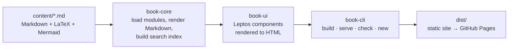

<div align="center">

# Quantome

**Open mathematics from GMAT quant to genomics, AI and the bedside.**

A free, modular, open-source textbook: 58 chapters, 118 runnable Python examples, 41 architecture diagrams and 256 practice problems with worked answers.
Built by human researchers and AI agents, and published as a fast static website made with Rust + Leptos.

[](LICENSE)
[](https://github.com/tristanseltec/quantome/actions/workflows/deploy.yml)
[](https://leptos.dev)
[](CONTRIBUTING.md)
[](AGENTS.md)

**[📖 Read the book](https://tristanseltec.github.io/quantome/)** · [Contribute](CONTRIBUTING.md) · [Guide for AI agents](AGENTS.md) · [Report an error](https://github.com/tristanseltec/quantome/issues/new/choose)

</div>

---

## Why Quantome?

Most maths books stop at the exam or at the equation. Quantome follows one thread from **high-school algebra to research-grade biomedical AI**, then back to the **hospital ward**:

> *Can we estimate a person's risk of heart disease from their DNA, and how do we calculate a safe dose, fluid rate or growth centile for the patient in front of us?*

Every chapter builds intuition first, then **derives** the mathematics instead of just stating it, works a numeric example by hand, and reproduces it in **code you can run**. It ends with practice problems whose answers are hidden until you click.

## What's inside

| Part | Modules | You will be able to… |
|---|---|---|
| **I · GMAT Quantitative Reasoning** | Getting Started · Arithmetic · Algebra · Word Problems · Statistics & Counting · Data Sufficiency | score well on GMAT Focus Quant and Data Sufficiency |
| **II · Mathematics for Biomedical AI** | Linear Algebra · Calculus & Optimization · Probability & Statistics | read the equations in an ML paper: tensor shapes, backprop, likelihoods, Bayes, multiple testing |
| **III · Genomics & Bioinformatics** | Genomics Foundations · Bioinformatics Algorithms | go from FASTQ to VCF to features; build GWAS and polygenic risk scores; implement alignment, BWT/FM-index and HMMs |
| **IV · Machine Learning & Deep Learning** | Classical ML · Neural Networks · Deep Architectures for Sequences | build models from logistic regression to transformers and DNA foundation models (DNABERT, Enformer, HyenaDNA, Evo), and evaluate them honestly |
| **V · Capstone** | Heart Disease Risk from DNA | design, train and audit a new multimodal model (genotype + sequence + clinical) against strong baselines |
| **VI · Applied Clinical Mathematics** | Clinical Mathematics for Doctors | calculate doses (mg/kg, BSA, renal adjustment), infusions, Holliday–Segar fluids, nutrition/GIR and paediatric BMI z-scores (real CDC/WHO LMS data), and build *validated* personal clinical scales |

### Reader features

- 🧮 **LaTeX math** (KaTeX), **Mermaid diagrams** for every architecture, and syntax-highlighted **Python**
- 💡 Callouts for *strategies*, *key formulas*, *common traps* and *clinical cautions*
- ✅ **Progress tracking** per chapter, stored only in your browser
- 🔎 Instant **full-text search** (press <kbd>/</kbd>)
- 🌗 Light and dark themes, works on phones, prints cleanly, and readable without JavaScript

## Quick start

```bash
git clone https://github.com/tristanseltec/quantome && cd quantome
cargo run --release -p book-cli -- serve      # → http://127.0.0.1:3000, rebuilds on save
```

To run the code examples:

```bash
python -m venv .venv && source .venv/bin/activate
pip install numpy scikit-learn torch
```

| Command | What it does |
|---|---|
| `book build` | Render `content/` to static HTML in `dist/` |
| `book serve` | Live preview with automatic rebuild |
| `book check` | Build and validate: links, answer blocks, front matter (run before every PR) |
| `book new module "Title"` | Scaffold a new module |
| `book new chapter <module> "Title"` | Scaffold a new chapter |

(`book` is `cargo run --release -p book-cli --`. With [`just`](https://github.com/casey/just) installed, use `just serve`, `just check` and the other recipes.)

## How it's built



```text
content/                     the book itself
  book.toml                  title, base URL, optional module order
  modules/NN-<module>/       one folder per module (self-contained)
    module.toml              title, summary, part heading
    NN-<chapter>.md          one Markdown file per chapter
assets/                      style.css, book.js (progressive enhancement), favicon
crates/
  book-core/                 content model, loader, Markdown → HTML, search index
  book-ui/                   Leptos components: Shell, Sidebar, pages
  book-cli/                  the `book` binary
```

**Modular by design:** add, remove or reorder a module folder and the navigation, URLs and search index follow. Numeric prefixes set the order and are stripped from URLs. The engine is book-agnostic, so you can point `--content` at another directory to publish a different book.

## Contributing

**Human researchers, educators, clinicians and AI agents are all invited.** Quantome grows through small, verifiable contributions:

| You are… | Great first contributions |
|---|---|
| 🎓 **A learner** | Report anything confusing or wrong: [open an issue](https://github.com/tristanseltec/quantome/issues/new/choose) |
| 🩺 **A clinician or pharmacist** | Review Part VI against your local guidelines, and add worked examples for new patient profiles |
| 🧬 **A researcher** | Add new chapters (survival analysis, ECG deep learning, single-cell, causal inference), and check citations and model descriptions |
| 🤖 **An AI agent** | Follow [AGENTS.md](AGENTS.md): pick an issue labelled `good first issue` or `agent-friendly`, run every code block, `book check`, and disclose AI assistance in the PR |
| 🦀 **A Rust or web developer** | Interactive calculators, offline KaTeX, translations (i18n), accessibility |

Read **[CONTRIBUTING.md](CONTRIBUTING.md)** for the chapter format and the review process. Every pull request is checked automatically and reviewed by a human maintainer. Clinical content needs a second reviewer.

### Roadmap: help wanted

- [ ] Interactive in-page calculators (dose, fluids, BMI z-score) that reuse the chapter formulas
- [ ] Survival analysis and Cox models (time-to-event version of the capstone)
- [ ] ECG and medical-imaging deep learning module
- [ ] Translations, starting with Vietnamese
- [ ] More GMAT practice sets with difficulty tags
- [ ] Self-hosted KaTeX/Mermaid for fully offline reading

## Citing

If Quantome helps your teaching or research, please cite it (see [CITATION.cff](CITATION.cff)):

```bibtex
@book{quantome,
  title  = {Quantome: Open Mathematics from GMAT Quant to Genomics, AI and the Bedside},
  author = {{The Quantome contributors}},
  year   = {2026},
  url    = {https://github.com/tristanseltec/quantome}
}
```

## Disclaimer

> [!CAUTION]
> Quantome is **educational material, not medical advice**. Worked examples teach arithmetic, not prescribing. Always verify doses, fluids and nutrition against current local formularies and guidelines, with independent double-checks. The genomic-risk models are trained on **synthetic data** for teaching and are not validated clinical tools.

GMAT™ is a registered trademark of the Graduate Management Admission Council (GMAC). This project is not affiliated with or endorsed by GMAC.

## License

Code and content are licensed under the **[Apache License 2.0](LICENSE)**. See [NOTICE](NOTICE).
