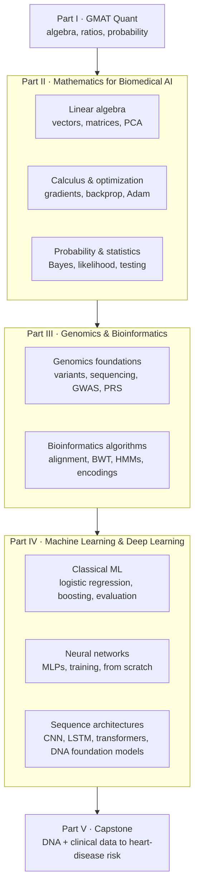

+++
summary = "The roadmap from GMAT-level algebra to designing a DNA-based heart-disease risk model."
+++

# The Biomedical AI Track

Part I of this book prepares you for the GMAT. Parts II–V reuse the same algebra and arithmetic for a bigger goal: understanding modern machine-learning algorithms and neural-network architectures well enough to **design your own model**.

One project runs through the whole track:

> **Can we estimate a person's risk of coronary artery disease from their DNA, together with routine clinical measurements?**

Every chapter adds one piece you need to answer that question properly.

## The roadmap



| Part | You will be able to… |
|---|---|
| II · Mathematics | read the equations in an ML paper: shapes of tensors, gradients, likelihoods |
| III · Genomics | turn raw sequencing data into features, and know what the biology allows you to claim |
| IV · Machine learning | choose, implement, train and *honestly evaluate* models, from logistic regression to transformers |
| V · Capstone | design a new multimodal architecture, compare it with strong baselines, and report it responsibly |

## Prerequisites and tools

- **Maths:** Part I, especially algebra, exponents, ratios and probability. Everything beyond that is built up from scratch.
- **Programming:** basic Python. Code examples use `numpy`, `scikit-learn` and `PyTorch` on small synthetic datasets that run on a laptop CPU:

```bash
python -m venv .venv && source .venv/bin/activate
pip install numpy scikit-learn torch
```

> [!TIP]
> Type the code out yourself instead of copy-pasting, then change one thing (a learning rate, a layer size, the amount of noise) and predict what will happen before you run it. That habit is how intuition for models is built.

## How to study this track

1. **Work through the derivations on paper.** Every key result (backpropagation, cross-entropy, the PCA solution, the Viterbi recursion) is derived step by step. Re-derive it without looking.
2. **Run the code and break it.** Each snippet is small and self-contained.
3. **Connect to the project.** Each chapter ends with a *Biomedical connection* section that explains where its idea appears in the heart-disease model.

> [!CAUTION]
> This is educational material, not medical advice. Real genetic risk prediction needs approved data access, ethical review, clinical validation and regulatory oversight. The capstone discusses all four.
