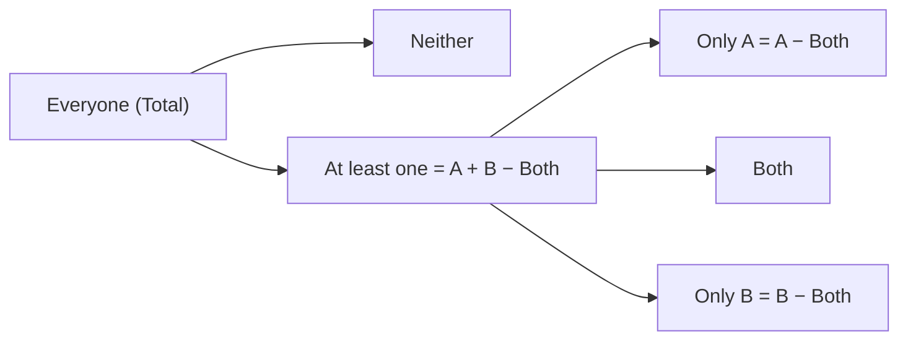

+++
summary = "Solve two-set and three-set overlap problems with the overlapping-sets formula, Venn diagrams and the double-set matrix, and find the greatest or least possible overlap."
+++

# Overlapping Sets

"Of the 80 employees, 45 speak Spanish, 30 speak French and 12 speak both..." Questions like this appear on almost every GMAT, and they are easy points once you have a reliable bookkeeping system. The whole topic rests on one idea: **when groups overlap, people in the overlap get counted more than once, and you must correct for it.** Everything else in this chapter (the formula, the Venn diagram, the double-set matrix, the three-set formulas, max/min questions) is a way of doing that bookkeeping without mistakes.

There are two different kinds of overlapping-set problem, and recognising which one you face is the first decision:

- **Two overlapping groups** that people may belong to, both, or neither (speaks Spanish / speaks French). Use the **formula** or a **Venn diagram**.
- **Two attributes, each splitting everyone into categories** (male/female *and* smoker/non-smoker). Every person sits in exactly one cell of a grid. Use the **double-set matrix**.

## Key ideas

### The two-set formula

Suppose group $A$ and group $B$ overlap. Adding $\vert A \vert + \vert B \vert$ counts everyone in exactly one group once, but counts everyone in **both** twice. Subtract the overlap once to fix that, and you have the number of people in **at least one** group. Add those in **neither** and you have everyone:

> [!IMPORTANT]
> $$\text{Total} = A + B - \text{Both} + \text{Neither}$$

Example: in a group of 50, 30 run, 25 swim and 12 do both. Then $30 + 25 - 12 = 43$ do at least one, so $50 - 43 = 7$ do neither.

The formula has five quantities. Any four determine the fifth, which also tells you what Data Sufficiency is really asking: you need four of the five (or enough relations to pin them down).

### Venn diagrams: the four regions

The formula hides a picture. Two overlapping circles inside a box split everyone into **four disjoint regions**:

| Region | Size |
|---|---|
| only $A$ | $A - \text{Both}$ |
| only $B$ | $B - \text{Both}$ |
| both | $\text{Both}$ |
| neither | $\text{Neither}$ |

These four sizes add to the total, with no double counting. When a problem mixes "only", "both" and plain totals, fill the regions **from the inside out**: overlap first, then the "only" pieces, then neither. A frequent wording trap is "18 take Latin" (all Latin students, including those who also take Greek) versus "18 take only Latin". Write each number in the right region before computing anything.

### The double-set matrix

When **every** person has one value of attribute 1 (say male/female) and one value of attribute 2 (say smoker/non-smoker), draw a $3 \times 3$ grid:

| | Smoker | Non-smoker | **Total** |
|---|---|---|---|
| **Female** | | | |
| **Male** | | | |
| **Total** | | | |

Every row adds across to its total, and every column adds down to its total. That gives you a system of simple equations you can solve **one cell at a time**: any row or column with two known entries yields the third. Nine cells, but only four of them are independent (once you know the grand total, one row total, one column total and one inner cell, everything else follows).

The routine:

1. Draw the grid and put the grand total in the bottom-right corner. If the problem gives only fractions or percentages, **pick a convenient total** (100 for percents, the least common multiple of the denominators for fractions).
2. Enter every fact in the cell it describes. Translate carefully: "25% of the **men** smoke" is $0.25 \times (\text{men total})$, a fraction of a *row*, not of the grand total.
3. Fill in any line (row or column) with two known entries. Repeat until you reach the cell you want.

> [!TIP]
> **Pick smart numbers.** If a matrix problem gives only fractions, the answer must be a fraction, so the total is yours to choose. Choose one that makes every fraction of every row and column an integer: for "$\tfrac{3}{5}$ of the attendees, then $\tfrac{1}{3}$ of those and $\tfrac{3}{4}$ of the rest", 60 works.

The matrix is the safest tool any time a problem says "of the X, ..." about two yes/no attributes. You can even use it for a plain two-set problem: the attributes become "in $A$ / not in $A$" and "in $B$ / not in $B$", and the four inner cells are exactly the four Venn regions.

### Three overlapping sets

Three circles create **eight** regions: three "only one set" regions, three "exactly two sets" regions, one "all three" region, and "none". Two formulas cover nearly every GMAT question, and the difference between them is the most important trap in this chapter.

**Version 1: pairwise overlaps.** If you know the size of each pairwise intersection $\vert A \cap B \vert$, $\vert A \cap C \vert$, $\vert B \cap C \vert$ (each of which **includes** the people in all three), then

$$\text{At least one} = A + B + C - (\vert A \cap B \vert + \vert A \cap C \vert + \vert B \cap C \vert) + \text{All three}.$$

*Why:* a person in exactly one set is counted once by $A + B + C$, and in no intersection: net 1. A person in exactly two sets is counted twice, then subtracted once: net 1. A person in all three is counted 3 times, subtracted 3 times (they are in all three pairwise intersections), then added back once: net 1. Everyone is counted exactly once. This is **inclusion–exclusion**, the same principle as $P(A \cup B) = P(A) + P(B) - P(A \cap B)$ in [Probability in depth](../../statistics-and-counting/probability-in-depth/).

**Version 2: "exactly two".** If instead you know how many people are in **exactly two** sets, then

$$\text{At least one} = A + B + C - (\text{Exactly two}) - 2 \times (\text{All three}).$$

*Why:* $A + B + C$ counts each exactly-one person once, each exactly-two person twice and each all-three person three times. Subtract the exactly-two people once and the all-three people twice, and everyone is counted once.

> [!IMPORTANT]
> Let $E_1$, $E_2$ and $E_3$ be the numbers of people in exactly one, exactly two and all three sets. Then
> $$A + B + C = E_1 + 2E_2 + 3E_3, \qquad \text{At least one} = E_1 + E_2 + E_3.$$
> Both versions of the three-set formula follow from these two lines, and so does almost every three-set question.

Example: of 60 people, 25 read paper $A$, 20 read $B$ and 30 read $C$; 8 read both $A$ and $B$, 7 read both $A$ and $C$, 10 read both $B$ and $C$, and 4 read all three. Version 1: $25 + 20 + 30 - (8 + 7 + 10) + 4 = 54$ read at least one, so 6 read none.

> [!WARNING]
> **"Exactly two" versus "at least two" versus "both A and B".** "12 people are in both $A$ and $B$" normally *includes* anyone also in $C$: it is a pairwise intersection (Version 1). "12 people are in exactly two of the sets" *excludes* the all-three group (Version 2). "At least two" means $E_2 + E_3$. Plugging an "exactly two" number into Version 1 is the most common way to land on a wrong answer choice, and the test writers always include that choice.

### Greatest and least possible overlap

Some questions give the group sizes and ask how large or small the overlap (or the "neither" group) **could** be.

For two sets inside a total $T$:

- **Greatest overlap:** the smaller group sits entirely inside the larger, so $\text{Both}_{\max} = \min(A, B)$.
- **Least overlap:** push the groups apart as much as possible. If $A + B \le T$ they can be disjoint (overlap 0). If $A + B > T$, the excess must overlap: $\text{Both}_{\min} = A + B - T$ (this is "Neither = 0").

Because $\text{Neither} = T - A - B + \text{Both}$, "neither" is largest when the overlap is largest and smallest when the overlap is smallest.

For three sets, the least possible number in **all three** comes from looking at the complements: the people **missing** from $A$, $B$ or $C$ number at most $(T - A) + (T - B) + (T - C)$, so at least

$$A + B + C - 2T$$

people are in all three (if that is positive; otherwise the answer is 0). The bound is reached when the three "missing" groups do not overlap.

> [!TIP]
> For max/min overlap questions, **build the extreme case** and check it. Ask "what is forcing these groups to overlap?" The only force is the total: if the groups do not fit side by side in the room, the overflow must share.

> [!WARNING]
> **Common traps**
> - Forgetting the "neither" group, i.e. assuming everyone is in at least one set.
> - Reading "18 take Latin" as "18 take only Latin" (or the reverse).
> - In a matrix, taking a percentage of the grand total when the problem says "of the men" (a row) or "of the smokers" (a column).
> - Using the pairwise formula with an "exactly two" number, or vice versa.
> - In max/min questions, forgetting that the overlap can never exceed the smaller group, or that "neither" can never be negative.

> [!NOTE]
> Readers using Claude Code can check their working with the `quantome-math` plugin (`/plugin install quantome-math@quantome`). It is optional: every problem here is designed to be done by hand.

## Worked examples

### Example 1 (Easy): the two-set formula

Of the 80 employees at a company, 45 speak Spanish, 30 speak French and 12 speak both. How many employees speak neither language?

(A) 5 · (B) 12 · (C) 15 · (D) 17 · (E) 23

**Solution.** $80 = 45 + 30 - 12 + \text{Neither}$, so $\text{Neither} = 80 - 63 = 17$. **Answer: (D).**

Choice (A) forgets to subtract the overlap ($80 - 75$), counting the 12 bilingual employees twice. Choice (C) is the difference $45 - 30$, a number that answers nothing.

### Example 2 (Medium): the double-set matrix

A clinic has 200 patients, 60% of whom are female. Of the male patients, 25% smoke. If 70 patients smoke in total, how many female patients do not smoke?

(A) 50 · (B) 70 · (C) 80 · (D) 90 · (E) 100

**Solution.** Draw the matrix and fill it in one line at a time.

| | Smoker | Non-smoker | **Total** |
|---|---|---|---|
| **Female** | $70 - 20 = 50$ | $120 - 50 = 70$ | $0.6 \times 200 = 120$ |
| **Male** | $0.25 \times 80 = 20$ | 60 | $200 - 120 = 80$ |
| **Total** | 70 | 130 | 200 |

Order of filling: female total (120), male total (80), male smokers (25% of the **male row**, 20), female smokers (column: $70 - 20 = 50$), female non-smokers (row: $120 - 50 = 70$). **Answer: (B).** Choice (A) is the female smokers, and a reader who takes 25% of all 200 patients gets 50 male smokers, then 20 female smokers and the trap answer (E).

### Example 3 (Medium): a matrix with fractions only

At a conference, $\tfrac{3}{5}$ of the attendees are academics and the rest work in industry. One third of the academics and three quarters of the industry attendees went to a workshop. What fraction of all attendees did **not** go to the workshop?

(A) $\tfrac{1}{4}$ · (B) $\tfrac{2}{5}$ · (C) $\tfrac{1}{2}$ · (D) $\tfrac{3}{5}$ · (E) $\tfrac{7}{12}$

**Solution.** No count is given, so pick a total. The denominators 5, 3 and 4 suggest 60.

| | Workshop | No workshop | **Total** |
|---|---|---|---|
| **Academic** | $\tfrac{1}{3} \times 36 = 12$ | 24 | 36 |
| **Industry** | $\tfrac{3}{4} \times 24 = 18$ | 6 | 24 |
| **Total** | 30 | 30 | 60 |

$30/60 = \tfrac{1}{2}$. **Answer: (C).** The algebraic check: $\tfrac{3}{5} \cdot \tfrac{2}{3} + \tfrac{2}{5} \cdot \tfrac{1}{4} = \tfrac{2}{5} + \tfrac{1}{10} = \tfrac{1}{2}$, a weighted average of the two "no workshop" rates.

### Example 4 (Hard): three sets with "exactly two"

Each of 100 students was asked whether they take art, biology or chemistry. 35 take art, 40 take biology and 45 take chemistry. 20 students take exactly two of the three subjects, and 5 take all three. How many students take none of the three?

(A) 5 · (B) 10 · (C) 15 · (D) 20 · (E) 25

**Solution.** This is the "exactly two" version:

$$\text{At least one} = 35 + 40 + 45 - 20 - 2 \times 5 = 90,$$

so $100 - 90 = 10$ take none. **Answer: (B).**

Check with the $E$-equations: $E_2 = 20$, $E_3 = 5$ and $E_1 + 2(20) + 3(5) = 120$, so $E_1 = 65$ and at least one $= 65 + 20 + 5 = 90$. Choice (A) comes from subtracting the all-three group only once ($120 - 20 - 5 = 95$). Treating 20 as a pairwise total in Version 1 gives $120 - 20 + 5 = 105$, more than the 100 students, a sure sign the wrong formula is in use.

### Example 5 (Hard): range of possible overlap

In a club of 60 members, 42 like jazz and 35 like blues. Let $x$ be the number of members who like both. What is the difference between the greatest and the least possible values of $x$?

(A) 7 · (B) 10 · (C) 15 · (D) 17 · (E) 18

**Solution.** *Greatest:* all 35 blues fans also like jazz, so $x_{\max} = 35$ (and then $60 - 42 = 18$ like neither, which is fine). *Least:* $42 + 35 = 77$ is 17 more than the 60 members, so at least 17 must like both: $x_{\min} = 17$, with nobody liking neither. The difference is $35 - 17 = 18$. **Answer: (E).** Choice (D) is just the minimum, and (A) is $42 - 35$.

## Practice

**1.** *(Easy)* In a survey of 90 households, 50 own a dog, 40 own a cat and 25 own neither. How many households own both a dog and a cat?

(A) 10 · (B) 15 · (C) 20 · (D) 25 · (E) 30

Answer

**(D).** $90 = 50 + 40 - \text{Both} + 25$, so $\text{Both} = 115 - 90 = 25$. Sanity check: 25 is not more than the 40 cat owners.

**2.** *(Easy)* Of 40 students, 18 take only Latin, 10 take both Latin and Greek, and 7 take neither language. How many students take Greek?

(A) 10 · (B) 15 · (C) 18 · (D) 22 · (E) 25

Answer

**(B).** The four Venn regions add to 40: $18 + 10 + (\text{only Greek}) + 7 = 40$, so only Greek $= 5$. Greek in total $= 5 + 10 = 15$. Choice (A) counts only the students who take both, and (D) is $40 - 18$, which ignores the overlap and the 7 who take neither.

**3.** *(Medium)* Of the 300 voters in a poll, 55% are over 40. Two thirds of the voters aged 40 or under support a proposal, and 150 voters in total support it. How many voters over 40 do **not** support the proposal?

(A) 60 · (B) 75 · (C) 90 · (D) 105 · (E) 135

Answer

**(D).**

| | Support | Not support | **Total** |
|---|---|---|---|
| **Over 40** | $150 - 90 = 60$ | $165 - 60 = 105$ | 165 |
| **40 or under** | $\tfrac{2}{3} \times 135 = 90$ | 45 | 135 |
| **Total** | 150 | 150 | 300 |

Choice (A) is the over-40 supporters; (E) is the number aged 40 or under.

**4.** *(Medium)* In a town, 70% of households own a car, 45% own a bicycle, and 10% own neither. What percent of households own a bicycle but not a car?

(A) 20% · (B) 25% · (C) 30% · (D) 35% · (E) 45%

Answer

**(A).** Use a total of 100: $100 = 70 + 45 - \text{Both} + 10$, so $\text{Both} = 25$. Bicycle only $= 45 - 25 = 20$, i.e. 20%. Choice (B) is the overlap, and (E) is all bicycle owners.

**5.** *(Medium)* Three clubs have 25, 30 and 20 members. Clubs 1 and 2 share 8 members, clubs 1 and 3 share 6, and clubs 2 and 3 share 5; these counts include the 3 students who belong to all three clubs. How many students belong to at least one club?

(A) 50 · (B) 53 · (C) 56 · (D) 57 · (E) 59

Answer

**(E).** These are pairwise intersections (they include the all-three group), so use Version 1: $25 + 30 + 20 - (8 + 6 + 5) + 3 = 59$. Choice (C) forgets to add back the 3, and (B) subtracts them instead.

**6.** *(Hard)* In a group of 150 people, 70 read newspaper $A$, 60 read $B$ and 50 read $C$. Exactly 30 people read exactly two of the newspapers, and 10 read all three. How many people read exactly one newspaper?

(A) 60 · (B) 70 · (C) 80 · (D) 90 · (E) 130

Answer

**(D).** Use $A + B + C = E_1 + 2E_2 + 3E_3$: $180 = E_1 + 2(30) + 3(10)$, so $E_1 = 90$. (At least one $= 90 + 30 + 10 = 130$, which is choice (E), and 20 read none.)

**7.** *(Hard)* Of 100 patients in a study, 80 have condition $X$, 75 have condition $Y$ and 65 have condition $Z$. What is the least possible number of patients who have all three conditions?

(A) 0 · (B) 5 · (C) 10 · (D) 15 · (E) 20

Answer

**(E).** Count the patients **missing** a condition: 20 lack $X$, 25 lack $Y$ and 35 lack $Z$. At most $20 + 25 + 35 = 80$ patients lack at least one condition, so at least $100 - 80 = 20$ have all three. This is reached when the three "lacking" groups do not overlap, for example: 20 patients with only $Y$ and $Z$, 25 with only $X$ and $Z$, 35 with only $X$ and $Y$, and 20 with all three. Check: $X$: $25 + 35 + 20 = 80$; $Y$: $20 + 35 + 20 = 75$; $Z$: $20 + 25 + 20 = 65$. Choice (A) is what you get if you assume the sets can always be made disjoint.

**8.** *(Medium)* Of 50 students, 30 play chess and 25 play go. What is the greatest possible number of students who play neither game?

(A) 5 · (B) 15 · (C) 20 · (D) 25 · (E) 30

Answer

**(C).** $\text{Neither} = 50 - 30 - 25 + \text{Both} = \text{Both} - 5$. It is largest when the overlap is largest: all 25 go players also play chess, giving $\text{Neither} = 20$. (The least possible is 0, with an overlap of 5.) Choice (A) is the minimum overlap, a quantity that answers a different question.

**9.** *(Medium, Data Sufficiency)* Each of the 80 employees at a firm either has or does not have a degree, and either has or does not have a professional certification. How many employees have both a degree and a certification?

(1) 50 employees have a degree and 45 have a certification.
(2) 10 employees have neither a degree nor a certification.

(A) Statement (1) alone is sufficient, but statement (2) alone is not sufficient.
(B) Statement (2) alone is sufficient, but statement (1) alone is not sufficient.
(C) Both statements together are sufficient, but neither statement alone is sufficient.
(D) Each statement alone is sufficient.
(E) Statements (1) and (2) together are not sufficient.

Answer

**(C).** In $80 = D + C - \text{Both} + \text{Neither}$, (1) gives $D$ and $C$ but leaves Both anywhere from 15 to 45 (with Neither from 0 to 30). Not sufficient. (2) gives only Neither. Not sufficient. Together: $80 = 50 + 45 - \text{Both} + 10$, so Both $= 25$. Sufficient.

**10.** *(Hard, Data Sufficiency)* Each of 100 students takes at least one of three courses: $A$, $B$ and $C$. How many students take all three courses?

(1) 50 students take $A$, 40 take $B$ and 40 take $C$.
(2) 75 students take exactly one of the three courses.

(A) Statement (1) alone is sufficient, but statement (2) alone is not sufficient.
(B) Statement (2) alone is sufficient, but statement (1) alone is not sufficient.
(C) Both statements together are sufficient, but neither statement alone is sufficient.
(D) Each statement alone is sufficient.
(E) Statements (1) and (2) together are not sufficient.

Answer

**(C).** Use $E_1 + E_2 + E_3 = 100$ (everyone takes at least one course) and $A + B + C = E_1 + 2E_2 + 3E_3$.

(1): $130 = E_1 + 2E_2 + 3E_3$. Subtracting the first equation gives $E_2 + 2E_3 = 30$, which allows, for example, $E_3 = 0$ or $E_3 = 15$. Not sufficient.
(2): $E_1 = 75$, so $E_2 + E_3 = 25$, with any split. Not sufficient.
Together: $E_2 + 2E_3 = 30$ and $E_2 + E_3 = 25$ give $E_3 = 5$ (and $E_2 = 20$). Sufficient.

**11.** *(Hard)* At a company, $\tfrac{1}{3}$ of the employees work remotely. Of the remote employees, $\tfrac{3}{5}$ are engineers; of the other employees, $\tfrac{1}{4}$ are engineers. If there are 48 more non-engineers than engineers, how many employees who do not work remotely are not engineers?

(A) 72 · (B) 90 · (C) 108 · (D) 120 · (E) 150

Answer

**(B).** Let the total be $T$. Remote engineers: $\tfrac{3}{5} \cdot \tfrac{T}{3} = \tfrac{T}{5}$. Office engineers: $\tfrac{1}{4} \cdot \tfrac{2T}{3} = \tfrac{T}{6}$. Engineers: $\tfrac{T}{5} + \tfrac{T}{6} = \tfrac{11T}{30}$, non-engineers $\tfrac{19T}{30}$. The difference is $\tfrac{8T}{30} = 48$, so $T = 180$.

| | Engineer | Not engineer | **Total** |
|---|---|---|---|
| **Remote** | 36 | 24 | 60 |
| **Office** | 30 | **90** | 120 |
| **Total** | 66 | 114 | 180 |

Check: $114 - 66 = 48$.

## Takeaways

- $\text{Total} = A + B - \text{Both} + \text{Neither}$: any four of the five quantities give the fifth.
- Draw a Venn diagram and fill its regions from the overlap outward; "only $A$" is not "$A$".
- For two attributes that split everyone (male/female, smoker/non-smoker), use the double-set matrix and complete one row or column at a time.
- With fractions or percents only, pick a total that makes every cell an integer.
- Three sets: $A + B + C = E_1 + 2E_2 + 3E_3$ and at least one $= E_1 + E_2 + E_3$. Know whether you have pairwise intersections or "exactly two".
- Greatest overlap of two sets is the smaller set; least overlap is $\max(0, A + B - T)$.
- For "least in all three", count the people missing each set and assume those groups don't overlap.

## Further reading

- GMAC, *GMAT Official Guide* (current edition): real retired questions on overlapping sets in both Problem Solving and Data Sufficiency.
- Within this book: the matrix method reappears as the two-way table behind conditional probability in [Probability in depth](../../statistics-and-counting/probability-in-depth/) and in [Probability and Bayes' theorem](../../probability-and-statistics/probability-and-bayes-theorem/).
