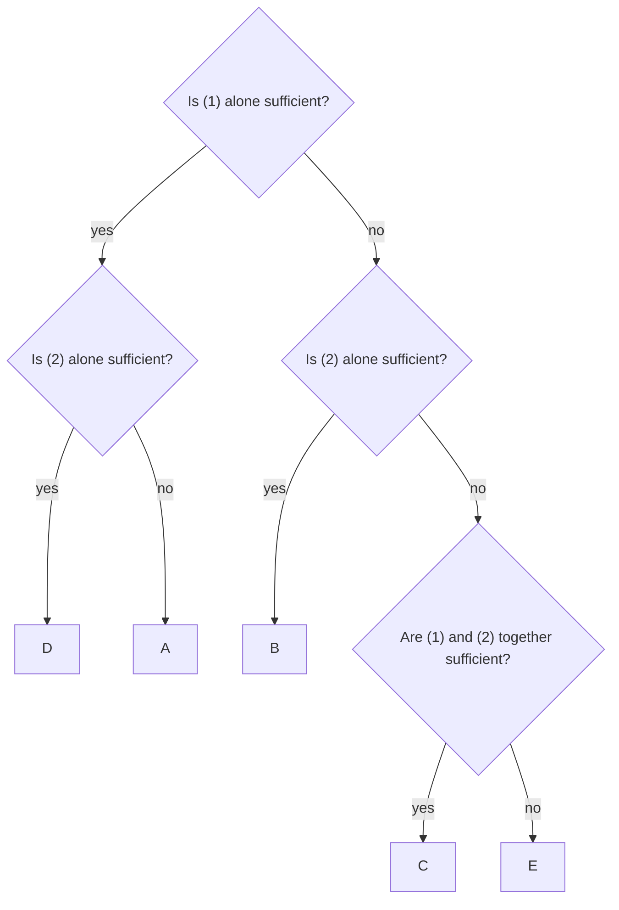

+++
summary = "Answer Data Sufficiency questions with a fixed process: rephrase the question, translate each statement, use the AD/BCE grid, test cases to find a yes and a no, and avoid the C, E and D traps."
+++

# The Data Sufficiency Method

Data Sufficiency (DS) questions ask something unusual: not "what is the answer?" but "**do you have enough information to find the answer?**". A question stem is followed by two statements, and you decide whether the statements, alone or together, pin the answer down. You almost never need to compute the answer itself.

This makes DS a test of *reasoning about information*. Strong students lose points on DS not because the maths is hard, but because they solve when they only needed to decide, assume things the question never said, or fall for answer choices built to exploit those habits. This chapter gives you a fixed process that avoids all three. [Data Sufficiency by topic](../../data-sufficiency/data-sufficiency-by-topic/) applies it to each content area, and the [practice set](../../data-sufficiency/data-sufficiency-practice-set/) gives you 20 timed questions.

DS appears in the **Data Insights** section of the GMAT Focus Edition, where an on-screen calculator is available. You will rarely need it: DS rewards thinking, not arithmetic.

## Key ideas

### The fixed answer choices

Every DS question has the same five answer choices, so learn them once and never read them again on test day:

| Choice | Meaning |
|---|---|
| **A** | Statement (1) ALONE is sufficient, but statement (2) alone is not sufficient |
| **B** | Statement (2) ALONE is sufficient, but statement (1) alone is not sufficient |
| **C** | BOTH statements TOGETHER are sufficient, but NEITHER statement ALONE is sufficient |
| **D** | EACH statement ALONE is sufficient |
| **E** | Statements (1) and (2) TOGETHER are NOT sufficient |

> [!IMPORTANT]
> "Sufficient" means the information leads to **exactly one** answer to the question. For a value question, that is one value. For a yes/no question, it is a definite "yes" **or** a definite "no". A definite "no" is sufficient.

Two rules of the format are worth knowing:

- **The statements are true.** You never have to doubt them.
- **The statements never contradict each other.** There is always at least one case where both hold. If your analysis says that (1) forces $x = 3$ and (2) forces $x = 5$, you have made an error.

Numbers in DS are real numbers unless the question says otherwise. "Integer", "positive" and "distinct" are only true when they are stated.

### Value questions and yes/no questions

Every DS question is one of two kinds, and "sufficient" means slightly different things for each.

**Value questions** ask "What is…?" or "How many…?". A statement is sufficient if it allows exactly one value. Two possible values, even very close ones, is insufficient.

**Yes/no questions** ask "Is…?" or "Does…?". A statement is sufficient if the answer is *always yes* or *always no*. It is insufficient if the answer can be yes in one case and no in another.

> [!TIP]
> Yes/no questions are often easier than they look. You do not need to know $x$; you only need to know which side of a boundary it is on. "Is $x > 5$?" is answered by "$x$ is between 7 and 9", even though $x$ is still unknown.

### Step 1: rephrase the question

Before reading the statements, simplify the question into the plainest thing you need to know. This turns many DS questions from hard to routine.

| Question as written | Rephrased |
|---|---|
| What is the value of $3x - 6y$? | What is $x - 2y$? |
| Is the integer $n$ divisible by 6? | Is $n$ divisible by both 2 and 3? |
| Is $x^2 < x$? | Is $0 < x < 1$? |
| Is $\dfrac{a}{b} > 0$? | Do $a$ and $b$ have the same sign? |
| What is the average of $p$, $q$ and $r$? | What is $p + q + r$? |
| What percent of the class are women? | What is the ratio of women to the whole class? |

Rephrasing also tells you what kind of information is **enough**. If the question becomes "What is $x - 2y$?", then a statement giving the combination $x - 2y$ is sufficient even though it does not give $x$ or $y$.

### Step 2: translate and simplify each statement

Turn words into algebra and then simplify each statement on its own: "$a$ is 20% more than $b$" becomes $a = 1.2b$. "$x^2 = 9$" becomes "$x = 3$ or $x = -3$". "$k$ leaves remainder 2 when divided by 3" becomes "$k$ is one of $2, 5, 8, 11, \dots$". Then compare the simplified statement with the rephrased question.

### Step 3: the AD / BCE grid

Evaluate the statements in a fixed order:

1. Evaluate statement (1) **alone**. If it is sufficient, the answer is **A or D**. If not, it is **B, C or E**.
2. Evaluate statement (2) **alone**, forgetting statement (1) completely.
3. Only if both fail alone, combine them: **C** if together they are sufficient, **E** if not.

If statement (2) looks easier, start with it. The grid then becomes BD / ACE: if (2) is sufficient, the answer is B or D; if not, it is A, C or E.

A first example. **Is $x > 0$?** (1) $x^2 = 9$. (2) $x^3 = 27$.

(1) gives $x = 3$ or $x = -3$: yes or no. Not sufficient, so the answer is B, C or E. (2) gives $x = 3$, since a real number has only one cube root. Sufficient. **Answer: B.**

### Testing cases or algebra?

There are two ways to judge a statement, and good DS solvers switch between them.

**Algebra** works best when a statement is an equation and the question asks for a value or a combination. Ask: "Can I turn this statement into the rephrased question?"

**Testing cases** works best for yes/no questions, inequalities, number properties and anything with "integer" or "positive" in it. The aim is to **prove insufficiency** by finding two cases that satisfy the statement but give different answers:

1. Pick a number that satisfies the statement and gives "yes".
2. Deliberately try to find one that satisfies the statement and gives "no". Use the checklist from [Problem-solving strategies](../../getting-started/problem-solving-strategies/): 0, 1, negatives, fractions, large numbers.
3. If you find both: insufficient. If every honest attempt gives the same answer, it is probably sufficient, so confirm with a line of algebra.

> [!TIP]
> When testing cases, your job is to **break** the statement, not to confirm it. Testing $x = 2$, $x = 3$ and $x = 10$ is one test repeated three times. Testing $x = 2$, $x = -2$ and $x = \tfrac12$ is three different tests.

### The common traps

> [!WARNING]
> **The C-trap.** Two statements that look like they need each other, such as two equations in two unknowns, invite you to choose C. But one statement alone may already answer the question, especially if the question asks for a ratio or a combination. Always evaluate each statement alone, honestly, before combining. If the answer looks like an easy C, check whether it is really A, B or D.

> [!WARNING]
> **The E-trap.** The opposite mistake: a question with more unknowns than equations looks hopeless, so you choose E. But the question may ask for a combination (such as $a + b + c$) that the statements determine together, or a hidden constraint (integers, positive counts) may leave only one possibility. Before choosing E, ask what combination the question actually needs.

> [!WARNING]
> **The D-trap: the same information twice.** Sometimes statement (2) is statement (1) in disguise: $2x + 4y = 14$ is $x + 2y = 7$ doubled, and $(x - 2)(x - 3) = 0$ is $x^2 - 5x + 6 = 0$ factorised. Two copies of the same information can never do more together than one copy alone. So when the statements are equivalent, the answer is **D** (if one is sufficient) or **E** (if not), never A, B or C.

Three more habits cause most other errors:

- **Carrying information across.** When you judge statement (2) alone, statement (1) does not exist. Cover it with your hand if you need to.
- **Assuming.** Unless the question says so, $x$ may be negative, zero or a fraction, and two variables may be equal.
- **Solving all the way.** Once you know a unique answer *exists*, stop. Computing it costs time and adds nothing.

### A 2-minute process

Use this sequence on every DS question. With practice it takes about 2 minutes.

| Time | Step |
|---|---|
| 0:00–0:30 | Read the question. Note the type (value or yes/no) and any constraints (integer, positive). **Rephrase** it. |
| 0:30–1:00 | Statement (1) alone: translate, simplify, decide. Write "A/D" or "BCE". |
| 1:00–1:30 | Statement (2) alone, forgetting (1). Cross off choices. |
| 1:30–2:00 | If needed, combine. Before choosing C, check for the C-trap; before choosing E, check for a combination or hidden constraint. |

> [!TIP]
> If you run short of time, use the grid to guess. Even one solid decision about statement (1) narrows five choices to two or three.

## Worked examples

**Example 1 (rephrasing a value question).** What is the value of $3x - 6y$?

(1) $x = 2y + 4$
(2) $xy = 6$

**Solution.** Rephrase: $3x - 6y = 3(x - 2y)$, so the question is "What is $x - 2y$?".

(1): rearrange to $x - 2y = 4$. So $3x - 6y = 12$. Sufficient: A or D.

(2): $x = 3$, $y = 2$ gives $9 - 12 = -3$, and $x = 6$, $y = 1$ gives $18 - 6 = 12$. Not sufficient. **Answer: A.**

**Example 2 (the C-trap).** If $x$ and $y$ are positive, what is the value of $\dfrac{x}{y}$?

(1) $4x - 6y = 0$
(2) $x + y = 10$

**Solution.** Two equations, two unknowns: the trap is to combine them, find $x = 6$ and $y = 4$, and choose C.

But the question asks for a **ratio**. (1): $4x = 6y$, so $\tfrac{x}{y} = \tfrac64 = \tfrac32$. Sufficient on its own. (2): $x = 5, y = 5$ gives $1$; $x = 6, y = 4$ gives $\tfrac32$. Not sufficient. **Answer: A.**

**Example 3 (the E-trap).** What is the value of $a + b + c$?

(1) $a + 2b + 3c = 20$
(2) $3a + 2b + c = 12$

**Solution.** Three unknowns and at most two equations, so it is tempting to say E at once. But the question asks for the combination $a + b + c$.

(1) alone: $a = 20$, $b = c = 0$ gives a sum of 20; $a = 0$, $b = 10$, $c = 0$ gives 10. Not sufficient. (2) alone is similar: $a = 4$, $b = c = 0$ gives 4; $a = 0$, $b = 6$, $c = 0$ gives 6. Not sufficient.

Together: add the equations. $4a + 4b + 4c = 32$, so $a + b + c = 8$. Sufficient, even though $a$, $b$ and $c$ themselves are not determined. **Answer: C.**

**Example 4 (the D-trap: the same information twice).** What is the value of $x$?

(1) $x^2 - 5x + 6 = 0$
(2) $(x - 2)(x - 3) = 0$

**Solution.** (1) factorises to $(x - 2)(x - 3) = 0$, so $x = 2$ or $x = 3$. Not sufficient. (2) is the same equation, with the same two solutions. Not sufficient. Together: still $x = 2$ or $x = 3$, because two copies of the same information add nothing. **Answer: E.** The trap is C ("two equations, so together they must fix $x$").

**Example 5 (testing cases on a yes/no question).** Is $x > y$?

(1) $x^2 > y^2$
(2) $x > 0$

**Solution.** (1): try to get a yes and a no. $x = 3$, $y = 2$: $9 > 4$ and $x > y$, so yes. $x = -3$, $y = 2$: $9 > 4$ but $x < y$, so no. Not sufficient: BCE.

(2): $x = 3$, $y = 2$ gives yes; $x = 3$, $y = 5$ gives no. Not sufficient: CE.

Together: (1) says $|x| > |y|$, and (2) says $x = |x|$. So $x = |x| > |y| \ge y$, and the answer is always yes. Before trusting this, try to break it with a negative $y$: $x = 3$, $y = -2$ satisfies both statements, and $3 > -2$. Still yes. **Answer: C.**

## Practice

All questions use the standard Data Sufficiency answer choices (A)–(E) from the table above.

**1.** *(Easy)* What is the value of the integer $n$?

(1) $n^2 < 10$
(2) $n > 2$

Answer

**C.** (1): $n \in \{-3, -2, -1, 0, 1, 2, 3\}$. Not sufficient. (2): $n$ could be $3, 4, 5, \dots$. Not sufficient. Together: $n > 2$ and $n^2 < 10$ leave only $n = 3$. Sufficient.

**2.** *(Easy)* Is the positive integer $k$ even?

(1) $k^2$ is even.
(2) $3k$ is even.

Answer

**D.** (1): if $k$ were odd, $k^2$ would be odd (odd × odd = odd). So $k$ is even. Sufficient. (2): 3 is odd, and odd × odd is odd, so $3k$ even forces $k$ even. Sufficient.

**3.** *(Easy)* What is the value of $|x|$?

(1) $x = -7$
(2) $x^2 = 49$

Answer

**D.** (1): $|x| = 7$. Sufficient. (2): $x = 7$ or $x = -7$, but the question asks for $|x|$, which is 7 either way. Sufficient. Rephrasing ("what is $|x|$?" means "what is $x^2$?") makes this immediate.

**4.** *(Medium)* Is $x > 5$?

(1) $x^2 > 25$
(2) $x$ is positive.

Answer

**C.** (1): $x > 5$ or $x < -5$. $x = 6$ gives yes; $x = -6$ gives no. Not sufficient. (2): $x = 1$ gives no; $x = 6$ gives yes. Not sufficient. Together: positive and outside $[-5, 5]$ forces $x > 5$. Sufficient.

**5.** *(Medium)* What is the value of $x$?

(1) $x + 2y = 7$
(2) $2x + 4y = 14$

Answer

**E.** (1): one equation in two unknowns; $x = 7, y = 0$ and $x = 1, y = 3$ both work. Not sufficient. (2): divide by 2 to get $x + 2y = 7$, the same line as (1). Not sufficient, and together they are still one equation. This is the D-trap: equivalent statements give D or E, never C.

**6.** *(Medium)* Is the positive integer $n$ divisible by 12?

(1) $n$ is divisible by both 4 and 6.
(2) $n$ is divisible by both 2 and 6.

Answer

**A.** A number divisible by both 4 and 6 is divisible by their **least common multiple**, $\operatorname{lcm}(4, 6) = 12$. So (1) is sufficient (yes). For (2), $\operatorname{lcm}(2, 6) = 6$: $n = 6$ gives no and $n = 12$ gives yes. Not sufficient.

The trap is to think "divisible by 4 and 6 means divisible by 24", and then decide that $n = 12$ breaks it. Divisibility by two numbers means divisibility by their LCM, not their product.

**7.** *(Medium)* What is the remainder when the positive integer $k$ is divided by 6?

(1) When $k$ is divided by 3, the remainder is 2.
(2) $k$ is even.

Answer

**C.** (1): $k \in \{2, 5, 8, 11, \dots\}$, with remainders 2, 5, 2, 5, … on division by 6. Not sufficient. (2): $k \in \{2, 4, 6, \dots\}$, with remainders 2, 4, 0. Not sufficient. Together: the even members of $2, 5, 8, 11, 14, \dots$ are $2, 8, 14, \dots$, which all leave remainder 2. Sufficient.

**8.** *(Hard)* What is the value of $x$?

(1) $|x - 3| = 5$
(2) $x(x - 6) = 16$

Answer

**E.** (1): $x - 3 = 5$ or $x - 3 = -5$, so $x = 8$ or $x = -2$. Not sufficient. (2): $x^2 - 6x - 16 = 0$, so $(x - 8)(x + 2) = 0$ and again $x = 8$ or $x = -2$. Not sufficient. Together: the same two values. The statements look completely different, but they carry the same information.

**9.** *(Hard)* Is $|x| < 1$?

(1) $|x + 1| < 2$
(2) $x^2 < x$

Answer

**B.** Rephrase: is $-1 < x < 1$?

(1): $-2 < x + 1 < 2$, so $-3 < x < 1$. $x = 0$ gives yes; $x = -2$ gives no. Not sufficient.

(2): $x^2 - x < 0$ means $x(x - 1) < 0$, so $0 < x < 1$. Every such $x$ has $|x| < 1$: yes. Sufficient.

**10.** *(Hard)* If $x$ and $y$ are nonzero, is $\dfrac{x}{y} > 1$?

(1) $x > y$
(2) $y > 0$

Answer

**C.** (1): $x = 2$, $y = 1$ gives $2$, yes. $x = -1$, $y = -2$ gives $\tfrac12$, no. Not sufficient. The trap is dividing $x > y$ by $y$ without knowing its sign.

(2): $y = 1$ with $x = 2$ gives yes; with $x = 0.5$ gives no. Not sufficient.

Together: $y > 0$, so dividing $x > y$ by $y$ keeps the direction: $\tfrac{x}{y} > 1$. Sufficient.

## Takeaways

- The five DS answer choices never change. Learn them, and use the AD/BCE grid to eliminate in a fixed order.
- "Sufficient" means one value, or a definite yes, or a definite no.
- Rephrase the question first. It tells you what information is enough, often a combination or a range rather than a value.
- Translate and simplify each statement, and judge each one alone before combining.
- To prove a statement insufficient, find two cases that satisfy it and give different answers. Test 0, 1, negatives and fractions.
- Watch for the C-trap (one statement alone was enough), the E-trap (a combination or hidden constraint was enough) and the D-trap (two statements carrying the same information: D or E only).
- Stop as soon as you know a unique answer exists. Never compute what you don't need.

## Further reading

- GMAC, *GMAT Official Guide* (current edition) and the official *Data Insights Review*: the authoritative source of real Data Sufficiency questions for timed practice.
- The official GMAC website (mba.com) for the current Data Insights format and the exact wording of the answer choices.
