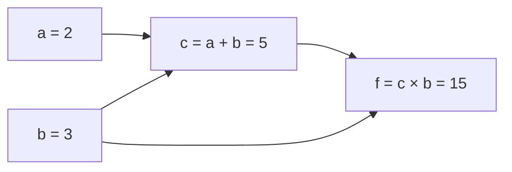
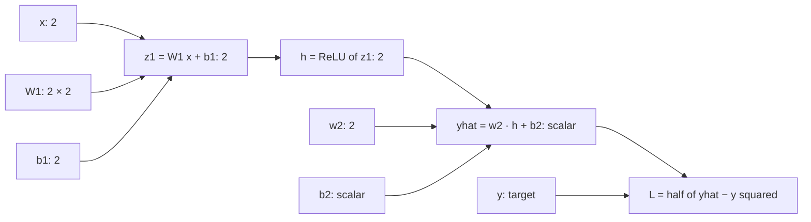

+++
summary = "Draw a computational graph, apply the multivariate chain rule in forward and reverse mode, and backpropagate by hand through a two-layer network, then verify every number with torch.autograd."
+++

# The Chain Rule and Backpropagation

A deep model for heart-disease risk might pass a DNA sequence through dozens of layers before producing one number, a predicted probability. When that prediction is wrong, which of the millions of weights should change, and by how much? **Backpropagation** answers this exactly and efficiently: it computes the gradient of the loss with respect to every parameter for roughly the cost of a couple of forward passes. It is nothing more than the chain rule from calculus applied systematically to a graph of simple operations, in a clever order.

In this chapter you will compute a full backward pass by hand through a tiny network, with real numbers, and then watch PyTorch reproduce every one of them.

## Key ideas

### Computational graphs

Any formula can be broken into elementary operations (add, multiply, ReLU, exp, …). Draw each intermediate result as a node, with arrows from the inputs of each operation to its output. This is a **computational graph**. For example, $f(a, b) = (a + b)\cdot b$ becomes

- $c = a + b$
- $f = c\cdot b$

Note that $b$ is used twice: once to make $c$ and once directly in $f$. There are two paths from $b$ to $f$.



Deep-learning frameworks build this graph automatically as your code runs (PyTorch records it whenever a tensor has `requires_grad=True`) and then traverse it backwards to compute derivatives. This is **automatic differentiation**: not numerical approximation, not symbolic algebra, but exact derivatives of the program you actually ran.

### The chain rule

**One variable.** If $y = g(x)$ and $z = f(y)$, then

$$
\frac{dz}{dx} = \frac{dz}{dy}\cdot\frac{dy}{dx}.
$$

Rates multiply along a chain: if $y$ changes 3 times as fast as $x$, and $z$ changes 2 times as fast as $y$, then $z$ changes 6 times as fast as $x$.

**Several paths.** If $x$ influences $z$ through several intermediate variables $y_1,\dots,y_m$, the contributions from all paths **add**:

> [!IMPORTANT]
> $$\frac{\partial z}{\partial x} = \sum_{k=1}^{m}\frac{\partial z}{\partial y_k}\,\frac{\partial y_k}{\partial x}$$
> Multiply along each path, add across paths.

For $f = (a + b)\,b$: from $a$ there is one path, $a\to c\to f$, giving $\frac{\partial f}{\partial c}\frac{\partial c}{\partial a} = b\cdot1 = 3$. From $b$ there are two: via $c$, $b\cdot1 = 3$; directly, $\frac{\partial f}{\partial b}\big|_{c\text{ fixed}} = c = 5$. Total $\frac{\partial f}{\partial b} = 3 + 5 = 8$. Check by expanding: $f = ab + b^2$, so $\partial f/\partial b = a + 2b = 2 + 6 = 8$.

**Vector form.** If $\mathbf{y} = \mathbf{g}(\mathbf{x})$ with Jacobian $\mathbf{J}_g$ and $\mathbf{z} = \mathbf{f}(\mathbf{y})$ with Jacobian $\mathbf{J}_f$, then the Jacobian of the composition is the matrix product $\mathbf{J}_f\mathbf{J}_g$ (see [Jacobians](../../calculus-and-optimization/derivatives-and-gradients/)). A matrix product is exactly "multiply along paths, add across paths" for every pair of input and output at once.

### Forward mode and reverse mode

A network is a long chain: $\mathbf{x}\to\mathbf{h}_1\to\mathbf{h}_2\to\dots\to L$, where $L$ is a single number, the loss. By the chain rule,

$$
\frac{\partial L}{\partial\mathbf{x}} = \underbrace{\frac{\partial L}{\partial\mathbf{h}_k}}_{1\times n_k}\ \underbrace{\frac{\partial\mathbf{h}_k}{\partial\mathbf{h}_{k-1}}}_{n_k\times n_{k-1}}\ \cdots\ \underbrace{\frac{\partial\mathbf{h}_1}{\partial\mathbf{x}}}_{n_1\times n_0}.
$$

Matrix multiplication is associative, so we may evaluate this product in either order.

- **Forward mode** multiplies from the right, starting at the inputs. It carries "how does everything change if I wiggle *one* input?" forward through the graph. One pass gives the derivatives of all outputs with respect to one input direction. With $n$ inputs you need $n$ passes.
- **Reverse mode** multiplies from the left, starting at the output. It carries "how does the loss change if I wiggle *this* node?" backwards. One pass gives the derivatives of one output with respect to *all* inputs.

A loss is one number and a network has millions of parameters, so reverse mode wins by a factor of millions. **Backpropagation is reverse-mode automatic differentiation.** The leftmost factor is a row vector, so each step is a cheap **vector–Jacobian product**, and the big Jacobian matrices are never formed explicitly.

Let us run both modes on $f = (a + b)\,b$ at $a = 2$, $b = 3$, writing $\dot{v}$ for a forward-mode tangent and $\bar{v} = \partial f/\partial v$ for a reverse-mode **adjoint**.

| Step | Forward mode, seeded with $\dot a = 1,\ \dot b = 0$ | Reverse mode, seeded with $\bar f = 1$ |
|---|---|---|
| 1 | $\dot c = \dot a + \dot b = 1$ | $\bar c = \bar f\cdot b = 3$ |
| 2 | $\dot f = \dot c\,b + c\,\dot b = 3 + 0 = 3$ | $\bar b = \bar f\cdot c + \bar c\cdot1 = 5 + 3 = 8$ |
| 3 | result: $\partial f/\partial a = 3$ only | $\bar a = \bar c\cdot1 = 3$ |

Forward mode produced one derivative; getting $\partial f/\partial b$ would need a second pass seeded with $\dot b = 1$. Reverse mode produced both in one pass. Note how in reverse mode $\bar b$ **accumulates** contributions from both of its uses. In code, that is why PyTorch adds into `.grad` rather than overwriting it, and why you must call `optimizer.zero_grad()` between training steps.

### Backprop rules for the building blocks

Write $\boldsymbol\delta_\mathbf{v} = \partial L/\partial\mathbf{v}$ for the gradient flowing back into node $\mathbf{v}$; it always has the same shape as $\mathbf{v}$. Each layer only needs a local rule turning the gradient at its output into gradients at its inputs and parameters.

**Linear layer** $\mathbf{y} = \mathbf{W}\mathbf{x} + \mathbf{b}$, given $\boldsymbol\delta_\mathbf{y}$. In index form $y_i = \sum_j W_{ij}x_j + b_i$, so $\partial y_i/\partial W_{ij} = x_j$, $\partial y_i/\partial x_j = W_{ij}$ and $\partial y_i/\partial b_i = 1$. Applying the chain rule (summing over the outputs $i$ that each input feeds):

> [!IMPORTANT]
> $$\frac{\partial L}{\partial\mathbf{W}} = \boldsymbol\delta_\mathbf{y}\,\mathbf{x}^\top,\qquad \frac{\partial L}{\partial\mathbf{b}} = \boldsymbol\delta_\mathbf{y},\qquad \frac{\partial L}{\partial\mathbf{x}} = \mathbf{W}^\top\boldsymbol\delta_\mathbf{y}$$

Check the shapes: $\boldsymbol\delta_\mathbf{y}\mathbf{x}^\top$ is $(n_\text{out}\times1)(1\times n_\text{in})$, the shape of $\mathbf{W}$. $\mathbf{W}^\top\boldsymbol\delta_\mathbf{y}$ is $(n_\text{in}\times n_\text{out})(n_\text{out}\times1)$, the shape of $\mathbf{x}$. Shape-matching is a reliable way to remember (and debug) these formulas. For a batch stored as rows, $\mathbf{Y} = \mathbf{X}\mathbf{W}^\top + \mathbf{b}^\top$, the rules become $\partial L/\partial\mathbf{W} = \boldsymbol\Delta^\top\mathbf{X}$ (summing over the batch), $\partial L/\partial\mathbf{b}$ equal to the column sums of $\boldsymbol\Delta$, and $\partial L/\partial\mathbf{X} = \boldsymbol\Delta\mathbf{W}$.

**Element-wise activation** $\mathbf{h} = \phi(\mathbf{z})$: $\boldsymbol\delta_\mathbf{z} = \boldsymbol\delta_\mathbf{h}\odot\phi'(\mathbf{z})$, where $\odot$ is element-wise multiplication. For ReLU, $\phi'(z)$ is 1 if $z > 0$ and 0 otherwise, so ReLU acts as a **gate**: gradient passes through active units and is blocked at inactive ones.

**Squared-error loss** $L = \tfrac12(\hat y - y)^2$: $\partial L/\partial\hat y = \hat y - y$, the signed error.

**Addition** copies the incoming gradient to both inputs. **Multiplication** $f = uv$ sends $\bar f\,v$ to $u$ and $\bar f\,u$ to $v$ (each input gets the gradient times the *other* input).

### What backprop costs

The forward pass must **store** every intermediate value ($\mathbf{z}_1$, $\mathbf{h}$, …), because the backward rules use them ($\mathbf{x}$ in $\boldsymbol\delta\mathbf{x}^\top$, $\mathbf{z}$ in $\phi'(\mathbf{z})$). The backward pass costs about the same as the forward pass, roughly twice for the matrix multiplications, since each needs gradients for both inputs and weights. Memory for stored activations, not arithmetic, is often what limits the batch size or sequence length you can train on, which matters for long DNA sequences.

### Why depth makes gradients fragile

The gradient reaching the first layer is a product of one Jacobian per layer. If those factors are typically smaller than 1 in size, the product shrinks exponentially with depth (**vanishing gradients**); if larger than 1, it explodes. Sigmoid derivatives are at most 0.25, so ten stacked sigmoids can shrink a gradient by up to $0.25^{10}\approx10^{-6}$. ReLU, careful initialisation, normalisation layers and residual connections exist largely to keep these products well behaved; see [training deep networks](../../neural-networks/training-deep-networks/).

## Worked example

A two-layer network with 2 inputs, 2 hidden ReLU units and 1 linear output, trained with squared error on one example.

**Values.**

$$
\mathbf{x} = \begin{bmatrix}1\\2\end{bmatrix},\
\mathbf{W}_1 = \begin{bmatrix}0.5 & -0.5\\ 1.0 & 0.5\end{bmatrix},\
\mathbf{b}_1 = \begin{bmatrix}0\\0.5\end{bmatrix},\
\mathbf{w}_2 = \begin{bmatrix}1.0\\-0.5\end{bmatrix},\
b_2 = 0.25,\
y = 1.
$$

**Computational graph.**



### Forward pass

1. $\mathbf{z}_1 = \mathbf{W}_1\mathbf{x} + \mathbf{b}_1$:
   row 1: $0.5\cdot1 + (-0.5)\cdot2 + 0 = -0.5$;
   row 2: $1.0\cdot1 + 0.5\cdot2 + 0.5 = 2.5$. So $\mathbf{z}_1 = (-0.5,\ 2.5)$.
2. $\mathbf{h} = \operatorname{ReLU}(\mathbf{z}_1) = (0,\ 2.5)$. Hidden unit 1 is inactive.
3. $\hat y = \mathbf{w}_2^\top\mathbf{h} + b_2 = 1.0\cdot0 + (-0.5)\cdot2.5 + 0.25 = -1.0$.
4. $L = \tfrac12(\hat y - y)^2 = \tfrac12(-2)^2 = 2$.

### Backward pass

Work from the loss back to the inputs, reusing each result.

1. **Loss.** $\delta_{\hat y} = \hat y - y = -1 - 1 = -2$. (The prediction is too low, so increasing $\hat y$ would reduce the loss: negative gradient.)
2. **Output layer** (a linear layer with one output, so $\boldsymbol\delta_\mathbf{y}$ is the scalar $-2$):
   $\dfrac{\partial L}{\partial\mathbf{w}_2} = \delta_{\hat y}\,\mathbf{h} = -2\cdot(0, 2.5) = (0,\ -5)$.
   $\dfrac{\partial L}{\partial b_2} = \delta_{\hat y} = -2$.
   $\boldsymbol\delta_\mathbf{h} = \delta_{\hat y}\,\mathbf{w}_2 = -2\cdot(1, -0.5) = (-2,\ 1)$.
3. **ReLU gate.** $\boldsymbol\delta_{\mathbf{z}_1} = \boldsymbol\delta_\mathbf{h}\odot[\mathbf{z}_1 > 0] = (-2, 1)\odot(0, 1) = (0,\ 1)$.
   The inactive unit blocks its gradient entirely.
4. **First layer.**
   $\dfrac{\partial L}{\partial\mathbf{W}_1} = \boldsymbol\delta_{\mathbf{z}_1}\mathbf{x}^\top = \begin{bmatrix}0\\1\end{bmatrix}\begin{bmatrix}1 & 2\end{bmatrix} = \begin{bmatrix}0 & 0\\ 1 & 2\end{bmatrix}$.
   $\dfrac{\partial L}{\partial\mathbf{b}_1} = \boldsymbol\delta_{\mathbf{z}_1} = (0,\ 1)$.
5. **Input** (useful for saliency, not for training): $\dfrac{\partial L}{\partial\mathbf{x}} = \mathbf{W}_1^\top\boldsymbol\delta_{\mathbf{z}_1} = \begin{bmatrix}0.5 & 1.0\\ -0.5 & 0.5\end{bmatrix}\begin{bmatrix}0\\1\end{bmatrix} = (1.0,\ 0.5)$.

**Sanity checks.** $\partial L/\partial w_{2,2} = -5$ is negative: $w_{2,2} = -0.5$ multiplies a positive activation (2.5), so making it less negative raises $\hat y$ toward the target. The first row of $\partial L/\partial\mathbf{W}_1$ is zero: those weights feed a dead ReLU, so nudging them slightly changes nothing.

**One step of gradient descent** with learning rate $0.1$ (each parameter minus $0.1\times$ its gradient):
$\mathbf{W}_1\to\begin{bmatrix}0.5 & -0.5\\ 0.9 & 0.3\end{bmatrix}$, $\mathbf{b}_1\to(0, 0.4)$, $\mathbf{w}_2\to(1.0, 0.0)$, $b_2\to0.45$.
New forward pass: $\mathbf{z}_1 = (-0.5,\ 0.9 + 0.6 + 0.4) = (-0.5, 1.9)$, $\mathbf{h} = (0, 1.9)$, $\hat y = 0 + 0 + 0.45 = 0.45$, $L = \tfrac12(0.55)^2 = 0.15125$. The loss fell from 2 to about 0.151.

## In code

The backward pass written out in numpy, one line per rule:

```python
import numpy as np

# The worked example, forward and backward by hand in numpy
x  = np.array([1.0, 2.0])
W1 = np.array([[0.5, -0.5],
               [1.0,  0.5]])
b1 = np.array([0.0, 0.5])
w2 = np.array([1.0, -0.5])
b2 = 0.25
y  = 1.0

# Forward pass (store every intermediate value)
z1   = W1 @ x + b1             # (2,)
h    = np.maximum(z1, 0)       # ReLU
yhat = w2 @ h + b2             # scalar
L    = 0.5 * (yhat - y) ** 2
print("z1 =", z1, " h =", h, " yhat =", yhat, " L =", L)

# Backward pass (reverse order, one local derivative at a time)
d_yhat = yhat - y              # dL/dyhat
d_w2   = d_yhat * h            # dL/dw2
d_b2   = d_yhat
d_h    = d_yhat * w2           # dL/dh
d_z1   = d_h * (z1 > 0)        # ReLU gate
d_W1   = np.outer(d_z1, x)     # dL/dW1 = d_z1 x^T
d_b1   = d_z1
d_x    = W1.T @ d_z1           # dL/dx
for name, g in [("w2", d_w2), ("b2", d_b2), ("h", d_h), ("z1", d_z1),
                ("W1", d_W1), ("b1", d_b1), ("x", d_x)]:
    print(f"dL/d{name} =", (np.array(g) + 0.0).tolist())  # +0.0 turns -0.0 into 0.0
```

```text
z1 = [-0.5  2.5]  h = [0.  2.5]  yhat = -1.0  L = 2.0
dL/dw2 = [0.0, -5.0]
dL/db2 = -2.0
dL/dh = [-2.0, 1.0]
dL/dz1 = [0.0, 1.0]
dL/dW1 = [[0.0, 0.0], [1.0, 2.0]]
dL/db1 = [0.0, 1.0]
dL/dx = [1.0, 0.5]
```

And the same network in PyTorch, where `L.backward()` does all of the above automatically:

```python
import torch

# Same network, same numbers; autograd builds the graph and runs reverse mode
x  = torch.tensor([1.0, 2.0], requires_grad=True)
W1 = torch.tensor([[0.5, -0.5], [1.0, 0.5]], requires_grad=True)
b1 = torch.tensor([0.0, 0.5], requires_grad=True)
w2 = torch.tensor([1.0, -0.5], requires_grad=True)
b2 = torch.tensor(0.25, requires_grad=True)
y  = torch.tensor(1.0)

z1   = W1 @ x + b1
h    = torch.relu(z1)
yhat = w2 @ h + b2
L    = 0.5 * (yhat - y) ** 2
L.backward()                    # reverse-mode autodiff from the scalar loss

print("L       =", L.item())
print("dL/dW1  =", W1.grad.tolist())
print("dL/db1  =", b1.grad.tolist())
print("dL/dw2  =", (w2.grad + 0.0).tolist())
print("dL/db2  =", b2.grad.item())
print("dL/dx   =", x.grad.tolist())

# One gradient-descent step with learning rate 0.1 lowers the loss
with torch.no_grad():
    for p in (W1, b1, w2, b2):
        p -= 0.1 * p.grad
    yhat_new = w2 @ torch.relu(W1 @ x + b1) + b2
    print("after one step: yhat =", round(yhat_new.item(), 4),
          " L =", round(0.5 * (yhat_new - y).item() ** 2, 4))

# The two-path example f = (a + b) * b
a = torch.tensor(2.0, requires_grad=True)
b = torch.tensor(3.0, requires_grad=True)
f = (a + b) * b
f.backward()
print("f =", f.item(), " df/da =", a.grad.item(), " df/db =", b.grad.item())
```

```text
L       = 2.0
dL/dW1  = [[0.0, 0.0], [1.0, 2.0]]
dL/db1  = [0.0, 1.0]
dL/dw2  = [0.0, -5.0]
dL/db2  = -2.0
dL/dx   = [1.0, 0.5]
after one step: yhat = 0.45  L = 0.1513
f = 15.0  df/da = 3.0  df/db = 8.0
```

Every gradient matches the hand calculation. (The loss after one step is printed as 0.1513; the exact value 0.15125 is stored in float32 as slightly more than 0.15125, so it rounds up.)

> [!TIP]
> When you implement a new layer by hand, verify it with a finite-difference gradient check in float64, as in [derivatives and gradients](../../calculus-and-optimization/derivatives-and-gradients/). PyTorch provides `torch.autograd.gradcheck` for exactly this.

## Biomedical connection

The network in the worked example is a miniature of the models in this course. Replace the 2 inputs with 4 one-hot channels at each of 1,000 positions, the first layer with a convolution, and the output with a sigmoid giving the probability of coronary artery disease: the backward pass follows the same rules, just with bigger tensors. The gradient that arrives at each convolutional filter is a sum, over all positions and all people in the batch, of "error signal at this position" times "the DNA window the filter was looking at". Filters therefore drift toward sequence patterns that help distinguish cases from controls.

Reverse mode also gives the gradient with respect to the **input**, $\partial L/\partial\mathbf{x}$ or, more commonly, $\partial\hat p/\partial\mathbf{x}$, for free. For a DNA model this assigns a score to every base at every position, the basis of the attribution methods discussed in [interpretability](../../deep-architectures-for-sequences/interpretability/).

The ReLU gating you saw by hand has a practical consequence. If a unit's pre-activation is negative for every person in the dataset, it never receives a gradient and never recovers (a "dead ReLU"). With sparse, mostly-zero inputs such as rare-variant dosages, this is worth monitoring.

> [!CAUTION]
> Gradient-based attributions explain what a model has learned from its training cohort, including any biases or confounders in it (such as ancestry or recruitment site). They are hypotheses about biology, not evidence of it.

## Practice

1. For $f(x, y) = (x + 2y)^2$, draw the graph with $u = x + 2y$, $f = u^2$, and use reverse mode to find $\partial f/\partial x$ and $\partial f/\partial y$ at $(1, 1)$.

<details>
<summary>Answer</summary>

Forward: $u = 3$, $f = 9$. Reverse: $\bar f = 1$; $\bar u = 2u = 6$; $\bar x = \bar u\cdot1 = 6$; $\bar y = \bar u\cdot2 = 12$. Check: $\partial f/\partial y = 2(x + 2y)\cdot2 = 12$.

</details>

2. For $f(a) = a\cdot e^{a}$ written as $u = e^a$, $f = a\cdot u$, use the multi-path chain rule to find $f'(a)$ and evaluate it at $a = 0$.

<details>
<summary>Answer</summary>

Two paths from $a$ to $f$. Direct: $\partial f/\partial a|_{u\text{ fixed}} = u = e^a$. Via $u$: $\partial f/\partial u\cdot du/da = a\cdot e^a$. Sum: $f'(a) = e^a(1 + a)$, which is the product rule. At $a = 0$: $1$.

</details>

3. In the worked example, change the target to $y = -1$ (keep everything else). Compute $L$, $\partial L/\partial b_2$, $\partial L/\partial\mathbf{w}_2$ and $\partial L/\partial\mathbf{W}_1$.

<details>
<summary>Answer</summary>

$\hat y = -1$ as before, so $\hat y - y = 0$ and $L = 0$. Every gradient is zero: $\partial L/\partial b_2 = 0$, $\partial L/\partial\mathbf{w}_2 = (0,0)$, $\partial L/\partial\mathbf{W}_1 = \mathbf{0}$. A perfect prediction gives no learning signal.

</details>

4. A linear layer maps $\mathbf{x}\in\mathbb{R}^{3}$ to $\mathbf{y}\in\mathbb{R}^{2}$ with $\mathbf{W} = \begin{bmatrix}1 & 0 & 2\\ -1 & 1 & 0\end{bmatrix}$. If $\mathbf{x} = (1, -1, 2)$ and $\boldsymbol\delta_\mathbf{y} = (0.5, -1)$, find $\partial L/\partial\mathbf{W}$ and $\partial L/\partial\mathbf{x}$.

<details>
<summary>Answer</summary>

$\partial L/\partial\mathbf{W} = \boldsymbol\delta_\mathbf{y}\mathbf{x}^\top = \begin{bmatrix}0.5 & -0.5 & 1\\ -1 & 1 & -2\end{bmatrix}$.
$\partial L/\partial\mathbf{x} = \mathbf{W}^\top\boldsymbol\delta_\mathbf{y}$: entry 1: $1(0.5) + (-1)(-1) = 1.5$; entry 2: $0(0.5) + 1(-1) = -1$; entry 3: $2(0.5) + 0(-1) = 1$. So $(1.5, -1, 1)$.

</details>

5. A function maps 1,000,000 inputs to 1 output. Another maps 1 input to 1,000,000 outputs. Which mode of automatic differentiation would you use for each, and why?

<details>
<summary>Answer</summary>

Many inputs, one output (like a loss): **reverse mode**, one backward pass gives all 1,000,000 partial derivatives. One input, many outputs: **forward mode**, one forward pass seeded with $\dot x = 1$ gives the derivatives of all outputs. Each mode costs one pass per seed, so seed on the small side.

</details>

## Further reading

- David E. Rumelhart, Geoffrey E. Hinton and Ronald J. Williams, "Learning representations by back-propagating errors", *Nature*, 1986.
- Atılım Güneş Baydin, Barak A. Pearlmutter, Alexey Andreyevich Radul and Jeffrey Mark Siskind, "Automatic differentiation in machine learning: a survey", *Journal of Machine Learning Research*, 2018.
- Ian Goodfellow, Yoshua Bengio and Aaron Courville, *Deep Learning*, MIT Press, 2016 (section 6.5, "Back-Propagation and Other Differentiation Algorithms").
- Andreas Griewank and Andrea Walther, *Evaluating Derivatives: Principles and Techniques of Algorithmic Differentiation*, 2nd edition, SIAM, 2008.
