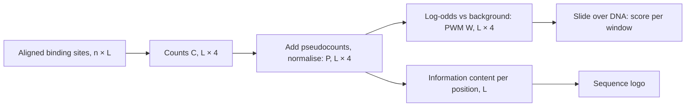

+++
summary = "Measure uncertainty and surprise in bits, build a position weight matrix and compute the information content of a DNA motif, and explain why cross-entropy is the loss we minimise when training classifiers."
+++

# Information Theory

How much does knowing one base of a DNA sequence tell you? How "strong" is the signal a transcription factor recognises in the genome? How far is your model's predicted probability from the truth? These sound like three different questions, but Claude Shannon's information theory (1948) answers all three with one idea: **information is reduction in uncertainty, and uncertainty can be measured in bits.**

For our heart-disease project, information theory gives us two essential tools. It explains **sequence motifs**, the short DNA patterns that control when genes switch on. Many variants linked to coronary artery disease sit in non-coding DNA where such motifs live. It also explains **cross-entropy**, the loss function you will minimise to train nearly every classifier in Part IV.

You should be comfortable with logarithms and with the likelihood ideas in [distributions and likelihood](../../probability-and-statistics/distributions-and-likelihood/).

## Key ideas

### Surprise

An event with probability $p$ carries a **surprise** (or self-information) of

$$
s(p) = -\log_2 p \ \text{ bits}.
$$

Why this formula? We want three properties: certain events ($p=1$) carry no surprise; rarer events are more surprising; and the surprise of two independent events adds up. Since independent probabilities multiply, $p_1 p_2$, we need a function that turns products into sums, which is the logarithm. The base sets the unit: base 2 gives **bits**, base $e$ gives **nats** ($1$ nat $\approx 1.443$ bits).

A fair coin landing heads: $-\log_2 0.5 = 1$ bit. One particular base out of four equally likely: $-\log_2 0.25 = 2$ bits.

### Entropy

**Entropy** is the average surprise of a random variable:

> [!IMPORTANT]
> $$H(X) = -\sum_{x} p(x)\log_2 p(x) \quad\text{bits, with } 0 \log 0 = 0.$$

Properties:

- $H(X) \ge 0$, with equality only when one outcome is certain.
- For $k$ outcomes, $H(X) \le \log_2 k$, with equality for the uniform distribution. So a DNA base has at most $\log_2 4 = \mathbf{2}$ **bits** of entropy.
- A biased coin with $P(\text{heads}) = p$ has $H = -p\log_2 p - (1-p)\log_2(1-p)$, which peaks at 1 bit when $p = 0.5$.

Entropy is also the minimum average number of yes/no questions (or bits in an optimal code) needed to pin down the outcome. Two bits per base is why a genome of about 3 billion bases fits in roughly 750 MB if stored naively at 2 bits per base.

### Cross-entropy

Suppose the truth is $p$ but you believe $q$, so you are surprised by $-\log_2 q(x)$ when $x$ happens. Your average surprise is the **cross-entropy**:

$$
H(p, q) = -\sum_x p(x)\log_2 q(x).
$$

### KL divergence

The extra surprise caused by using $q$ instead of $p$ is the **Kullback–Leibler divergence**:

> [!IMPORTANT]
> $$D_{\mathrm{KL}}(p \,\Vert\, q) = \sum_x p(x)\log_2\frac{p(x)}{q(x)} = H(p, q) - H(p).$$

**KL is never negative.** Proof, using the inequality $\ln t \le t - 1$ (a curve lies below its tangent at $t = 1$):

$$
-D_{\mathrm{KL}}(p \,\Vert\, q) \cdot \ln 2 = \sum_x p(x)\ln\frac{q(x)}{p(x)} \le \sum_x p(x)\left(\frac{q(x)}{p(x)} - 1\right) = \sum_x q(x) - \sum_x p(x) \le 1 - 1 = 0.
$$

(The sums run over $x$ with $p(x) > 0$, so $\sum q(x) \le 1$.) Equality holds only when $q = p$. This result is called **Gibbs' inequality**, and it implies $H(p, q) \ge H(p)$: you can never do better on average than by believing the truth.

> [!WARNING]
> KL divergence is not a distance. It is not symmetric: $D_{\mathrm{KL}}(p \Vert q) \ne D_{\mathrm{KL}}(q \Vert p)$ in general. It is infinite if $q(x) = 0$ for some $x$ with $p(x) > 0$, which is why models should never assign exactly zero probability to something that can happen.

### Mutual information

How much does knowing $Y$ reduce uncertainty about $X$? The **conditional entropy** $H(X \mid Y) = \sum_y p(y) H(X \mid Y = y)$ is the average uncertainty left about $X$ once $Y$ is known. The **mutual information** is the reduction:

$$
I(X; Y) = H(X) - H(X \mid Y) = \sum_{x, y} p(x, y)\log_2\frac{p(x, y)}{p(x)\,p(y)}.
$$

The second form shows $I(X;Y) = D_{\mathrm{KL}}\big(p(x,y) \,\Vert\, p(x)p(y)\big)$: how far the joint distribution is from what it would be under independence. So $I(X; Y) \ge 0$, it equals zero exactly when $X$ and $Y$ are independent, and it is symmetric. Unlike correlation, it detects any kind of dependence, not just linear.

## Sequence motifs and position weight matrices

### From aligned sites to a matrix

A **transcription factor** is a protein that binds short DNA sequences, typically 6–20 bases, to switch genes on or off. It tolerates some variation, so its preference is a probability distribution over bases at each position. Collect $n$ experimentally determined binding sites of length $L$, align them, and count:

- the **position frequency matrix** $\mathbf{C} \in \mathbb{R}^{L \times 4}$, where $C_{i,b}$ is how many sites have base $b$ at position $i$;
- the **position probability matrix** $P_{i,b} = C_{i,b}/n$, each row a distribution over A, C, G, T;
- the **position weight matrix** (PWM), the log-odds against a background distribution $g$ (often uniform, $g_b = 0.25$):

$$
W_{i,b} = \log_2 \frac{P_{i,b}}{g_b}.
$$

Zero counts would give $\log 0 = -\infty$, so in practice we add a small **pseudocount** to each cell before normalising.

To score a candidate sequence $x_1 x_2 \dots x_L$, add the matrix entries for its bases:

$$
S(x) = \sum_{i=1}^{L} W_{i, x_i} = \log_2 \frac{\prod_i P_{i, x_i}}{\prod_i g_{x_i}}.
$$

This is a **log-likelihood ratio**: how much more probable the sequence is under the motif model (positions independent) than under the background. Scanning a long sequence means sliding this window along it and recording the score at each offset. That operation is exactly a **1D convolution** with a fixed $L \times 4$ filter applied to one-hot DNA, which is why the first layer of a [convolutional network for DNA](../../deep-architectures-for-sequences/convolutional-networks-for-dna/) often learns PWM-like filters.

### Information content and sequence logos

How much does a motif position constrain the base? Compare its entropy with the maximum:

> [!IMPORTANT]
> **Information content** of position $i$ against a uniform background:
> $$\text{IC}_i = 2 - H(P_{i,\cdot}) = 2 + \sum_{b} P_{i,b}\log_2 P_{i,b} \quad\text{bits.}$$
> It ranges from 0 (any base, no preference) to 2 (one base always).

More generally, $\text{IC}_i = D_{\mathrm{KL}}(P_{i,\cdot} \,\Vert\, g)$, which reduces to $2 - H$ when $g$ is uniform. This matters because the human genome is AT-rich (GC content around 40%), so a G or C in a motif is slightly more surprising than an A or T.

A **sequence logo** (Schneider and Stephens, 1990) draws each position as a stack of letters. The stack's total height is $\text{IC}_i$, and each letter's height is $P_{i,b} \times \text{IC}_i$. Tall, single-letter stacks are positions the factor cares about. A variant that hits one of those is much more likely to disrupt binding than one at a low-information position.



## Why cross-entropy is the loss we minimise

Suppose labels $y$ (say, CAD within ten years: yes or no; or one of $K$ classes) come from a true conditional distribution $p(y \mid \mathbf{x})$, and our model predicts $q_{\mathbf{w}}(y \mid \mathbf{x})$. Training on examples $(\mathbf{x}_i, y_i)$ by minimising the average of $-\log q_{\mathbf{w}}(y_i \mid \mathbf{x}_i)$ does three equivalent things:

1. **It maximises the likelihood** of the labels (the negative log-likelihood of [distributions and likelihood](../../probability-and-statistics/distributions-and-likelihood/)).
2. **It minimises cross-entropy** between the empirical label distribution and the model, since each observed label is a one-hot "true distribution".
3. **It minimises KL divergence** to the truth. In expectation over the data, the loss is $H(p, q_{\mathbf{w}}) = H(p) + D_{\mathrm{KL}}(p \,\Vert\, q_{\mathbf{w}})$. The first term is fixed by nature and does not depend on $\mathbf{w}$. So the only thing training can reduce is the KL term, and by Gibbs' inequality its minimum, zero, is reached when $q_{\mathbf{w}} = p$.

That last point is the deep reason cross-entropy is a good loss. It is a **proper scoring rule**: its expected value is minimised only by the true probabilities, so it rewards honest, calibrated predictions, not just correct rankings. A model that says 0.99 when the truth is 0.6 is punished heavily whenever the 40% case happens.

> [!NOTE]
> PyTorch's `F.cross_entropy` takes raw scores (logits), applies softmax internally, and uses natural logs, so its values are in nats. The gradient of softmax followed by cross-entropy with respect to the logits is simply $\mathbf{q} - \mathbf{y}$ (predicted probabilities minus one-hot target). This is derived in [loss functions](../../calculus-and-optimization/loss-functions/).

## Worked example

Eight aligned binding sites of a toy 4-base motif:

```text
TATA  TATC  TATG  TATT  TAAA  TAAC  TTAG  TTAT
```

**Step 1: counts per position** (columns A, C, G, T).

| Position | A | C | G | T |
|---|---|---|---|---|
| 1 | 0 | 0 | 0 | 8 |
| 2 | 6 | 0 | 0 | 2 |
| 3 | 4 | 0 | 0 | 4 |
| 4 | 2 | 2 | 2 | 2 |

**Step 2: entropy and information content.**

- Position 1: always T. $H = 0$, $\text{IC} = 2$ bits.
- Position 2: $(0.75, 0.25)$ for A, T. $H = -0.75\log_2 0.75 - 0.25\log_2 0.25 = 0.75(0.415) + 0.25(2) \approx 0.811$. $\text{IC} \approx 1.189$ bits.
- Position 3: $(0.5, 0.5)$. $H = 1$, $\text{IC} = 1$ bit.
- Position 4: uniform. $H = 2$, $\text{IC} = 0$ bits.

Total information content: $2 + 1.189 + 1 + 0 \approx 4.19$ bits. In a logo, position 1 is a tall T (height 2), position 2 is an A of height $0.75 \times 1.189 \approx 0.89$ above a T of height $0.30$, and position 4 is empty.

**Step 3: a PWM with pseudocounts.** Add 1 to every count, so each row sums to 12, and take $\log_2(P/0.25)$:

| Position | A | C | G | T |
|---|---|---|---|---|
| 1 | $\log_2\frac{1/12}{1/4} = -1.585$ | $-1.585$ | $-1.585$ | $\log_2\frac{9/12}{1/4} = 1.585$ |
| 2 | $\log_2\frac{7/12}{1/4} = 1.222$ | $-1.585$ | $-1.585$ | $\log_2\frac{3/12}{1/4} = 0$ |
| 3 | $\log_2\frac{5/12}{1/4} = 0.737$ | $-1.585$ | $-1.585$ | $0.737$ |
| 4 | 0 | 0 | 0 | 0 |

**Step 4: score two sequences.**

- `TATA`: $1.585 + 1.222 + 0.737 + 0 = 3.544$ bits. The sequence is $2^{3.544} \approx 11.7$ times more likely under the motif than under the background.
- `GCGC`: $-1.585 - 1.585 - 1.585 + 0 = -4.755$ bits. Strongly disfavoured.

A single-base change `TATA` → `GATA` drops the score by $1.585 - (-1.585) = 3.17$ bits, because it hits the 2-bit position. The change `TATA` → `TATC` costs nothing, because position 4 carries no information.

## In code

The first snippet defines entropy, cross-entropy and KL, then rebuilds the worked example and scans a random sequence with a planted site.

```python
import numpy as np

BASES = "ACGT"

def entropy(p):
    p = np.asarray(p, dtype=float)
    p = p[p > 0]                          # 0 log 0 = 0 by convention
    return -np.sum(p * np.log2(p))

def cross_entropy(p, q):
    p, q = np.asarray(p, float), np.asarray(q, float)
    mask = p > 0
    return -np.sum(p[mask] * np.log2(q[mask]))

def kl(p, q):
    return cross_entropy(p, q) - entropy(p)

print("H(uniform DNA) =", entropy([0.25] * 4), "bits")
print("H(fair coin)   =", entropy([0.5, 0.5]))
p, q = [0.7, 0.2, 0.1], [1/3, 1/3, 1/3]
print(f"H(p)={entropy(p):.4f}  H(p,q)={cross_entropy(p, q):.4f}  "
      f"KL(p||q)={kl(p, q):.4f}  KL(q||p)={kl(q, p):.4f}")

# ---- Position weight matrix from aligned binding sites ----
sites = ["TATA", "TATC", "TATG", "TATT", "TAAA", "TAAC", "TTAG", "TTAT"]
onehot = np.array([[[b == base for base in BASES] for b in s] for s in sites], float)
print("one-hot sites shape:", onehot.shape)          # (n_sites, L, 4)
counts = onehot.sum(axis=0)                          # (L, 4)
freqs = counts / counts.sum(axis=1, keepdims=True)
ic = np.array([2 - entropy(row) for row in freqs])   # bits per position
print("information content per position:", ic.round(3), "total:", ic.sum().round(3))

pseudo = (counts + 1) / (counts.sum(axis=1, keepdims=True) + 4)
pwm = np.log2(pseudo / 0.25)                          # (L, 4) log-odds vs uniform background
print("PWM (rows = positions, cols = A C G T):\n", pwm.round(3))

def score(seq):
    return sum(pwm[i, BASES.index(b)] for i, b in enumerate(seq))

print("score TATA =", round(score("TATA"), 3), "| score GCGC =", round(score("GCGC"), 3))

# Scan a random sequence with one planted site
rng = np.random.default_rng(3)
seq = list(rng.choice(list(BASES), size=60))
seq[40:44] = list("TATA")
seq = "".join(seq)
scores = [score(seq[i:i + 4]) for i in range(len(seq) - 3)]
hits = [(i, seq[i:i + 4], round(float(s), 3)) for i, s in enumerate(scores) if s > 3]
print("windows scoring > 3 bits:", hits)
```

```text
H(uniform DNA) = 2.0 bits
H(fair coin)   = 1.0
H(p)=1.1568  H(p,q)=1.5850  KL(p||q)=0.4282  KL(q||p)=0.4678
one-hot sites shape: (8, 4, 4)
information content per position: [2.    1.189 1.    0.   ] total: 4.189
PWM (rows = positions, cols = A C G T):
 [[-1.585 -1.585 -1.585  1.585]
 [ 1.222 -1.585 -1.585  0.   ]
 [ 0.737 -1.585 -1.585  0.737]
 [ 0.     0.     0.     0.   ]]
score TATA = 3.544 | score GCGC = -4.755
windows scoring > 3 bits: [(0, 'TAAA', 3.544), (40, 'TATA', 3.544), (42, 'TATC', 3.544)]
```

Notice the KL asymmetry, and notice that the scan found two "sites" we did not plant. Under a uniform background, a random window gets the top score of 3.544 bits whenever it reads T, A, then A or T, then anything, which happens with probability $\tfrac14 \cdot \tfrac14 \cdot \tfrac12 = \tfrac{1}{32}$. Over 57 windows we expect about 1.8 chance hits. As a rule of thumb, a motif carrying $I$ bits of information matches random sequence about once every $2^{I}$ positions, and this toy has only about 4 bits. Real transcription factor motifs have more information than this toy, but genome-wide scans still produce huge numbers of chance matches, which is why motif hits alone are weak evidence of function.

The second snippet computes mutual information, and confirms that PyTorch's cross-entropy loss is the formula above and that expected cross-entropy is smallest when the prediction equals the truth.

```python
import numpy as np
import torch
import torch.nn.functional as F
from sklearn.metrics import mutual_info_score

# ---- Mutual information between a carrier status X and disease Y ----
joint = np.array([[0.04, 0.16],     # rows: carrier yes / no
                  [0.06, 0.74]])    # cols: CAD yes / no
px, py = joint.sum(axis=1), joint.sum(axis=0)
mi = np.sum(joint * np.log2(joint / np.outer(px, py)))
print(f"I(X;Y) = {mi:.4f} bits")

# Same estimate from 100,000 simulated people (sklearn reports nats)
rng = np.random.default_rng(0)
cells = rng.choice(4, size=100_000, p=joint.ravel())
x, y = cells // 2, cells % 2
print(f"sklearn estimate = {mutual_info_score(x, y) / np.log(2):.4f} bits")

# ---- Cross-entropy loss: PyTorch vs the formula ----
logits = torch.tensor([[2.0, 0.5, -1.0],
                       [0.1, 0.2,  3.0]])           # (batch=2, classes=3)
target = torch.tensor([0, 2])                         # true class indices
loss = F.cross_entropy(logits, target)                # mean over batch, in nats
probs = torch.softmax(logits, dim=1)
manual = -torch.log(probs[torch.arange(2), target]).mean()
print("softmax probs:\n", probs.numpy().round(4))
print(f"torch CE = {loss.item():.4f} nats, manual = {manual.item():.4f}")

# Expected cross-entropy is minimised when q equals the true distribution p
p = np.array([0.7, 0.2, 0.1])
for q in ([0.7, 0.2, 0.1], [0.6, 0.3, 0.1], [1/3, 1/3, 1/3]):
    q = np.array(q)
    print(q.round(3), "H(p,q) =", round(-np.sum(p * np.log2(q)), 4), "bits")
```

```text
I(X;Y) = 0.0172 bits
sklearn estimate = 0.0162 bits
softmax probs:
 [[0.7856 0.1753 0.0391]
 [0.0493 0.0545 0.8962]]
torch CE = 0.1755 nats, manual = 0.1755
[0.7 0.2 0.1] H(p,q) = 1.1568 bits
[0.6 0.3 0.1] H(p,q) = 1.1955 bits
[0.333 0.333 0.333] H(p,q) = 1.585 bits
```

The variant in this toy joint distribution more than doubles risk (20% in carriers versus 7.5% in non-carriers), yet it carries only 0.017 bits of information about disease status, out of a possible $H(Y) \approx 0.47$ bits. Individual variants are weak predictors; that is why we need many of them.

## Biomedical connection

- **Non-coding variants and motifs.** Most genome-wide significant variants for common diseases, CAD included, lie outside protein-coding sequence. The core 9p21 CAD risk interval, for example, does not overlap the protein-coding sequence of any gene; it overlaps a long non-coding RNA (ANRIL, also called CDKN2B-AS1) and lies near the genes CDKN2A and CDKN2B. One way such variants could act is by changing a transcription-factor binding site in an enhancer. A PWM score difference between the two alleles ($\Delta S$ in bits) is a first, crude estimate of that effect. Deep models that predict regulatory activity from sequence generalise this idea, as you will see in [encoding DNA for machine learning](../../bioinformatics-algorithms/encoding-dna-for-machine-learning/) and [interpretability](../../deep-architectures-for-sequences/interpretability/).
- **Feature screening.** Mutual information between a variant and disease status is a model-free measure of association. It is rarely used for GWAS itself, but it is a useful lens on why single variants predict so little.
- **The training objective.** Every classifier we build for CAD risk, from logistic regression to transformers, will be trained with cross-entropy. When we later check **calibration** (do predicted 10% risks come true 10% of the time?), we are checking whether minimising cross-entropy actually got $q$ close to $p$.

> [!CAUTION]
> A high PWM score shows that a sequence resembles a binding site, not that a protein binds there in a given cell type, nor that a variant changes disease risk. Treat motif disruption as a hypothesis to be tested experimentally.

## Practice

1. Compute the entropy of a DNA position with base probabilities $(0.5, 0.5, 0, 0)$, and its information content against a uniform background.

<details>
<summary>Answer</summary>

$H = -2 \times 0.5\log_2 0.5 = 1$ bit. $\text{IC} = 2 - 1 = 1$ bit.

</details>

2. A model predicts $q = (0.5, 0.25, 0.25)$ when the truth is $p = (1, 0, 0)$. Compute $H(p)$, $H(p,q)$ and $D_{\mathrm{KL}}(p \Vert q)$ in bits.

<details>
<summary>Answer</summary>

$H(p) = 0$ (certain outcome). $H(p, q) = -1 \times \log_2 0.5 = 1$ bit. $D_{\mathrm{KL}} = 1 - 0 = 1$ bit. For a one-hot target, cross-entropy equals KL, and both equal the per-example training loss (in bits).

</details>

3. Using the PWM of the worked example, what is the score of `TTTA`? By how much does a variant change the score if it turns `TATA` into `TTTA`?

<details>
<summary>Answer</summary>

`TTTA`: $1.585 + 0 + 0.737 + 0 = 2.322$ bits. The change at position 2 from A to T lowers the score by $1.222 - 0 = 1.222$ bits.

</details>

4. Verify the mutual information in the code by hand: joint probabilities $0.04, 0.16, 0.06, 0.74$ (carrier & CAD, carrier & no CAD, non-carrier & CAD, non-carrier & no CAD), with $P(\text{carrier}) = 0.2$ and $P(\text{CAD}) = 0.1$.

<details>
<summary>Answer</summary>

Products of marginals: $0.02, 0.18, 0.08, 0.72$. Terms $p\log_2(p/\text{product})$:

- $0.04\log_2 2 = 0.0400$
- $0.16\log_2(0.889) \approx -0.0272$
- $0.06\log_2(0.75) \approx -0.0249$
- $0.74\log_2(1.0278) \approx 0.0293$

Sum $\approx 0.0172$ bits.

</details>

5. Explain why a model trained by minimising cross-entropy has no incentive to output overconfident probabilities, using the decomposition $H(p,q) = H(p) + D_{\mathrm{KL}}(p\Vert q)$.

<details>
<summary>Answer</summary>

The expected loss is $H(p) + D_{\mathrm{KL}}(p \Vert q)$. $H(p)$ is fixed, and $D_{\mathrm{KL}} \ge 0$ with equality only at $q = p$. Pushing $q$ towards 0 or 1 when the true probability is in between makes $D_{\mathrm{KL}}$ positive, so it increases the expected loss. The loss is minimised by reporting the true probability. (In practice, models can still become overconfident through overfitting to the training set, which is why we check calibration on held-out data.)

</details>

## Further reading

- Shannon, C. E. (1948). A mathematical theory of communication. *Bell System Technical Journal*, 27, 379–423 and 623–656.
- Cover, T. M. & Thomas, J. A. *Elements of Information Theory*, 2nd ed. Wiley, 2006.
- MacKay, D. J. C. *Information Theory, Inference, and Learning Algorithms*. Cambridge University Press, 2003.
- Schneider, T. D. & Stephens, R. M. (1990). Sequence logos: a new way to display consensus sequences. *Nucleic Acids Research*, 18(20), 6097–6100.
- Stormo, G. D. (2000). DNA binding sites: representation and discovery. *Bioinformatics*, 16(1), 16–23.
