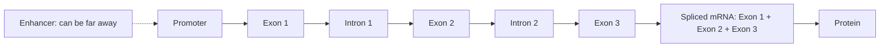

+++
summary = "Read DNA as data: reverse-complement and translate sequences, classify genetic variants, encode genotypes as dosages, and derive and test Hardy–Weinberg equilibrium and linkage disequilibrium."
+++

# DNA, Genes and Variation

Our model takes DNA as input. Before we can design that input, we need to know what DNA is, which parts of it matter, how people differ from one another, and how those differences are written down as numbers. This chapter covers the biology a model builder needs: the structure of DNA, how genes encode proteins, the main kinds of genetic variation, and two pieces of population genetics, **Hardy–Weinberg equilibrium** and **linkage disequilibrium**, that shape every genetic dataset you will ever touch.

No biology background is assumed. You will use the binomial distribution from [distributions and likelihood](../../probability-and-statistics/distributions-and-likelihood/) and the chi-square test from [hypothesis testing](../../probability-and-statistics/hypothesis-testing-and-multiple-comparisons/).

## Key ideas

### DNA is a string over a four-letter alphabet

**DNA** (deoxyribonucleic acid) is a long polymer of **nucleotides**. Each nucleotide carries one of four **bases**: adenine (A), cytosine (C), guanine (G) or thymine (T). For a programmer, a DNA strand is a string over the alphabet $\{A, C, G, T\}$.

The strand has a direction. Its two ends are called **5′** ("five prime") and **3′**, after carbon atoms in the sugar backbone. Sequences are written 5′ → 3′ by convention, and the cell's copying and reading machinery works in that direction.

### Base pairing and the double helix

DNA usually exists as two strands wound into a **double helix**, held together by **base pairing**:

- A pairs with T (two hydrogen bonds);
- G pairs with C (three hydrogen bonds).

The strands are **antiparallel**: one runs 5′ → 3′, its partner 3′ → 5′. So the second strand is fully determined by the first. To read it in the standard 5′ → 3′ direction, complement every base and reverse the order. This is the **reverse complement**:

```text
5'-ATGGCTGAA-3'    top strand
3'-TACCGACTT-5'    bottom strand (complement, read right to left)
reverse complement of the top strand, written 5'->3':  TTCAGCCAT
```

> [!WARNING]
> A sequencing read can come from either strand. A motif, a primer or a variant on the "minus" strand appears as its reverse complement. Many bugs in genomics code are strand bugs. Models of DNA often augment training data with reverse complements for this reason.

### Chromosomes and the genome

The human **genome** is about 3 billion base pairs per set, packaged into 23 chromosomes: autosomes 1–22 plus a sex chromosome (X or Y). Most cells are **diploid**: they carry two sets, one inherited from each parent. So at every autosomal position you have two copies, which is why genotypes have two alleles. Mitochondria carry a small separate genome of their own.

### The central dogma

> [!IMPORTANT]
> **Central dogma of molecular biology:** DNA → (transcription) → RNA → (translation) → protein.

- **Transcription** copies a stretch of DNA into **RNA**, a similar molecule with uracil (U) in place of thymine.
- **Translation** reads messenger RNA (mRNA) three bases at a time and builds a chain of **amino acids**, a protein.

Proteins do most of the work in a cell: the LDL receptor that pulls cholesterol out of the blood is a protein, as are the motor proteins that make heart muscle contract.

### Genes, exons, introns and regulatory regions

A **gene** is a stretch of DNA that is transcribed into a functional RNA, most often one that codes for a protein. Humans have roughly 20,000 protein-coding genes, yet protein-coding sequence makes up under 2% of the genome.

A typical protein-coding gene contains:

- a **promoter** near the start, where the transcription machinery assembles;
- **exons**, the pieces kept in the mature mRNA;
- **introns**, the pieces between exons, cut out by **splicing** after transcription;
- **untranslated regions** (UTRs) at the 5′ and 3′ ends of the mRNA, kept but not translated.



Away from genes, **regulatory regions** such as **enhancers** and **silencers** control when, where and how strongly a gene is transcribed. They work by providing binding sites for transcription factors, the sequence motifs of [information theory](../../probability-and-statistics/information-theory/). An enhancer can sit tens or even hundreds of thousands of bases from the gene it controls. Most variants linked to common diseases lie in non-coding DNA, many plausibly in such regulatory elements, so a model that sees only exons sees only part of the picture.

### The genetic code

Translation reads mRNA in non-overlapping triplets called **codons**. With 4 bases there are $4^3 = 64$ codons for 20 amino acids, so the code is redundant:

- 61 codons specify amino acids, often several codons per amino acid;
- **ATG** (AUG in RNA) codes for methionine and usually marks the **start**;
- **TAA, TAG, TGA** are **stop** codons, which end translation.

The **reading frame** is set by the start codon. Shift it by one base and every downstream codon changes.

## Genetic variation

Any two people's genomes differ at millions of positions. A typical genome differs from the human reference sequence at roughly 4 to 5 million sites (1000 Genomes Project Consortium, 2015). Most differences have no noticeable effect; a few matter a lot.

### Types of variants

| Type | What changes | Typical size |
|---|---|---|
| **SNV** (single-nucleotide variant; called a **SNP** when common) | one base replaced by another | 1 bp |
| **Indel** | small insertion or deletion | 1 bp to ~50 bp |
| **CNV** (copy-number variant) | a segment is deleted or duplicated | ~1 kb to megabases |
| **Structural variant** | larger rearrangements: deletions, duplications, inversions, translocations | ≥ ~50 bp |

(CNVs are a kind of structural variant. The 50 bp boundary between "indel" and "structural variant" is a convention, not biology.)

Inside a protein-coding exon, the effect depends on what happens to the codons:

- **synonymous**: the codon changes but the amino acid does not;
- **missense**: one amino acid is replaced by another;
- **nonsense** (stop-gain): a codon becomes a stop codon, truncating the protein;
- **frameshift**: an indel whose length is not a multiple of 3 shifts the reading frame;
- **splice-site**: the change disrupts the signals for cutting out introns.

Nonsense, frameshift and canonical splice-site variants are often grouped as **loss-of-function** variants, because they tend to destroy the protein's function.

### Alleles, genotypes and dosage

At a variable position, the different versions are **alleles**. By convention we call the base in the reference genome the **reference allele** (REF) and the other one the **alternative allele** (ALT). Because you are diploid, your **genotype** at a biallelic site is one of:

| Genotype | Name | Dosage (number of ALT alleles) |
|---|---|---|
| REF/REF | homozygous reference | 0 |
| REF/ALT | heterozygous | 1 |
| ALT/ALT | homozygous alternative | 2 |

> [!IMPORTANT]
> **Dosage coding.** A genotype matrix for $n$ people and $m$ variants is $\mathbf{G} \in \{0, 1, 2\}^{n \times m}$. This additive coding is the default input to GWAS and polygenic risk scores. Imputed genotypes give fractional, expected dosages in $[0, 2]$.

The **allele frequency** of ALT is the fraction of all chromosomes in the population carrying it. The **minor allele frequency** (MAF) is the frequency of the less common allele, so MAF $\le 0.5$. Common conventions: **common** variants have MAF $\ge 5\%$, **low-frequency** 1–5%, **rare** below 1%.

> [!WARNING]
> The REF allele is simply whatever is in the reference genome. It is not "normal", not "ancestral", and not necessarily the more common allele. The "risk allele" in a study can be REF or ALT. Always check which allele an effect size refers to.

## Hardy–Weinberg equilibrium

### Derivation

Consider a biallelic site with alleles A (frequency $p$) and a (frequency $q = 1 - p$). Assume **random mating** with respect to this site, a large population, and no selection, mutation or migration. A child receives one allele from each parent, and each is an independent random draw from the population's allele pool. So:

$$
P(\text{AA}) = p \cdot p = p^2, \qquad P(\text{Aa}) = p\,q + q\,p = 2pq, \qquad P(\text{aa}) = q^2.
$$

The heterozygote term is $2pq$ because there are two ways to get it: A from mother and a from father, or the reverse. This is just the binomial $\text{Bin}(2, q)$ for the number of a alleles.

Now check that allele frequencies stay put. In the children, the frequency of A is

$$
p' = P(\text{AA}) + \tfrac{1}{2}P(\text{Aa}) = p^2 + pq = p(p + q) = p.
$$

So after a single generation of random mating, genotype frequencies reach $p^2 : 2pq : q^2$ and stay there.

> [!IMPORTANT]
> **Hardy–Weinberg equilibrium (HWE):** with allele frequencies $p$ and $q = 1-p$,
> $$P(\text{AA}) = p^2, \qquad P(\text{Aa}) = 2pq, \qquad P(\text{aa}) = q^2.$$

A practical consequence: for a rare recessive allele, carriers vastly outnumber affected people. If $q = 0.01$, then $q^2 = 1$ in 10,000 are affected, but $2pq \approx 0.0198$, about 1 in 50, are carriers.

### Testing HWE

Given genotype counts $n_{AA}, n_{Aa}, n_{aa}$ with total $n$:

1. Estimate $\hat p = (2n_{AA} + n_{Aa}) / (2n)$.
2. Expected counts: $n\hat p^2$, $2n\hat p\hat q$, $n\hat q^2$.
3. $X^2 = \sum (O - E)^2 / E$.
4. Compare with $\chi^2$ on **1** degree of freedom: 3 categories, minus 1 because counts sum to $n$, minus 1 for estimating $p$.

In practice, a strong HWE deviation in a large dataset is more often a **genotyping error** than biology (for example, an assay that misreads heterozygotes). GWAS quality control therefore removes variants with extreme HWE p-values in controls, using a very small threshold, often around $10^{-6}$. Real deviations also arise from population structure (mixing groups with different allele frequencies produces too few heterozygotes) and from selection, for example in cases with a strongly associated disease variant.

## Linkage disequilibrium

Alleles at nearby positions on the same chromosome tend to be inherited together, because recombination rarely separates them in any one generation. Over many generations, recombination slowly breaks up these associations, so they decay with distance. The non-random association of alleles at different sites is called **linkage disequilibrium** (LD).

Take two biallelic sites with alleles A/a and B/b, frequencies $p_A$ and $p_B$. A **haplotype** is the combination of alleles on one chromosome: AB, Ab, aB or ab. If the sites were independent, $P(\text{AB}) = p_A p_B$. The departure from that is

$$
D = p_{AB} - p_A\,p_B.
$$

$D$ depends on allele frequencies, so two normalised versions are used:

> [!IMPORTANT]
> $$D' = \frac{D}{D_{\max}}, \quad D_{\max} = \begin{cases} \min\big(p_A(1-p_B),\ (1-p_A)p_B\big) & D > 0 \\ \min\big(p_A p_B,\ (1-p_A)(1-p_B)\big) & D < 0 \end{cases}$$
> $$r^2 = \frac{D^2}{p_A(1-p_A)\,p_B(1-p_B)}$$

- $\vert D' \vert = 1$ means at most three of the four haplotypes exist: no recombination is visible between the sites. It speaks to **history**.
- $r^2$ is the squared correlation between the allele indicators on a haplotype. $r^2 = 1$ means one SNP perfectly predicts the other. It speaks to **prediction** and statistical power: if you genotype a SNP with $r^2 = 0.8$ to a causal variant, a GWAS needs roughly $1/0.8 = 1.25$ times the sample size to detect the effect as if it had genotyped the causal variant directly.

LD is a blessing and a curse. It lets genotyping arrays with a few hundred thousand SNPs "tag" millions of others. But it also means a GWAS signal usually implicates a whole block of correlated variants, and pinpointing the causal one (**fine-mapping**) is hard. LD patterns differ between populations, which is one reason genetic risk scores transfer poorly across ancestries (see [GWAS and polygenic risk scores](../../genomics-foundations/gwas-and-polygenic-risk-scores/)).

## Worked example

### Testing Hardy–Weinberg

A study genotypes 1,000 people at one SNP: 380 AA, 440 Aa, 180 aa.

**Allele frequency.** Count A alleles: $2 \times 380 + 440 = 1200$ out of $2000$. $\hat p = 0.6$, $\hat q = 0.4$.

**Expected counts under HWE.**

- AA: $1000 \times 0.36 = 360$
- Aa: $1000 \times 2 \times 0.6 \times 0.4 = 480$
- aa: $1000 \times 0.16 = 160$

**Chi-square.**

$$
X^2 = \frac{(380-360)^2}{360} + \frac{(440-480)^2}{480} + \frac{(180-160)^2}{160} = 1.111 + 3.333 + 2.500 = 6.944.
$$

With 1 df, $p \approx 0.0084$. There are too few heterozygotes. At $\alpha = 0.05$ we would reject HWE, but at a QC threshold like $10^{-6}$ we would keep the SNP. If this were a control sample, the deficit of heterozygotes would prompt us to check for genotyping problems or population structure.

### Measuring LD

Two SNPs have haplotype frequencies $p_{AB} = 0.5$, $p_{Ab} = 0.1$, $p_{aB} = 0.1$, $p_{ab} = 0.3$.

- $p_A = 0.5 + 0.1 = 0.6$, $p_B = 0.5 + 0.1 = 0.6$.
- $D = 0.5 - 0.6 \times 0.6 = 0.14 > 0$.
- $D_{\max} = \min(0.6 \times 0.4,\ 0.4 \times 0.6) = 0.24$, so $D' = 0.14/0.24 \approx 0.583$.
- $r^2 = \dfrac{0.14^2}{0.6 \times 0.4 \times 0.6 \times 0.4} = \dfrac{0.0196}{0.0576} \approx 0.340$.

Knowing the allele at one SNP explains about a third of the variance in the allele at the other.

## In code

First, sequences as strings: the reverse complement, translation with the standard genetic code, and the effect of different single-base changes on a toy gene.

```python
# Standard genetic code, built from the classic compact string (order T, C, A, G)
BASES = "TCAG"
AMINO = "FFLLSSSSYY**CC*WLLLLPPPPHHQQRRRRIIIMTTTTNNKKSSRRVVVVAAAADDEEGGGG"
CODON_TABLE = {a + b + c: AMINO[16 * i + 4 * j + k]
               for i, a in enumerate(BASES)
               for j, b in enumerate(BASES)
               for k, c in enumerate(BASES)}

COMPLEMENT = str.maketrans("ACGTacgt", "TGCAtgca")

def reverse_complement(seq):
    return seq.translate(COMPLEMENT)[::-1]

def translate(seq):
    """Translate from the first base until a stop codon ('*')."""
    protein = []
    for i in range(0, len(seq) - 2, 3):
        aa = CODON_TABLE[seq[i:i + 3]]
        if aa == "*":
            break
        protein.append(aa)
    return "".join(protein)

print("codons:", len(CODON_TABLE), "| stops:", sorted(c for c, a in CODON_TABLE.items() if a == "*"))
print("ATG ->", CODON_TABLE["ATG"])

coding = "ATGGCTGAAGTTCGCTGGTAA"
print("reverse complement:", reverse_complement(coding))
print("protein:           ", translate(coding))

# Three kinds of single-base change in the same gene
snv_syn  = coding[:5] + "C" + coding[6:]      # GCT -> GCC, still Ala
snv_mis  = coding[:7] + "T" + coding[8:]      # GAA -> GTA, Glu -> Val
snv_non  = coding[:17] + "A" + coding[18:]    # TGG -> TGA, Trp -> stop
deletion = coding[:7] + coding[8:]            # 1-base deletion: frameshift
for name, s in [("synonymous", snv_syn), ("missense", snv_mis),
                ("nonsense", snv_non), ("frameshift", deletion)]:
    print(f"{name:11s} {translate(s)}")
```

```text
codons: 64 | stops: ['TAA', 'TAG', 'TGA']
ATG -> M
reverse complement: TTACCAGCGAACTTCAGCCAT
protein:            MAEVRW
synonymous  MAEVRW
missense    MAVVRW
nonsense    MAEVR
frameshift  MAEFAG
```

The frameshift scrambles every amino acid after the deletion (here the third codon happens to still read as glutamate, E) and the original stop codon is no longer in frame, so translation would run on into whatever sequence follows.

Second, population genetics: the HWE test, a simulated population that obeys HWE, and LD statistics checked against simulated haplotypes.

```python
import numpy as np
from scipy import stats

def hwe_test(n_AA, n_Aa, n_aa):
    """Chi-square goodness-of-fit test for Hardy-Weinberg equilibrium (1 df)."""
    n = n_AA + n_Aa + n_aa
    p = (2 * n_AA + n_Aa) / (2 * n)
    expected = n * np.array([p**2, 2 * p * (1 - p), (1 - p)**2])
    observed = np.array([n_AA, n_Aa, n_aa])
    chi2 = np.sum((observed - expected) ** 2 / expected)
    return p, expected, chi2, stats.chi2.sf(chi2, df=1)

p, e, chi2, pval = hwe_test(380, 440, 180)
print(f"p(A)={p:.2f} expected={e.round(1)} chi2={chi2:.3f} p-value={pval:.4f}")

# Simulate a population in HWE: each person gets two independent alleles
rng = np.random.default_rng(0)
haps = rng.random((5000, 2)) < 0.3                  # True = alt allele, shape (people, 2)
dosage = haps.sum(axis=1)                           # 0, 1, 2
counts = np.bincount(dosage, minlength=3)
print("simulated genotype counts (0,1,2 alt):", counts)
_, _, chi2, pval = hwe_test(counts[2], counts[1], counts[0])
print(f"HWE test on simulated data: chi2={chi2:.3f}, p={pval:.3f}")
print(f"MAF = {min(dosage.mean() / 2, 1 - dosage.mean() / 2):.3f}")

def ld(hap_freqs):
    """hap_freqs = dict with keys 'AB','Ab','aB','ab'. Returns D, D', r^2."""
    pA = hap_freqs["AB"] + hap_freqs["Ab"]
    pB = hap_freqs["AB"] + hap_freqs["aB"]
    D = hap_freqs["AB"] - pA * pB
    if D >= 0:
        Dmax = min(pA * (1 - pB), (1 - pA) * pB)
    else:
        Dmax = min(pA * pB, (1 - pA) * (1 - pB))
    r2 = D**2 / (pA * (1 - pA) * pB * (1 - pB))
    return D, D / Dmax, r2

D, Dp, r2 = ld({"AB": 0.5, "Ab": 0.1, "aB": 0.1, "ab": 0.3})
print(f"D={D:.3f}  D'={Dp:.3f}  r^2={r2:.3f}")

# r^2 is the squared correlation between allele indicators on the same haplotype
n = 100_000
cells = rng.choice(4, size=n, p=[0.5, 0.1, 0.1, 0.3])   # AB, Ab, aB, ab
x = (cells <= 1).astype(float)                           # carries A
y = np.isin(cells, [0, 2]).astype(float)                 # carries B
print(f"correlation^2 from {n} simulated haplotypes: {np.corrcoef(x, y)[0, 1]**2:.3f}")
```

```text
p(A)=0.60 expected=[360. 480. 160.] chi2=6.944 p-value=0.0084
simulated genotype counts (0,1,2 alt): [2418 2156  426]
HWE test on simulated data: chi2=3.152, p=0.076
MAF = 0.301
D=0.140  D'=0.583  r^2=0.340
correlation^2 from 100000 simulated haplotypes: 0.342
```

Even data simulated exactly under HWE gives a p-value of 0.076 here. Under the null, p-values are uniform, so values like this are routine.

## Biomedical connection

Everything in this chapter becomes a design decision for the heart-disease model:

- **Input representation.** For variant-based models (GWAS, polygenic scores, gradient-boosted trees on genotypes), each person is a row of dosages $\in \{0,1,2\}$. For sequence-based deep models, a stretch of DNA becomes a one-hot matrix of shape $L \times 4$, and the reverse complement is a natural data augmentation. Both are developed in [encoding DNA for machine learning](../../bioinformatics-algorithms/encoding-dna-for-machine-learning/).
- **Variant effect.** A nonsense variant in a gene such as *LDLR*, which encodes the LDL receptor, can cause familial hypercholesterolemia, a monogenic cause of early heart disease. Common variants near genes and in regulatory DNA usually have far smaller effects. [Genetics of heart disease](../../genomics-foundations/genetics-of-heart-disease/) covers both.
- **Correlated features.** LD makes neighbouring dosage columns highly correlated. Linear models with correlated features have unstable coefficients, which is why polygenic score methods prune or model LD explicitly, and why [regularisation](../../classical-machine-learning/regularization-and-the-bias-variance-tradeoff/) matters.
- **Quality control.** HWE tests, MAF filters and missingness filters are standard first steps in cleaning genotype data, before any model sees it.

> [!CAUTION]
> Variant names like "missense" or "loss-of-function" describe a predicted molecular consequence, not a clinical verdict. Whether a specific variant causes disease is decided by expert curation of many lines of evidence, covered in [genetics of heart disease](../../genomics-foundations/genetics-of-heart-disease/).

## Practice

1. Write the reverse complement of `5'-ACCGTTAG-3'`.

<details>
<summary>Answer</summary>

Complement: `TGGCAATC`. Reverse: `CTAACGGT`. So the reverse complement is `5'-CTAACGGT-3'`.

</details>

2. In 1,000 people you observe 650 REF/REF, 300 REF/ALT and 50 ALT/ALT. What is the ALT allele frequency and the MAF? Test for HWE.

<details>
<summary>Answer</summary>

ALT alleles: $300 + 2 \times 50 = 400$ out of $2000$, frequency $0.2$, so MAF $= 0.2$.

Expected: REF/REF $1000 \times 0.64 = 640$, REF/ALT $1000 \times 0.32 = 320$, ALT/ALT $1000 \times 0.04 = 40$.

$X^2 = \frac{10^2}{640} + \frac{20^2}{320} + \frac{10^2}{40} = 0.156 + 1.25 + 2.5 = 3.906$, 1 df, $p \approx 0.048$. Borderline at $\alpha = 0.05$; no QC filter would remove it.

</details>

3. Which is more likely to destroy a protein's function, a 3-base deletion or a 2-base deletion inside an exon? Why?

<details>
<summary>Answer</summary>

Usually the 2-base deletion. It shifts the reading frame, changing every downstream codon and typically hitting a premature stop codon soon after. The 3-base deletion removes one amino acid (and possibly alters one neighbour) but keeps the frame, so the rest of the protein is intact.

</details>

4. Two SNPs have haplotype frequencies $p_{AB} = 0.4$, $p_{Ab} = 0$, $p_{aB} = 0.2$, $p_{ab} = 0.4$. Compute $D$, $D'$ and $r^2$.

<details>
<summary>Answer</summary>

$p_A = 0.4$, $p_B = 0.6$. $D = 0.4 - 0.24 = 0.16$. $D_{\max} = \min(0.4 \times 0.4,\ 0.6 \times 0.6) = 0.16$, so $D' = 1$. $r^2 = \frac{0.0256}{0.4 \times 0.6 \times 0.6 \times 0.4} = \frac{0.0256}{0.0576} \approx 0.444$.

$D' = 1$ because the Ab haplotype is absent, but $r^2$ is well below 1 because the allele frequencies differ, so neither SNP perfectly predicts the other.

</details>

5. A recessive condition affects 1 in 40,000 people. Assuming HWE, roughly what fraction of people are carriers?

<details>
<summary>Answer</summary>

$q^2 = 1/40{,}000 \Rightarrow q = 1/200 = 0.005$. Carriers: $2pq = 2 \times 0.995 \times 0.005 \approx 0.00995$, about 1 in 100.

</details>

## Further reading

- Alberts, B. et al. *Molecular Biology of the Cell*, 6th ed. Garland Science, 2014. Chapters on DNA, genes and gene expression.
- Strachan, T. & Read, A. *Human Molecular Genetics*, 5th ed. CRC Press, 2018.
- Hartl, D. L. & Clark, A. G. *Principles of Population Genetics*, 4th ed. Sinauer, 2007. Hardy–Weinberg and linkage disequilibrium.
- The 1000 Genomes Project Consortium (2015). A global reference for human genetic variation. *Nature*, 526, 68–74.
- Slatkin, M. (2008). Linkage disequilibrium: understanding the evolutionary past and mapping the medical future. *Nature Reviews Genetics*, 9, 477–485.
