+++
summary = "Follow genetic data from the sequencing machine to a genotype matrix: read FASTQ quality scores, size coverage with the Poisson model, read VCF genotype fields, and understand reference builds and imputation."
+++

# Sequencing Data

A model can only be as good as its inputs, and genetic inputs are the end product of a long measurement pipeline. Before a dosage of 0, 1 or 2 reaches your model, DNA was extracted from blood, broken into fragments, read by a machine that makes errors, placed on a reference genome by an aligner, and turned into genotype calls by a statistical (or neural) variant caller. Each step has failure modes that can silently bias a heart-disease model, for example if cases and controls were sequenced on different platforms.

This chapter follows that pipeline. You will use the Poisson and binomial distributions from [distributions and likelihood](../../probability-and-statistics/distributions-and-likelihood/) and Bayes' theorem from [probability and Bayes' theorem](../../probability-and-statistics/probability-and-bayes-theorem/).

## Key ideas

### Ways to read a genome

**Short-read sequencing** (dominated by Illumina) reads millions of DNA fragments in parallel. Each fragment is copied into a cluster on a flow cell, and the machine adds one fluorescently labelled base per cycle, photographing the colour each time (**sequencing by synthesis**). Reads are short, commonly 100–150 bases, often from both ends of a fragment (**paired-end**). Per-base error rates are low, typically well under 1%, and errors are mostly substitutions. Short reads struggle in repetitive regions, where a 150-base read may match many places equally well.

**Long-read sequencing** reads single molecules thousands of bases long. Pacific Biosciences (PacBio) HiFi reads are typically 10–25 kb with high accuracy. Oxford Nanopore reads are commonly tens of kilobases, and some exceed a megabase. Long reads resolve repeats and structural variants that short reads miss, and can **phase** variants (tell which ones sit on the same chromosome copy). They remain more expensive per genome at scale.

### What to read: genome, exome or array

| Assay | What it measures | Typical use |
|---|---|---|
| **Whole-genome sequencing (WGS)** | essentially every base, often at ~30× coverage | all variant types, including non-coding and structural |
| **Whole-exome sequencing (WES)** | the protein-coding exons, roughly 1–2% of the genome, captured by probes | rare coding variants; diagnosing monogenic disease |
| **Genotyping array** | a fixed set of hundreds of thousands to a few million pre-chosen SNPs | GWAS and polygenic scores in very large cohorts, at low cost |

Arrays cannot discover new variants and measure rare variants poorly, but they are cheap enough to genotype hundreds of thousands of people. UK Biobank, for example, genotyped its roughly half a million participants on arrays before later adding exome and genome sequencing. Most polygenic risk scores for CAD have been developed on array data plus imputation.

### FASTQ: reads with quality scores

Raw reads come in **FASTQ** files. Each read takes four lines:

```text
@read1                      <- 1. '@' then the read name
GATTTGGGGTTCAAAGCAGT        <- 2. the bases
+                           <- 3. separator
IIIIIIIIIIII?????55+        <- 4. one quality character per base
```

Each quality character encodes the machine's estimated probability $p$ that the base call is wrong, on the **Phred scale**.

> [!IMPORTANT]
> **Phred quality score**
> $$Q = -10\log_{10} p, \qquad p = 10^{-Q/10}.$$
> Q10 means a 1 in 10 chance of error, Q20 1 in 100, Q30 1 in 1,000, Q40 1 in 10,000.

The score is stored as a single character: modern files use **Phred+33**, so the character is `chr(Q + 33)`. `I` is ASCII 73, so $Q = 40$; `?` (63) is $Q = 30$; `5` (53) is $Q = 20$; `+` (43) is $Q = 10$.

The logarithmic scale turns tiny probabilities into readable numbers and turns multiplication of independent error probabilities into addition. Phred scores appear everywhere in genomics: base qualities, mapping qualities (probability a read is placed wrongly) and variant qualities (the `QUAL` column of a VCF).

### Coverage and the Lander–Waterman model

If we sequence $N$ reads of length $L$ from a genome of length $G$, the **average coverage** (depth) is

$$
c = \frac{NL}{G}.
$$

Model read start positions as independent and uniform along the genome. As derived in [distributions and likelihood](../../probability-and-statistics/distributions-and-likelihood/), the number of reads covering any given base is then approximately **Poisson($c$)**.

> [!IMPORTANT]
> **Lander–Waterman (Poisson) coverage model**
> $$P(\text{depth} = d) = \frac{e^{-c} c^d}{d!}, \qquad P(\text{base uncovered}) = e^{-c}.$$

The same paper (Lander and Waterman, 1988) gives the expected number of separate covered "islands" as roughly $N e^{-c}$: each read is the last in its island if no other read starts within the next $L$ bases, which has probability about $e^{-c}$.

Real data is less even than Poisson. Regions with extreme GC content, repeats and segmental duplications get too few reads or reads that cannot be placed uniquely. So the Poisson model is a lower bound on how much sequencing you need, not a guarantee.

### Calling a genotype from reads

At a site where a person has $d$ reads and $k$ show the ALT base, the three genotypes predict different ALT fractions: about $\varepsilon$ (sequencing error) for REF/REF, $1/2$ for REF/ALT, and $1 - \varepsilon$ for ALT/ALT. Each gives a binomial **genotype likelihood**:

$$
P(k \mid g) = \binom{d}{k} f_g^{\,k} (1 - f_g)^{d-k}, \qquad f_g \in \{\varepsilon,\ \tfrac12,\ 1-\varepsilon\}.
$$

Combine with a prior from population allele frequency (Hardy–Weinberg) via Bayes' theorem to get posterior genotype probabilities. Real callers add base and mapping qualities, local re-assembly of reads, and models of systematic errors. **DeepVariant** (Poplin et al., 2018) even reframes calling as image classification: it renders the reads around a candidate site as an image and feeds it to a convolutional network.

Low depth hurts heterozygotes most. With $d$ reads, a heterozygote shows at most one ALT read with probability $(1 + d)/2^d$, which is about 31% at $d = 4$ but about 1% at $d = 10$.

## The pipeline: from reads to a VCF

```mermaid
flowchart LR
    A["DNA sample"] --> B["Library prep and sequencing"]
    B --> C["FASTQ: reads and qualities"]
    C --> D["QC and adapter trimming"]
    D --> E["Alignment to reference genome"]
    E --> F["BAM: sorted, duplicates marked"]
    F --> G["Variant calling"]
    G --> H["VCF: variants and genotypes"]
    H --> I["Filtering and annotation"]
    I --> J["Dosage matrix for modelling"]
```



1. **Alignment.** Each read is placed on the reference genome by an aligner such as BWA-MEM, which tolerates mismatches and small gaps. The algorithms behind this are in [sequence alignment](../../bioinformatics-algorithms/sequence-alignment/) and [indexing and read mapping](../../bioinformatics-algorithms/indexing-and-read-mapping/).
2. **SAM/BAM.** Alignments are stored in SAM (text) or its compressed binary form BAM (or the more compact CRAM). Each record holds the read, its position, a **CIGAR string** describing matches, insertions and deletions, and a mapping quality. Files are sorted by position and indexed so a region can be fetched quickly. **PCR duplicates**, multiple copies of the same original fragment, are marked so they are not counted as independent evidence.
3. **Variant calling.** A caller (GATK HaplotypeCaller, DeepVariant and others) scans the aligned reads for positions that differ from the reference and computes genotype likelihoods. For cohorts, callers produce per-sample intermediate files that are then **jointly genotyped**, so every person has a call at every variant site.
4. **VCF.** Results are written to a **Variant Call Format** file.

### Reading a VCF

Here is a small synthetic VCF with three people:

```text
##fileformat=VCFv4.2
##reference=GRCh38
##FORMAT=<ID=GT,Number=1,Type=String,Description="Genotype">
##FORMAT=<ID=DP,Number=1,Type=Integer,Description="Read depth">
#CHROM  POS      ID  REF  ALT  QUAL  FILTER   INFO     FORMAT  P1      P2      P3
chr1    1000150  .   A    G    812   PASS     AF=0.50  GT:DP   0/1:31  0/0:28  1/1:35
chr1    1000420  .   C    T    95    PASS     AF=0.17  GT:DP   0/0:30  0|1:27  0/0:33
chr1    1002001  .   GTA  G    240   PASS     AF=0.17  GT:DP   0/0:29  0/0:31  0/1:26
chr1    1003777  .   T    C    12    LowQual  AF=0.50  GT:DP   ./.:3   0/1:5   0/1:4
```

(Columns are tab-separated in a real file. The ID column usually holds a dbSNP identifier such as `rs…`; here it is `.` for "unknown".)

- Lines starting `##` are **meta-information**: format version, reference build, definitions of every field.
- The `#CHROM` line names the columns. After `FORMAT`, there is one column per sample.
- `POS` is **1-based**: the first base of a chromosome is position 1. (BED files are 0-based. Off-by-one errors between formats are a classic bug.)
- `REF`/`ALT` give the alleles. The third row, `GTA` → `G`, is a **deletion** of `TA`. Indels are written with one shared "anchor" base before the change.
- `QUAL` is a Phred-scaled confidence that a variant exists. `FILTER` is `PASS` or the name of a failed filter. `INFO` holds site-level annotations such as allele frequency.
- `FORMAT` (`GT:DP`) says how to split each sample's field. So `0/1:31` means genotype `0/1` with 31 reads.

> [!IMPORTANT]
> **The GT field.** Alleles are numbered: `0` = REF, `1` = first ALT, `2` = second ALT, and so on.
> - `0/0` homozygous REF (dosage 0), `0/1` heterozygous (dosage 1), `1/1` homozygous ALT (dosage 2).
> - `/` means **unphased** (we don't know which chromosome copy carries which allele). `|` means **phased**: `0|1` says the ALT is on the second haplotype.
> - `./.` means the genotype is **missing**.
> - `1/2` at a multi-allelic site means one copy of each of two different ALT alleles.

Reading the snippet: P1 is heterozygous at the first site and homozygous REF at the next two. P3 is homozygous ALT at the first site and carries the deletion. The last row failed filtering (`LowQual`, depth 3–5), and P1's call there is missing.

### Reference genome builds

Positions only mean something relative to a specific **reference assembly**. Two builds dominate human genetics:

- **GRCh37** (also called hg19), released in 2009, still used by many older datasets and published GWAS summary statistics;
- **GRCh38** (hg38), released in 2013, which fixed errors and gaps and added alternative sequences for highly variable regions.

The same variant has different coordinates in the two builds. Mixing them silently corrupts an analysis, for example by applying GRCh37 effect sizes to GRCh38 positions. Tools for **liftover** convert coordinates between builds, though some positions do not map. A newer, gapless assembly, **T2T-CHM13**, was completed by the Telomere-to-Telomere Consortium in 2022.

> [!WARNING]
> Before merging any two genetic files (genotypes, GWAS summary statistics, annotations), check that they use the same build, the same chromosome naming (`chr1` vs `1`), and the same definition of REF/ALT or effect allele.

### Imputation

Arrays genotype a few hundred thousand SNPs, but a GWAS or PRS may need millions. **Genotype imputation** fills in the gaps. It compares each person's observed SNPs with a **reference panel** of fully sequenced haplotypes (such as 1000 Genomes, the Haplotype Reference Consortium or TOPMed), finds the haplotypes that match in each region, and uses LD to infer the untyped variants. Under the hood, most imputation tools use a hidden Markov model over reference haplotypes, the kind of model in [hidden Markov models](../../bioinformatics-algorithms/hidden-markov-models/).

Imputation outputs **expected dosages**, real numbers between 0 and 2 such as 1.83, along with a per-variant quality score (often called INFO or $R^2$) estimating how well the variant was imputed. Common variants in populations well represented in the reference panel impute well. Rare variants, and people from populations under-represented in reference panels, impute less accurately.

## Worked example

**(a) Decoding quality scores.** The read above has the quality string `IIIIIIIIIIII?????55+`: twelve `I`, five `?`, two `5` and one `+`. Decoding Phred+33: twelve bases at Q40, five at Q30, two at Q20, one at Q10. The expected number of errors in the read is the sum of the error probabilities:

$$
12(10^{-4}) + 5(10^{-3}) + 2(10^{-2}) + 1(10^{-1}) = 0.0012 + 0.005 + 0.02 + 0.1 = 0.1262.
$$

Notice how the single Q10 base at the end contributes most of it. Base quality usually declines along a short read, which is why tools trim low-quality read ends.

**(b) Planning coverage.** We want 30× coverage of a 3.1-billion-base genome with 150-base reads.

- Reads needed: $N = cG/L = 30 \times 3.1\times10^9 / 150 = 6.2 \times 10^8$, that is 310 million read pairs.
- Under Poisson, the fraction of bases with depth below 10 is $P(D \le 9) \approx 7.1 \times 10^{-6}$ (computed in [distributions and likelihood](../../probability-and-statistics/distributions-and-likelihood/)). That is about $3.1\times10^9 \times 7.1\times10^{-6} \approx 22{,}000$ bases.
- Uncovered fraction: $e^{-30} \approx 9.4\times10^{-14}$, essentially zero.

In practice, millions of bases in difficult regions are poorly covered, far more than the Poisson model predicts, which is a measure of how much real data departs from the ideal.

**(c) Calling a genotype.** A person has 12 reads at a site, 5 showing ALT. With error rate $\varepsilon = 0.01$ and $\binom{12}{5} = 792$:

- $P(k=5 \mid \text{0/0}) = 792 \times 0.01^5 \times 0.99^7 \approx 7.4\times10^{-8}$
- $P(k=5 \mid \text{0/1}) = 792 \times 0.5^{12} = 792/4096 \approx 0.193$
- $P(k=5 \mid \text{1/1}) = 792 \times 0.99^5 \times 0.01^7 \approx 7.5\times10^{-12}$

With a population ALT frequency of 0.2, the HWE prior is $(0.64, 0.32, 0.04)$. The heterozygote's likelihood is millions of times larger than the others, so its posterior is essentially 1. The genotype is `0/1`, dosage 1.

## In code

First, parsing FASTQ and decoding Phred scores, then checking the Poisson coverage model by scattering reads on a toy genome (made circular to avoid edge effects).

```python
import io
import numpy as np

fastq = """@read1
GATTTGGGGTTCAAAGCAGT
+
IIIIIIIIIIII?????55+
@read2
ACGTTGCAAGTCCATAGGCA
+
IIIIIIII5555++++++++
"""

def read_fastq(handle):
    """Yield (name, sequence, quality-string) from a FASTQ file, 4 lines per record."""
    while True:
        header = handle.readline().rstrip()
        if not header:
            return
        seq = handle.readline().rstrip()
        handle.readline()                      # the '+' line
        qual = handle.readline().rstrip()
        yield header[1:], seq, qual

for name, seq, qual in read_fastq(io.StringIO(fastq)):
    q = np.array([ord(c) - 33 for c in qual])  # Phred+33 decoding
    p_err = 10 ** (-q / 10)
    print(f"{name}: Q = {q.tolist()}")
    print(f"   expected errors = {p_err.sum():.3f}, bases with Q>=30: {(q >= 30).sum()}/{len(q)}")

# Lander-Waterman / Poisson check: drop reads uniformly on a toy circular genome
rng = np.random.default_rng(0)
G, L = 2_000_000, 150
for c in [1, 3, 8]:
    N = int(c * G / L)
    starts = rng.integers(0, G, size=N)
    diff = np.zeros(G + L, dtype=int)
    np.add.at(diff, starts, 1)                 # +1 where each read starts
    np.add.at(diff, starts + L, -1)            # -1 just after it ends
    depth = np.cumsum(diff)
    depth = depth[:G] + np.r_[depth[G:], np.zeros(G - L, dtype=int)]  # wrap the overhang
    print(f"c={c}: reads={N:6d}  mean depth={depth.mean():.2f}  "
          f"uncovered={np.mean(depth == 0):.5f}  Poisson e^-c={np.exp(-c):.5f}")
```

```text
read1: Q = [40, 40, 40, 40, 40, 40, 40, 40, 40, 40, 40, 40, 30, 30, 30, 30, 30, 20, 20, 10]
   expected errors = 0.126, bases with Q>=30: 17/20
read2: Q = [40, 40, 40, 40, 40, 40, 40, 40, 20, 20, 20, 20, 10, 10, 10, 10, 10, 10, 10, 10]
   expected errors = 0.841, bases with Q>=30: 8/20
c=1: reads= 13333  mean depth=1.00  uncovered=0.36880  Poisson e^-c=0.36788
c=3: reads= 40000  mean depth=3.00  uncovered=0.05000  Poisson e^-c=0.04979
c=8: reads=106666  mean depth=8.00  uncovered=0.00022  Poisson e^-c=0.00034
```

The simulation matches $e^{-c}$ well. At $c = 8$ only a few dozen gaps are expected in two million bases, so the observed fraction is noisy.

Second, turning a VCF into a dosage matrix, and computing genotype likelihoods and posteriors.

```python
import numpy as np
from math import comb

vcf = """##fileformat=VCFv4.2
##reference=GRCh38
##FORMAT=<ID=GT,Number=1,Type=String,Description="Genotype">
##FORMAT=<ID=DP,Number=1,Type=Integer,Description="Read depth">
#CHROM\tPOS\tID\tREF\tALT\tQUAL\tFILTER\tINFO\tFORMAT\tP1\tP2\tP3
chr1\t1000150\t.\tA\tG\t812\tPASS\tAF=0.50\tGT:DP\t0/1:31\t0/0:28\t1/1:35
chr1\t1000420\t.\tC\tT\t95\tPASS\tAF=0.17\tGT:DP\t0/0:30\t0|1:27\t0/0:33
chr1\t1002001\t.\tGTA\tG\t240\tPASS\tAF=0.17\tGT:DP\t0/0:29\t0/0:31\t0/1:26
chr1\t1003777\t.\tT\tC\t12\tLowQual\tAF=0.50\tGT:DP\t./.:3\t0/1:5\t0/1:4
"""

def gt_to_dosage(gt):
    """'0/1' or '0|1' -> number of ALT alleles; missing -> nan."""
    alleles = gt.replace("|", "/").split("/")
    if "." in alleles:
        return np.nan
    return sum(a != "0" for a in alleles)

rows, sample_names = [], None
for line in vcf.splitlines():
    if line.startswith("##"):
        continue
    fields = line.split("\t")
    if line.startswith("#CHROM"):
        sample_names = fields[9:]
        continue
    if fields[6] != "PASS":                       # keep only variants passing filters
        continue
    fmt = fields[8].split(":")
    gts = [dict(zip(fmt, s.split(":")))["GT"] for s in fields[9:]]
    rows.append([gt_to_dosage(g) for g in gts])
    print(fields[0], fields[1], fields[3], ">", fields[4], gts)

G = np.array(rows).T                               # (people, variants)
print("samples:", sample_names, "| dosage matrix shape:", G.shape)
print(G)

# Genotype likelihoods at one site: d reads, k show ALT, per-base error eps
d, k, eps = 12, 5, 0.01
alt_frac = {"0/0": eps, "0/1": 0.5, "1/1": 1 - eps}
lik = {g: comb(d, k) * f**k * (1 - f)**(d - k) for g, f in alt_frac.items()}
p = 0.2                                            # population ALT frequency (HWE prior)
prior = {"0/0": (1 - p)**2, "0/1": 2 * p * (1 - p), "1/1": p**2}
evidence = sum(lik[g] * prior[g] for g in lik)
for g in lik:
    print(f"{g}: likelihood={lik[g]:.3e}  posterior={lik[g] * prior[g] / evidence:.3g}")

# Chance of missing a heterozygote: it shows <=1 ALT read out of d
for d in [4, 10, 20]:
    print(f"depth {d:2d}: P(<=1 ALT read | het) = {(1 + d) / 2**d:.2e}")
```

```text
chr1 1000150 A > G ['0/1', '0/0', '1/1']
chr1 1000420 C > T ['0/0', '0|1', '0/0']
chr1 1002001 GTA > G ['0/0', '0/0', '0/1']
samples: ['P1', 'P2', 'P3'] | dosage matrix shape: (3, 3)
[[1 0 0]
 [0 1 0]
 [2 0 1]]
0/0: likelihood=7.382e-08  posterior=7.64e-07
0/1: likelihood=1.934e-01  posterior=1
1/1: likelihood=7.532e-12  posterior=4.87e-12
depth  4: P(<=1 ALT read | het) = 3.12e-01
depth 10: P(<=1 ALT read | het) = 1.07e-02
depth 20: P(<=1 ALT read | het) = 2.00e-05
```

The result `G` has shape (people, variants), the layout every model in this book expects. For real files, use a library such as `pysam` or `cyvcf2`, or convert to PLINK format; hand-written parsers like this one ignore many corner cases of the VCF specification.

## Biomedical connection

For the CAD model, data provenance is part of the model:

- **Batch effects are confounders.** If cases came from a hospital sequencing study and controls from an array-genotyped biobank, the model can learn "which platform" instead of "which risk". Genotype data for a single analysis should be generated, called and imputed together, or carefully harmonised.
- **Coverage limits what you can see.** A clinically important variant in a poorly covered or repetitive region may be missed entirely by short reads. *LPA*, a key gene for lipoprotein(a) and heart disease, contains a large, variable number of repeated segments ("kringle IV type 2" repeats) that are hard to measure with short reads (see [genetics of heart disease](../../genomics-foundations/genetics-of-heart-disease/)).
- **Imputation quality varies by ancestry.** Reference panels have historically been dominated by European-ancestry genomes, so imputation, and therefore polygenic scores built on it, can be less accurate in other groups.
- **Rare variants need sequencing.** Familial hypercholesterolemia variants in *LDLR*, *APOB* and *PCSK9* are mostly rare and individually unique to families. Arrays and imputation miss many of them; targeted, exome or genome sequencing finds them.

> [!CAUTION]
> A variant call in a research VCF is not a clinical result. Clinical laboratories validate their pipelines, often confirm important findings, and interpret variants under formal guidelines. Never return research genotype calls to individuals as if they were diagnostic.

## Practice

1. A base has quality character `+` in a Phred+33 FASTQ. What is its Q score and error probability? What Q corresponds to an error probability of $1/5000$?

<details>
<summary>Answer</summary>

`+` is ASCII 43, so $Q = 43 - 33 = 10$ and $p = 10^{-1} = 0.1$. For $p = 1/5000 = 2\times10^{-4}$: $Q = -10\log_{10}(2\times10^{-4}) = -10(\log_{10}2 - 4) \approx -10(0.301 - 4) = 36.99 \approx 37$.

</details>

2. An exome target of 50 million bases is sequenced with 60 million reads of 100 bases, and 80% of reads land on target. What is the average on-target coverage, and under Poisson what fraction of target bases have zero coverage?

<details>
<summary>Answer</summary>

On-target bases sequenced: $0.8 \times 60\times10^6 \times 100 = 4.8\times10^9$. Coverage $c = 4.8\times10^9 / 5\times10^7 = 96$. $P(0) = e^{-96}$, effectively zero; in reality, uneven capture leaves some exons poorly covered.

</details>

3. Interpret the sample fields `1|0:22`, `./.:0` and `1/2:30` under `FORMAT` = `GT:DP`.

<details>
<summary>Answer</summary>

`1|0:22`: heterozygous, phased, ALT on the first haplotype, 22 reads. `./.:0`: genotype missing, no reads. `1/2:30`: unphased, one copy of the first ALT allele and one copy of the second ALT allele at a multi-allelic site, 30 reads. (A single "dosage" is not defined for `1/2`; you need one dosage per ALT allele.)

</details>

4. A heterozygous site is covered by 6 reads. What is the probability that all 6 reads show the REF allele (ignoring sequencing error)? Why does this matter?

<details>
<summary>Answer</summary>

Each read shows REF with probability $1/2$, so $P = (1/2)^6 = 1/64 \approx 0.016$. In about 1.6% of such sites, the heterozygote would look homozygous REF and the variant would be missed. Low-coverage data systematically under-calls heterozygotes.

</details>

5. A GWAS summary-statistics file uses GRCh37 coordinates and your genotype VCF uses GRCh38. You match variants by chromosome and position. What goes wrong, and how do you fix it?

<details>
<summary>Answer</summary>

Most positions differ between builds, so variants will be matched to the wrong variants or not matched at all, and effect sizes will be applied to unrelated genotypes. Fix: lift one dataset over to the other build (or match on build-independent identifiers such as rsIDs, with care), then also check that the REF/ALT or effect alleles agree, flipping signs where alleles are swapped.

</details>

## Further reading

- Lander, E. S. & Waterman, M. S. (1988). Genomic mapping by fingerprinting random clones: a mathematical analysis. *Genomics*, 2(3), 231–239.
- Ewing, B. & Green, P. (1998). Base-calling of automated sequencer traces using phred. II. Error probabilities. *Genome Research*, 8(3), 186–194.
- Li, H. et al. (2009). The Sequence Alignment/Map format and SAMtools. *Bioinformatics*, 25(16), 2078–2079.
- Danecek, P. et al. (2011). The variant call format and VCFtools. *Bioinformatics*, 27(15), 2156–2158.
- Poplin, R. et al. (2018). A universal SNP and small-indel variant caller using deep neural networks. *Nature Biotechnology*, 36, 983–987.
- Marchini, J. & Howie, B. (2010). Genotype imputation for genome-wide association studies. *Nature Reviews Genetics*, 11, 499–511.
- Nurk, S. et al. (2022). The complete sequence of a human genome. *Science*, 376(6588), 44–53.
