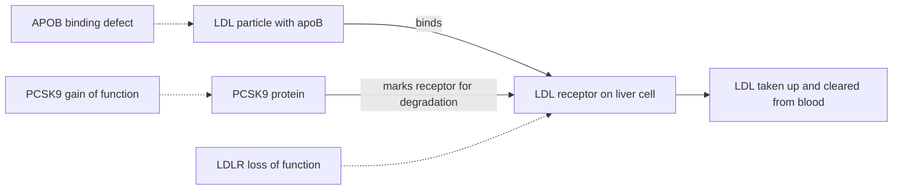

+++
summary = "Explain how genes influence coronary artery disease and cardiomyopathy, from rare high-impact variants in LDLR, APOB and PCSK9 to common loci like 9p21 and LPA, and how variants are classified for clinical use."
+++

# The Genetics of Heart Disease

Our running goal is to predict coronary artery disease (CAD) risk from DNA. Before building a model, we should know what the model is supposed to find. What does genetics actually contribute to heart disease? Which genes are well established, how big are their effects, and how do clinicians decide whether a variant matters?

The short answer is that heart disease genetics has **two layers**. A small number of people carry a **rare variant with a large effect**, such as a variant causing familial hypercholesterolemia, which can raise CAD risk several-fold on its own. Everyone carries a large number of **common variants with tiny effects**, which add up to a **polygenic** risk. A good model must handle both, and must also respect the large role of environment and behaviour. This chapter sticks to findings that are well replicated and widely accepted.

> [!CAUTION]
> This chapter is educational. It is not medical advice and is not a substitute for assessment by a clinician or genetic counsellor. Genetic risk is probabilistic; carrying a risk variant does not mean a person will develop disease, and not carrying one does not mean they will not.

## Key ideas

### CAD biology in one page

**Coronary arteries** supply the heart muscle with blood. In **atherosclerosis**, fatty, inflamed deposits called **plaques** build up within the artery wall over decades:

1. Cholesterol in the blood is carried in **lipoprotein** particles. Particles containing **apolipoprotein B** (apoB), most of all **LDL** (low-density lipoprotein), can enter the artery wall and become trapped there.
2. Trapped lipoproteins are modified and trigger an immune response. Immune cells (macrophages) engulf them and become lipid-laden "foam cells".
3. A plaque grows, with a lipid-rich core and a fibrous cap. It can narrow the artery and cause chest pain on exertion (**angina**).
4. If a plaque ruptures or erodes, a blood clot can form and block the artery, starving heart muscle of oxygen: a **myocardial infarction** (heart attack).

The evidence that LDL **causes** atherosclerosis is unusually strong. It comes from genetics (people with lifelong genetically high or low LDL), from prospective cohort studies and from randomised trials of LDL-lowering drugs, and was summarised in a European Atherosclerosis Society consensus statement (Ference et al., 2017). A key idea from the genetic evidence is that **risk depends on cumulative exposure**: the level of LDL multiplied by the number of years it has been elevated.

Major non-genetic risk factors include age, male sex, smoking, high blood pressure, diabetes, high LDL cholesterol, obesity and physical inactivity. Clinical risk calculators combine these.

### Heritability

CAD clusters in families. Twin studies estimate that a substantial fraction of the variation in CAD liability is heritable, with estimates often around 40–50%. Heritability is a population statistic. It says how much of the **variation** in a population is associated with genetic differences, not how much of one person's disease is "caused by genes", and it can change when the environment changes.

### Monogenic versus polygenic

| | Monogenic | Polygenic |
|---|---|---|
| Number of variants | one (or two) in a single gene | thousands to millions across the genome |
| Frequency | rare (typically well under 1%) | common (most have MAF > 1%) |
| Effect per variant | large | tiny (odds ratios mostly near 1.0–1.2) |
| Inheritance | Mendelian patterns, e.g. autosomal dominant | no simple pattern; continuous risk |
| How found | family studies, sequencing | GWAS in very large cohorts |
| Example in heart disease | familial hypercholesterolemia | polygenic risk score for CAD |

The two are not separate worlds. A monogenic variant acts against a polygenic background, and people at the top of the polygenic distribution can have risk comparable to monogenic carriers, as discussed in [GWAS and polygenic risk scores](../../genomics-foundations/gwas-and-polygenic-risk-scores/).

### Penetrance and expressivity

**Penetrance** is the probability that a person carrying a disease variant shows the disease (or trait):

$$
\text{penetrance} = P(\text{disease} \mid \text{carrier}).
$$

It is a conditional probability, so the tools of [probability and Bayes' theorem](../../probability-and-statistics/probability-and-bayes-theorem/) apply directly. Penetrance for heart disease is usually **incomplete** (less than 100%) and **age-dependent**: a carrier may be unaffected at 30 but affected at 60. **Variable expressivity** means carriers who are affected can differ in severity. Both arise from other genes, environment and chance. Penetrance estimated in families selected because many relatives were affected tends to be higher than penetrance estimated in population cohorts, because the families were chosen for severity.

## Familial hypercholesterolemia

**Familial hypercholesterolemia** (FH) is the most common monogenic cause of premature CAD. Heterozygous FH affects roughly 1 in 250 people in many populations, with estimates ranging from about 1 in 200 to 1 in 500 depending on population and method. It is **autosomal dominant**: one altered copy is enough, so each child of a heterozygous carrier has a 50% chance of inheriting it. Carriers have high LDL from birth, so their cumulative LDL exposure builds up much faster, and untreated they have a markedly increased risk of early CAD. Effective LDL-lowering treatment substantially reduces that risk, which is why finding carriers matters.

Three genes account for most genetically confirmed cases, all in the same pathway for clearing LDL from the blood:

- **LDLR** encodes the **LDL receptor**, which sits on liver cells, binds LDL particles and pulls them out of the circulation. Loss-of-function variants in *LDLR* are by far the most common cause of FH. Fewer receptors means LDL lingers in the blood.
- **APOB** encodes **apolipoprotein B**, the protein on the LDL particle that the receptor recognises. Certain variants in the receptor-binding region of apoB weaken binding, with the same consequence.
- **PCSK9** encodes a protein that binds the LDL receptor and directs it to be degraded. **Gain-of-function** variants in *PCSK9* make it too active, destroying receptors, and cause FH (Abifadel et al., 2003). They are a small minority of cases.

The *PCSK9* story is a landmark for genetics-led drug discovery. People carrying **loss-of-function** variants in *PCSK9* have lifelong lower LDL and a lower risk of coronary heart disease (Cohen et al., 2006). That observation helped motivate PCSK9-inhibiting drugs, which lower LDL cholesterol and reduce cardiovascular events in trials.



Two important lessons from large sequencing studies:

1. **Most people with very high LDL do not have a detectable FH variant.** Among people with LDL cholesterol of 190 mg/dL (about 4.9 mmol/L) or above, only a small minority, under 2% in one large analysis, carried an FH variant (Khera et al., 2016). Many of the rest have a high polygenic load for LDL.
2. **At the same measured LDL, carriers had higher CAD risk than non-carriers** in that analysis. A plausible explanation is cumulative exposure: carriers have had high LDL since birth.

**Homozygous FH**, with two altered copies, is much rarer and far more severe, with extremely high LDL and atherosclerosis beginning in childhood.

> [!NOTE]
> **Cascade testing.** Because FH is dominant and the prior probability for a first-degree relative of a carrier is about 50%, testing relatives of a known carrier finds new carriers efficiently. This is the high-prior setting of the diagnostic-testing example in [probability and Bayes' theorem](../../probability-and-statistics/probability-and-bayes-theorem/).

## Common variants: the 9p21 locus

In 2007, several independent genome-wide association studies reported the same signal for CAD on chromosome **9p21** (for example McPherson et al., 2007; Helgadottir et al., 2007; and the Wellcome Trust Case Control Consortium, 2007). It remains one of the most robustly replicated common-variant associations for CAD.

Key features:

- The risk haplotype is **very common**: in European-ancestry populations, roughly half of all chromosomes carry it.
- The effect per copy is **modest**, with odds ratios commonly reported in the range of about 1.2–1.3 per risk allele.
- The association with CAD appears to be **largely independent of LDL cholesterol** and other traditional risk factors.
- The core risk interval does **not** overlap the protein-coding sequence of any gene. It overlaps a long non-coding RNA, *ANRIL* (also called *CDKN2B-AS1*), and lies near the cell-cycle genes *CDKN2A* and *CDKN2B*. Its precise mechanism is still being worked out, with evidence pointing to effects on gene regulation in vascular cells.

9p21 is a model for what most GWAS hits look like: common, non-coding, modest effect, mechanism hard to pin down. Since 2007, CAD GWAS with hundreds of thousands of participants have identified hundreds of associated loci. Many point to lipid metabolism, blood pressure and vascular biology, and many remain unexplained.

## Lipoprotein(a) and LPA

**Lipoprotein(a)**, written Lp(a), is an LDL-like particle with an extra protein, **apolipoprotein(a)**, attached to its apoB. Apolipoprotein(a) is encoded by the gene **LPA**.

- Lp(a) levels in blood are **largely determined by genetics** and remain fairly stable through life, so lifestyle changes do little to them.
- *LPA* contains a variable number of copies of a repeated protein domain called **kringle IV type 2**. Smaller numbers of repeats produce smaller apolipoprotein(a) isoforms, which are associated with **higher** Lp(a) levels.
- Genetic variants at *LPA* that raise Lp(a) levels are strongly associated with CAD (Clarke et al., 2009). Mendelian randomization studies support a **causal** role for Lp(a) in CAD.
- Elevated Lp(a) is common; a frequently quoted figure is around one in five people, with the distribution differing between ancestry groups.

For modelling, *LPA* is a warning about measurement. The kringle repeat region is hard to capture with short-read sequencing and with SNP arrays, so a SNP-based model may only partly capture this strong genetic risk factor (see [sequencing data](../../genomics-foundations/sequencing-data/)). Measuring Lp(a) in blood directly, once in a lifetime, is a common recommendation in recent guidelines and may be a better feature.

## Cardiomyopathies

Not all genetic heart disease is atherosclerotic. **Cardiomyopathies** are diseases of the heart muscle itself, and many are monogenic.

- **Hypertrophic cardiomyopathy (HCM)** is abnormal thickening of the heart muscle. It is often inherited in an autosomal dominant pattern, and is commonly cited as affecting around 1 in 500 people. It is usually caused by variants in genes encoding the **sarcomere**, the contractile machinery of muscle. The two most commonly implicated genes are **MYH7** (β-myosin heavy chain) and **MYBPC3** (cardiac myosin-binding protein C).
- **Dilated cardiomyopathy (DCM)** is enlargement and weakening of the left ventricle. Truncating variants in **TTN**, which encodes the giant muscle protein titin, are the most common genetic finding in DCM (Herman et al., 2012). However, *TTN* truncating variants are also found in a small percentage of people without DCM, so their location within the gene and the clinical context matter a great deal in interpretation.

Cardiomyopathies matter for our project because "heart disease" in a dataset may mix CAD with heart failure and cardiomyopathy. These have different genetic architectures, and a model trained on a mixed label may learn a blurred signal. Defining the outcome precisely is a theme of [framing the problem](../../capstone-heart-disease-risk/framing-the-problem/).

## Variant classification: ACMG categories and ClinVar

When sequencing finds a rare variant in *LDLR* or *MYH7*, how do we decide whether it causes disease? In 2015 the American College of Medical Genetics and Genomics (ACMG) and the Association for Molecular Pathology (AMP) published standard guidelines (Richards et al., 2015). They define five categories:

| Category | Meaning |
|---|---|
| **Pathogenic** | disease-causing, with high confidence |
| **Likely pathogenic** | disease-causing with high, but lower, confidence (often described as greater than 90% certainty) |
| **Uncertain significance (VUS)** | not enough evidence either way |
| **Likely benign** | probably not disease-causing |
| **Benign** | not disease-causing |

Evidence is sorted into types, each with a strength. Pathogenic evidence comes at **very strong**, **strong**, **moderate** or **supporting** levels, and benign evidence at **stand-alone**, **strong** or **supporting**. Examples of evidence types:

- the variant is predicted to destroy the gene product (nonsense, frameshift, canonical splice site) in a gene where loss of function causes the disease;
- it is absent or extremely rare in large population databases such as gnomAD (a variant common in healthy people cannot cause a rare, highly penetrant disease);
- it segregates with disease in families;
- functional experiments show a damaging effect;
- computational predictors agree that it is damaging (supporting evidence only).

Combining rules then assign a category. For example, one strong piece of pathogenic evidence plus one or two moderate pieces gives "likely pathogenic". Expert panels (coordinated by ClinGen) refine the rules for specific genes and diseases, including FH and cardiomyopathy genes.

**ClinVar** is a public archive, run by the US National Center for Biotechnology Information, where laboratories and expert panels submit their classifications. It records each submission with its evidence and a **review status**, and flags variants where submitters disagree ("conflicting interpretations"). It is an essential resource, but not ground truth: classifications change as evidence accumulates, and many variants are VUS.

### A Bayesian reading of the rules

Tavtigian et al. (2018) showed that the ACMG/AMP combining rules can be modelled with the odds form of Bayes' theorem. Start from a prior probability of pathogenicity of 0.10. Each piece of evidence multiplies the odds by a factor that depends only on its strength: **very strong** by 350, and the weaker levels by successive square roots: **strong** $350^{1/2} \approx 18.7$, **moderate** $350^{1/4} \approx 4.33$, **supporting** $350^{1/8} \approx 2.08$. Benign evidence divides the odds in the same way. The posterior probability maps to categories: above 0.99 pathogenic, 0.90–0.99 likely pathogenic, 0.10–0.90 VUS, 0.001–0.10 likely benign, below 0.001 benign. This framework reproduces most of the original combining rules, and it makes the logic explicit: classification is evidence accumulation on the log-odds scale.

## Gene–environment interplay

Genes do not act in a vacuum.

- **Exposure accumulates.** In FH, the harm comes from LDL over time, so early treatment changes the outcome. Genetic risk is a reason to act, not a fate.
- **Lifestyle matters at every level of genetic risk.** In a study of over 55,000 participants in four cohorts, a favourable lifestyle (no smoking, no obesity, regular physical activity, a healthy diet) was associated with substantially lower CAD risk, by roughly half in relative terms, within every category of polygenic risk (Khera et al., 2016, *NEJM*).
- **Treatment benefit can vary with genetic risk.** Analyses of statin trials found larger relative and absolute risk reductions in participants with higher genetic risk scores (Mega et al., 2015).
- **Mendelian randomization** uses genetic variants as natural experiments to test whether a risk factor causes disease. Because alleles are assigned at conception, they are much less confounded by lifestyle. This approach supports a causal role for LDL cholesterol and Lp(a). By contrast, variants that raise HDL cholesterol alone did not appear to lower myocardial infarction risk (Voight et al., 2012), challenging the idea that raising HDL is protective.

## Worked example

**(a) Dominant inheritance.** A woman is heterozygous for a pathogenic *LDLR* variant; her partner is not a carrier. Each child has probability $1/2$ of inheriting it, independently. With three children:

- $P(\text{no carriers}) = (1/2)^3 = 1/8$;
- $P(\text{at least one carrier}) = 1 - 1/8 = 7/8$;
- expected number of carriers $= 3 \times 1/2 = 1.5$.

**(b) A common locus under a multiplicative model.** Suppose, for illustration, a 9p21-like risk allele with frequency $0.5$ and a per-allele odds ratio of $1.25$. With dosage $g$, the odds ratio relative to dosage 0 is $1.25^{g}$:

| Dosage | Frequency (HWE) | Odds ratio vs dosage 0 |
|---|---|---|
| 0 | $0.25$ | $1$ |
| 1 | $0.50$ | $1.25$ |
| 2 | $0.25$ | $1.5625$ |

Three-quarters of the population carries at least one risk allele, so this locus affects far more people than FH does. Yet even the highest-risk genotype has an odds ratio of only about 1.6. Compare FH, which affects about 1 in 250 people but carries a much larger relative risk. Add up a few hundred loci like this one and you get a polygenic score, whose top tail can rival a monogenic effect.

**(c) Classifying a variant.** A rare *MYBPC3* variant has one **strong** and two **moderate** pieces of pathogenic evidence, and no benign evidence. In the Bayesian framework:

- prior odds $= 0.10/0.90 = 1/9$;
- likelihood ratio $= 18.7 \times 4.33 \times 4.33 \approx 350$ (since $4.33^2 \approx 18.7$ and $18.7^2 \approx 350$);
- posterior odds $\approx 350/9 \approx 38.9$, so $P \approx 38.9/39.9 \approx 0.975$.

That falls in 0.90–0.99: **likely pathogenic**, matching the ACMG rule "one strong plus one or two moderate".

## In code

The first snippet is a **toy, synthetic** simulation (the coefficients are chosen for illustration, not estimated from data). It mixes rare FH carriers with a polygenic LDL background and shows two lessons of this chapter: most people with very high LDL are not monogenic carriers, and carriers have higher CAD risk at the same measured LDL.

```python
import numpy as np

rng = np.random.default_rng(2024)
n = 500_000

# Illustrative, synthetic model (numbers chosen for teaching, not estimated from data)
fh = rng.random(n) < 1 / 250                    # monogenic FH variant carriers
prs = rng.normal(size=n)                         # standardised polygenic score for LDL
ldl = 3.3 + 0.4 * prs + 1.8 * fh + rng.normal(scale=0.85, size=n)   # mmol/L

severe = ldl >= 4.9                              # roughly 190 mg/dL
print(f"carriers: {fh.sum()}  |  people with LDL >= 4.9: {severe.sum()}")
print(f"fraction of severe-LDL group carrying FH variant: {fh[severe].mean():.3f}")
print(f"fraction of carriers with LDL >= 4.9 (penetrance for severe LDL): {severe[fh].mean():.3f}")
print(f"mean PRS in severe-LDL non-carriers: {prs[severe & ~fh].mean():.2f} SD")

# CAD by age 60: log-odds rises with LDL; carriers carry extra risk from lifelong exposure
logit = -4.2 + 0.6 * (ldl - 3.3) + 0.8 * fh
cad = rng.random(n) < 1 / (1 + np.exp(-logit))
print(f"CAD risk: carriers {cad[fh].mean():.3f}  non-carriers {cad[~fh].mean():.3f}")
for lo, hi in [(4.9, 5.5), (5.5, 6.5)]:
    band = (ldl >= lo) & (ldl < hi)
    print(f"LDL {lo}-{hi}: CAD risk carriers {cad[band & fh].mean():.3f} "
          f"(n={np.sum(band & fh)}), non-carriers {cad[band & ~fh].mean():.3f} (n={np.sum(band & ~fh)})")
```

```text
carriers: 1935  |  people with LDL >= 4.9: 23234
fraction of severe-LDL group carrying FH variant: 0.047
fraction of carriers with LDL >= 4.9 (penetrance for severe LDL): 0.564
mean PRS in severe-LDL non-carriers: 0.90 SD
CAD risk: carriers 0.096  non-carriers 0.017
LDL 4.9-5.5: CAD risk carriers 0.095 (n=444), non-carriers 0.043 (n=17260)
LDL 5.5-6.5: CAD risk carriers 0.122 (n=515), non-carriers 0.067 (n=4708)
```

In this toy world, fewer than 5% of people with severe LDL are carriers (real data shows an even smaller share), and non-carriers with severe LDL sit about 0.9 SD up the polygenic distribution. Only 56% of carriers reach the severe threshold: incomplete penetrance for the trait. Carrier status adds risk on top of measured LDL because we built that into the simulation. The real-world observation of the same pattern is what motivated the cumulative-exposure explanation.

The second snippet implements the Bayesian reading of the ACMG/AMP evidence strengths.

```python
import numpy as np

# Bayesian reading of the ACMG/AMP evidence strengths (Tavtigian et al., 2018):
# each strength level multiplies the odds of pathogenicity by a fixed factor.
O_VERY_STRONG = 350.0
ODDS = {
    "supporting": O_VERY_STRONG ** (1 / 8),
    "moderate":   O_VERY_STRONG ** (1 / 4),
    "strong":     O_VERY_STRONG ** (1 / 2),
    "very_strong": O_VERY_STRONG,
}
PRIOR = 0.10

def posterior(pathogenic=(), benign=()):
    """Combine evidence: pathogenic items multiply the odds, benign items divide them."""
    log_odds = np.log(PRIOR / (1 - PRIOR))
    log_odds += sum(np.log(ODDS[s]) for s in pathogenic)
    log_odds -= sum(np.log(ODDS[s]) for s in benign)
    return 1 / (1 + np.exp(-log_odds))

def category(p):
    if p > 0.99:  return "pathogenic"
    if p >= 0.90: return "likely pathogenic"
    if p > 0.10:  return "uncertain significance"
    if p >= 0.001: return "likely benign"
    return "benign"

for s, o in ODDS.items():
    print(f"{s:12s} odds factor {o:7.2f}")

cases = {
    "1 very strong + 1 moderate":             (["very_strong", "moderate"], []),
    "1 strong + 2 moderate":                  (["strong", "moderate", "moderate"], []),
    "2 moderate + 1 supporting":              (["moderate", "moderate", "supporting"], []),
    "1 strong + 1 supporting benign":         (["strong"], ["supporting"]),
}
for name, (path, ben) in cases.items():
    p = posterior(path, ben)
    print(f"{name:42s} P(pathogenic) = {p:.3f} -> {category(p)}")
```

```text
supporting   odds factor    2.08
moderate     odds factor    4.33
strong       odds factor   18.71
very_strong  odds factor  350.00
1 very strong + 1 moderate                 P(pathogenic) = 0.994 -> pathogenic
1 strong + 2 moderate                      P(pathogenic) = 0.975 -> likely pathogenic
2 moderate + 1 supporting                  P(pathogenic) = 0.812 -> uncertain significance
1 strong + 1 supporting benign             P(pathogenic) = 0.500 -> uncertain significance
```

Notice that this is exactly the "add log-likelihood ratios" structure of [probability and Bayes' theorem](../../probability-and-statistics/probability-and-bayes-theorem/), and of logistic regression.

## Biomedical connection

What this means for designing the DNA → CAD model:

- **Two kinds of signal, two kinds of feature.** Rare, high-impact variants (FH genes) are best captured by explicit features such as "carries a pathogenic or likely pathogenic *LDLR*/*APOB*/*PCSK9* variant", built from sequencing plus curated classification. Common-variant risk is best captured by a polygenic score ([next chapter](../../genomics-foundations/gwas-and-polygenic-risk-scores/)). A combined model can use both.
- **Some genetic risk is better measured as a phenotype.** Measured LDL cholesterol and Lp(a) summarise genetic and non-genetic influences on key causal pathways. Including them can help prediction, but be careful: if the goal is to estimate genetic risk early in life, before LDL is measured, the features must reflect that.
- **Label definitions matter.** Separate CAD from cardiomyopathy and heart failure when the question is about atherosclerosis.
- **Classifications evolve.** If your model uses ClinVar labels, record the release date. Re-running with a later release can change features for the same person.

> [!CAUTION]
> Reporting genetic risk to people carries responsibilities: results should be clinically validated, interpreted in context (family history, measured lipids) and delivered with access to genetic counselling. A VUS should not be used to make clinical decisions. Treatment decisions belong to clinicians and patients.

## Practice

1. Define penetrance as a conditional probability. In a cohort, 400 carriers of a variant are followed to age 60 and 120 develop CAD. Among 40,000 non-carriers, 2,000 develop CAD. Estimate the penetrance to age 60 and the relative risk.

<details>
<summary>Answer</summary>

Penetrance $= P(\text{CAD by 60} \mid \text{carrier}) \approx 120/400 = 0.30$. Risk in non-carriers $= 2000/40{,}000 = 0.05$. Relative risk $= 0.30/0.05 = 6$.

</details>

2. Explain why both loss-of-function variants in *LDLR* and gain-of-function variants in *PCSK9* raise LDL cholesterol.

<details>
<summary>Answer</summary>

Both reduce the number of working LDL receptors on liver cells. *LDLR* loss of function means fewer or defective receptors are made. *PCSK9* normally sends receptors to be degraded; a gain-of-function variant does this more aggressively, so fewer receptors remain. Either way, less LDL is cleared from the blood.

</details>

3. A parent has heterozygous FH and the other parent does not. What is the probability that exactly one of their two children is a carrier?

<details>
<summary>Answer</summary>

Binomial with $n = 2$, $p = 1/2$: $\binom{2}{1}(1/2)(1/2) = 1/2$.

</details>

4. Using the Bayesian ACMG framework (prior 0.10; supporting ×2.08, moderate ×4.33, strong ×18.7), classify a variant with one moderate and four supporting pieces of pathogenic evidence.

<details>
<summary>Answer</summary>

Likelihood ratio $= 4.33 \times 2.08^4$. Since $2.08 = 350^{1/8}$ and $4.33 = 350^{1/4}$, this is $350^{1/4 + 4/8} = 350^{3/4} \approx 80.9$. Posterior odds $\approx 80.9/9 \approx 8.99$, so $P \approx 8.99/9.99 \approx 0.900$. This sits right on the 0.90 boundary between VUS and likely pathogenic. The original ACMG rule ("one moderate and at least four supporting") calls it likely pathogenic; borderline cases like this are why gene-specific expert panels refine the rules.

</details>

5. A colleague says: "The 9p21 risk allele is carried by most people, so it must be an important target for genetic screening." What is wrong with this reasoning?

<details>
<summary>Answer</summary>

Being common makes the variant a poor discriminator, not a strong one. With a per-allele odds ratio around 1.2–1.3, carriers and non-carriers have similar absolute risks, so knowing someone's 9p21 genotype alone barely changes their predicted risk. Its value lies in contributing, with many other loci, to a polygenic score, and in what it may reveal about biology.

</details>

## Further reading

- Ference, B. A. et al. (2017). Low-density lipoproteins cause atherosclerotic cardiovascular disease. 1. Evidence from genetic, epidemiologic, and clinical studies. A consensus statement from the European Atherosclerosis Society Consensus Panel. *European Heart Journal*, 38(32), 2459–2472.
- Abifadel, M. et al. (2003). Mutations in PCSK9 cause autosomal dominant hypercholesterolemia. *Nature Genetics*, 34, 154–156.
- Cohen, J. C., Boerwinkle, E., Mosley, T. H. & Hobbs, H. H. (2006). Sequence variations in PCSK9, low LDL, and protection against coronary heart disease. *New England Journal of Medicine*, 354, 1264–1272.
- Khera, A. V. et al. (2016). Diagnostic yield and clinical utility of sequencing familial hypercholesterolemia genes in patients with severe hypercholesterolemia. *Journal of the American College of Cardiology*, 67(22), 2578–2589.
- McPherson, R. et al. (2007). A common allele on chromosome 9 associated with coronary heart disease. *Science*, 316, 1488–1491.
- Helgadottir, A. et al. (2007). A common variant on chromosome 9p21 affects the risk of myocardial infarction. *Science*, 316, 1491–1493.
- Clarke, R. et al. (2009). Genetic variants associated with Lp(a) lipoprotein level and coronary disease. *New England Journal of Medicine*, 361, 2518–2528.
- Herman, D. S. et al. (2012). Truncations of titin causing dilated cardiomyopathy. *New England Journal of Medicine*, 366, 619–628.
- Richards, S. et al. (2015). Standards and guidelines for the interpretation of sequence variants: a joint consensus recommendation of the American College of Medical Genetics and Genomics and the Association for Molecular Pathology. *Genetics in Medicine*, 17(5), 405–424.
- Tavtigian, S. V. et al. (2018). Modeling the ACMG/AMP variant classification guidelines as a Bayesian classification framework. *Genetics in Medicine*, 20(9), 1054–1060.
- Khera, A. V. et al. (2016). Genetic risk, adherence to a healthy lifestyle, and coronary disease. *New England Journal of Medicine*, 375, 2349–2358.
- Voight, B. F. et al. (2012). Plasma HDL cholesterol and risk of myocardial infarction: a mendelian randomisation study. *The Lancet*, 380(9841), 572–580.
