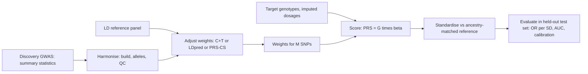

+++
summary = "Run a genome-wide association study as one regression per SNP, read Manhattan and QQ plots, build and evaluate a polygenic risk score in numpy, and explain why PRS accuracy depends on ancestry."
+++

# GWAS and Polygenic Risk Scores

The previous chapter showed that most of the inherited risk of coronary artery disease (CAD) is **polygenic**: spread across many common variants, each with a tiny effect. To use that risk we need two things. A **genome-wide association study** (GWAS) estimates the effect of each variant. A **polygenic risk score** (PRS) adds those effects up for one person into a single number.

A PRS is the simplest possible "DNA → heart disease" model: a linear model on dosages. It is the baseline every deep-learning model in this book has to beat, and it is a powerful one. This chapter builds it from scratch, evaluates it, and is honest about its limits.

Prerequisites: regression ideas (developed fully in [linear and logistic regression](../../classical-machine-learning/linear-and-logistic-regression/)), [hypothesis testing and multiple comparisons](../../probability-and-statistics/hypothesis-testing-and-multiple-comparisons/), and linkage disequilibrium from [DNA, genes and variation](../../genomics-foundations/dna-genes-and-variation/).

## Key ideas

### A GWAS is one regression per SNP

We have $n$ people, a genotype matrix $\mathbf{G} \in \{0,1,2\}^{n \times m}$ with $m$ SNPs (often millions after imputation), an outcome $y_i$ (CAD yes/no, or a quantitative trait such as LDL cholesterol), and covariates. For **each** SNP $j$ separately, fit

$$
\operatorname{logit} P(y_i = 1) = \alpha + \beta_j\, g_{ij} + \gamma_1\,\text{age}_i + \gamma_2\,\text{sex}_i + \sum_{k=1}^{K} \delta_k\,\text{PC}_{ik},
$$

where $\operatorname{logit}(p) = \log\frac{p}{1-p}$. For a quantitative trait, use linear regression with the same right-hand side. The output for SNP $j$ is the estimate $\hat\beta_j$ (a **log odds ratio per allele**), its standard error $\text{SE}_j$, the statistic $z_j = \hat\beta_j / \text{SE}_j$ and a p-value. Collected over all SNPs, these are the **summary statistics**, the currency of statistical genetics. Large consortia share summary statistics rather than individual-level data.

Why these covariates?

- **Age and sex** affect CAD risk strongly. Adjusting for them removes noise and so increases power.
- **Principal components (PCs)** of the genotype matrix capture **ancestry**. If allele frequencies and disease rates both differ between ancestry groups (for example because of different environments), every SNP whose frequency differs between groups will look associated with disease. This **population stratification** is the classic GWAS confounder. The top PCs of standardised genotypes (see [eigenvectors, SVD and PCA](../../linear-algebra/eigenvectors-svd-and-pca/)) track ancestry, and including them as covariates removes most of the problem.

Modern tools (such as BOLT-LMM and REGENIE) use **mixed models** that also handle relatedness and fine-scale structure, but the one-regression-per-SNP picture is still the right mental model.

### Manhattan plots

A **Manhattan plot** puts each SNP at its genomic position on the x-axis (chromosomes 1 to 22 side by side, in alternating colours) and $-\log_{10} p$ on the y-axis. Most SNPs form a low band of noise. Associated loci rise as "skyscrapers", towers of SNPs, because LD makes all variants near a causal one show association too. A horizontal line at $-\log_{10}(5\times10^{-8}) \approx 7.3$ marks genome-wide significance.

### QQ plots and genomic inflation

A **QQ plot** compares observed p-values with what we expect if every SNP were null. Sort the $m$ p-values; plot $-\log_{10}$ of the $k$-th smallest against $-\log_{10}\frac{k}{m+1}$, the expected value under a uniform distribution.

- Points on the diagonal: behaves like the null.
- Points rising above the diagonal only at the far right: a few true associations.
- The whole curve lifted off the diagonal from early on: systematic **inflation**, often from stratification or cryptic relatedness, though highly polygenic traits in very large samples inflate the curve genuinely too.

The **genomic inflation factor** summarises the curve:

$$
\lambda_{GC} = \frac{\operatorname{median}(z_j^2)}{0.455},
$$

where $0.455$ is the median of a $\chi^2_1$ distribution. Under the null, $\lambda_{GC} \approx 1$.

### LD and fine-mapping

Because of LD, a GWAS peak usually contains dozens of significant SNPs, and the most significant one is not necessarily causal. **Fine-mapping** methods (for example FINEMAP and SuSiE) model the joint effects of SNPs in a region, using the LD matrix, and output a **credible set**: a small set of SNPs that contains the causal variant with, say, 95% probability. Functional data (is the SNP in an enhancer active in artery cells?) can further prioritise variants. This is where sequence-based deep models, which predict a variant's regulatory effect, become useful.

## From GWAS to a polygenic risk score

### The score

> [!IMPORTANT]
> **Polygenic risk score** for person $i$, using weights $\hat\beta_j$ from a GWAS:
> $$\text{PRS}_i = \sum_{j \in S} \hat\beta_j\, g_{ij} \qquad\text{or, in matrix form,}\qquad \mathbf{s} = \mathbf{G}_S\,\hat{\boldsymbol\beta}_S$$
> with $\mathbf{G}_S$ of shape $(n, |S|)$, $\hat{\boldsymbol\beta}_S$ of shape $(|S|,)$ and $\mathbf{s}$ of shape $(n,)$. Here $S$ is the set of SNPs included.

If the weights are log odds ratios, the PRS is on the log-odds scale: it is the genetic part of a logistic regression's linear predictor. The interesting questions are **which SNPs** to include and **how to adjust** their weights, because the raw GWAS estimates are noisy and correlated through LD.

### Why not just use every SNP's raw estimate?

Two problems:

1. **LD double counting.** If ten SNPs are in strong LD with one causal variant, all ten carry roughly the same marginal $\hat\beta$. Adding all ten counts that effect about ten times.
2. **Noise and the winner's curse.** With millions of SNPs, most $\hat\beta_j$ are pure noise. The ones that look largest are partly large by chance and overestimate the truth (see [hypothesis testing](../../probability-and-statistics/hypothesis-testing-and-multiple-comparisons/)).

### Clumping and thresholding (C+T)

The classic fix has two steps:

1. **Clumping.** Sort SNPs by p-value. Take the most significant as an **index SNP**, then remove every nearby SNP (commonly within a few hundred kilobases) in LD with it above some $r^2$ (commonly 0.1). Repeat with the next most significant remaining SNP. The survivors are roughly independent.
2. **Thresholding.** Keep index SNPs with $p < p_T$. Try a grid of thresholds ($5\times10^{-8}, 10^{-6}, 10^{-4}, 10^{-2}, 1$) and pick the one that predicts best in a **separate validation set**, never the final test set.

C+T is simple and transparent, but it throws information away: a dropped SNP may carry independent signal, and the kept weights are not shrunk.

### Bayesian shrinkage: LDpred and PRS-CS

A better approach treats the true effects as random and asks for their **posterior mean** given the GWAS results.

Start with one SNP and no LD. Suppose the true effect has a prior $\beta \sim \mathcal{N}(0, \tau^2)$ (most effects are small), and the GWAS estimate is $\hat\beta \mid \beta \sim \mathcal{N}(\beta, s^2)$ with $s$ the standard error. Multiplying prior and likelihood and completing the square gives a normal posterior with mean

$$
\mathbb{E}[\beta \mid \hat\beta] = \frac{\tau^2}{\tau^2 + s^2}\,\hat\beta.
$$

The factor $\frac{\tau^2}{\tau^2+s^2} < 1$ **shrinks** the estimate towards zero. It shrinks noisy estimates (large $s$) a lot and precise ones only a little. That is exactly the correction the winner's curse needs.

Now add LD. If $\mathbf{D}$ is the LD (correlation) matrix of $M$ SNPs in a region, estimated from a reference panel, and we work with standardised genotypes, the infinitesimal version of **LDpred** (Vilhjálmsson et al., 2015) gives posterior mean effects

$$
\tilde{\boldsymbol\beta} \approx \left(\mathbf{D} + \frac{M}{N h^2}\mathbf{I}\right)^{-1} \hat{\boldsymbol\beta},
$$

where $N$ is the GWAS sample size and $h^2$ the SNP heritability. Two things happen at once: the $\mathbf{D}^{-1}$-like part **de-correlates** effects that were double counted through LD, and the $\frac{M}{Nh^2}\mathbf{I}$ term **shrinks**, like ridge regression (see [regularization](../../classical-machine-learning/regularization-and-the-bias-variance-tradeoff/)). Full LDpred uses a "spike-and-slab" prior in which only a fraction of SNPs are causal. **PRS-CS** (Ge et al., 2019) uses a **continuous shrinkage** prior that shrinks small effects strongly while leaving large ones nearly untouched. In practice both usually outperform C+T, and both use all SNPs, not a pruned subset.



### Standardising and interpreting a PRS

A raw PRS has arbitrary units. To interpret it, **standardise**: subtract the mean and divide by the standard deviation **in a reference population of matched ancestry**, giving a z-score, which maps to a percentile. Because a PRS is a sum of many small independent-ish terms, it is approximately normal by the central limit theorem ([distributions and likelihood](../../probability-and-statistics/distributions-and-likelihood/)).

If the SNPs were independent with allele frequencies $p_j$ and HWE held, the mean and variance would be

$$
\mathbb{E}[\text{PRS}] = \sum_j \hat\beta_j\,2p_j, \qquad \operatorname{Var}(\text{PRS}) = \sum_j \hat\beta_j^2\,2p_j(1-p_j).
$$

Common ways to report performance:

- **Odds ratio per standard deviation**: fit $\operatorname{logit} P(y=1) = a + b\,z$ and report $e^{b}$. Large CAD scores in European-ancestry cohorts reach hazard ratios of roughly 1.7 per SD (Inouye et al., 2018).
- **Odds ratio for the top $x\%$ versus the rest.** This is how **Khera et al. (2018)** framed their influential result: a genome-wide CAD score of about 6.6 million variants, built with LDpred, identified 8% of the UK Biobank population with at least a threefold increased risk of CAD compared with everyone else, a group about 20 times larger than the number of carriers of monogenic FH variants.
- **AUC** (discrimination) and **calibration** (do predicted risks match observed risks?), covered in [model evaluation](../../classical-machine-learning/model-evaluation/). A PRS alone usually has modest AUC. Its value is mainly in **adding** information to clinical risk factors, and in being available from birth, long before cholesterol or blood pressure rise.

> [!WARNING]
> A threefold relative risk does not mean a threefold absolute risk for an individual, and a high percentile is not a diagnosis. Absolute risk depends on age, sex, baseline risk in the population and other risk factors. Always convert relative effects to absolute risk before communicating them.

### Portability across ancestries

Most GWAS participants so far have been of European ancestry. PRS built from such GWAS predict substantially less well in other populations. Martin et al. (2019) reported that, across many traits, prediction accuracy was roughly 2-fold lower in East Asian and about 4.5-fold lower in African-ancestry individuals than in European-ancestry individuals. Reasons include:

- **LD differs** between populations. A tag SNP that is in strong LD with the causal variant in Europeans may be weakly linked in another population, so its weight is wrong there. African-ancestry genomes have, on average, shorter LD blocks.
- **Allele frequencies differ**, so the same variant explains a different share of variance, and some causal variants are common in one population and rare or absent in another.
- **Effect sizes may differ** in some cases through interactions with genetic background or environment.
- **Raw score distributions shift** between ancestries for reasons that largely reflect allele-frequency and LD differences rather than true differences in risk. A percentile must therefore be computed against an ancestry-matched reference.

Remedies include multi-ancestry GWAS, methods that combine summary statistics across populations, and, above all, recruiting diverse participants (as in All of Us and other biobanks). For our project, the lesson is concrete: **evaluate every model separately in each ancestry group** and report the differences, as in [evaluation, fairness and deployment](../../capstone-heart-disease-risk/evaluation-fairness-and-deployment/).

## Worked example

### Scoring one person

A toy five-SNP score has weights (log odds ratios per risk allele) and population allele frequencies:

| SNP | $\hat\beta_j$ | $p_j$ | Person's dosage $g_j$ | $\hat\beta_j g_j$ |
|---|---|---|---|---|
| 1 | 0.10 | 0.4 | 2 | 0.20 |
| 2 | −0.05 | 0.3 | 1 | −0.05 |
| 3 | 0.20 | 0.1 | 0 | 0.00 |
| 4 | 0.08 | 0.5 | 1 | 0.08 |
| 5 | 0.15 | 0.2 | 2 | 0.30 |

**Raw PRS:** $0.20 - 0.05 + 0 + 0.08 + 0.30 = 0.53$.

**Population mean:** $\sum \hat\beta_j\,2p_j = 0.10(0.8) - 0.05(0.6) + 0.20(0.2) + 0.08(1.0) + 0.15(0.4) = 0.08 - 0.03 + 0.04 + 0.08 + 0.06 = 0.23$.

**Population variance:** $\sum \hat\beta_j^2\,2p_j(1-p_j)$:

$$
0.01(0.48) + 0.0025(0.42) + 0.04(0.18) + 0.0064(0.50) + 0.0225(0.32) = 0.0048 + 0.00105 + 0.0072 + 0.0032 + 0.0072 = 0.02345,
$$

so the SD is $\sqrt{0.02345} \approx 0.153$.

**z-score:** $(0.53 - 0.23)/0.153 \approx 1.96$, about the **97.5th percentile**.

**Relative odds.** If the weights were the true joint log odds ratios, this person's odds would be $e^{0.53 - 0.23} = e^{0.30} \approx 1.35$ times those of a person with an average score. In this idealised case the odds ratio per SD is $e^{0.153} \approx 1.17$: the OR per SD of a score is $e^{\text{SD}}$ when the score is on the true log-odds scale. Five SNPs give a weak score, even at the 97.5th percentile.

**Absolute risk.** If an average person of this age and sex has a 5% ten-year risk, their odds are $0.05/0.95 \approx 0.0526$. Multiplying by 1.35 gives odds $\approx 0.0711$, a risk of $0.0711/1.0711 \approx 6.6\%$. A "97.5th percentile" headline translates to a 1.6 percentage-point increase.

### Shrinking an estimate

Prior $\tau = 0.1$ (so $\tau^2 = 0.01$). SNP A has $\hat\beta = 0.20$ with $s = 0.05$; SNP B has the same $\hat\beta = 0.20$ but $s = 0.10$.

- A: factor $0.01/(0.01 + 0.0025) = 0.8$, posterior mean $0.16$.
- B: factor $0.01/(0.01 + 0.01) = 0.5$, posterior mean $0.10$.

Same estimate, different trust: the noisier one is shrunk twice as hard.

## In code

We simulate a small GWAS from scratch, with two ancestry groups that differ in both allele frequencies and baseline risk, then build and evaluate a C+T polygenic score. The three blocks run in sequence as one script (they share variables). It takes roughly 15 seconds on a laptop.

**Step 1: synthetic genotypes and phenotypes.** LD is created by thresholding correlated normal variables within blocks of 10 SNPs.

```python
import numpy as np
from scipy.stats import norm

rng = np.random.default_rng(11)
n, n_blocks, block = 20_000, 100, 10           # people, LD blocks, SNPs per block
m = n_blocks * block                           # 1,000 SNPs

# Two ancestry groups with slightly different allele frequencies
pop = (rng.random(n) < 0.5).astype(int)
p_base = rng.uniform(0.05, 0.5, size=m)
p_pop = np.clip(p_base + rng.normal(0, 0.03, size=(2, m)), 0.02, 0.98)   # (2, m)

# Haplotypes with LD: threshold correlated normals (corr 0.9^distance within a block)
idx = np.arange(block)
chol = np.linalg.cholesky(0.9 ** np.abs(idx[:, None] - idx[None, :]))

def draw_haplotype():
    z = (rng.normal(size=(n, n_blocks, block)) @ chol.T).reshape(n, m)
    return (norm.cdf(z) < p_pop[pop]).astype(np.int8)            # allele present?

G = draw_haplotype() + draw_haplotype()                           # dosages, (n, m)
print("genotype matrix:", G.shape, G.dtype, "| mean dosage / 2:", (G.mean(0) / 2)[:5].round(3))

# Phenotype: 30 causal SNPs, plus age, sex and an ancestry-linked environmental effect
causal = rng.choice(m, size=30, replace=False)
beta = np.zeros(m)
beta[causal] = rng.normal(0, 0.2, size=30)                        # per-allele log-odds
age = rng.uniform(40, 70, size=n)
sex = rng.integers(0, 2, size=n)
logit = -3.0 + G @ beta + 0.05 * (age - 55) + 0.5 * sex + 0.6 * pop
y = (rng.random(n) < 1 / (1 + np.exp(-logit))).astype(int)
print(f"prevalence: {y.mean():.3f} | by group: {y[pop == 0].mean():.3f}, {y[pop == 1].mean():.3f}")
```

```text
genotype matrix: (20000, 1000) int8 | mean dosage / 2: [0.263 0.37  0.406 0.437 0.055]
prevalence: 0.095 | by group: 0.063, 0.127
```

**Step 2: the GWAS.** One logistic regression per SNP, fitted by Newton's method, with and without ancestry PCs. We measure $\lambda_{GC}$ on "unlinked" null SNPs, those in LD blocks with no causal SNP, which should show no association at all.

```python
from scipy import stats

train, test = np.arange(15_000), np.arange(15_000, n)

# Principal components of standardised genotypes capture ancestry
Gs = (G - G.mean(0)) / G.std(0)
U, S, Vt = np.linalg.svd(Gs.astype(np.float32), full_matrices=False)
pcs = U[:, :2] * S[:2]                                     # (n, 2)
print("corr(PC1, ancestry group):", round(abs(np.corrcoef(pcs[:, 0], pop)[0, 1]), 3))

def logistic_fit(X, y, iters=8):
    """Newton-Raphson for logistic regression; returns coefficients and standard errors."""
    b = np.zeros(X.shape[1])
    for _ in range(iters):
        p = 1 / (1 + np.exp(-X @ b))
        H = X.T @ (X * (p * (1 - p))[:, None])             # Fisher information
        b += np.linalg.solve(H, X.T @ (y - p))
    return b, np.sqrt(np.diag(np.linalg.inv(H)))

def gwas(covariates):
    """One logistic regression per SNP: y ~ 1 + covariates + dosage."""
    base = np.column_stack([np.ones(len(train)), covariates[train]])
    betas, ses = np.empty(m), np.empty(m)
    for j in range(m):
        X = np.column_stack([base, G[train, j]])
        b, se = logistic_fit(X, y[train])
        betas[j], ses[j] = b[-1], se[-1]
    return betas, ses, 2 * stats.norm.sf(np.abs(betas / ses))

# "Unlinked" null SNPs: in LD blocks that contain no causal SNP
unlinked = ~np.isin(np.arange(m) // block, causal // block)

cov_basic = np.column_stack([(age - 55) / 10, sex])
cov_pcs = np.column_stack([cov_basic, pcs])
for name, cov in [("age+sex", cov_basic), ("age+sex+PCs", cov_pcs)]:
    b_hat, se_hat, pvals = gwas(cov)
    chi2 = (b_hat / se_hat) ** 2
    lam = np.median(chi2[unlinked]) / stats.chi2.ppf(0.5, 1)
    hits = pvals < 5e-8
    print(f"{name:12s} lambda_GC={lam:.2f}  hits p<5e-8: {hits.sum():3d} "
          f"(causal {np.sum(hits & (beta != 0))}, in causal blocks {np.sum(hits & ~unlinked)}, "
          f"unlinked {np.sum(hits & unlinked)}); unlinked p<1e-3: {np.sum((pvals < 1e-3) & unlinked)}")
```

```text
corr(PC1, ancestry group): 0.833
age+sex      lambda_GC=2.00  hits p<5e-8:  20 (causal 11, in causal blocks 20, unlinked 0); unlinked p<1e-3: 27
age+sex+PCs  lambda_GC=1.04  hits p<5e-8:  20 (causal 9, in causal blocks 20, unlinked 0); unlinked p<1e-3: 2
```

Without PCs, null SNPs are badly inflated ($\lambda_{GC} = 2.0$) and 27 unlinked null SNPs reach $p < 10^{-3}$. With two PCs, $\lambda_{GC} \approx 1.04$ and only 2 do, close to what chance alone would produce. Note that more than half of the genome-wide hits are **non-causal SNPs in LD** with a causal one: the skyscraper effect that fine-mapping must untangle.

**Step 3: clumping, thresholding and evaluation** on the 5,000 held-out people.

```python
from sklearn.metrics import roc_auc_score

# b_hat, se_hat, pvals now hold the GWAS with age, sex and PCs (last loop iteration)
def clump(pvals, r2_max=0.1, window=10):
    """Greedy LD clumping: keep the most significant SNP, drop correlated neighbours."""
    kept, removed = [], np.zeros(m, dtype=bool)
    Gt = G[train].astype(np.float32)
    for j in np.argsort(pvals):
        if removed[j]:
            continue
        kept.append(j)
        lo, hi = max(0, j - window), min(m, j + window + 1)
        r = np.corrcoef(Gt[:, j], Gt[:, lo:hi].T)[0, 1:]
        removed[lo:hi] |= r**2 > r2_max
    return np.array(kept)

index_snps = clump(pvals)
print("index SNPs after clumping:", len(index_snps))

def evaluate(weights, label):
    prs = G[test] @ weights                                    # (n_test,)
    z = (prs - prs.mean()) / prs.std()                         # standardise
    b, se = logistic_fit(np.column_stack([np.ones(len(test)), z]), y[test])
    top = z >= np.quantile(z, 0.95)
    odds = lambda mask: y[test][mask].mean() / (1 - y[test][mask].mean())
    print(f"{label:16s} SNPs={np.count_nonzero(weights):4d}  AUC={roc_auc_score(y[test], z):.3f}  "
          f"OR per SD={np.exp(b[1]):.2f}  OR top 5% vs rest={odds(top) / odds(~top):.2f}")
    return prs

scores = {}
for thr in [5e-8, 1e-4, 1e-2, 1.0]:
    w = np.zeros(m)
    chosen = index_snps[pvals[index_snps] < thr]
    w[chosen] = b_hat[chosen]
    scores[thr] = evaluate(w, f"C+T p<{thr:g}")
evaluate(beta, "oracle (true b)")

# Raw PRS distributions differ by ancestry group: percentiles need a matched reference
for g in (0, 1):
    print(f"ancestry group {g}: mean raw PRS (p<1e-4 score) = {scores[1e-4][pop[test] == g].mean():.3f}")
```

```text
index SNPs after clumping: 202
C+T p<5e-08      SNPs=   8  AUC=0.618  OR per SD=1.57  OR top 5% vs rest=2.69
C+T p<0.0001     SNPs=  15  AUC=0.627  OR per SD=1.62  OR top 5% vs rest=3.10
C+T p<0.01       SNPs=  28  AUC=0.623  OR per SD=1.59  OR top 5% vs rest=2.55
C+T p<1          SNPs= 202  AUC=0.622  OR per SD=1.57  OR top 5% vs rest=2.78
oracle (true b)  SNPs=  30  AUC=0.650  OR per SD=1.76  OR top 5% vs rest=2.94
ancestry group 0: mean raw PRS (p<1e-4 score) = -0.517
ancestry group 1: mean raw PRS (p<1e-4 score) = -0.452
```

Things to notice:

- The **oracle** score using the true effects is the ceiling. The estimated scores fall short because of estimation noise and LD.
- The best threshold here is $10^{-4}$, but the differences between thresholds are small and noisy. We are also, strictly, choosing the threshold on the test set. A real analysis would pick it on a separate validation set.
- The "top 5% vs rest" odds ratio is itself noisy, because the top 5% is only 250 people.
- The raw score means differ between ancestry groups, so a single reference distribution would mis-assign percentiles.

## Biomedical connection

The PRS is the first real model in our pipeline, and it sets the bar:

- **Baseline.** In the capstone ([baselines: PRS and clinical models](../../capstone-heart-disease-risk/baselines-prs-and-clinical-models/)) we will compare a PRS, a clinical risk model and a combined model before trying anything deep. A neural network that cannot beat "PRS + age + sex + LDL" is not worth its complexity.
- **Linear by construction.** A PRS assumes effects add on the log-odds scale. Deep models can, in principle, capture interactions between variants and between genes and environment, but for many complex traits the evidence suggests that additive effects account for most of the common-variant signal. Interactions are a hypothesis to test, not an assumption to build in.
- **Monogenic plus polygenic.** A PRS does not capture rare FH variants ([genetics of heart disease](../../genomics-foundations/genetics-of-heart-disease/)). A combined model should include both.
- **Fairness.** Because of reduced portability, a PRS-based tool can work worse for exactly the populations under-represented in research. Report performance by ancestry, and do not deploy a score in a population where it has not been validated.

> [!CAUTION]
> A polygenic score is a probabilistic, population-level estimate. It does not diagnose disease, it explains only part of inherited risk, and its accuracy depends on ancestry. Clinical use requires validated scores, ancestry-appropriate reference distributions, conversion to absolute risk, and integration with established clinical risk factors under clinical guidance.

## Practice

1. Why does a GWAS that omits ancestry principal components often show $\lambda_{GC}$ well above 1?

<details>
<summary>Answer</summary>

If ancestry groups differ in allele frequencies and also in disease rates (for any reason, genetic or environmental), then every SNP whose frequency differs between groups becomes correlated with disease through ancestry. Many null SNPs then get inflated test statistics, lifting the median $\chi^2$ above $0.455$. PCs capture ancestry, so adjusting for them removes this confounding.

</details>

2. A PRS uses three SNPs with weights $0.2, 0.1, -0.1$, and a person has dosages $1, 2, 2$. Compute the raw PRS. If allele frequencies are $0.5, 0.5, 0.5$ and SNPs are independent, compute the z-score.

<details>
<summary>Answer</summary>

Raw PRS $= 0.2 + 0.2 - 0.2 = 0.2$. Mean $= \sum \beta_j 2p_j = 0.2 + 0.1 - 0.1 = 0.2$. So $z = 0$: exactly average. (Variance $= 0.5(0.04 + 0.01 + 0.01) = 0.03$, SD $\approx 0.173$, but the numerator is 0.)

</details>

3. With prior $\beta \sim \mathcal{N}(0, 0.05^2)$, a GWAS estimate is $\hat\beta = 0.12$ with $\text{SE} = 0.05$. What is the posterior mean? What if the SE were $0.01$?

<details>
<summary>Answer</summary>

$\tau^2 = 0.0025$. With $s = 0.05$: factor $0.0025/(0.0025 + 0.0025) = 0.5$, posterior mean $0.06$. With $s = 0.01$: factor $0.0025/(0.0025 + 0.0001) \approx 0.962$, posterior mean $\approx 0.115$.

</details>

4. A study reports that the top 8% of a PRS distribution has three times the odds of CAD of the remaining 92%. For a group in the remaining 92% with a 4% ten-year risk, what risk corresponds to three times the odds?

<details>
<summary>Answer</summary>

Odds $= 0.04/0.96 \approx 0.0417$. Times 3: $0.125$. Risk $= 0.125/1.125 \approx 0.111$, about 11.1%. Note this is not exactly three times the risk ($12\%$), because odds and risk differ.

</details>

5. Give two reasons why a PRS trained on European-ancestry GWAS might predict poorly in an African-ancestry cohort, and one thing you would do in your evaluation because of it.

<details>
<summary>Answer</summary>

Any two of: different LD patterns (tag SNPs no longer track causal variants well); different allele frequencies (variants explain different variance, some causal variants rare or absent in the discovery population); possible differences in effect sizes; imputation is less accurate with less representative reference panels. In evaluation: report discrimination and calibration separately for each ancestry group, and standardise scores against an ancestry-matched reference rather than a pooled one.

</details>

## Further reading

- Visscher, P. M. et al. (2017). 10 years of GWAS discovery: biology, function, and translation. *American Journal of Human Genetics*, 101(1), 5–22.
- Price, A. L. et al. (2006). Principal components analysis corrects for stratification in genome-wide association studies. *Nature Genetics*, 38, 904–909.
- Vilhjálmsson, B. J. et al. (2015). Modeling linkage disequilibrium increases accuracy of polygenic risk scores. *American Journal of Human Genetics*, 97(4), 576–592.
- Ge, T., Chen, C.-Y., Ni, Y., Feng, Y.-C. A. & Smoller, J. W. (2019). Polygenic prediction via Bayesian regression and continuous shrinkage priors. *Nature Communications*, 10, 1776.
- Khera, A. V. et al. (2018). Genome-wide polygenic scores for common diseases identify individuals with risk equivalent to monogenic mutations. *Nature Genetics*, 50, 1219–1224.
- Inouye, M. et al. (2018). Genomic risk prediction of coronary artery disease in 480,000 adults: implications for primary prevention. *Journal of the American College of Cardiology*, 72(16), 1883–1893.
- Martin, A. R. et al. (2019). Clinical use of current polygenic risk scores may exacerbate health disparities. *Nature Genetics*, 51, 584–591.
- Choi, S. W., Mak, T. S.-H. & O'Reilly, P. F. (2020). Tutorial: a guide to performing polygenic risk score analyses. *Nature Protocols*, 15, 2759–2772.
