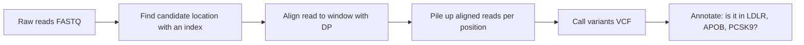

+++
summary = "Fill a dynamic-programming table by hand to find the optimal global (Needleman–Wunsch) or local (Smith–Waterman) alignment of two DNA sequences, and implement both in Python."
+++

# Sequence Alignment

Before any machine-learning model can ask "does this person carry a damaging variant in *LDLR*?", someone has to answer a humbler question: *which letters in this person's DNA correspond to which letters in the reference genome?* A sequencing machine hands us millions of short, slightly noisy fragments (reads). To find the variants in them we must line each read up against the reference, allowing for substitutions, insertions and deletions. That lining-up is **sequence alignment**, and the algorithm that solves it exactly, **dynamic programming**, is one of the most important ideas in all of computer science.

This chapter builds alignment from first principles: what we are optimising, why brute force is hopeless, how dynamic programming collapses an exponential search into a table of $m \times n$ numbers, and how to read the answer back out of that table.

## Key ideas

### Why we align

Two DNA sequences that descend from a common ancestor (or a read and the genome region it came from) differ by three kinds of events:

| Event | Example | In an alignment |
|---|---|---|
| Substitution (SNV) | `ACGT` → `ACTT` | a mismatched column |
| Insertion | `ACGT` → `ACGGT` | a letter opposite a gap `-` |
| Deletion | `ACGT` → `AGT` | a gap `-` opposite a letter |

An **alignment** writes the two sequences one above the other, inserting gap symbols so that the rows have equal length, and never placing two gaps in the same column:

```text
G A T T C
G - T A C
```

Read column by column: match G/G, deletion of A, match T/T, mismatch T/A, match C/C. The alignment is a *hypothesis* about what happened, and different hypotheses explain the same pair of sequences. We choose the most plausible one by giving each column a **score** and maximising the total.

### Edit distance

The simplest score is the **edit (Levenshtein) distance**: the minimum number of single-letter substitutions, insertions and deletions that turn $x$ into $y$. For `GATTC` → `GTAC` it is 2 (delete the `A`, substitute the second `T` by `A`). Edit distance is a *cost* we minimise; alignment scores are *rewards* we maximise. They are the same idea with the sign flipped.

### Scoring an alignment

For DNA a common scheme is:

- match: $+1$ (or a larger value)
- mismatch: $-1$
- gap (per gap symbol): $-d$, with $d > 0$, often $d = 2$

The total score is the sum over columns. Under these rules the alignment above scores $+1 - 2 + 1 - 1 + 1 = 0$.

### Why brute force fails

How many alignments of two sequences of length $n$ are there? Even counting only the ways to interleave gaps, the number grows like

$$
\binom{2n}{n} \approx \frac{4^n}{\sqrt{\pi n}}.
$$

For $n = 100$ that is about $10^{59}$. We cannot enumerate them. We need a way to reuse work.

### Dynamic programming: the key insight

Look at the **last column** of any alignment of $x_1 \ldots x_i$ with $y_1 \ldots y_j$. There are only three possibilities:

1. $x_i$ aligned to $y_j$ (match or mismatch);
2. $x_i$ aligned to a gap;
3. a gap aligned to $y_j$.

Remove that last column and what remains is an alignment of shorter prefixes. And if the whole alignment is optimal, the remainder must be an optimal alignment of those prefixes. (If it were not, swap in a better one and the total would improve, a contradiction.) This is the **principle of optimality**, and it gives a recursion.

Let $F(i, j)$ be the best score for aligning the first $i$ letters of $x$ with the first $j$ letters of $y$. With substitution score $s(a, b)$ and gap penalty $d$:

> [!IMPORTANT]
> **Needleman–Wunsch recurrence (global alignment)**
> $$F(i,j) = \max \begin{cases} F(i-1,\,j-1) + s(x_i, y_j) & \text{diagonal: (mis)match} \\ F(i-1,\,j) - d & \text{up: } x_i \text{ against a gap} \\ F(i,\,j-1) - d & \text{left: gap against } y_j \end{cases}$$
> with boundary conditions $F(0,0) = 0$, $F(i,0) = -i\,d$, $F(0,j) = -j\,d$. The optimal score is $F(m, n)$.

The boundaries say: aligning $i$ letters against nothing costs $i$ gaps.

We fill the table row by row; every cell only needs its three neighbours above, left and diagonally above-left, which are already computed. That reuse is the whole trick: each of the $(m+1)(n+1)$ cells is computed once, in constant time.

### Traceback

The table gives the best *score*. To recover the *alignment*, start at $(m, n)$ and ask which of the three cases produced the value. Step to that neighbour and emit the corresponding column. Repeat until you reach $(0, 0)$, then reverse the columns. When two moves tie, both lead to equally good (co-optimal) alignments.

### Complexity

| Resource | Cost | Why |
|---|---|---|
| Time | $O(mn)$ | $(m+1)(n+1)$ cells, 3 comparisons each |
| Memory (score only) | $O(\min(m, n))$ | keep only the previous row |
| Memory (with traceback) | $O(mn)$ | store the whole table (Hirschberg's trick reduces this to linear) |

Aligning a 150-letter read to a 1,000-letter window is $1.5 \times 10^5$ cells: trivial. Aligning that read against the whole 3.1-billion-letter genome would be about $5 \times 10^{11}$ cells per read, and there are hundreds of millions of reads. That is why the [next chapter](../../bioinformatics-algorithms/indexing-and-read-mapping/) is about *indexing*: we use an index to find a small candidate window, then run dynamic programming only there.

### Local alignment: Smith–Waterman

Global alignment forces every letter of both sequences into the alignment. Often we want something else: the best-matching *pieces*. A read might contain adapter sequence at one end, or we might look for a conserved domain inside two otherwise unrelated proteins. **Smith–Waterman** changes the recurrence in two small ways:

> [!IMPORTANT]
> **Smith–Waterman recurrence (local alignment)**
> $$H(i,j) = \max \begin{cases} 0 \\ H(i-1,\,j-1) + s(x_i, y_j) \\ H(i-1,\,j) - d \\ H(i,\,j-1) - d \end{cases}$$
> with $H(i, 0) = H(0, j) = 0$. The answer is the **largest cell anywhere** in the table; traceback stops at the first $0$.

The extra $0$ means "start a fresh alignment here instead of dragging in a negative prefix". For this to make sense the expected score of aligning two random letters must be negative; otherwise long random stretches would accumulate positive scores and every local alignment would grow to cover everything.

A common read-mapping variant is **semi-global** (or "glocal") alignment: the read must be aligned end to end, but gaps at the ends of the reference window are free. It is Needleman–Wunsch with the first row set to 0 and the answer taken as the maximum of the last row.

### Scoring matrices

For DNA a single match/mismatch pair is usually enough, though transitions (A↔G, C↔T) are more common than transversions and can be penalised less. For proteins, the 20 × 20 substitution matrices **PAM** (Dayhoff and colleagues) and **BLOSUM** (Henikoff and Henikoff) give each pair of amino acids a score that is a **log-odds ratio**:

$$
s(a, b) = \log \frac{p_{ab}}{q_a\, q_b},
$$

where $p_{ab}$ is how often $a$ and $b$ are aligned in trusted alignments of related proteins and $q_a q_b$ is how often they would pair by chance. A positive score means "seen together more than chance". So an alignment score is a sum of log-likelihood ratios, which connects alignment directly to the [likelihood ideas](../../probability-and-statistics/distributions-and-likelihood/) of Part III.

### Affine gap penalties

Biologically, a single 3-letter deletion is one event and is far more likely than three separate 1-letter deletions. A **linear** gap penalty ($-d$ per gap letter) cannot tell the difference. An **affine** gap penalty charges

$$
\gamma(g) = -(o + e\,(g - 1))
$$

for a gap of length $g$, with a large opening cost $o$ and a small extension cost $e$. Gotoh showed this still runs in $O(mn)$ time by keeping **three** tables: one for alignments ending in a (mis)match, one ending in a gap in $x$, and one ending in a gap in $y$. Each table's recurrence looks only at its neighbours, so the cost is three times larger, not asymptotically larger. Every practical aligner (BWA-MEM, Bowtie 2, minimap2) uses affine or similar gap scores.

## Worked example

Align $x$ = `GATTC` (rows) with $y$ = `GTAC` (columns) globally, with match $+1$, mismatch $-1$, gap $d = 2$.

**Step 1: boundaries.** Row 0 is $0, -2, -4, -6, -8$ and column 0 is $0, -2, -4, -6, -8, -10$.

**Step 2: fill row 1 (letter G).**

- $F(1,1)$: G vs G is a match. Diagonal $0 + 1 = 1$; up $-2 - 2 = -4$; left $-2 - 2 = -4$. Max $= 1$.
- $F(1,2)$: G vs T. Diagonal $F(0,1) - 1 = -3$; up $F(0,2) - 2 = -6$; left $F(1,1) - 2 = -1$. Max $= -1$.
- $F(1,3)$: G vs A. Diagonal $-4 - 1 = -5$; up $-8$; left $-1 - 2 = -3$. Max $= -3$.
- $F(1,4)$: G vs C. Diagonal $-7$; up $-10$; left $-5$. Max $= -5$.

**Step 3: row 2 (letter A).**

- $F(2,1)$: A vs G. Diagonal $F(1,0) - 1 = -3$; up $F(1,1) - 2 = -1$; left $-4-2=-6$. Max $= -1$ (up).
- $F(2,2)$: A vs T. Diagonal $F(1,1) - 1 = 0$; up $-1 - 2 = -3$; left $-1-2=-3$. Max $= 0$.
- $F(2,3)$: A vs A. Diagonal $F(1,2) + 1 = 0$; up $-5$; left $0 - 2 = -2$. Max $= 0$.
- $F(2,4)$: A vs C. Diagonal $-3 - 1 = -4$; up $-7$; left $0 - 2 = -2$. Max $= -2$.

Continuing the same way for rows 3–5 gives the full table (arrows mark the traceback path):

| | — | G | T | A | C |
|---|---|---|---|---|---|
| **—** | **0** | −2 | −4 | −6 | −8 |
| **G** | −2 | **1** ↖ | −1 | −3 | −5 |
| **A** | −4 | **−1** ↑ | 0 | 0 | −2 |
| **T** | −6 | −3 | **0** ↖ | −1 | −1 |
| **T** | −8 | −5 | −2 | **−1** ↖ | −2 |
| **C** | −10 | −7 | −4 | −3 | **0** ↖ |

Check a few late cells yourself:

- $F(4,3)$: T vs A. Diagonal $F(3,2) - 1 = -1$; up $F(3,3) - 2 = -3$; left $F(4,2) - 2 = -4$. Max $= -1$.
- $F(5,4)$: C vs C. Diagonal $F(4,3) + 1 = 0$; up $F(4,4) - 2 = -4$; left $F(5,3) - 2 = -5$. Max $= 0$.

**Step 4: traceback** from $(5,4)$, score 0.

| Cell | Value | Which move reproduces it? | Column emitted |
|---|---|---|---|
| $(5,4)$ | 0 | diagonal: $F(4,3) + 1 = 0$ | C / C |
| $(4,3)$ | −1 | diagonal: $F(3,2) - 1 = -1$ | T / A |
| $(3,2)$ | 0 | diagonal: $F(2,1) + 1 = 0$ | T / T |
| $(2,1)$ | −1 | up: $F(1,1) - 2 = -1$ | A / − |
| $(1,1)$ | 1 | diagonal: $F(0,0) + 1 = 1$ | G / G |

Reversing the emitted columns:

```text
x:  G A T T C
y:  G - T A C
```

Score: $+1 - 2 + 1 - 1 + 1 = 0$, which matches $F(5,4)$. Each traceback step had a unique best move, so this is the only optimal alignment under this scoring. Notice it also corresponds to the edit distance of 2 (one deletion, one substitution).

> [!WARNING]
> Off-by-one errors are the classic bug. Row $i$ of the table corresponds to the letter $x_i$, which is `x[i-1]` in zero-based Python. The extra row and column (index 0) represent the empty prefix.

## In code

A direct implementation of Needleman–Wunsch with traceback, plus edit distance for comparison.

```python
import numpy as np

def needleman_wunsch(x, y, match=1, mismatch=-1, gap=-2):
    """Global alignment. Returns (score, aligned_x, aligned_y, F)."""
    m, n = len(x), len(y)
    F = np.zeros((m + 1, n + 1), dtype=int)        # shape (m+1, n+1)
    F[:, 0] = gap * np.arange(m + 1)                 # x against nothing
    F[0, :] = gap * np.arange(n + 1)                 # y against nothing
    for i in range(1, m + 1):
        for j in range(1, n + 1):
            s = match if x[i - 1] == y[j - 1] else mismatch
            F[i, j] = max(F[i - 1, j - 1] + s,       # diagonal
                          F[i - 1, j] + gap,         # up: gap in y
                          F[i, j - 1] + gap)         # left: gap in x
    ax, ay, i, j = [], [], m, n                      # traceback
    while i > 0 or j > 0:
        diag_ok = i > 0 and j > 0
        s = match if diag_ok and x[i - 1] == y[j - 1] else mismatch
        if diag_ok and F[i, j] == F[i - 1, j - 1] + s:
            ax.append(x[i - 1]); ay.append(y[j - 1]); i -= 1; j -= 1
        elif i > 0 and F[i, j] == F[i - 1, j] + gap:
            ax.append(x[i - 1]); ay.append("-"); i -= 1
        else:
            ax.append("-"); ay.append(y[j - 1]); j -= 1
    return F[m, n], "".join(reversed(ax)), "".join(reversed(ay)), F

def edit_distance(x, y):
    m, n = len(x), len(y)
    D = np.zeros((m + 1, n + 1), dtype=int)
    D[:, 0], D[0, :] = np.arange(m + 1), np.arange(n + 1)
    for i in range(1, m + 1):
        for j in range(1, n + 1):
            D[i, j] = min(D[i - 1, j - 1] + (x[i - 1] != y[j - 1]),
                          D[i - 1, j] + 1, D[i, j - 1] + 1)
    return D[m, n]

score, ax, ay, F = needleman_wunsch("GATTC", "GTAC")
print(F)
print("score:", score)
print(ax)
print(ay)
print("edit distance:", edit_distance("GATTC", "GTAC"))
```

Output (it reproduces the hand-filled table):

```text
[[  0  -2  -4  -6  -8]
 [ -2   1  -1  -3  -5]
 [ -4  -1   0   0  -2]
 [ -6  -3   0  -1  -1]
 [ -8  -5  -2  -1  -2]
 [-10  -7  -4  -3   0]]
score: 0
GATTC
G-TAC
edit distance: 2
```

Local alignment needs only the extra $0$, a maximum over the whole table, and a traceback that stops at zero:

```python
import numpy as np

def smith_waterman(x, y, match=2, mismatch=-1, gap=-2):
    """Local alignment: the best-scoring pair of substrings."""
    m, n = len(x), len(y)
    H = np.zeros((m + 1, n + 1), dtype=int)
    for i in range(1, m + 1):
        for j in range(1, n + 1):
            s = match if x[i - 1] == y[j - 1] else mismatch
            H[i, j] = max(0, H[i - 1, j - 1] + s,
                          H[i - 1, j] + gap, H[i, j - 1] + gap)
    i, j = np.unravel_index(np.argmax(H), H.shape)   # best cell anywhere
    best, ax, ay = int(H[i, j]), [], []
    while i > 0 and j > 0 and H[i, j] > 0:            # stop at a zero
        s = match if x[i - 1] == y[j - 1] else mismatch
        if H[i, j] == H[i - 1, j - 1] + s:
            ax.append(x[i - 1]); ay.append(y[j - 1]); i -= 1; j -= 1
        elif H[i, j] == H[i - 1, j] + gap:
            ax.append(x[i - 1]); ay.append("-"); i -= 1
        else:
            ax.append("-"); ay.append(y[j - 1]); j -= 1
    return best, "".join(reversed(ax)), "".join(reversed(ay))

print(smith_waterman("TTGACCTA", "AAGACGTT"))
```

Output:

```text
(7, 'GACCT', 'GACGT')
```

The flanking `TT…A` and `AA…TT` are ignored; the local core `GACCT`/`GACGT` scores $2+2+2-1+2 = 7$.

> [!NOTE]
> Pure-Python double loops are slow (roughly a microsecond per cell). Production aligners write this inner loop in C with SIMD instructions, which compute many cells of an anti-diagonal at once. The algorithm is identical.

## Biomedical connection

Suppose we sequence a patient with very high LDL cholesterol to look for **familial hypercholesterolaemia**, which is most often caused by a damaging variant in *LDLR*, *APOB* or *PCSK9* (see [the genetics of heart disease](../../genomics-foundations/genetics-of-heart-disease/)). The pipeline is:



The DP step is where substitutions, insertions and deletions get their coordinates. Two practical consequences:

- **Indels are fragile.** A small deletion inside a repetitive stretch (say `CACACA`) can be placed at several equally scoring positions. Different reads may place it differently, which splits the evidence and can hide a real frameshift. Variant callers therefore **left-normalise** indels and re-align reads locally around them.
- **Gap penalties are a modelling choice.** Too-cheap gaps produce spurious indels; too-expensive gaps make a real 2-base deletion look like a cluster of mismatches. A frameshift deletion in *LDLR* would be read as "several SNVs" and might be misclassified. Affine penalties are the standard compromise.

Later, when we train models on DNA, the input is usually the *reference* sequence around a variant with the alternative allele substituted in. Getting that substitution right depends on alignment having put the variant in the right place.

## Practice

1. Compute the edit distance between `ACGT` and `AGT`, and give one optimal sequence of edits.

<details>
<summary>Answer</summary>

Distance **1**: delete the `C` (`ACGT` → `AGT`). It cannot be 0 because the strings differ, so 1 is optimal.

</details>

2. Using match $+1$, mismatch $-1$, gap $-2$, fill the Needleman–Wunsch table for $x$ = `AC` (rows) and $y$ = `AGC` (columns). What is the optimal score and alignment?

<details>
<summary>Answer</summary>

| | — | A | G | C |
|---|---|---|---|---|
| **—** | 0 | −2 | −4 | −6 |
| **A** | −2 | 1 | −1 | −3 |
| **C** | −4 | −1 | 0 | 0 |

$F(2,3)$: diagonal $F(1,2) + 1 = -1 + 1 = 0$; up $F(1,3) - 2 = -5$; left $F(2,2) - 2 = -2$. Score **0**. Traceback: $(2,3)$ diagonal C/C → $(1,2) = -1$, which came from left ($F(1,1) - 2 = -1$): gap/G → $(1,1)$ diagonal A/A. Alignment `A-C` over `AGC`: $1 - 2 + 1 = 0$.

</details>

3. In Smith–Waterman, why must the expected score for aligning two random letters be negative? What happens with match $+1$ and mismatch $0$ on DNA?

<details>
<summary>Answer</summary>

With mismatch $0$, extending an alignment never lowers the score, so the maximum-scoring local alignment tends to extend across the entire overlap of the two sequences: it degenerates into a global alignment and the "local" signal is lost. A negative expected score makes random extensions drift downwards, so high-scoring local alignments stand out as genuine similarity.

</details>

4. With affine gaps $o = 5$, $e = 1$, what is the penalty for one gap of length 3 versus three separate gaps of length 1? With a linear penalty $d = 2$?

<details>
<summary>Answer</summary>

Affine: one gap of length 3 costs $5 + 1 \cdot 2 = 7$; three separate gaps cost $3 \times 5 = 15$. Linear with $d = 2$: both cost $6$. Only the affine scheme prefers the single event, which matches biology.

</details>

5. How many DP cells are needed to globally align a 150-base read against a 500-base window, and against a whole 3.1 Gb genome? Comment on the difference.

<details>
<summary>Answer</summary>

$151 \times 501 = 75{,}651$ cells for the window. For the genome, about $150 \times 3.1 \times 10^9 \approx 4.65 \times 10^{11}$ cells, roughly six million times more, for a single read. With hundreds of millions of reads, exhaustive DP against the whole genome is infeasible; an index must first narrow the search.

</details>

## Further reading

- Needleman, S. B. and Wunsch, C. D. (1970). A general method applicable to the search for similarities in the amino acid sequence of two proteins. *Journal of Molecular Biology* 48(3).
- Smith, T. F. and Waterman, M. S. (1981). Identification of common molecular subsequences. *Journal of Molecular Biology* 147(1).
- Gotoh, O. (1982). An improved algorithm for matching biological sequences. *Journal of Molecular Biology* 162(3).
- Henikoff, S. and Henikoff, J. G. (1992). Amino acid substitution matrices from protein blocks. *PNAS* 89(22).
- Durbin, R., Eddy, S., Krogh, A. and Mitchison, G. (1998). *Biological Sequence Analysis: Probabilistic Models of Proteins and Nucleic Acids.* Cambridge University Press. Chapter 2.
- Compeau, P. and Pevzner, P. *Bioinformatics Algorithms: An Active Learning Approach.* Active Learning Publishers.
