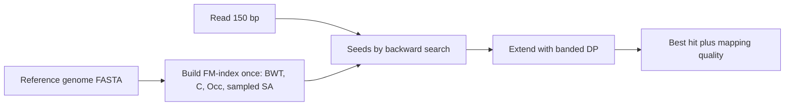

+++
summary = "Explain why read mapping needs an index, build a k-mer index and a suffix array, compute the Burrows–Wheeler transform by hand, and implement FM-index backward search in Python."
+++

# Indexing and Read Mapping

The [previous chapter](../../bioinformatics-algorithms/sequence-alignment/) gave us an exact way to align two sequences in $O(mn)$ time. That is fine for one read against one gene. It is hopeless for a whole-genome sequencing run: a 30× human genome with 150-base reads is about

$$
\frac{3.1 \times 10^9 \text{ bases} \times 30}{150 \text{ bases per read}} \approx 6 \times 10^8 \text{ reads},
$$

and dynamic programming of each read against all $3.1 \times 10^9$ reference positions would need on the order of $10^{20}$ cell updates. Every DNA → heart-disease model starts from variant calls, and variant calls start from mapped reads, so this chapter is about the trick that makes mapping fast: **build an index of the reference once, then look up each read in roughly the time it takes to read it.**

## Key ideas

### The shape of the problem

Read mapping is a **search** problem: given a short pattern $P$ (length $m \approx 100$–$250$) and a huge text $T$ (length $n \approx 3 \times 10^9$), find the positions where $P$ occurs in $T$ *approximately* (allowing a few mismatches and small indels). The strategy every modern mapper uses is:

1. **Seed:** find short *exact* matches between the read and the genome using an index.
2. **Extend / verify:** for each candidate location, run dynamic programming on a small window.

Exact matching is what indexes are good at. Approximation is handled by step 2.

### Idea 1: a k-mer hash index

Record, for every length-$k$ substring ($k$-mer) of the genome, the list of positions where it occurs. A hash table makes each lookup $O(1)$ on average.

How big should $k$ be? There are $4^k$ possible $k$-mers. In a random genome of length $n$, a given $k$-mer is expected to occur about $n / 4^k$ times. For the seed to be informative we want this to be well below 1:

| $k$ | $4^k$ | expected hits in 3.1 Gb (random model) |
|---|---|---|
| 11 | $4.2 \times 10^6$ | ≈ 740 |
| 16 | $4.3 \times 10^9$ | ≈ 0.7 |
| 20 | $1.1 \times 10^{12}$ | ≈ 0.003 |

Real genomes are far from random (about half of the human genome is repeats), so some $k$-mers occur millions of times while most are unique.

**Pigeonhole principle for seeds.** Cut a read into $s$ non-overlapping seeds. If the read has at most $e$ errors and $s > e$, at least one seed is error-free and matches exactly. With a 100-base read, 11-base seeds and 2 errors, at least $9 - 2 = 7$ of the 9 seeds match. Each matching seed "votes" for the read's start position (seed position in genome minus seed offset in read), and the position with the most votes is verified.

This is the logic of BLAST (for database search) and of early short-read mappers. Its weakness is memory: storing a position for every $k$-mer of the genome costs at least 4 bytes × 3.1 × 10⁹ ≈ 12 GB, plus the hash table.

### Idea 2: the suffix array

Write down every **suffix** of $T$ (append a sentinel `$` that sorts before every letter) and sort them alphabetically. The **suffix array** $SA$ lists the starting positions in sorted order. For $T$ = `GATTACA$`:

| Row | Suffix | $SA$ |
|---|---|---|
| 0 | `$` | 7 |
| 1 | `A$` | 6 |
| 2 | `ACA$` | 4 |
| 3 | `ATTACA$` | 1 |
| 4 | `CA$` | 5 |
| 5 | `GATTACA$` | 0 |
| 6 | `TACA$` | 3 |
| 7 | `TTACA$` | 2 |

Every occurrence of a pattern is a *prefix of some suffix*, and all suffixes that start with $P$ sit in a **contiguous block** of rows, because they are sorted. Binary search finds the block in $O(m \log n)$ time, for any pattern length, not just a fixed $k$. Memory is still one integer per genome position, around 12 GB for a human genome.

### Idea 3: the Burrows–Wheeler transform

The **Burrows–Wheeler transform (BWT)** was invented for data compression. Write all cyclic **rotations** of $T$, sort them, and keep the **last column** $L$. The first column $F$ is just the letters of $T$ in sorted order.

The sorted rotations are the sorted suffixes with the rest of the text wrapped around, so row $i$ of the BWT matrix corresponds to row $i$ of the suffix array, and

$$
L[i] = T[SA[i] - 1] \quad (\text{the character just before suffix } SA[i]; \text{ wrap around for } SA[i]=0).
$$

Why bother? Two reasons:

1. **Compressibility.** Characters that precede similar contexts get grouped together, so $L$ has long runs that compress well. For a genome, $L$ is also storable at 2 bits per base: about 0.8 GB for 3.1 Gb.
2. **It is reversible and searchable**, thanks to the LF-mapping.

### The LF-mapping

> [!IMPORTANT]
> **Last-to-first (LF) property.** The $k$-th occurrence of character $c$ in $L$ is the *same text position* as the $k$-th occurrence of $c$ in $F$.
> $$\operatorname{LF}(i) = C[c] + \operatorname{Occ}(c, i), \qquad c = L[i]$$
> where $C[c]$ is the number of characters in $T$ smaller than $c$, and $\operatorname{Occ}(c, i)$ is the number of times $c$ appears in $L[0 \ldots i-1]$.

**Why it holds.** Take all rows whose last character is `A`. Rotate each one right by one position: now they all *start* with `A`, and the rest of each row is the old row minus its last letter. Among rows starting with `A`, the sort order is decided by what follows the `A`, which is exactly the original rows, already in sorted order. So the relative order of the `A`s is the same in $L$ and in $F$. $C[c]$ jumps to the block of $F$ that starts with $c$; $\operatorname{Occ}(c, i)$ says how far into that block we are.

$\operatorname{LF}(i)$ answers: "the row that begins with the character at $L[i]$", i.e. it steps **one position backwards in the text**. Repeating LF from the `$` row walks the whole text backwards, which is how the BWT is inverted.

### FM-index backward search

Ferragina and Manzini showed that $C$, $\operatorname{Occ}$ and $L$ alone are enough to count occurrences of a pattern. Process $P$ **from right to left**, maintaining the half-open range $[lo, hi)$ of rows whose rows begin with the suffix of $P$ processed so far:

> [!IMPORTANT]
> **Backward search.** Start with $lo = 0,\ hi = n$. For each character $c$ of $P$ from last to first:
> $$lo \leftarrow C[c] + \operatorname{Occ}(c, lo), \qquad hi \leftarrow C[c] + \operatorname{Occ}(c, hi).$$
> If $lo \ge hi$ the pattern does not occur. At the end, $hi - lo$ is the number of occurrences and $SA[lo \ldots hi-1]$ gives their positions.

Each step is two $\operatorname{Occ}$ lookups. If $\operatorname{Occ}$ is precomputed (or sampled every few dozen positions and finished with a short count), the search costs $O(m)$, **independent of the genome size**. To report positions without storing the whole suffix array, tools keep a sample of it (say every 32nd entry) and walk LF steps from an unsampled row until they hit a sampled one.

### How BWA and Bowtie use this

- **Bowtie** and **BWA** (both 2009) built FM-indexes of the human reference, which let a short-read mapper run in a few gigabytes of memory.
- Exact backward search gives exact matches only. To allow mismatches, they **backtrack**: at some positions they try substituting each other base and continue the search, with limits on how many substitutions are allowed.
- **BWA-MEM** and **Bowtie 2** use the FM-index to find **seeds** (for BWA-MEM, maximal exact matches), then do affine-gap Smith–Waterman style extension around each seed. This is exactly the seed-and-extend pattern, with the FM-index replacing the hash table.



The **mapping quality** (MAPQ) reported for each read is a phred-scaled estimate of the probability the chosen location is wrong. A read lying in a repeat that occurs twice in the genome gets MAPQ near 0 because both locations fit equally well.

### Minimizers (brief)

For long reads (thousands of bases, higher error rates) and for comparing genomes, storing every $k$-mer is wasteful. A **minimizer** scheme looks at each window of $w$ consecutive $k$-mers and keeps only the smallest one (by lexicographic order or, better, by a hash). Two sequences that share a long enough exact stretch are guaranteed to share the minimizer of that stretch, so a much smaller index still finds matching seeds. **minimap2**, the standard mapper for long reads, is built on minimizers.

## Worked example

Text $T$ = `GATTACA$`. From the table above, the sorted rotations and their last characters are:

| Row | $F$ | Rotation | $L$ |
|---|---|---|---|
| 0 | `$` | `$GATTACA` | `A` |
| 1 | `A` | `A$GATTAC` | `C` |
| 2 | `A` | `ACA$GATT` | `T` |
| 3 | `A` | `ATTACA$G` | `G` |
| 4 | `C` | `CA$GATTA` | `A` |
| 5 | `G` | `GATTACA$` | `$` |
| 6 | `T` | `TACA$GAT` | `T` |
| 7 | `T` | `TTACA$GA` | `A` |

So $\operatorname{BWT}(T) = L$ = `ACTGA$TA`.

**The $C$ array.** Count characters: one `$`, three `A`, one `C`, one `G`, two `T`. Then $C[\$] = 0$, $C[A] = 1$, $C[C] = 4$, $C[G] = 5$, $C[T] = 6$.

**The Occ table.** $\operatorname{Occ}(c, i)$ counts $c$ in $L[0 \ldots i-1]$:

| $i$ | 0 | 1 | 2 | 3 | 4 | 5 | 6 | 7 | 8 |
|---|---|---|---|---|---|---|---|---|---|
| A | 0 | 1 | 1 | 1 | 1 | 2 | 2 | 2 | 3 |
| C | 0 | 0 | 1 | 1 | 1 | 1 | 1 | 1 | 1 |
| G | 0 | 0 | 0 | 0 | 1 | 1 | 1 | 1 | 1 |
| T | 0 | 0 | 0 | 1 | 1 | 1 | 1 | 2 | 2 |

**LF-mapping.** For example $\operatorname{LF}(4)$: $L[4]$ = `A`, so $C[A] + \operatorname{Occ}(A, 4) = 1 + 1 = 2$. Row 4 is `CA$GATTA`; its last `A` moved to the front gives `ACA$GATT`, which is indeed row 2. All eight values are

$$
\operatorname{LF} = [1, 4, 6, 5, 2, 0, 7, 3].
$$

**Inverting the BWT.** Start at row 0 (the row beginning with `$`) and repeatedly output $L[i]$ and move to $\operatorname{LF}(i)$:

$$
\underset{\texttt{A}}{0} \to \underset{\texttt{C}}{1} \to \underset{\texttt{A}}{4} \to \underset{\texttt{T}}{2} \to \underset{\texttt{T}}{6} \to \underset{\texttt{A}}{7} \to \underset{\texttt{G}}{3} \to 5 \ (\texttt{\$}, \text{ stop})
$$

The letters read `ACATTAG`, which is `GATTACA` backwards. The BWT lost no information.

**Backward search for $P$ = `ACA`.**

| Step | Character | $lo$ | $hi$ | Rows | Meaning |
|---|---|---|---|---|---|
| start | | 0 | 8 | 0–7 | all rows |
| 1 | `A` | $C[A] + \operatorname{Occ}(A,0) = 1$ | $C[A] + \operatorname{Occ}(A,8) = 4$ | 1–3 | rows starting `A` |
| 2 | `C` | $4 + \operatorname{Occ}(C,1) = 4$ | $4 + \operatorname{Occ}(C,4) = 5$ | 4 | rows starting `CA` |
| 3 | `A` | $1 + \operatorname{Occ}(A,4) = 2$ | $1 + \operatorname{Occ}(A,5) = 3$ | 2 | rows starting `ACA` |

One row remains, row 2, and $SA[2] = 4$: `ACA` occurs once, at position 4 (0-based) of `GATTACA`. Correct.

**A failed search, $P$ = `GC`.** After `C`: $[4, 5)$. Then `G`: $lo = 5 + \operatorname{Occ}(G, 4) = 6$, $hi = 5 + \operatorname{Occ}(G, 5) = 6$. Since $lo = hi$, `GC` does not occur.

## In code

First, a $k$-mer hash index with seed-and-extend on a synthetic 20 kb genome. The read carries two sequencing errors, so some seeds miss but the pigeonhole principle guarantees most still hit.

```python
import numpy as np
from collections import defaultdict

rng = np.random.default_rng(0)
genome = "".join(rng.choice(list("ACGT"), size=20_000))

def build_kmer_index(seq, k):
    index = defaultdict(list)                        # k-mer -> start positions
    for i in range(len(seq) - k + 1):
        index[seq[i:i + k]].append(i)
    return index

def map_read(read, genome, index, k, max_mm=3):
    """Seed with non-overlapping k-mers, vote for a start, then verify."""
    votes = defaultdict(int)
    for off in range(0, len(read) - k + 1, k):       # seeds at 0, k, 2k, ...
        for pos in index.get(read[off:off + k], []):
            votes[pos - off] += 1                    # implied read start
    hits = []
    for start, v in sorted(votes.items(), key=lambda kv: -kv[1]):
        if start < 0 or start + len(read) > len(genome):
            continue
        window = genome[start:start + len(read)]
        mm = sum(a != b for a, b in zip(read, window))   # verify (no indels here)
        if mm <= max_mm:
            hits.append((start, v, mm))
    return hits

k = 11
index = build_kmer_index(genome, k)
true_start = 12_345
read = list(genome[true_start:true_start + 100])
read[30] = "A" if read[30] != "A" else "C"           # sequencing error 1
read[71] = "G" if read[71] != "G" else "T"           # sequencing error 2
read = "".join(read)

print("distinct 11-mers in index:", len(index))
print("hits (start, seed votes, mismatches):", map_read(read, genome, index, k))
```

```text
distinct 11-mers in index: 19941
hits (start, seed votes, mismatches): [(12345, 7, 2)]
```

Seven of the nine seeds voted for position 12,345, as the pigeonhole argument predicted. A real mapper would verify with banded affine-gap DP instead of counting mismatches, so indels are handled too.

Next, a complete (if unoptimised) FM-index: suffix array, BWT, $C$, Occ, LF, backward search, locate and inversion. It reproduces the worked example and is checked against naive search on a random 5 kb text.

```python
import numpy as np

def suffix_array(text):
    # Naive construction; real tools use linear-time algorithms such as SA-IS.
    return sorted(range(len(text)), key=lambda i: text[i:])

class FMIndex:
    def __init__(self, text):
        assert text.endswith("$")
        self.sa = suffix_array(text)
        self.bwt = "".join(text[i - 1] for i in self.sa)  # char before each suffix
        alphabet = sorted(set(text))
        self.C, total = {}, 0                    # C[c]: count of chars < c
        for c in alphabet:
            self.C[c] = total
            total += text.count(c)
        # occ[c][i] = occurrences of c in bwt[:i]; length n+1 per symbol
        self.occ = {c: np.concatenate([[0], np.cumsum([b == c for b in self.bwt])])
                    for c in alphabet}

    def lf(self, i):
        c = self.bwt[i]
        return int(self.C[c] + self.occ[c][i])

    def backward_search(self, pattern):
        lo, hi = 0, len(self.bwt)                # half-open range of rows
        for c in reversed(pattern):
            if c not in self.C:
                return 0, 0
            lo = int(self.C[c] + self.occ[c][lo])
            hi = int(self.C[c] + self.occ[c][hi])
            if lo >= hi:
                return 0, 0
        return lo, hi

    def locate(self, pattern):
        lo, hi = self.backward_search(pattern)
        return sorted(self.sa[lo:hi])

    def invert(self):
        i, out = 0, []                           # row 0 begins with "$"
        for _ in range(len(self.bwt) - 1):
            out.append(self.bwt[i])
            i = self.lf(i)
        return "".join(reversed(out)) + "$"

fm = FMIndex("GATTACA$")
print("BWT:", fm.bwt)
print("C:", fm.C)
print("LF:", [fm.lf(i) for i in range(8)])
print("ACA rows:", fm.backward_search("ACA"), "positions:", fm.locate("ACA"))
print("TA positions:", fm.locate("TA"), " GC rows:", fm.backward_search("GC"))
print("inverted:", fm.invert())

rng = np.random.default_rng(1)                   # check against naive search
g = "".join(rng.choice(list("ACGT"), size=5000)) + "$"
big = FMIndex(g)
for p in ["ACGTA", "TTTT", "GATTACA"]:
    naive = [i for i in range(len(g)) if g.startswith(p, i)]
    print(p, big.locate(p) == naive, len(naive), "hits")
```

```text
BWT: ACTGA$TA
C: {'$': 0, 'A': 1, 'C': 4, 'G': 5, 'T': 6}
LF: [1, 4, 6, 5, 2, 0, 7, 3]
ACA rows: (2, 3) positions: [4]
TA positions: [3]  GC rows: (0, 0)
inverted: GATTACA$
ACGTA True 3 hits
TTTT True 27 hits
GATTACA True 0 hits
```

Finally, minimizers in a few lines: keep only the smallest 3-mer in every window of 4 consecutive 3-mers.

```python
def minimizers(seq, k, w):
    """Positions of the smallest k-mer in every window of w consecutive k-mers."""
    kmers = [seq[i:i + k] for i in range(len(seq) - k + 1)]
    chosen = set()
    for start in range(len(kmers) - w + 1):
        window = kmers[start:start + w]
        best = min(range(w), key=lambda j: window[j])   # ties -> leftmost
        chosen.add(start + best)
    return sorted(chosen)

seq = "GATTACAGATTTCCAGGA"
pos = minimizers(seq, k=3, w=4)
print("k-mers total:", len(seq) - 3 + 1, " minimizers kept:", len(pos))
print([(p, seq[p:p + 3]) for p in pos])
```

```text
k-mers total: 16  minimizers kept: 7
[(1, 'ATT'), (4, 'ACA'), (6, 'AGA'), (8, 'ATT'), (12, 'CCA'), (13, 'CAG'), (14, 'AGG')]
```

Fewer than half the $k$-mers are stored, yet any shared stretch of at least $w + k - 1 = 6$ bases between two sequences shares a minimizer.

> [!NOTE]
> Lexicographic order is a poor choice in practice: it favours `AAA…` and creates many minimizers in poly-A stretches. Real tools order $k$-mers with a hash function.

## Biomedical connection

Every downstream genetic feature in our heart-disease model, from a rare *LDLR* frameshift to the thousands of common SNPs in a [polygenic risk score](../../genomics-foundations/gwas-and-polygenic-risk-scores/), inherits the accuracy of read mapping.

- **Repeats and paralogs.** If a read maps equally well to two places, it gets a low MAPQ and variant callers typically discount it. Genes with close paralogs or pseudogenes can therefore have poorly covered regions in short-read data. Long reads (mapped with minimizer-based tools) help here.
- **The LPA gene.** *LPA*, which determines lipoprotein(a) levels and is an established cardiovascular risk factor, contains a highly variable number of near-identical kringle IV type 2 repeats. Short reads within the repeat cannot be placed uniquely, so the copy number has to be estimated by other means (for example, from read depth) rather than from ordinary variant calls.
- **Reference bias.** Reads carrying the non-reference allele have one extra mismatch, so they map slightly less often than reads carrying the reference allele. In individuals whose ancestry differs most from the reference genome, more reads are affected. This is one of several technical reasons genetic models must be evaluated across ancestries.

> [!CAUTION]
> A variant that appears in a sequencing report may be a mapping artefact, especially in repetitive or paralogous regions. Clinically actionable findings (for example a suspected familial hypercholesterolaemia variant) are confirmed by an accredited laboratory, often with an orthogonal method, before they influence care.

## Practice

1. Compute the BWT of `BANANA$` (with `$` smallest).

<details>
<summary>Answer</summary>

Sorted rotations: `$BANANA`, `A$BANAN`, `ANA$BAN`, `ANANA$B`, `BANANA$`, `NA$BANA`, `NANA$BA`. Last column: **`ANNB$AA`**.

</details>

2. Using the `GATTACA$` tables above, run backward search for `TA`. How many occurrences, and where?

<details>
<summary>Answer</summary>

Start $[0, 8)$. `A`: $[1 + 0,\ 1 + 3) = [1, 4)$. `T`: $lo = 6 + \operatorname{Occ}(T, 1) = 6$, $hi = 6 + \operatorname{Occ}(T, 4) = 7$. One row (row 6), $SA[6] = 3$: one occurrence, at position 3 (`GAT`**`TA`**`CA`).

</details>

3. A read of length 120 is split into non-overlapping seeds of length 20. What is the largest number of mismatches for which at least one seed is guaranteed to match exactly?

<details>
<summary>Answer</summary>

There are 6 seeds. Each mismatch can spoil at most one seed, so with 5 mismatches at least one seed is still clean. With 6 they could all be spoiled. Answer: **5**.

</details>

4. Why does backward search take $O(m)$ time regardless of genome length, whereas binary search on a suffix array takes $O(m \log n)$?

<details>
<summary>Answer</summary>

Each backward-search step is a constant number of $C$ and Occ lookups (constant time with precomputed or sampled Occ tables), and there are $m$ steps. Binary search needs $O(\log n)$ probes, and each probe compares up to $m$ characters of the pattern against a suffix.

</details>

5. In a uniformly random 3.1 Gb sequence, how many times would you expect a specific 14-mer to occur? Is 14 a good seed length for human?

<details>
<summary>Answer</summary>

$3.1 \times 10^9 / 4^{14} = 3.1 \times 10^9 / 2.68 \times 10^8 \approx 11.5$. Even in a random genome a 14-mer would usually hit about a dozen places, and the repeat-rich human genome is worse, so longer seeds (around 19 or more, or variable-length maximal exact matches) are preferred.

</details>

## Further reading

- Burrows, M. and Wheeler, D. J. (1994). A block-sorting lossless data compression algorithm. Digital Equipment Corporation, SRC Research Report 124.
- Manber, U. and Myers, G. (1993). Suffix arrays: a new method for on-line string searches. *SIAM Journal on Computing* 22(5).
- Ferragina, P. and Manzini, G. (2000). Opportunistic data structures with applications. *Proceedings of the 41st IEEE Symposium on Foundations of Computer Science (FOCS)*.
- Langmead, B., Trapnell, C., Pop, M. and Salzberg, S. L. (2009). Ultrafast and memory-efficient alignment of short DNA sequences to the human genome. *Genome Biology* 10, R25.
- Li, H. and Durbin, R. (2009). Fast and accurate short read alignment with Burrows–Wheeler transform. *Bioinformatics* 25(14).
- Roberts, M., Hayes, W., Hunt, B. R., Mount, S. M. and Yorke, J. A. (2004). Reducing storage requirements for biological sequence comparison. *Bioinformatics* 20(18).
- Li, H. (2018). Minimap2: pairwise alignment for nucleotide sequences. *Bioinformatics* 34(18).
