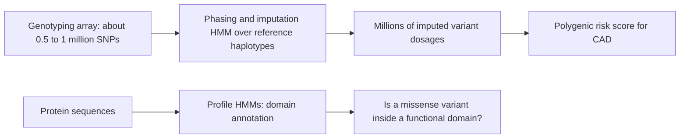

+++
summary = "Define a hidden Markov model, compute the probability of a DNA sequence with the forward algorithm, decode the most likely hidden states with Viterbi by hand and in code, and recognise where HMMs are used in genomics."
+++

# Hidden Markov Models

DNA is not a bag of independent letters. The base at one position depends on its neighbours, and long stretches of the genome have a "character" (gene or intergenic region, CpG island or not, inherited from your mother's or your father's haplotype) that we cannot see directly but that changes the letters we observe. A **hidden Markov model (HMM)** is the classic probabilistic model for exactly this situation: an unobserved sequence of states generates an observed sequence of symbols.

HMMs matter for a DNA → heart-disease model in a very concrete way. The genotype data in large biobanks are mostly **imputed**: a chip measures a few hundred thousand variants, and an HMM over reference haplotypes fills in millions more. The polygenic risk score you will build later is computed largely from these HMM outputs. HMMs are also the conceptual ancestor of the recurrent networks in [Module 13](../../deep-architectures-for-sequences/recurrent-networks-and-lstms/), and their dynamic-programming algorithms are close cousins of the [alignment algorithms](../../bioinformatics-algorithms/sequence-alignment/) of this module.

## Key ideas

### Markov chains

A sequence of random variables $X_1, X_2, \ldots$ is a **(first-order) Markov chain** if the next value depends only on the current one:

$$
P(X_t = b \mid X_{t-1} = a, X_{t-2}, \ldots, X_1) = P(X_t = b \mid X_{t-1} = a) = a_{ab}.
$$

The numbers $a_{ab}$ form a **transition matrix** $A$ whose rows sum to 1. For DNA, $A$ is $4 \times 4$. By the chain rule of probability (see [probability and Bayes' theorem](../../probability-and-statistics/probability-and-bayes-theorem/)), the probability of a whole sequence factorises:

$$
P(x_1, \ldots, x_T) = P(x_1) \prod_{t=2}^{T} a_{x_{t-1} x_t}.
$$

### The CpG-island example

In vertebrate genomes the dinucleotide CG (written **CpG**, "C then G on the same strand") is much rarer than the base composition alone would predict. The reason is chemical: the C in a CpG is often methylated, and methylated cytosine tends to mutate to T over evolutionary time. But there are stretches, typically a few hundred to a few thousand bases long and often around gene promoters, where CpGs are not depleted. These are **CpG islands**.

Two Markov chains, one trained on islands ("+") and one on the rest of the genome ("−"), give different transition probabilities: in particular $a^{+}_{CG}$ is much larger than $a^{-}_{CG}$. To classify a short stretch $x$ we compare likelihoods with a log-odds score,

$$
S(x) = \log \frac{P(x \mid +)}{P(x \mid -)} = \sum_{t=2}^{T} \log \frac{a^{+}_{x_{t-1}x_t}}{a^{-}_{x_{t-1}x_t}},
$$

which is a sum of per-dinucleotide contributions, just like an alignment score. But this only classifies a stretch we have already cut out. To **find** islands inside a long sequence we need a model in which the label itself can switch along the sequence. That is an HMM.

### Hidden Markov models

An HMM has:

| Component | Symbol | Shape | Meaning |
|---|---|---|---|
| Hidden states | $\pi_t \in \{1, \ldots, K\}$ | sequence of length $T$ | e.g. B = background, I = island |
| Initial distribution | $\boldsymbol{\pi}$ | $K$ | $P(\pi_1 = k)$ |
| Transition matrix | $A$ | $K \times K$ | $a_{jk} = P(\pi_t = k \mid \pi_{t-1} = j)$ |
| Emission matrix | $E$ | $K \times M$ | $e_k(b) = P(x_t = b \mid \pi_t = k)$, $M = 4$ for DNA |

The generative story: pick a starting state, emit a base from that state's emission distribution, move to a next state according to $A$, emit again, and so on. The **joint probability** of a state path and a sequence is

> [!IMPORTANT]
> $$P(x, \pi) = P(\pi_1)\, e_{\pi_1}(x_1) \prod_{t=2}^{T} a_{\pi_{t-1}\pi_t}\, e_{\pi_t}(x_t).$$

We see $x$, never $\pi$. That raises three classic questions:

1. **Evaluation:** what is $P(x) = \sum_\pi P(x, \pi)$? (forward algorithm)
2. **Decoding:** which single path $\pi^*$ maximises $P(x, \pi)$? (Viterbi algorithm)
3. **Learning:** which parameters $(\boldsymbol\pi, A, E)$ make the observed data most likely? (Baum–Welch)

### The forward algorithm

Summing over all paths directly costs $K^T$ terms: $2^{1000}$ for a 1 kb sequence with two states. But like alignment, the problem has optimal substructure. Define

$$
f_k(t) = P(x_1, \ldots, x_t,\ \pi_t = k),
$$

the probability of the first $t$ observations **and** being in state $k$ at time $t$. Every path that is in state $k$ at time $t$ was in *some* state $j$ at $t-1$. Splitting on $j$ and using the Markov property:

> [!IMPORTANT]
> **Forward recursion**
> $$f_k(1) = \pi_k\, e_k(x_1), \qquad f_k(t) = e_k(x_t) \sum_{j=1}^{K} f_j(t-1)\, a_{jk}, \qquad P(x) = \sum_k f_k(T).$$

Cost: $O(TK^2)$. In matrix form, $\mathbf{f}(t) = \big(\mathbf{f}(t-1)^\top A\big) \odot \mathbf{e}(x_t)$, a vector–matrix product followed by an element-wise product.

**Underflow.** $P(x)$ for a 3,000-base sequence is around $10^{-1800}$, far below the smallest positive 64-bit float (about $10^{-308}$). Implementations either rescale $\mathbf f(t)$ to sum to 1 at every step and add up the logs of the scale factors, or work in log space with the log-sum-exp trick.

### The Viterbi algorithm

To find the single best path, replace the **sum** by a **max**:

> [!IMPORTANT]
> **Viterbi recursion**
> $$v_k(1) = \pi_k\, e_k(x_1), \qquad v_k(t) = e_k(x_t) \max_{j}\, v_j(t-1)\, a_{jk}, \qquad \operatorname{ptr}_k(t) = \arg\max_j\, v_j(t-1)\, a_{jk}.$$
> The best path ends in $\arg\max_k v_k(T)$ and is recovered by following the pointers backwards.

This is the same pattern as Needleman–Wunsch: a table of best partial scores, plus a traceback. In log space products become sums, $\log v_k(t) = \log e_k(x_t) + \max_j [\log v_j(t-1) + \log a_{jk}]$, which avoids underflow and makes the analogy with alignment scores exact.

### Posterior decoding

Viterbi gives the best *whole path*, but we may want, for each position, $P(\pi_t = k \mid x)$: "how sure are we this base is in an island?". A mirror-image **backward** recursion computes $b_k(t) = P(x_{t+1}, \ldots, x_T \mid \pi_t = k)$, and then

$$
P(\pi_t = k \mid x) = \frac{f_k(t)\, b_k(t)}{P(x)}.
$$

This **forward–backward** quantity is a calibrated per-position probability, which is often more useful downstream than a hard label.

### Baum–Welch (intuition)

If we knew the hidden path we could estimate the parameters by counting: $\hat a_{jk}$ = (number of $j \to k$ transitions) / (number of transitions out of $j$), and similarly for emissions. We do not know the path, so **Baum–Welch** (an instance of the expectation–maximisation, EM, algorithm) alternates:

- **E-step:** with the current parameters, run forward–backward to get the *expected* number of times each transition and emission is used, averaging over all paths weighted by their posterior probability.
- **M-step:** re-estimate the parameters from these expected counts, exactly as if they were real counts.

Each iteration provably does not decrease $P(x)$, but it can converge to a **local** optimum, so initialisation matters. (Viterbi training, which uses only the single best path in the E-step, is a cheaper and cruder alternative.)

## Worked example

A two-state CpG model with states B (background) and I (island):

- start: $\pi_B = \pi_I = 0.5$
- transitions: $a_{BB} = a_{II} = 0.7$, $a_{BI} = a_{IB} = 0.3$
- emissions: B emits A, C, G, T with $0.30, 0.20, 0.20, 0.30$; I emits them with $0.15, 0.35, 0.35, 0.15$

Observed sequence $x$ = `ATCGC`. Find the most probable state path.

**$t = 1$ (A).** $v_B(1) = 0.5 \times 0.30 = 0.15$, $\ v_I(1) = 0.5 \times 0.15 = 0.075$.

**$t = 2$ (T).**

- $v_B(2) = e_B(T) \max(0.15 \times 0.7,\ 0.075 \times 0.3) = 0.30 \times \max(0.105, 0.0225) = 0.0315$, pointer B.
- $v_I(2) = e_I(T) \max(0.15 \times 0.3,\ 0.075 \times 0.7) = 0.15 \times \max(0.045, 0.0525) = 0.007875$, pointer I.

**$t = 3$ (C).**

- $v_B(3) = 0.20 \times \max(0.0315 \times 0.7,\ 0.007875 \times 0.3) = 0.20 \times \max(0.02205, 0.0023625) = 0.00441$, pointer B.
- $v_I(3) = 0.35 \times \max(0.0315 \times 0.3,\ 0.007875 \times 0.7) = 0.35 \times \max(0.00945, 0.0055125) = 0.0033075$, pointer **B**.

**$t = 4$ (G).**

- $v_B(4) = 0.20 \times \max(0.003087, 0.00099225) = 0.0006174$, pointer B.
- $v_I(4) = 0.35 \times \max(0.001323, 0.00231525) = 0.00081034$, pointer I.

**$t = 5$ (C).**

- $v_B(5) = 0.20 \times \max(0.00043218, 0.00024310) = 0.0000864$, pointer B.
- $v_I(5) = 0.35 \times \max(0.00018522, 0.00056724) = 0.00019853$, pointer I.

Summary table (pointer in brackets):

| $t$ | 1 | 2 | 3 | 4 | 5 |
|---|---|---|---|---|---|
| $x_t$ | A | T | C | G | C |
| $v_B$ | 0.15 | 0.0315 (B) | 0.00441 (B) | 0.000617 (B) | 0.0000864 (B) |
| $v_I$ | 0.075 | 0.007875 (I) | 0.003308 (**B**) | 0.000810 (I) | **0.000199** (I) |

**Traceback.** The larger final value is $v_I(5)$, so $\pi_5 = \text{I}$. Its pointer says $\pi_4 = \text{I}$, whose pointer says $\pi_3 = \text{I}$, whose pointer says $\pi_2 = \text{B}$, whose pointer says $\pi_1 = \text{B}$.

$$
\pi^* = \text{B B I I I}, \qquad P(x, \pi^*) \approx 1.99 \times 10^{-4}.
$$

The model "switches into" an island at the C, and the CG that follows confirms the switch: even though $v_B(3) > v_I(3)$, the subsequent G and C make the island path win overall. Viterbi decides with hindsight, which a greedy left-to-right labelling cannot.

**Forward algorithm on the same sequence.** Replacing max by sum:

| $t$ | 1 | 2 | 3 | 4 | 5 |
|---|---|---|---|---|---|
| $f_B$ | 0.15 | 0.03825 | 0.006233 | 0.001329 | 0.000337 |
| $f_I$ | 0.075 | 0.014625 | 0.007599 | 0.002516 | 0.000756 |

For example $f_B(2) = 0.30 \times (0.15 \times 0.7 + 0.075 \times 0.3) = 0.30 \times 0.1275 = 0.03825$. The total is $P(x) = 0.000337 + 0.000756 \approx 0.001093$. The Viterbi path carries $0.000199 / 0.001093 \approx 18\%$ of all the probability: the other 31 paths share the rest. That is why posterior probabilities are often more honest than a single decoded path.

## In code

Log-space Viterbi and a scaled forward algorithm, checked against the hand example and then used on a simulated 3,000-base sequence with planted islands.

```python
import numpy as np

BASES = {"A": 0, "C": 1, "G": 2, "T": 3}
STATES = "BI"                                   # 0 = background, 1 = island

def viterbi(x, log_pi, log_A, log_E):
    """Most probable state path. log_A: (K, K), log_E: (K, 4)."""
    obs = [BASES[c] for c in x]
    T, K = len(obs), len(log_pi)
    V = np.zeros((T, K))                        # best log-prob ending in state k
    ptr = np.zeros((T, K), dtype=int)           # argmax predecessor
    V[0] = log_pi + log_E[:, obs[0]]
    for t in range(1, T):
        cand = V[t - 1][:, None] + log_A        # (K_prev, K_next)
        ptr[t] = cand.argmax(axis=0)
        V[t] = cand.max(axis=0) + log_E[:, obs[t]]
    path = [int(V[-1].argmax())]
    for t in range(T - 1, 0, -1):
        path.append(int(ptr[t, path[-1]]))
    return "".join(STATES[k] for k in reversed(path)), V[-1].max()

def forward(x, pi, A, E):
    """Scaled forward algorithm. Returns log P(x)."""
    obs = [BASES[c] for c in x]
    f = pi * E[:, obs[0]]
    log_px = 0.0
    for t in range(1, len(obs) + 1):
        s = f.sum()                             # rescale to avoid underflow
        log_px += np.log(s)
        f = f / s
        if t < len(obs):
            f = (f @ A) * E[:, obs[t]]
    return log_px

pi = np.array([0.5, 0.5])
A = np.array([[0.7, 0.3], [0.3, 0.7]])
E = np.array([[0.30, 0.20, 0.20, 0.30],         # background: A C G T
              [0.15, 0.35, 0.35, 0.15]])        # island
path, lp = viterbi("ATCGC", np.log(pi), np.log(A), np.log(E))
print("Viterbi path:", path, " P(x, path) =", round(np.exp(lp), 9))
print("Forward P(x) =", round(np.exp(forward("ATCGC", pi, A, E)), 9))

# A longer simulation: sticky states, 3000 bases
rng = np.random.default_rng(42)
A2 = np.array([[0.995, 0.005], [0.02, 0.98]])   # islands are short, rare
state, states, seq = 0, [], []
for _ in range(3000):
    states.append(state)
    seq.append("ACGT"[rng.choice(4, p=E[state])])
    state = rng.choice(2, p=A2[state])
seq, truth = "".join(seq), "".join(STATES[s] for s in states)
decoded, _ = viterbi(seq, np.log([0.9, 0.1]), np.log(A2), np.log(E))
acc = np.mean([a == b for a, b in zip(decoded, truth)])
print("true island bases:", truth.count("I"), " decoded:", decoded.count("I"))
print("per-base accuracy:", round(acc, 3),
      " always-background baseline:", round(1 - truth.count("I") / len(truth), 3))
print("log P(seq) under model:", round(forward(seq, np.array([0.9, 0.1]), A2, E), 1))
```

```text
Viterbi path: BBIII  P(x, path) = 0.000198533
Forward P(x) = 0.001092945
true island bases: 772  decoded: 746
per-base accuracy: 0.926  always-background baseline: 0.743
log P(seq) under model: -4095.1
```

Two observations:

- The log-probability of the long sequence is about $-4095$ (natural log), i.e. $P(\text{seq}) \approx e^{-4095} \approx 10^{-1778}$. Without scaling, the forward variables would underflow to exactly 0 after a few hundred bases.
- Decoding is good but not perfect, because island and background emissions overlap. Errors cluster at the boundaries of islands, where the evidence for a switch accumulates only gradually.

> [!TIP]
> Shapes to keep in mind: the Viterbi and forward tables are $T \times K$; each step does a $(K \times 1) + (K \times K)$ broadcast. With $K = 2$ this is tiny, but profile HMMs and imputation HMMs have thousands of states, and the $O(TK^2)$ cost (or clever $O(TK)$ special structure) becomes the main engineering concern.

## Biomedical connection

HMMs appear throughout the pipeline that turns DNA into features for a cardiovascular risk model.



- **Genotype imputation.** In the Li–Stephens model, a person's haplotype is modelled as a mosaic of reference haplotypes (for example from the 1000 Genomes Project or larger reference panels). The hidden state at each SNP is "which reference haplotype am I copying here"; transitions correspond to recombination; emissions allow occasional mismatches. Forward–backward gives posterior probabilities for untyped alleles, which are reported as **dosages** between 0 and 2. Tools such as IMPUTE, Beagle and Minimac are built on this idea. Large polygenic-score studies of coronary artery disease use imputed genotypes, so imputation quality (lower for rare variants and for ancestries under-represented in the reference panel) directly affects risk-score accuracy.
- **Gene finding.** Gene-prediction programs such as GENSCAN use HMMs (more precisely, generalised HMMs whose states emit whole exons or introns) with states for exons, introns, splice sites and intergenic sequence.
- **Profile HMMs.** A protein family (say the LDL-receptor class A repeat found in *LDLR*) is summarised as a profile HMM with match, insert and delete states per alignment column. HMMER and the Pfam database use these to annotate domains, which helps interpret whether a missense variant hits a conserved part of the protein.
- **Other uses.** Copy-number variant calling from read depth, chromatin-state segmentation and local-ancestry inference all use HMM-style models in which a hidden label changes slowly along the genome.

> [!CAUTION]
> Imputed genotypes are probabilistic. A rare pathogenic variant (for instance in *LDLR*) imputed with moderate confidence is not a diagnosis. Clinical genetic testing uses direct sequencing and confirmation, not imputation.

## Practice

1. For a Markov chain on $\{A, C, G, T\}$ with $P(x_1 = A) = 0.25$, $a_{AC} = 0.3$, $a_{CG} = 0.1$, what is $P(\texttt{ACG})$?

<details>
<summary>Answer</summary>

$0.25 \times 0.3 \times 0.1 = 0.0075$.

</details>

2. Using the worked-example HMM, compute $f_I(2)$ for $x$ = `AT` and check it against the table.

<details>
<summary>Answer</summary>

$f_I(2) = e_I(T)\,[f_B(1)\, a_{BI} + f_I(1)\, a_{II}] = 0.15 \times (0.15 \times 0.3 + 0.075 \times 0.7) = 0.15 \times 0.0975 = 0.014625$. Matches.

</details>

3. Using the same HMM, run Viterbi on the two-letter sequence `CG`. What is the best path and its probability?

<details>
<summary>Answer</summary>

$v_B(1) = 0.5 \times 0.2 = 0.1$, $v_I(1) = 0.5 \times 0.35 = 0.175$. Then $v_B(2) = 0.2 \times \max(0.1 \times 0.7, 0.175 \times 0.3) = 0.2 \times 0.07 = 0.014$; $v_I(2) = 0.35 \times \max(0.1 \times 0.3, 0.175 \times 0.7) = 0.35 \times 0.1225 = 0.042875$. Best path **I I**, probability $0.042875$.

</details>

4. How many state paths does a 3-state HMM have for a sequence of length 50? How many multiply-adds (roughly) does the forward algorithm need?

<details>
<summary>Answer</summary>

$3^{50} \approx 7.2 \times 10^{23}$ paths. Forward needs about $T K^2 = 50 \times 9 = 450$ multiply-adds (plus $TK$ emission multiplications).

</details>

5. Why might Baum–Welch, started from parameters where both states have identical emissions and symmetric transitions, fail to learn anything?

<details>
<summary>Answer</summary>

If the two states are exactly interchangeable, the posterior gives them identical expected counts, so the M-step produces identical parameters again. The symmetry is never broken and the model stays stuck at a stationary point. Random or informed initialisation breaks the symmetry.

</details>

## Further reading

- Rabiner, L. R. (1989). A tutorial on hidden Markov models and selected applications in speech recognition. *Proceedings of the IEEE* 77(2).
- Durbin, R., Eddy, S., Krogh, A. and Mitchison, G. (1998). *Biological Sequence Analysis.* Cambridge University Press. Chapters 3 (Markov chains, HMMs, CpG islands) and 5 (profile HMMs).
- Eddy, S. R. (2004). What is a hidden Markov model? *Nature Biotechnology* 22(10).
- Burge, C. and Karlin, S. (1997). Prediction of complete gene structures in human genomic DNA. *Journal of Molecular Biology* 268(1).
- Li, N. and Stephens, M. (2003). Modeling linkage disequilibrium and identifying recombination hotspots using single-nucleotide polymorphism data. *Genetics* 165(4).
- Marchini, J. and Howie, B. (2010). Genotype imputation for genome-wide association studies. *Nature Reviews Genetics* 11(7).
