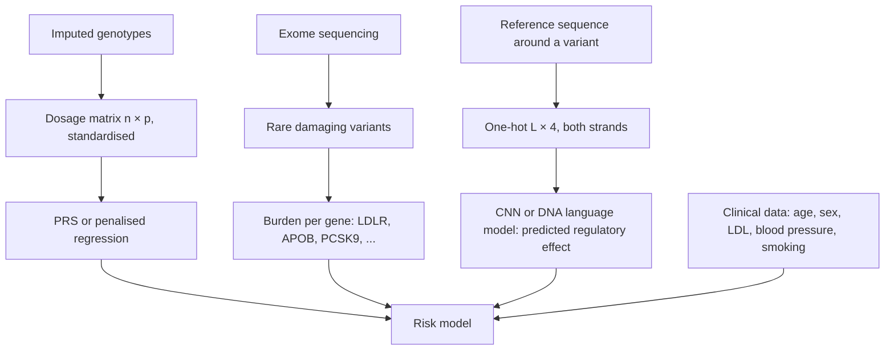

+++
summary = "Turn DNA sequences and genotypes into numeric tensors: one-hot (L × 4), k-mer counts, k-mer and BPE tokens, reverse-complement augmentation, standardised dosage matrices, sparse storage and gene-level burden scores."
+++

# Encoding DNA for Machine Learning

A neural network multiplies matrices; it cannot multiply the letter `G`. Before any model can learn that a variant near *PCSK9* raises LDL cholesterol, or that a person's genome-wide profile puts them in the top few percent of coronary-artery-disease risk, we must decide how to turn DNA into numbers. That decision is not neutral. It fixes what the model can see (single bases? motifs? whole genes?), how big the input is, which symmetries the model respects, and how easily information can leak between training and test data.

There are two very different kinds of genetic input, and this chapter covers both:

| Input | Example | Typical tensor | Used by |
|---|---|---|---|
| **Sequence** | 1,000 bases around a variant | one-hot $(L, 4)$ or tokens $(L',)$ | CNNs, transformers, DNA language models |
| **Genotype** | a person's alleles at $p$ known variants | dosage matrix $(n, p)$ with values 0, 1, 2 | regression, PRS, tree ensembles, MLPs |

## Key ideas

### One-hot encoding

Map each base to a unit vector:

$$
\texttt{A} \mapsto (1,0,0,0), \quad \texttt{C} \mapsto (0,1,0,0), \quad \texttt{G} \mapsto (0,0,1,0), \quad \texttt{T} \mapsto (0,0,0,1).
$$

A sequence of length $L$ becomes a matrix $X \in \{0,1\}^{L \times 4}$, and a batch of $N$ sequences a tensor of shape $(N, L, 4)$. PyTorch's `Conv1d` expects channels first, $(N, 4, L)$, so you will often transpose.

Why not code A, C, G, T as 0, 1, 2, 3? Because that invents an order and a distance: it would claim that G is "between" C and T, and that A and T are three times as different as A and C. One-hot vectors are all at the same distance $\sqrt 2$ from each other, so the model starts with no false assumptions. A first-layer weight matrix $W$ of shape $(4, d)$ applied to a one-hot row simply **selects** one row of $W$: one-hot followed by a linear layer is exactly an embedding lookup.

**Handling N.** Reference genomes and reads contain `N` (unknown base). Two common choices:

- all zeros: "no information", and the convolution contributes nothing at that position;
- $(0.25, 0.25, 0.25, 0.25)$: "uniform uncertainty", which keeps the row summing to 1.

Either is fine if used consistently. Lowercase letters (soft-masked repeats in reference FASTA files) should be uppercased first, unless you deliberately want to keep repeat masking as an extra channel.

### Bag of k-mers

Count every overlapping $k$-mer in a sequence. With $4^k$ possible $k$-mers, a sequence becomes a fixed-length vector of counts regardless of its length. A $k$-mer is indexed by reading it as a base-4 number (A = 0, C = 1, G = 2, T = 3):

$$
\operatorname{index}(b_1 b_2 \cdots b_k) = \sum_{i=1}^{k} \operatorname{code}(b_i)\, 4^{k-i}.
$$

This "bag" throws away order beyond $k$ letters, but it is compact and works well with linear models and gradient boosting (for example, $k = 6$ gives 4,096 features). It also gives you the dinucleotide CpG statistics of the [previous chapter](../../bioinformatics-algorithms/hidden-markov-models/) for free.

### Tokenisation for language models

Transformers operate on a sequence of **tokens**, each mapped to a learned embedding. Options for DNA:

| Scheme | Vocabulary | Length of 1,000 bp | Notes |
|---|---|---|---|
| Single nucleotide | 4 (+ specials) | 1,000 tokens | finest resolution, longest sequences |
| Overlapping $k$-mers (DNABERT, $k = 6$) | $4^6 = 4096$ | 995 tokens | no compression; neighbouring tokens share $k-1$ bases, so a masked token can be read off its neighbours |
| Non-overlapping $k$-mers | $4^k$ | $1000/k$ tokens | compresses, but a 1-base insertion shifts every downstream token |
| Byte-pair encoding (DNABERT-2) | learned, e.g. a few thousand | varies; several-fold fewer than 1,000 | frequent substrings become single tokens |

**Byte-pair encoding (BPE)** starts with single bases as tokens and repeatedly merges the most frequent **adjacent pair** into a new token, adding it to the vocabulary. After many merges, common substrings (repeats, frequent motifs) become single tokens while rare regions stay finely split. This compresses the sequence, so a transformer whose cost grows with the square of the sequence length (see [attention and transformers](../../deep-architectures-for-sequences/attention-and-transformers/)) can see a longer stretch of DNA. The price is that tokens have variable length and that a single-base variant can change how a whole neighbourhood is tokenised.

### Reverse complement: augmentation and equivariance

DNA is double stranded. A transcription-factor binding site on the forward strand is the same biological object as its reverse complement on the other strand, and which strand the reference happens to list is arbitrary. So for most tasks the right answer satisfies

$$
f(x) = f(\operatorname{rc}(x)) \quad \text{(invariance)},
$$

or, for per-position outputs, the output on $\operatorname{rc}(x)$ is the reversed (and if needed, strand-swapped) output on $x$ (**equivariance**).

With channels ordered A, C, G, T, complementing swaps A↔T (columns 0↔3) and C↔G (columns 1↔2), which is just **reversing the column order**. Reversing the sequence reverses the rows. So

> [!IMPORTANT]
> $$\operatorname{rc}(X) = X[\,::-1,\ ::-1\,] \qquad \text{for one-hot } X \in \{0,1\}^{L \times 4} \text{ with channel order A, C, G, T.}$$

Three ways to respect the symmetry:

1. **Augmentation:** during training, replace each example by its reverse complement with probability 0.5. The model *learns* approximate invariance.
2. **Test-time averaging:** predict $\tfrac12[f(x) + f(\operatorname{rc}(x))]$. Exactly invariant, at twice the inference cost.
3. **Architectural equivariance (parameter sharing):** for each convolution filter $W$, also apply $\operatorname{rc}(W)$, and combine the two responses with a symmetric operation such as max. Exactly invariant by construction, with no extra parameters.

### Genotype dosage matrices

For a set of $n$ people and $p$ variants (for example the SNPs of a [polygenic risk score](../../genomics-foundations/gwas-and-polygenic-risk-scores/)), the **dosage** $g_{ij} \in \{0, 1, 2\}$ is the number of copies of the alternative (ALT) allele that person $i$ carries at variant $j$. Stack them in a matrix $G \in \mathbb{R}^{n \times p}$. Imputed data give **expected** dosages, real numbers in $[0, 2]$.

This encoding assumes an **additive** effect: two ALT copies have twice the effect of one. That is the standard assumption in GWAS and PRS. Dominant or recessive effects can be captured with extra columns (for example an indicator $g = 2$).

Practical points:

- **Which allele is counted** must be consistent between training data, test data and published effect sizes. A strand or allele flip silently reverses the sign of a variant's effect.
- **Missing genotypes** are commonly filled with the mean dosage $2\hat p_j$, where $\hat p_j$ is the ALT allele frequency.
- **Scale:** UK-Biobank-sized data (about half a million people) with millions of imputed variants does not fit in memory as a dense float matrix; it is processed in chunks or on disk.

### Standardisation

Variants with high allele frequency have larger raw variance than rare ones. Many methods standardise each column:

$$
z_{ij} = \frac{g_{ij} - 2\hat p_j}{\sqrt{2\hat p_j (1 - \hat p_j)}},
$$

where $2\hat p_j$ is the expected dosage and $2\hat p_j(1-\hat p_j)$ is its variance under Hardy–Weinberg equilibrium (a binomial with 2 trials). After standardisation each column has mean 0 and variance about 1, which makes penalties like ridge and lasso treat variants evenly (see [regularisation](../../classical-machine-learning/regularization-and-the-bias-variance-tradeoff/)) and helps gradient descent.

> [!WARNING]
> Compute $\hat p_j$ (and any imputation means) on the **training set only**, then apply the same numbers to validation and test data. Fitting them on all data is a subtle form of leakage; see [model evaluation](../../classical-machine-learning/model-evaluation/). Also note that standardising a very rare variant divides by a tiny number, giving huge $z$ values for carriers; rare variants are often left unstandardised or aggregated instead.

### Gene-level aggregation: burden scores

Each rare variant is carried by too few people for its effect to be estimated alone. **Burden** methods collapse the qualifying variants in a gene (for example predicted loss-of-function, or missense predicted damaging) into one number per person per gene:

$$
b_{ik} = \sum_{j \in \text{gene } k} w_j\, g_{ij},
$$

or simply an indicator "carries at least one qualifying allele". With a sparse $p \times K$ variant-to-gene weight matrix $M$ (entry $w_j$ if variant $j$ is in gene $k$ and qualifies, else 0), all burdens at once are one matrix product:

$$
B = G\,M, \qquad (n \times p)(p \times K) = (n \times K).
$$

### Sparse matrices

Rare variants make $G$ overwhelmingly zero. **Compressed sparse row (CSR)** format stores only the nonzero values, their column indices, and one pointer per row, so memory scales with the number of nonzeros rather than $n \times p$. SciPy's `scipy.sparse` and PyTorch's sparse tensors support matrix products directly.

## Worked example

**One-hot and N.** The sequence `ACGTN` becomes

$$
X = \begin{bmatrix} 1 & 0 & 0 & 0 \\ 0 & 1 & 0 & 0 \\ 0 & 0 & 1 & 0 \\ 0 & 0 & 0 & 1 \\ 0 & 0 & 0 & 0 \end{bmatrix} \in \mathbb{R}^{5 \times 4}.
$$

**Reverse complement.** For `AACGT`, reverse the rows (giving the order T, G, C, A, A) and then reverse the columns (T→A, G→C, C→G, A→T, A→T): `ACGTT`. Check directly: complement of `AACGT` is `TTGCA`, read backwards `ACGTT`.

**Bag of 2-mers.** `ACGTAC` has the overlapping 2-mers AC, CG, GT, TA, AC. Their indices are AC $= 0 \cdot 4 + 1 = 1$, CG $= 1 \cdot 4 + 2 = 6$, GT $= 2 \cdot 4 + 3 = 11$, TA $= 3 \cdot 4 + 0 = 12$. The 16-dimensional count vector has a 2 at index 1 and 1s at indices 6, 11 and 12.

**Standardising a SNP.** Five people have dosages $0, 1, 2, 1, 0$. The mean dosage is $4/5 = 0.8$, so $\hat p = 0.4$ and the Hardy–Weinberg standard deviation is $\sqrt{2 \times 0.4 \times 0.6} = \sqrt{0.48} \approx 0.693$. The standardised values are

$$
\frac{0 - 0.8}{0.693} \approx -1.155, \quad \frac{1 - 0.8}{0.693} \approx 0.289, \quad \frac{2 - 0.8}{0.693} \approx 1.732.
$$

**A burden score.** Gene *K* contains three rare variants; variants 1 and 3 are predicted loss-of-function ($w = 1$), variant 2 is a synonymous change ($w = 0$). A person with dosages $(0, 1, 1)$ has burden $0 + 0 + 1 = 1$: one qualifying allele, so they are a carrier. Their synonymous variant is ignored.

## In code

One-hot (vectorised with a lookup table), reverse complement and $k$-mer counting:

```python
import numpy as np

# Lookup table: byte value -> row of a 5 x 4 matrix (N or anything else -> zeros)
LUT = np.full(256, 4, dtype=np.int64)
for i, b in enumerate(b"ACGT"):
    LUT[b] = i
    LUT[ord(chr(b).lower())] = i
EYE = np.vstack([np.eye(4, dtype=np.float32), np.zeros((1, 4), np.float32)])

def one_hot(seq):
    """(L,) string -> (L, 4) float32, columns A C G T; N -> all zeros."""
    idx = LUT[np.frombuffer(seq.encode(), dtype=np.uint8)]
    return EYE[idx]

def revcomp_onehot(X):
    """Reverse complement of an (L, 4) ACGT one-hot: flip rows AND columns."""
    return X[::-1, ::-1]

def kmer_counts(seq, k):
    """Bag of k-mers: vector of length 4**k (k-mers containing N are skipped)."""
    counts = np.zeros(4 ** k, dtype=np.int64)
    codes = LUT[np.frombuffer(seq.encode(), dtype=np.uint8)]
    for i in range(len(codes) - k + 1):
        window = codes[i:i + k]
        if (window == 4).any():
            continue
        counts[int(np.dot(window, 4 ** np.arange(k - 1, -1, -1)))] += 1
    return counts

X = one_hot("ACGTN")
print(X.shape)
print(X)
rc = revcomp_onehot(one_hot("AACGT"))
print("revcomp of AACGT:", "".join("ACGT"[r.argmax()] for r in rc))
c = kmer_counts("ACGTAC", 2)
print("nonzero 2-mer indices:", np.nonzero(c)[0], "counts:", c[np.nonzero(c)])
batch = np.stack([one_hot(s) for s in ["ACGTACGT", "GGGNNCCC"]])
print("batch shape (N, L, 4):", batch.shape,
      " channels-first for Conv1d:", batch.transpose(0, 2, 1).shape)
```

```text
(5, 4)
[[1. 0. 0. 0.]
 [0. 1. 0. 0.]
 [0. 0. 1. 0.]
 [0. 0. 0. 1.]
 [0. 0. 0. 0.]]
revcomp of AACGT: ACGTT
nonzero 2-mer indices: [ 1  6 11 12] counts: [2 1 1 1]
batch shape (N, L, 4): (2, 8, 4)  channels-first for Conv1d: (2, 4, 8)
```

A minimal BPE learner. We plant the motif `TATAAA` (a TATA-box-like sequence) in 200 random 40-base sequences and watch which merges are learned:

```python
import numpy as np
from collections import Counter

def learn_bpe(seqs, n_merges):
    """Learn byte-pair-encoding merges on DNA. Tokens start as single bases."""
    corpus = [list(s) for s in seqs]
    merges = []
    for _ in range(n_merges):
        pairs = Counter()
        for toks in corpus:
            pairs.update(zip(toks, toks[1:]))
        if not pairs:
            break
        (a, b), freq = pairs.most_common(1)[0]
        merges.append((a + b, freq))
        for n, toks in enumerate(corpus):            # apply the merge everywhere
            out, i = [], 0
            while i < len(toks):
                if i + 1 < len(toks) and toks[i] == a and toks[i + 1] == b:
                    out.append(a + b); i += 2
                else:
                    out.append(toks[i]); i += 1
            corpus[n] = out
    return merges, corpus

rng = np.random.default_rng(0)
motif = "TATAAA"
seqs = []
for _ in range(200):
    s = list(rng.choice(list("ACGT"), size=40))
    p = rng.integers(0, 34)
    s[p:p + 6] = motif
    seqs.append("".join(s))

merges, corpus = learn_bpe(seqs, n_merges=8)
for tok, freq in merges:
    print(f"merge -> {tok:8s} (pair seen {freq} times)")
print("first sequence tokenised:", corpus[0])
print("tokens per sequence: 40 bases ->", np.mean([len(c) for c in corpus]).round(1))
```

```text
merge -> AA       (pair seen 830 times)
merge -> AT       (pair seen 625 times)
merge -> GT       (pair seen 452 times)
merge -> CT       (pair seen 444 times)
merge -> GC       (pair seen 304 times)
merge -> AC       (pair seen 274 times)
merge -> GG       (pair seen 220 times)
merge -> ATAA     (pair seen 218 times)
first sequence tokenised: ['T', 'G', 'GC', 'C', 'AA', 'AA', 'T', 'GT', 'GT', 'ATAA', 'AT', 'CT', 'G', 'A', 'CT', 'G', 'AT', 'GT', 'AA', 'T', 'A', 'G', 'AC', 'C', 'C']
tokens per sequence: 40 bases -> 24.7
```

`AA` and `AT` win early partly because the motif contains them, and by merge 8 the motif core `ATAA` is a token of its own (seen 218 times, about once per sequence). Notice the context dependence: in the first sequence the motif appears as `GT` + `ATAA` + `AT…`, because the preceding `G` grabbed the motif's first `T`. The same motif can be tokenised differently in different contexts, which is one of BPE's known costs.

Reverse-complement symmetry for a toy one-filter CNN. The plain model gives different scores on the two strands; averaging and parameter sharing both fix it, and augmentation is a one-liner on a batch:

```python
import numpy as np

rng = np.random.default_rng(0)
EYE = np.eye(4, dtype=np.float32)

def one_hot(seq):
    return EYE[["ACGT".index(c) for c in seq]]          # (L, 4)

def rc(X):
    return X[::-1, ::-1]                                # reverse complement

W = rng.normal(size=(8, 4))                             # one conv filter, width 8

def model(X):
    """Toy CNN: slide the filter, ReLU, max-pool -> a single score."""
    L, w = X.shape[0], W.shape[0]
    acts = [np.sum(X[i:i + w] * W) for i in range(L - w + 1)]
    return max(0.0, max(acts))

def model_rc_avg(X):
    """Make any model strand-invariant by averaging over both strands."""
    return 0.5 * (model(X) + model(rc(X)))

def model_rc_shared(X):
    """Weight sharing: scan with the filter and with its reverse complement."""
    return max(model(X), max(0.0, max(np.sum(X[i:i + 8] * W[::-1, ::-1])
                                      for i in range(X.shape[0] - 7))))

seq = "".join(rng.choice(list("ACGT"), size=50))
X = one_hot(seq)
for f in (model, model_rc_avg, model_rc_shared):
    print(f"{f.__name__:16s} forward={f(X):.4f}  revcomp={f(rc(X)):.4f}")

# Data augmentation: each training batch sees a random strand
batch = np.stack([one_hot("".join(rng.choice(list("ACGT"), size=50))) for _ in range(4)])
flip = rng.random(4) < 0.5
augmented = np.where(flip[:, None, None], batch[:, ::-1, ::-1], batch)
print("flipped which examples:", flip, " shape kept:", augmented.shape)
```

```text
model            forward=3.4131  revcomp=2.9326
model_rc_avg     forward=3.1729  revcomp=3.1729
model_rc_shared  forward=3.4131  revcomp=3.4131
flipped which examples: [ True False  True  True]  shape kept: (4, 50, 4)
```

Why does parameter sharing work? Scanning $\operatorname{rc}(X)$ with $W$ gives the same set of window scores as scanning $X$ with $\operatorname{rc}(W)$, so taking the max over both filters gives the same answer whichever strand comes in.

Finally, genotypes: a dosage matrix with missing calls, train-only standardisation, sparse storage of rare variants, and gene burdens as a sparse matrix product.

```python
import numpy as np
import scipy.sparse as sp

rng = np.random.default_rng(1)
n, p = 1000, 2000                                     # people x variants
maf = np.concatenate([rng.uniform(0.05, 0.5, 500),    # 500 common variants
                      rng.uniform(1e-4, 5e-3, 1500)]) # 1500 rare variants
# Dosage = number of ALT alleles = sum of two haplotypes (Hardy-Weinberg)
G = (rng.random((n, p)) < maf).astype(np.int8) + (rng.random((n, p)) < maf).astype(np.int8)
G = G.astype(np.float32)
G[rng.random((n, p)) < 0.01] = np.nan                 # 1% missing calls

train = np.arange(n) < 800                            # fit statistics on TRAIN only
p_hat = np.nanmean(G[train], axis=0) / 2              # ALT allele frequency
G_imp = np.where(np.isnan(G), 2 * p_hat, G)           # mean imputation
sd = np.sqrt(2 * p_hat * (1 - p_hat))
keep = sd > 0                                         # drop monomorphic-in-train
Z = (G_imp[:, keep] - 2 * p_hat[keep]) / sd[keep]     # standardised, shape (n, p')
print("dense dosage matrix:", G_imp.shape, f"{G_imp.nbytes / 1e6:.1f} MB")
print("standardised:", Z.shape, " train mean≈", Z[train].mean().round(3),
      " train var≈", Z[train].var().round(3))

# Rare variants are mostly zeros -> store them sparsely
R = sp.csr_matrix(G_imp[:, 500:].round())             # hard-call rare dosages
sp_bytes = R.data.nbytes + R.indices.nbytes + R.indptr.nbytes
print(f"rare block: {R.shape}, nonzeros={R.nnz}, sparse {sp_bytes / 1e3:.0f} kB "
      f"vs dense {G_imp[:, 500:].nbytes / 1e3:.0f} kB")

# Gene-level burden: variant -> gene map M (variants x genes), 1 if 'damaging'
n_genes = 30
gene_of = rng.integers(0, n_genes, size=1500)         # gene of each rare variant
damaging = rng.random(1500) < 0.3                     # e.g. predicted loss-of-function
M = sp.csr_matrix((damaging.astype(np.float32), (np.arange(1500), gene_of)),
                  shape=(1500, n_genes))
burden = (R @ M).toarray()                            # (n, genes)
carrier = (burden > 0).astype(int)
print("burden matrix:", burden.shape, " carriers per gene (first 5):", carrier.sum(0)[:5])
```

```text
dense dosage matrix: (1000, 2000) 8.0 MB
standardised: (1000, 1838)  train mean≈ 0.0  train var≈ 0.99
rare block: (1000, 1500), nonzeros=7696, sparse 66 kB vs dense 6000 kB
burden matrix: (1000, 30)  carriers per gene (first 5): [65 61 98 58 82]
```

Points to notice: 162 rare variants had no ALT allele among the 800 training people and were dropped from the standardised matrix, even though a few test people may carry them; the sparse rare block is about 90 times smaller than its dense version; and the training variance is slightly below 1 because mean-imputed entries have no spread.

## Biomedical connection

A full DNA → CAD model may combine several of these encodings, each feeding a different branch:



- **Common variants** enter as a standardised dosage matrix; the PRS of [Module 9](../../genomics-foundations/gwas-and-polygenic-risk-scores/) is literally $G\boldsymbol\beta$, a dot product of each row with a weight vector.
- **Rare monogenic variants**, such as loss-of-function variants in *LDLR* causing familial hypercholesterolaemia, are best captured by gene-level burden features, because each individual variant is too rare to learn from.
- **Non-coding variants** (for example in the 9p21 region, whose mechanism is not fully understood) can be scored by a sequence model that compares predictions for the reference and alternative one-hot sequences.

> [!CAUTION]
> Encoding choices can hide ancestry effects. Allele frequencies used for standardisation and imputation differ between populations, and variants that are rare in the training cohort may be common in another. A model trained mainly on European-ancestry data can behave differently on other ancestries even if the code runs without errors.

## Practice

1. What is the shape of a batch of 32 one-hot DNA sequences of length 1,000 in PyTorch's `Conv1d` layout? How many of its entries are 1 if there are no N bases?

<details>
<summary>Answer</summary>

$(32, 4, 1000)$, i.e. $128{,}000$ entries, of which $32 \times 1000 = 32{,}000$ are 1 (exactly one per position).

</details>

2. Give the reverse complement of `GATTACA` and the index of the 3-mer `GAT` in a bag-of-3-mers vector.

<details>
<summary>Answer</summary>

Complement `CTAATGT`, reversed: **`TGTAATC`**. `GAT` $= 2 \cdot 16 + 0 \cdot 4 + 3 = 35$.

</details>

3. A SNP has ALT allele frequency $\hat p = 0.1$ in the training set. What standardised value does a homozygous ALT carrier ($g = 2$) get? A non-carrier?

<details>
<summary>Answer</summary>

Mean $2\hat p = 0.2$, SD $\sqrt{2 \times 0.1 \times 0.9} = \sqrt{0.18} \approx 0.424$. Homozygous ALT: $(2 - 0.2)/0.424 \approx 4.24$. Non-carrier: $(0 - 0.2)/0.424 \approx -0.47$.

</details>

4. Why can overlapping 6-mer tokenisation make masked-language-model pretraining too easy?

<details>
<summary>Answer</summary>

Each overlapping 6-mer shares 5 bases with each neighbour. If one token is masked, its bases are almost fully visible in the adjacent tokens, so the model can "predict" it by copying rather than by learning sequence context. (Masking contiguous spans reduces but does not remove this.)

</details>

5. You have 400,000 people and 20,000 genes. You build a binary "carries a qualifying variant" matrix, and on average each person carries 30 qualifying variants. Roughly how many nonzeros does the matrix have, and what fraction is nonzero?

<details>
<summary>Answer</summary>

At most $400{,}000 \times 30 = 1.2 \times 10^7$ nonzeros (fewer if a person has two in the same gene), out of $8 \times 10^9$ entries: about $0.15\%$. A sparse format is clearly appropriate.

</details>

## Further reading

- Alipanahi, B., Delong, A., Weirauch, M. T. and Frey, B. J. (2015). Predicting the sequence specificities of DNA- and RNA-binding proteins by deep learning. *Nature Biotechnology* 33(8).
- Zhou, J. and Troyanskaya, O. G. (2015). Predicting effects of noncoding variants with deep learning-based sequence model. *Nature Methods* 12(10).
- Ji, Y., Zhou, Z., Liu, H. and Davuluri, R. V. (2021). DNABERT: pre-trained Bidirectional Encoder Representations from Transformers model for DNA-language in genome. *Bioinformatics* 37(15).
- Zhou, Z., Ji, Y., Li, W., Dutta, P., Davuluri, R. and Liu, H. (2024). DNABERT-2: Efficient foundation model and benchmark for multi-species genome. *International Conference on Learning Representations (ICLR)*.
- Sennrich, R., Haddow, B. and Birch, A. (2016). Neural machine translation of rare words with subword units. *Proceedings of ACL*.
- Lee, S., Abecasis, G. R., Boehnke, M. and Lin, X. (2014). Rare-variant association analysis: study designs and statistical tests. *American Journal of Human Genetics* 95(1).
