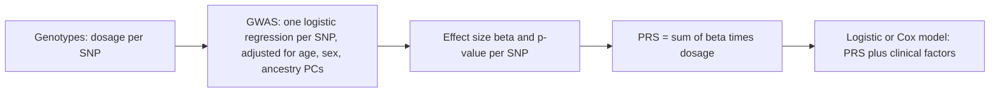

+++
summary = "Derive least squares and the normal equations, fit logistic regression by gradient descent and by Newton's method (IRLS) from scratch, and interpret coefficients as odds ratios per risk allele or per SD of LDL."
+++

# Linear and Logistic Regression

Almost every published result in cardiovascular genetics is a regression coefficient. A genome-wide association study runs one logistic regression per variant; a polygenic risk score is a weighted sum whose weights come from those regressions; and clinical risk calculators are regression models too. Before we build deep networks it is worth understanding these two models completely: they are the baselines our neural network has to beat, and, as you will see in [Module 12](../../neural-networks/from-perceptron-to-mlp/), a neural network's final layer *is* a logistic regression.

## Key ideas

### Setting up the data

We have $n$ people and $p$ features. Collect the features in a **design matrix** $X \in \mathbb{R}^{n \times (p+1)}$ whose first column is all ones (for the intercept), and the outcomes in a vector $\mathbf{y} \in \mathbb{R}^{n}$. The model has a coefficient vector $\boldsymbol\beta \in \mathbb{R}^{p+1}$, and $X\boldsymbol\beta$ is the vector of linear predictions, one per person.

| Object | Shape | Example |
|---|---|---|
| $X$ | $(n, p+1)$ | rows = people; columns = 1, age, sex, SNP dosages |
| $\mathbf y$ | $(n,)$ | LDL in mmol/L (linear) or CAD yes/no (logistic) |
| $\boldsymbol\beta$ | $(p+1,)$ | intercept + one weight per feature |
| $X\boldsymbol\beta$ | $(n,)$ | linear predictor for every person |

### Linear regression and least squares

Linear regression assumes $y_i = \mathbf{x}_i^\top \boldsymbol\beta + \varepsilon_i$ and chooses $\boldsymbol\beta$ to minimise the **residual sum of squares**:

$$
L(\boldsymbol\beta) = \lVert \mathbf y - X\boldsymbol\beta \rVert^2 = (\mathbf y - X\boldsymbol\beta)^\top(\mathbf y - X\boldsymbol\beta).
$$

**Derivation of the normal equations.** Expand the product:

$$
L(\boldsymbol\beta) = \mathbf y^\top\mathbf y - 2\boldsymbol\beta^\top X^\top \mathbf y + \boldsymbol\beta^\top X^\top X \boldsymbol\beta.
$$

(The two cross terms $\mathbf y^\top X \boldsymbol\beta$ and $\boldsymbol\beta^\top X^\top \mathbf y$ are the same scalar, hence the factor 2.) Using the vector derivative rules $\nabla_{\boldsymbol\beta}(\boldsymbol\beta^\top \mathbf a) = \mathbf a$ and $\nabla_{\boldsymbol\beta}(\boldsymbol\beta^\top A \boldsymbol\beta) = 2A\boldsymbol\beta$ for symmetric $A$ (see [derivatives and gradients](../../calculus-and-optimization/derivatives-and-gradients/)):

$$
\nabla L = -2X^\top\mathbf y + 2X^\top X\boldsymbol\beta.
$$

Setting the gradient to zero:

> [!IMPORTANT]
> **Normal equations**
> $$X^\top X\,\hat{\boldsymbol\beta} = X^\top \mathbf y \qquad\Longrightarrow\qquad \hat{\boldsymbol\beta} = (X^\top X)^{-1} X^\top \mathbf y \quad \text{(if } X^\top X \text{ is invertible)}.$$

The Hessian is $2X^\top X$, which is positive semi-definite ($\mathbf v^\top X^\top X \mathbf v = \lVert X\mathbf v\rVert^2 \ge 0$), so $L$ is convex and this stationary point is a global minimum. It is unique when $X$ has full column rank, which fails when features are perfectly collinear or when $p + 1 > n$. That second case is the normal state of affairs in genomics and is the subject of the [next chapter](../../classical-machine-learning/regularization-and-the-bias-variance-tradeoff/).

**Geometric reading.** The normal equations say $X^\top(\mathbf y - X\hat{\boldsymbol\beta}) = \mathbf 0$: the residual vector is **orthogonal to every column of $X$**. The fitted values $X\hat{\boldsymbol\beta}$ are the orthogonal projection of $\mathbf y$ onto the column space of $X$. With an intercept column, orthogonality to $\mathbf 1$ means residuals sum to zero.

**Probabilistic reading.** If $\varepsilon_i \sim \mathcal N(0, \sigma^2)$ independently, the log-likelihood is $-\tfrac{1}{2\sigma^2}\lVert\mathbf y - X\boldsymbol\beta\rVert^2$ plus a constant, so least squares is **maximum likelihood** under Gaussian noise (see [distributions and likelihood](../../probability-and-statistics/distributions-and-likelihood/)).

> [!NOTE]
> In practice you never invert $X^\top X$. Solving the linear system (`np.linalg.solve`) or, better, using a QR or SVD-based least-squares routine (`np.linalg.lstsq`) is faster and numerically more stable, because forming $X^\top X$ squares the condition number.

### From lines to probabilities: logistic regression

For a yes/no outcome (CAD by age 70, say) we want $p_i = P(y_i = 1 \mid \mathbf x_i)$, a number in $(0, 1)$. A linear predictor $z_i = \mathbf x_i^\top\boldsymbol\beta$ ranges over all real numbers, so we squash it with the **sigmoid** (logistic) function:

$$
\sigma(z) = \frac{1}{1 + e^{-z}}, \qquad p_i = \sigma(\mathbf x_i^\top \boldsymbol\beta).
$$

Properties worth knowing: $\sigma(0) = 0.5$; $\sigma(-z) = 1 - \sigma(z)$; and

$$
\sigma'(z) = \frac{e^{-z}}{(1+e^{-z})^2} = \sigma(z)\,\big(1 - \sigma(z)\big).
$$

Inverting the sigmoid gives the **logit**, the log of the odds:

$$
\log\frac{p}{1-p} = \mathbf x^\top\boldsymbol\beta = \beta_0 + \beta_1 x_1 + \cdots + \beta_p x_p.
$$

So logistic regression is a *linear model for the log-odds*.

### Logistic regression as a generalised linear model

A **generalised linear model (GLM)** has three parts:

| Part | Linear regression | Logistic regression |
|---|---|---|
| Distribution of $y$ | Gaussian | Bernoulli |
| Linear predictor | $\eta = \mathbf x^\top\boldsymbol\beta$ | $\eta = \mathbf x^\top\boldsymbol\beta$ |
| Link $g(\mathbb E[y]) = \eta$ | identity | logit |

Poisson regression (counts, log link) and the Cox model for time-to-event outcomes belong to the same broad family of ideas.

### The likelihood and its gradient

Each outcome is Bernoulli: $P(y_i \mid \mathbf x_i) = p_i^{y_i}(1-p_i)^{1-y_i}$. The negative log-likelihood (the **binary cross-entropy** of [loss functions](../../calculus-and-optimization/loss-functions/)) is

$$
\ell(\boldsymbol\beta) = -\sum_{i=1}^{n}\big[y_i\log p_i + (1-y_i)\log(1-p_i)\big] = \sum_{i=1}^{n}\big[\log(1 + e^{z_i}) - y_i z_i\big],
$$

where the second form uses $\log p_i = z_i - \log(1+e^{z_i})$ and $\log(1-p_i) = -\log(1+e^{z_i})$.

Differentiate one term with respect to $z_i$: $\frac{d}{dz}\log(1+e^{z}) = \sigma(z)$, so $\partial \ell_i/\partial z_i = p_i - y_i$. By the chain rule with $\partial z_i / \partial \boldsymbol\beta = \mathbf x_i$:

> [!IMPORTANT]
> **Gradient and Hessian of the logistic loss**
> $$\nabla\ell = X^\top(\mathbf p - \mathbf y), \qquad \nabla^2\ell = X^\top W X, \quad W = \operatorname{diag}\big(p_i(1-p_i)\big).$$

The gradient has the same "features times residuals" form as linear regression ($\nabla L = -2X^\top(\mathbf y - X\boldsymbol\beta)$). The Hessian is positive semi-definite, so $\ell$ is **convex**: there are no bad local minima. But unlike least squares, setting the gradient to zero has no closed-form solution because $\mathbf p$ depends non-linearly on $\boldsymbol\beta$. We iterate.

### Fitting by gradient descent

$$
\boldsymbol\beta \leftarrow \boldsymbol\beta - \eta\,\frac{1}{n}X^\top(\mathbf p - \mathbf y).
$$

Simple, cheap per step ($O(np)$), and it scales to huge data with mini-batches (see [gradient descent and optimisers](../../calculus-and-optimization/gradient-descent-and-optimizers/)). It may need thousands of steps, and standardising features helps a lot.

### Fitting by Newton's method (IRLS)

Newton's method uses curvature: approximate $\ell$ by its second-order Taylor expansion and jump to that quadratic's minimum:

$$
\boldsymbol\beta \leftarrow \boldsymbol\beta + (X^\top W X)^{-1} X^\top(\mathbf y - \mathbf p).
$$

Rewriting with a "working response" $\mathbf z^{*} = X\boldsymbol\beta + W^{-1}(\mathbf y - \mathbf p)$ gives $\boldsymbol\beta_{\text{new}} = (X^\top W X)^{-1}X^\top W\mathbf z^{*}$: each step is a **weighted least-squares** fit, which is why the method is called **iteratively reweighted least squares (IRLS)**. It typically converges in 5–10 iterations, but each iteration solves a $(p+1) \times (p+1)$ system, $O(np^2 + p^3)$, which is impractical for very large $p$.

A bonus: at the optimum, $(X^\top W X)^{-1}$ estimates the covariance of $\hat{\boldsymbol\beta}$ (the inverse Fisher information). Its diagonal gives standard errors, Wald tests and confidence intervals, which is exactly what GWAS software reports.

### Interpreting coefficients: odds ratios

Increase feature $x_j$ by one unit, holding the others fixed. The log-odds rise by $\beta_j$, so the odds are multiplied by

$$
\mathrm{OR}_j = e^{\beta_j}.
$$

- **Per allele.** With an additive dosage coding (0, 1, 2 risk alleles), $e^{\beta}$ is the **odds ratio per allele**; carrying two copies multiplies the odds by $e^{2\beta} = \mathrm{OR}^2$. Common CAD risk variants have small per-allele odds ratios; the well-known 9p21 locus is among the strongest common ones, with roughly 1.2–1.3 per allele.
- **Per SD.** If LDL is standardised, $e^{\beta}$ is the odds ratio **per standard deviation** of LDL. Standardising puts features on comparable scales, but the OR then depends on the SD in *your* cohort.
- **Odds are not probabilities.** An OR of 2 doubles the odds, not the risk. When the outcome is rare the two are close ($p/(1-p) \approx p$), but for common outcomes the risk ratio is noticeably smaller than the odds ratio.

> [!WARNING]
> **Separation.** If some combination of features perfectly separates cases from controls (for example a rare variant carried only by cases), the likelihood keeps increasing as a coefficient goes to $\pm\infty$ and the MLE does not exist. Software may report a huge coefficient with an enormous standard error, or fail to converge. Penalisation (next chapter) or Firth's correction fixes this.

## Worked example

### Least squares by hand

Four people have $x = 1, 2, 3, 4$ LDL-raising alleles (summed over a few SNPs) and LDL $y = 2, 3, 5, 6$ mmol/L (made-up numbers).

$$
X = \begin{bmatrix} 1 & 1 \\ 1 & 2 \\ 1 & 3 \\ 1 & 4 \end{bmatrix}, \quad
X^\top X = \begin{bmatrix} 4 & 10 \\ 10 & 30 \end{bmatrix}, \quad
X^\top \mathbf y = \begin{bmatrix} 2+3+5+6 \\ 2+6+15+24 \end{bmatrix} = \begin{bmatrix} 16 \\ 47 \end{bmatrix}.
$$

$\det(X^\top X) = 4 \cdot 30 - 10 \cdot 10 = 20$, so

$$
\hat{\boldsymbol\beta} = \frac{1}{20}\begin{bmatrix} 30 & -10 \\ -10 & 4 \end{bmatrix}\begin{bmatrix} 16 \\ 47 \end{bmatrix} = \frac{1}{20}\begin{bmatrix} 480 - 470 \\ -160 + 188 \end{bmatrix} = \begin{bmatrix} 0.5 \\ 1.4 \end{bmatrix}.
$$

Fitted line $\hat y = 0.5 + 1.4x$: each extra allele adds 1.4 mmol/L in this toy data. Residuals $y - \hat y = 0.1, -0.3, 0.3, -0.1$. Check orthogonality: they sum to 0, and $1(0.1) + 2(-0.3) + 3(0.3) + 4(-0.1) = 0.1 - 0.6 + 0.9 - 0.4 = 0$.

### One Newton step for logistic regression

Six people with risk-allele dosage $x = 0, 0, 1, 1, 2, 2$ and CAD status $y = 0, 1, 0, 0, 1, 1$. Start at $\boldsymbol\beta = (0, 0)$, so every $p_i = 0.5$ and every weight $p_i(1-p_i) = 0.25$.

**Gradient part.** $\mathbf y - \mathbf p = (-0.5, 0.5, -0.5, -0.5, 0.5, 0.5)$.

$$
X^\top(\mathbf y - \mathbf p) = \begin{bmatrix} \sum (y_i - p_i) \\ \sum x_i(y_i - p_i) \end{bmatrix} = \begin{bmatrix} 0 \\ 0 + 0 - 0.5 - 0.5 + 1 + 1 \end{bmatrix} = \begin{bmatrix} 0 \\ 1 \end{bmatrix}.
$$

**Hessian.** $X^\top W X = 0.25 \begin{bmatrix} 6 & \sum x_i \\ \sum x_i & \sum x_i^2 \end{bmatrix} = 0.25\begin{bmatrix} 6 & 6 \\ 6 & 10 \end{bmatrix} = \begin{bmatrix} 1.5 & 1.5 \\ 1.5 & 2.5 \end{bmatrix}$, with determinant $3.75 - 2.25 = 1.5$.

**Step.**

$$
\Delta = \frac{1}{1.5}\begin{bmatrix} 2.5 & -1.5 \\ -1.5 & 1.5 \end{bmatrix}\begin{bmatrix} 0 \\ 1 \end{bmatrix} = \begin{bmatrix} -1 \\ 1 \end{bmatrix}, \qquad \boldsymbol\beta^{(1)} = (-1, 1).
$$

Further iterations give $(-1.0963, 1.0963)$, then converge to $\hat\beta_0 = -\ln 3 \approx -1.0986$, $\hat\beta_1 = \ln 3 \approx 1.0986$. So the estimated **odds ratio per allele is exactly 3**, and the fitted risks are $\sigma(-\ln 3) = 0.25$, $\sigma(0) = 0.5$ and $\sigma(\ln 3) = 0.75$ for 0, 1 and 2 alleles.

### Reading a fitted model

Suppose a fitted model is $\operatorname{logit} p = -3 + 0.25\,(\text{risk alleles}) + 0.4\,(\text{LDL, per SD})$ (illustrative numbers). For someone with 2 risk alleles and LDL 1.5 SD above the mean:

$$
z = -3 + 0.5 + 0.6 = -1.9, \qquad p = \frac{1}{1 + e^{1.9}} = \frac{1}{1 + 6.686} \approx 0.130.
$$

For someone with no risk alleles and average LDL, $p = \sigma(-3) \approx 0.047$. The odds ratio per allele is $e^{0.25} \approx 1.28$, and per SD of LDL $e^{0.4} \approx 1.49$.

## In code

First, linear regression: the hand example, then a larger synthetic problem solved three ways.

```python
import numpy as np
from sklearn.linear_model import LinearRegression

# The hand-worked example
x = np.array([1.0, 2.0, 3.0, 4.0])
y = np.array([2.0, 3.0, 5.0, 6.0])
X = np.column_stack([np.ones_like(x), x])            # (4, 2) design matrix
print("X^T X =\n", X.T @ X, "\nX^T y =", X.T @ y)
beta = np.linalg.solve(X.T @ X, X.T @ y)             # normal equations
print("beta (intercept, slope):", beta)
resid = y - X @ beta
print("residuals:", resid, " X^T r =", (X.T @ resid).round(12))

# A bigger synthetic problem: LDL ~ age + sex + 3 SNP dosages
rng = np.random.default_rng(0)
n = 1000
F = np.column_stack([rng.normal(55, 8, n),            # age in years
                     rng.integers(0, 2, n),           # sex (0/1)
                     rng.binomial(2, 0.3, (n, 3))])   # three SNP dosages
true = np.array([0.02, -0.2, 0.15, 0.0, -0.10])
ldl = 2.0 + F @ true + rng.normal(0, 0.8, n)          # mmol/L
Xb = np.column_stack([np.ones(n), F])                 # (1000, 6)
b_ne = np.linalg.solve(Xb.T @ Xb, Xb.T @ ldl)
b_ls, *_ = np.linalg.lstsq(Xb, ldl, rcond=None)       # QR/SVD based, more stable
sk = LinearRegression().fit(F, ldl)
print("normal eq.:", b_ne.round(4))
print("lstsq     :", b_ls.round(4))
print("sklearn   :", np.r_[sk.intercept_, sk.coef_].round(4))
```

```text
X^T X =
 [[ 4. 10.]
 [10. 30.]] 
X^T y = [16. 47.]
beta (intercept, slope): [0.5 1.4]
residuals: [ 0.1 -0.3  0.3 -0.1]  X^T r = [0. 0.]
normal eq.: [ 1.9107  0.0212 -0.1407  0.1198  0.0116 -0.0872]
lstsq     : [ 1.9107  0.0212 -0.1407  0.1198  0.0116 -0.0872]
sklearn   : [ 1.9107  0.0212 -0.1407  0.1198  0.0116 -0.0872]
```

The estimates are close to, but not exactly, the true values $(2.0, 0.02, -0.2, 0.15, 0, -0.10)$; with $n = 1000$ and noise SD 0.8 that sampling error is expected.

Now logistic regression on 5,000 synthetic people with a risk SNP, standardised LDL and standardised age. We fit it by gradient descent, by Newton/IRLS, and with scikit-learn (no penalty), and report odds ratios with Wald 95% confidence intervals from the inverse Hessian.

```python
import numpy as np
from sklearn.linear_model import LogisticRegression

rng = np.random.default_rng(0)
n = 5000
snp = rng.binomial(2, 0.45, n)                       # risk-allele dosage 0/1/2
ldl = rng.normal(0, 1, n)                            # LDL, standardised (per SD)
age = rng.normal(0, 1, n)                            # age, standardised
X = np.column_stack([np.ones(n), snp, ldl, age])     # (n, 4) with intercept column
beta_true = np.array([-2.5, 0.25, 0.45, 0.70])
p_true = 1 / (1 + np.exp(-X @ beta_true))
y = rng.binomial(1, p_true)                          # CAD yes/no
print("prevalence:", y.mean().round(3))

def sigmoid(z):
    return 1 / (1 + np.exp(-z))

def nll(beta):                                       # average negative log-likelihood
    z = X @ beta
    return np.mean(np.logaddexp(0, z) - y * z)

# 1) Gradient descent
beta = np.zeros(4)
lr = 0.5
for it in range(5000):
    grad = X.T @ (sigmoid(X @ beta) - y) / n         # (4,)
    beta -= lr * grad
print("GD     :", beta.round(4), " NLL", nll(beta).round(6))

# 2) Newton / IRLS
beta_n = np.zeros(4)
for it in range(8):
    p = sigmoid(X @ beta_n)
    W = p * (1 - p)                                  # (n,) diagonal weights
    H = X.T @ (X * W[:, None])                       # (4, 4) = X^T W X
    g = X.T @ (y - p)                                # (4,)
    beta_n = beta_n + np.linalg.solve(H, g)
    print(f"  Newton iter {it + 1}: NLL {nll(beta_n):.8f}")
print("Newton :", beta_n.round(4))

# 3) scikit-learn, no penalty (C = infinity)
sk = LogisticRegression(C=np.inf, tol=1e-10, max_iter=10_000).fit(X[:, 1:], y)
print("sklearn:", np.r_[sk.intercept_, sk.coef_.ravel()].round(4))
se = np.sqrt(np.diag(np.linalg.inv(H)))
for name, b, s in zip(["intercept", "snp", "ldl", "age"], beta_n, se):
    print(f"{name:9s} beta={b:+.3f}  OR={np.exp(b):.3f}  "
          f"95% CI {np.exp(b - 1.96 * s):.3f}-{np.exp(b + 1.96 * s):.3f}")
```

```text
prevalence: 0.11
GD     : [-2.5299  0.148   0.5478  0.6986]  NLL 0.312474
  Newton iter 1: NLL 0.34424462
  Newton iter 2: NLL 0.31565928
  Newton iter 3: NLL 0.31254164
  Newton iter 4: NLL 0.31247366
  Newton iter 5: NLL 0.31247361
  Newton iter 6: NLL 0.31247361
  Newton iter 7: NLL 0.31247361
  Newton iter 8: NLL 0.31247361
Newton : [-2.5299  0.148   0.5478  0.6986]
sklearn: [-2.5299  0.148   0.5478  0.6986]
intercept beta=-2.530  OR=0.080  95% CI 0.067-0.094
snp       beta=+0.148  OR=1.160  95% CI 1.018-1.321
ldl       beta=+0.548  OR=1.730  95% CI 1.571-1.904
age       beta=+0.699  OR=2.011  95% CI 1.824-2.218
```

All three methods agree to four decimals. Newton converges in about 5 iterations (the NLL stops changing in the 8th digit); gradient descent needed thousands. The true SNP effect was 0.25 (OR 1.28), but the estimate is 0.148 (OR 1.16) with a wide interval: with 5,000 people and a small per-allele effect, single-SNP estimates are noisy. This is why GWAS need hundreds of thousands of participants.

## Biomedical connection



- **GWAS are regressions.** For each variant, [GWAS](../../genomics-foundations/gwas-and-polygenic-risk-scores/) fit $\operatorname{logit} P(\text{CAD}) = \beta_0 + \beta_{\text{SNP}}\,g + \boldsymbol\gamma^\top(\text{covariates})$. The reported "OR per allele" is $e^{\hat\beta_{\text{SNP}}}$. Ancestry principal components (from [PCA](../../linear-algebra/eigenvectors-svd-and-pca/)) are included as covariates to reduce confounding by population structure.
- **A PRS is a linear predictor.** $\text{PRS}_i = \sum_j \hat\beta_j g_{ij}$, i.e. $G\hat{\boldsymbol\beta}$. Khera and colleagues (2018) reported that about 8% of people in UK Biobank had a genome-wide CAD score conferring at least threefold increased risk, comparable to carrying a monogenic familial hypercholesterolaemia variant.
- **Clinical risk models** combine age, sex, cholesterol, blood pressure, smoking and diabetes. Widely used calculators such as the Pooled Cohort Equations and QRISK are survival (Cox) models rather than plain logistic regression, but the coefficient interpretation (log hazard ratios instead of log odds ratios) is closely analogous.

> [!CAUTION]
> Regression coefficients describe **associations** in the cohort studied, not guaranteed causal effects for an individual. An odds ratio estimated in one population (often of European ancestry) may not transfer to another. Risk models are tools for decision support and must be validated and calibrated for the population where they are used.

## Practice

1. Show that with only an intercept column ($X = \mathbf 1$), the least-squares estimate is the sample mean.

<details>
<summary>Answer</summary>

$X^\top X = \mathbf 1^\top \mathbf 1 = n$ and $X^\top \mathbf y = \sum_i y_i$, so $\hat\beta_0 = \frac{1}{n}\sum_i y_i = \bar y$.

</details>

2. Fit $y = \beta_0 + \beta_1 x$ by least squares to the points $(0, 1), (1, 3), (2, 5)$.

<details>
<summary>Answer</summary>

$X^\top X = \begin{bmatrix} 3 & 3 \\ 3 & 5 \end{bmatrix}$, $X^\top \mathbf y = \begin{bmatrix} 9 \\ 13 \end{bmatrix}$, determinant $6$. $\hat{\boldsymbol\beta} = \tfrac16\begin{bmatrix} 5 & -3 \\ -3 & 3 \end{bmatrix}\begin{bmatrix} 9 \\ 13 \end{bmatrix} = \tfrac16\begin{bmatrix} 6 \\ 12 \end{bmatrix} = (1, 2)$. The points lie exactly on $y = 1 + 2x$.

</details>

3. A SNP has per-allele OR 1.25 in an additive logistic model. What is the OR for two copies versus zero? What is $\beta$?

<details>
<summary>Answer</summary>

$\beta = \ln 1.25 \approx 0.223$. Two copies: $e^{2\beta} = 1.25^2 = 1.5625$.

</details>

4. Using $\sigma'(z) = \sigma(z)(1-\sigma(z))$, verify $\partial \ell_i / \partial z_i = p_i - y_i$ starting from $\ell_i = -[y_i\log p_i + (1-y_i)\log(1-p_i)]$.

<details>
<summary>Answer</summary>

$\frac{\partial \ell_i}{\partial p_i} = -\frac{y_i}{p_i} + \frac{1-y_i}{1-p_i}$ and $\frac{\partial p_i}{\partial z_i} = p_i(1-p_i)$. Multiply: $-y_i(1-p_i) + (1-y_i)p_i = p_i - y_i$.

</details>

5. A person's baseline 10-year risk is 5%. A risk factor has OR 2. What is their risk if they have the factor (assuming the OR applies)? Is the risk ratio 2?

<details>
<summary>Answer</summary>

Baseline odds $0.05/0.95 \approx 0.0526$; doubled: $0.1053$; risk $0.1053/1.1053 \approx 0.0952$, about 9.5%. The risk ratio is $0.0952/0.05 \approx 1.90$, slightly less than 2, because the outcome is fairly rare. For a 40% baseline risk the gap would be much larger (odds $0.667 \to 1.333$, risk $57\%$, risk ratio $1.43$).

</details>

## Further reading

- Hastie, T., Tibshirani, R. and Friedman, J. (2009). *The Elements of Statistical Learning*, 2nd edition. Springer. Chapters 3 and 4.
- James, G., Witten, D., Hastie, T. and Tibshirani, R. (2021). *An Introduction to Statistical Learning*, 2nd edition. Springer. Chapters 3 and 4.
- McCullagh, P. and Nelder, J. A. (1989). *Generalized Linear Models*, 2nd edition. Chapman and Hall.
- Agresti, A. (2013). *Categorical Data Analysis*, 3rd edition. Wiley.
- Khera, A. V. et al. (2018). Genome-wide polygenic scores for common diseases identify individuals with risk equivalent to monogenic mutations. *Nature Genetics* 50(9).
