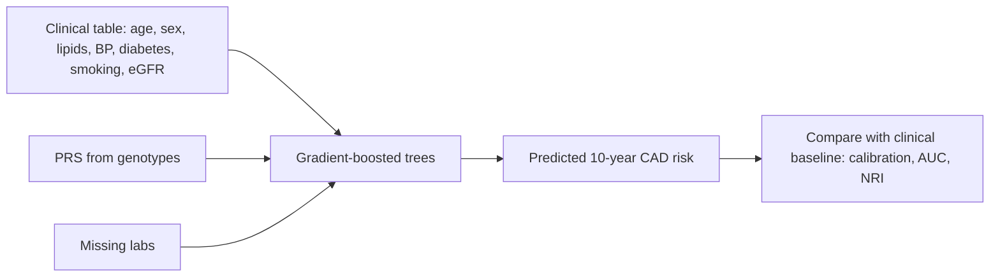

+++
summary = "Grow a decision tree by Gini or entropy split search, explain why random forests reduce variance and how OOB error works, derive gradient boosting as gradient descent in function space (with XGBoost's second-order leaf weights), and avoid the classic feature-importance traps."
+++

# Trees, Forests and Boosting

Logistic regression assumes that each feature adds a fixed amount to the log-odds. Real clinical risk is messier: the effect of blood pressure may matter mostly in smokers, LDL may act more like a threshold than a straight line, and genetic risk may matter most in younger people. You can hand-craft interaction and spline terms, but you must guess them in advance.

**Decision trees** discover such structure automatically by repeatedly splitting the data. A single tree is unstable, but **ensembles** of trees (random forests and gradient boosting) are among the most accurate off-the-shelf methods for tabular data: the kind of spreadsheet of age, sex, lipids, blood pressure, diabetes status and polygenic score that makes up most clinical prediction problems. In the capstone, a well-tuned gradient-boosting model will be one of the baselines a deep model has to beat.

## Key ideas

### Decision trees

A tree asks a sequence of yes/no questions of the form "is feature $j \le t$?". Each internal node holds one question; each leaf holds a prediction (a class probability for classification, a mean for regression). To predict for a new person, drop them down the tree.

Trees are grown **greedily, top down**: at each node, choose the feature and threshold that make the two children as "pure" as possible, then recurse on each child. Stop when a node is pure, too small, or the tree is deep enough.

### Impurity: Gini and entropy

For a node whose people have class proportions $p_1, \ldots, p_K$:

> [!IMPORTANT]
> $$\text{Gini} = 1 - \sum_{k} p_k^2, \qquad \text{Entropy} = -\sum_k p_k \log_2 p_k.$$
> A split of a node with $n$ people into children of sizes $n_L$ and $n_R$ is scored by the **impurity decrease**
> $$\Delta = I(\text{parent}) - \frac{n_L}{n} I(L) - \frac{n_R}{n} I(R).$$

Both are 0 for a pure node and largest for a 50/50 node (Gini 0.5, entropy 1 bit for two classes). Gini is the probability that two people drawn at random (with replacement) from the node have different labels; entropy is the [information-theoretic](../../probability-and-statistics/information-theory/) uncertainty, and its decrease is called **information gain**. In practice they choose very similar splits. For regression trees the impurity is the variance (mean squared error) of the outcome in the node.

### Split search

For one numeric feature, sort the node's people by that feature. Every boundary between two distinct consecutive values is a candidate threshold (use the midpoint). Scanning left to right, the class counts on each side can be updated in $O(1)$ per step, so all thresholds for one feature cost $O(n \log n)$ for the sort plus $O(n)$ for the scan. Repeat for every feature and keep the best. Histogram-based implementations (LightGBM, scikit-learn's `HistGradientBoosting`) first bucket each feature into, say, 255 bins, so the scan costs $O(\text{bins})$ instead of $O(n)$.

### Why single trees are not enough

Trees have attractive properties: they handle mixed feature types, need no scaling, capture interactions and thresholds, and are easy to read when shallow. But a deep tree has **high variance**: a small change in the data can change the first split, and with it the entire tree below. Shallow trees, on the other hand, are biased (too coarse). Ensembles fix this in two opposite ways: random forests average many deep, low-bias trees to cut variance; boosting adds many shallow, high-bias trees to cut bias.

### Bagging and random forests

**Bagging** (bootstrap aggregating): draw $B$ bootstrap samples (each $n$ people drawn with replacement), grow a deep tree on each, and average their predictions.

Why does averaging help? Let the trees' predictions at a point be identically distributed with variance $\sigma^2$ and pairwise correlation $\rho$. Then

$$
\operatorname{Var}\Big(\frac1B\sum_{b=1}^B T_b\Big) = \frac{1}{B^2}\Big[B\sigma^2 + B(B-1)\rho\sigma^2\Big] = \rho\sigma^2 + \frac{1-\rho}{B}\sigma^2.
$$

> [!IMPORTANT]
> As $B \to \infty$ the variance falls to $\rho\sigma^2$, not to zero. Adding trees never hurts, but beyond a point it stops helping. To go further you must make the trees **less correlated**.

**Random forests** decorrelate the trees with one extra trick: at each split, consider only a random subset of $m$ features (commonly $m \approx \sqrt p$ for classification). A strong feature can no longer dominate the top of every tree, so the trees differ more, $\rho$ falls, and the average improves.

**Out-of-bag (OOB) error.** The probability that a given person is *not* in a bootstrap sample is $(1 - 1/n)^n \to e^{-1} \approx 0.368$. So each person is left out of about a third of the trees. Predicting each person using only the trees that did not see them gives an honest, almost free estimate of test performance, without a separate validation set.

### Gradient boosting: gradient descent in function space

Boosting builds an **additive** model one small tree at a time, each tree correcting the current errors:

$$
F_M(\mathbf x) = F_0 + \nu\sum_{m=1}^{M} h_m(\mathbf x),
$$

where $\nu \in (0, 1]$ is the **learning rate** (shrinkage).

**Derivation.** We want to minimise the training loss $\mathcal L(F) = \sum_i L\big(y_i, F(\mathbf x_i)\big)$. Think of the vector of current predictions $\mathbf F = (F(\mathbf x_1), \ldots, F(\mathbf x_n))$ as the parameter. [Gradient descent](../../calculus-and-optimization/gradient-descent-and-optimizers/) on $\mathbf F$ would update

$$
F(\mathbf x_i) \leftarrow F(\mathbf x_i) - \nu\, g_i, \qquad g_i = \frac{\partial L(y_i, F)}{\partial F}\Big|_{F = F(\mathbf x_i)}.
$$

But that only defines the update at the training points. To get a *function* we can apply to new people, we fit a regression tree $h_m$ to the **negative gradients** (the "pseudo-residuals") $r_i = -g_i$, and step in the direction of that tree. Gradient boosting is gradient descent in which each step is projected onto the space of small trees.

| Loss | $L(y, F)$ | Pseudo-residual $r_i = -\partial L/\partial F$ |
|---|---|---|
| Squared error | $\tfrac12(y - F)^2$ | $y_i - F(\mathbf x_i)$: the ordinary residual |
| Log-loss ($F$ = log-odds) | $\log(1 + e^{F}) - yF$ | $y_i - p_i$, with $p_i = \sigma(F(\mathbf x_i))$ |

For log-loss the pseudo-residual is exactly the "features times residual" quantity from [logistic regression](../../classical-machine-learning/linear-and-logistic-regression/). The initial model $F_0$ is the best constant: the mean for squared error, the overall log-odds $\log\frac{\bar y}{1-\bar y}$ for log-loss.

### Second-order leaves: the XGBoost idea

Once a tree's structure is chosen, what value $w_j$ should leaf $j$ output? XGBoost expands the loss to **second order** around the current predictions, with $g_i$ the gradient and $h_i$ the second derivative, and adds a penalty $\Omega = \gamma T + \tfrac12\lambda\sum_j w_j^2$ on the number of leaves $T$ and the leaf values. For the people $I_j$ in leaf $j$, with $G_j = \sum_{i \in I_j} g_i$ and $H_j = \sum_{i \in I_j} h_i$:

$$
\sum_{i \in I_j}\Big[g_i w_j + \tfrac12 h_i w_j^2\Big] + \tfrac12\lambda w_j^2 = G_j w_j + \tfrac12 (H_j + \lambda) w_j^2.
$$

Minimising this quadratic in $w_j$:

> [!IMPORTANT]
> **Optimal leaf weight and split gain**
> $$w_j^* = -\frac{G_j}{H_j + \lambda}, \qquad \text{Gain} = \frac12\left[\frac{G_L^2}{H_L + \lambda} + \frac{G_R^2}{H_R + \lambda} - \frac{(G_L + G_R)^2}{H_L + H_R + \lambda}\right] - \gamma.$$

Each leaf takes one **Newton step**. For log-loss, $g_i = p_i - y_i$ and $h_i = p_i(1 - p_i)$, so $w_j^* = \sum (y_i - p_i) / (\sum p_i(1-p_i) + \lambda)$, the same as one IRLS step restricted to the leaf. The gain formula replaces Gini as the split criterion, and a split is made only if the gain exceeds $\gamma$.

Other ideas in modern libraries:

- **XGBoost:** the regularised second-order objective above, plus column and row subsampling and sparsity-aware handling of missing values (each split learns a default direction).
- **LightGBM:** histogram-based split finding, **leaf-wise** growth (always split the leaf with the largest gain, rather than growing level by level), and sampling tricks for speed on large data.
- **CatBoost:** careful handling of categorical features.

The main hyperparameters are the learning rate $\nu$, the number of trees $M$ (chosen by early stopping on validation data), tree depth or number of leaves, the minimum leaf size, $\lambda$, and subsampling rates. A smaller $\nu$ with more trees almost always generalises better, at more compute.

### Feature importance pitfalls

Tree ensembles report a **feature importance**, and it is tempting to read it as "what drives heart disease". Be careful:

1. **Impurity-based importance (MDI)**, the default `feature_importances_` in scikit-learn, sums the impurity decrease from every split on a feature. It is computed on the **training** data and is biased towards features with many possible split points (continuous variables, high-cardinality IDs), which can look important even if they are pure noise.
2. **Correlated features share or steal credit.** With two near-duplicate features, importance can be split between them, or one can absorb it all; permutation importance of either one alone can be near zero because the other compensates.
3. **Importance is not causation, and not direction.** It tells you what the *model* uses, not what changes *risk*, and not whether the effect is positive or negative.

Better tools: **permutation importance on held-out data** (how much does the test metric drop when one feature's values are shuffled?), grouped permutation for correlated features, and SHAP values for per-person attributions (see [interpretability](../../deep-architectures-for-sequences/interpretability/)).

### When trees beat neural networks on tabular data

On medium-sized tabular datasets, well-tuned gradient-boosted trees usually match or beat deep networks. Benchmarks such as Grinsztajn, Oyallon and Varoquaux (2022) point to reasons that fit clinical data well:

- **Irregular target functions.** Thresholds and step-like effects are natural for trees; neural networks are biased towards smooth functions.
- **Uninformative features.** Trees ignore useless columns easily; MLPs are hurt more by them.
- **No natural geometry.** Columns like "age", "smoker" and "creatinine" have different meanings, and rotating them into combinations (what an MLP's first layer does) is not a helpful bias.
- **Practicalities.** Mixed types, missing values and moderate sample sizes are all handled with little tuning.

Neural networks win when the input has structure that matches their inductive biases: **raw sequences** (DNA), images (ECGs, echocardiograms, retinal photos), text, or very large datasets. That is precisely why a heart-disease model that reads DNA sequence directly needs deep learning, while the clinical-variables part of it is often best served by boosting or by feeding a boosting model's output into the final combination.

## Worked example

### Choosing a split by hand

Ten people, with LDL (mmol/L), smoking status and CAD status (made-up data):

| Person | 1 | 2 | 3 | 4 | 5 | 6 | 7 | 8 | 9 | 10 |
|---|---|---|---|---|---|---|---|---|---|---|
| LDL | 5.1 | 4.6 | 4.4 | 4.2 | 3.9 | 3.5 | 3.2 | 3.0 | 2.8 | 2.5 |
| Smoker | 1 | 0 | 1 | 0 | 1 | 0 | 1 | 0 | 1 | 0 |
| CAD | 1 | 1 | 1 | 0 | 1 | 0 | 0 | 0 | 0 | 0 |

**Root.** 4 cases out of 10: Gini $= 1 - (0.4^2 + 0.6^2) = 1 - 0.52 = 0.48$; entropy $= -(0.4\log_2 0.4 + 0.6\log_2 0.6) \approx 0.971$ bits.

**Candidate: smoker.** Smokers (1, 3, 5, 7, 9) have 3 cases of 5: Gini $1 - (0.36 + 0.16) = 0.48$. Non-smokers have 1 case of 5: Gini $1 - (0.04 + 0.64) = 0.32$. Weighted: $0.5(0.48) + 0.5(0.32) = 0.40$. Decrease $0.48 - 0.40 = 0.08$.

**Candidate: LDL $> 4.3$** (between 4.4 and 4.2). Left = people 1–3, all cases: Gini 0. Right = people 4–10, 1 case of 7: Gini $1 - (1/49 + 36/49) = 12/49 \approx 0.245$. Weighted: $0.7 \times 0.245 = 0.171$. Decrease $\approx 0.309$.

**Candidate: LDL $> 3.7$** (between 3.9 and 3.5). Left = people 1–5, 4 cases of 5: Gini $1 - (0.64 + 0.04) = 0.32$. Right = people 6–10, no cases: Gini 0. Weighted: $0.5 \times 0.32 = 0.16$. Decrease $= 0.32$.

The best split is **LDL > 3.7** (decrease 0.32). Using entropy: left has entropy $-(0.8\log_2 0.8 + 0.2\log_2 0.2) \approx 0.722$, weighted $0.361$, so the information gain is $0.971 - 0.361 = 0.610$, and it is also the best by entropy.

### One boosting step by hand

**Squared error.** Four people with outcomes $y = (1, 3, 5, 7)$ and one feature that orders them. $F_0 = \bar y = 4$; residuals $r = (-3, -1, 1, 3)$. The best stump splits {1, 2} from {3, 4}, with leaf values equal to the mean residual, $-2$ and $+2$. With $\nu = 0.5$: $F_1 = (4 - 1, 4 - 1, 4 + 1, 4 + 1) = (3, 3, 5, 5)$. The sum of squared residuals drops from $9 + 1 + 1 + 9 = 20$ to $4 + 0 + 0 + 4 = 8$.

**Log-loss leaf value.** A leaf contains four people with $y = (1, 1, 0, 1)$ and current prediction $p = 0.5$ for all ($F = 0$). Then $G = \sum (p_i - y_i) = 2 - 3 = -1$, $H = \sum p_i(1 - p_i) = 4 \times 0.25 = 1$, and with $\lambda = 0$ the leaf weight is $w^* = 1/1 = 1.0$. The log-odds in this leaf move from 0 to 1, i.e. $p = \sigma(1) \approx 0.73$, close to the leaf's observed rate $3/4$ (whose log-odds is $\ln 3 \approx 1.10$). With $\lambda = 1$ the step would be shrunk to $0.5$.

## In code

Impurity measures and exhaustive split search from scratch, reproducing the hand example:

```python
import numpy as np

def gini(y):
    if len(y) == 0:
        return 0.0
    p = np.bincount(y, minlength=2) / len(y)
    return 1.0 - np.sum(p ** 2)

def entropy(y):
    p = np.bincount(y, minlength=2) / len(y)
    p = p[p > 0]
    return -np.sum(p * np.log2(p))

def best_split(X, y, impurity=gini):
    """Exhaustive search over features and thresholds (midpoints between sorted values)."""
    n, best = len(y), (None, None, 0.0)
    parent = impurity(y)
    for j in range(X.shape[1]):
        order = np.argsort(X[:, j])
        xs, ys = X[order, j], y[order]
        for i in range(1, n):
            if xs[i] == xs[i - 1]:
                continue                                  # no threshold between ties
            left, right = ys[:i], ys[i:]
            child = (i * impurity(left) + (n - i) * impurity(right)) / n
            gain = parent - child
            if gain > best[2]:
                best = (j, (xs[i] + xs[i - 1]) / 2, gain)
    return best

# Hand example: 10 people; columns = LDL (mmol/L), smoker (0/1); y = CAD
X = np.array([[5.1, 1], [4.6, 0], [4.4, 1], [4.2, 0], [3.9, 1],
              [3.5, 0], [3.2, 1], [3.0, 0], [2.8, 1], [2.5, 0]])
y = np.array([1, 1, 1, 0, 1, 0, 0, 0, 0, 0])
print("root Gini:", gini(y).round(4), " root entropy:", entropy(y).round(4))
for name, imp in [("Gini", gini), ("entropy", entropy)]:
    j, t, g = best_split(X, y, imp)
    print(f"best split by {name}: feature {j} at {t:.2f}, impurity decrease {g:.4f}")
sm = X[:, 1] == 1
print("smoker split Gini decrease:",
      (gini(y) - (sm.mean() * gini(y[sm]) + (~sm).mean() * gini(y[~sm]))).round(4))
```

```text
root Gini: 0.48  root entropy: 0.971
best split by Gini: feature 0 at 3.70, impurity decrease 0.3200
best split by entropy: feature 0 at 3.70, impurity decrease 0.6100
smoker split Gini decrease: 0.08
```

Next, gradient boosting for log-loss written from scratch (regression trees fitted to $y - p$, with Newton leaf values), compared with logistic regression, a random forest and scikit-learn's histogram gradient boosting. The synthetic "clinical" data have a curved age effect, an LDL threshold, a smoking × blood-pressure interaction and a PRS × age interaction.

```python
import numpy as np
from sklearn.tree import DecisionTreeRegressor
from sklearn.ensemble import RandomForestClassifier, HistGradientBoostingClassifier
from sklearn.linear_model import LogisticRegression
from sklearn.metrics import roc_auc_score, log_loss

rng = np.random.default_rng(0)
n = 6000
age = rng.uniform(40, 80, n)
ldl = rng.normal(3.5, 1.0, n)
sbp = rng.normal(135, 18, n)
smoker = rng.binomial(1, 0.2, n)
prs = rng.normal(0, 1, n)
X = np.column_stack([age, ldl, sbp, smoker, prs])           # (n, 5)
# True log-odds: curved age effect, LDL threshold, smoking x BP and PRS x age interactions
z = (-4.5 + 0.002 * (age - 40) ** 2 + 1.2 * (ldl > 4.5) + 1.5 * smoker * (sbp > 150)
     + 1.0 * (prs > 1) * (age < 55) + 0.4 * prs)
y = rng.binomial(1, 1 / (1 + np.exp(-z)))
tr, te = np.arange(n) < 4000, np.arange(n) >= 4000
print("prevalence:", y.mean().round(3))

def boost_logloss(X, y, n_trees=150, lr=0.05, depth=3):
    """Gradient boosting for log-loss: each tree fits the negative gradient y - p."""
    F0 = np.log(y.mean() / (1 - y.mean()))                    # best constant log-odds
    F, trees = np.full(len(y), F0), []
    for m in range(n_trees):
        p = 1 / (1 + np.exp(-F))
        r = y - p                                             # pseudo-residuals
        t = DecisionTreeRegressor(max_depth=depth, min_samples_leaf=50).fit(X, r)
        # Newton step per leaf: sum(r) / sum(p(1-p)) (as in Friedman 2001 / XGBoost)
        leaf = t.apply(X)
        for lf in np.unique(leaf):
            idx = leaf == lf
            t.tree_.value[lf, 0, 0] = r[idx].sum() / (p[idx] * (1 - p[idx])).sum()
        F += lr * t.predict(X)
        trees.append(t)
    return lambda Xn: 1 / (1 + np.exp(-(F0 + lr * sum(t.predict(Xn) for t in trees))))

models = {
    "logistic regression": LogisticRegression(max_iter=2000).fit(X[tr], y[tr]).predict_proba,
    "boosting (ours)": boost_logloss(X[tr], y[tr]),
}
rf = RandomForestClassifier(n_estimators=200, min_samples_leaf=20, oob_score=True,
                            random_state=0).fit(X[tr], y[tr])
hgb = HistGradientBoostingClassifier(learning_rate=0.05, max_iter=150, max_depth=3,
                                     random_state=0).fit(X[tr], y[tr])
models["random forest"], models["HistGradientBoosting"] = rf.predict_proba, hgb.predict_proba
for name, f in models.items():
    p = f(X[te])
    p = p[:, 1] if p.ndim == 2 else p
    print(f"{name:21s} test AUC={roc_auc_score(y[te], p):.3f}  log-loss={log_loss(y[te], p):.4f}")
print("random forest OOB AUC:", round(roc_auc_score(y[tr], rf.oob_decision_function_[:, 1]), 3))
p_true = 1 / (1 + np.exp(-z))                               # oracle: the true risk
print("oracle AUC  train:", round(roc_auc_score(y[tr], p_true[tr]), 3),
      " test:", round(roc_auc_score(y[te], p_true[te]), 3))
```

```text
prevalence: 0.074
logistic regression   test AUC=0.734  log-loss=0.2409
boosting (ours)       test AUC=0.759  log-loss=0.2338
random forest         test AUC=0.758  log-loss=0.2341
HistGradientBoosting  test AUC=0.767  log-loss=0.2312
random forest OOB AUC: 0.792
oracle AUC  train: 0.821  test: 0.771
```

The tree ensembles beat logistic regression because the truth contains thresholds and interactions that a linear log-odds model cannot represent. `HistGradientBoosting` comes within 0.004 of the **oracle** that knows the true risk, which is the ceiling for this data. The OOB AUC (0.792) is computed on the training people, whose oracle ceiling happens to be higher (0.821), so it should be compared with that, not with the test numbers: the two halves of a finite sample differ.

> [!NOTE]
> If you remove the thresholds and interactions from `z` so that the true log-odds is linear, logistic regression usually matches or beats the ensembles. Flexible models only pay off when there is non-linear structure to find and enough data to find it.

Finally, the feature-importance pitfalls in action. Risk depends on LDL and smoking only; `ldl_copy` is a noisy duplicate of LDL, and two columns are pure noise.

```python
import numpy as np
from sklearn.ensemble import RandomForestClassifier
from sklearn.inspection import permutation_importance

rng = np.random.default_rng(1)
n = 3000
ldl = rng.normal(3.5, 1.0, n)
ldl_copy = ldl + rng.normal(0, 0.1, n)                 # a near-duplicate (e.g. calculated LDL)
smoker = rng.binomial(1, 0.2, n)
noise_cont = rng.normal(0, 1, n)                       # pure noise, continuous
noise_bin = rng.binomial(1, 0.5, n)                    # pure noise, binary
X = np.column_stack([ldl, ldl_copy, smoker, noise_cont, noise_bin])
names = ["ldl", "ldl_copy", "smoker", "noise_cont", "noise_bin"]
z = -3 + 0.8 * (ldl - 3.5) + 1.0 * smoker
y = rng.binomial(1, 1 / (1 + np.exp(-z)))
tr, te = np.arange(n) < 2000, np.arange(n) >= 2000

rf = RandomForestClassifier(n_estimators=300, random_state=0).fit(X[tr], y[tr])
perm = permutation_importance(rf, X[te], y[te], scoring="roc_auc",
                              n_repeats=20, random_state=0)
print(f"{'feature':11s} {'impurity (MDI)':>15s} {'permutation (test AUC drop)':>28s}")
for i, nm in enumerate(names):
    print(f"{nm:11s} {rf.feature_importances_[i]:15.3f} "
          f"{perm.importances_mean[i]:15.3f} ± {perm.importances_std[i]:.3f}")
```

```text
feature      impurity (MDI)  permutation (test AUC drop)
ldl                   0.323           0.096 ± 0.019
ldl_copy              0.322           0.001 ± 0.022
smoker                0.025           0.043 ± 0.013
noise_cont            0.306          -0.014 ± 0.015
noise_bin             0.024           0.001 ± 0.007
```

Three lessons in one table:

- Impurity importance ranks **pure continuous noise** (0.306) almost level with LDL and more than ten times above smoking, a real risk factor. Fully grown trees split on noise deep down, and MDI rewards it.
- Permutation importance on test data correctly gives the noise columns about zero, and ranks smoking second.
- The two LDL columns *share* impurity importance, while permutation importance credits `ldl` and gives `ldl_copy` about zero (shuffling either one alone is partly compensated by the other). Neither number alone says "LDL matters a lot"; you need to permute correlated features as a group.

## Biomedical connection

Tree ensembles are a natural fit for the clinical half of a cardiovascular risk model:



- **Missing data** is the norm in health records (not everyone has had lipoprotein(a) measured). Histogram boosting libraries route missing values down a learned default branch, which avoids a separate imputation step, though *why* a value is missing can itself be informative and can leak information about care pathways.
- **Interactions** such as "genetic risk matters more in some subgroups" can be discovered rather than pre-specified, but must then be checked for plausibility and stability.
- **PRS as a feature.** A common, strong design is to compute a polygenic score separately (it is a linear function of millions of SNPs) and feed it to a boosting model alongside clinical variables, rather than giving the trees millions of raw genotype columns.

> [!CAUTION]
> A higher AUC on a benchmark is not enough for clinical use. Boosted models can be poorly calibrated, can encode biases in who was tested or treated, and their feature importances are not causal. Before any clinical use, a model must be compared against established risk tools in the target population, checked for calibration and subgroup performance (including across ancestries), and validated prospectively.

## Practice

1. A node has 30 cases and 70 controls. Compute its Gini impurity and entropy.

<details>
<summary>Answer</summary>

Gini $= 1 - (0.3^2 + 0.7^2) = 1 - 0.58 = 0.42$. Entropy $= -(0.3\log_2 0.3 + 0.7\log_2 0.7) \approx 0.3(1.737) + 0.7(0.515) \approx 0.881$ bits.

</details>

2. That node is split into a left child with 25 cases and 5 controls and a right child with 5 cases and 65 controls. What is the Gini decrease?

<details>
<summary>Answer</summary>

Left (30 people): $p = 25/30$, Gini $= 1 - (0.694 + 0.028) \approx 0.278$. Right (70 people): $p = 5/70$, Gini $= 1 - (0.0051 + 0.8622) \approx 0.133$. Weighted $= 0.3(0.278) + 0.7(0.133) \approx 0.083 + 0.093 = 0.176$. Decrease $\approx 0.42 - 0.176 = 0.244$.

</details>

3. Trees in a forest have prediction variance $\sigma^2 = 1$ and pairwise correlation $\rho = 0.3$. What is the variance of the average of 10 trees? Of infinitely many?

<details>
<summary>Answer</summary>

$\rho\sigma^2 + (1-\rho)\sigma^2/B = 0.3 + 0.7/10 = 0.37$ for 10 trees; $0.3$ in the limit.

</details>

4. In gradient boosting with log-loss, a person has $y = 1$ and current log-odds $F = -1$. What is their pseudo-residual and their contribution $h_i$ to the leaf's Hessian sum?

<details>
<summary>Answer</summary>

$p = \sigma(-1) \approx 0.269$. Pseudo-residual $y - p \approx 0.731$. Hessian contribution $p(1-p) \approx 0.269 \times 0.731 \approx 0.197$.

</details>

5. Using the XGBoost formula, a leaf has $G = -6$ and $H = 4$. What is the leaf weight with $\lambda = 0$ and with $\lambda = 2$? Why might you want $\lambda > 0$?

<details>
<summary>Answer</summary>

$\lambda = 0$: $w^* = 6/4 = 1.5$. $\lambda = 2$: $w^* = 6/6 = 1.0$. A positive $\lambda$ shrinks leaf values, especially in leaves with small $H$ (few people, or people whose predictions are already near 0 or 1), which reduces overfitting.

</details>

## Further reading

- Breiman, L., Friedman, J. H., Olshen, R. A. and Stone, C. J. (1984). *Classification and Regression Trees.* Wadsworth.
- Breiman, L. (2001). Random forests. *Machine Learning* 45(1).
- Friedman, J. H. (2001). Greedy function approximation: a gradient boosting machine. *Annals of Statistics* 29(5).
- Chen, T. and Guestrin, C. (2016). XGBoost: a scalable tree boosting system. *Proceedings of KDD 2016*.
- Ke, G. et al. (2017). LightGBM: a highly efficient gradient boosting decision tree. *Advances in Neural Information Processing Systems 30*.
- Strobl, C., Boulesteix, A.-L., Zeileis, A. and Hothorn, T. (2007). Bias in random forest variable importance measures: illustrations, sources and a solution. *BMC Bioinformatics* 8.
- Grinsztajn, L., Oyallon, E. and Varoquaux, G. (2022). Why do tree-based models still outperform deep learning on typical tabular data? *NeurIPS 2022 Datasets and Benchmarks Track*.
- Hastie, T., Tibshirani, R. and Friedman, J. (2009). *The Elements of Statistical Learning*, 2nd edition. Springer. Chapters 9, 10 and 15.
