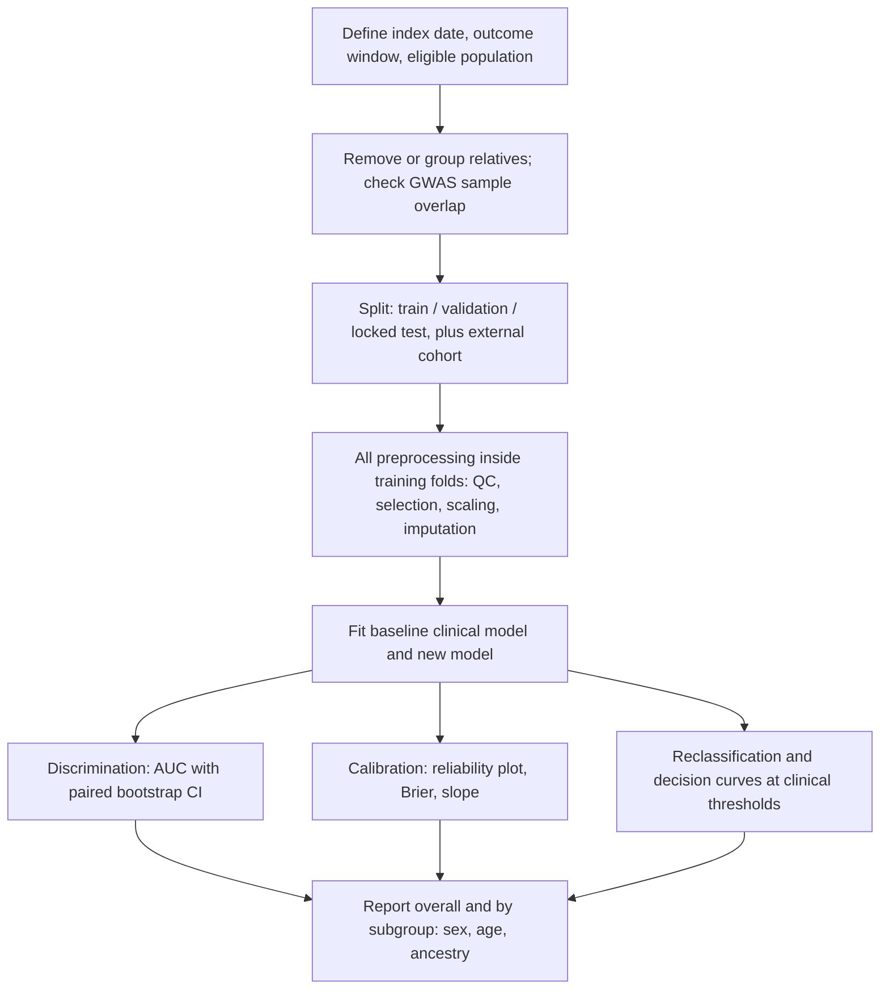

+++
summary = "Evaluate a clinical risk model honestly: design train/validation/test splits and (stratified, grouped) cross-validation, recognise leakage from relatives, preprocessing and time, and compute confusion-matrix metrics, ROC AUC, precision–recall, calibration, Brier score, bootstrap confidence intervals and NRI against a clinical baseline."
+++

# Model Evaluation

It is easy to build a model that looks excellent. It is hard to build one that *is* excellent on people it has never seen. In genomic medicine the gap between the two is filled with traps: relatives in both the training and test sets, polygenic-score weights estimated from a GWAS that included the test participants, lab values recorded after the diagnosis they are meant to predict, and metrics that look impressive for a rare outcome while the model is useless in practice.

This chapter is the toolkit for honest evaluation. Every result in the capstone (does adding DNA to clinical data actually improve CAD risk prediction?) will be judged with these tools, and the comparison that matters is always against a sensible **clinical baseline**, not against random guessing.

## Key ideas

### Train, validation and test

| Split | Used for | Touched how often |
|---|---|---|
| Training | fitting parameters ($\boldsymbol\beta$, tree splits, network weights) | constantly |
| Validation | choosing hyperparameters ($\lambda$, depth, learning rate), early stopping, model selection | many times |
| Test | the final, reported estimate of performance | **once** |

Every time you look at a test score and change something in response, information leaks from the test set into your model, and the test score becomes optimistic. With many design choices, this "garden of forking paths" can inflate performance substantially. Keep the test set locked away; ideally, also evaluate on an **external** cohort (different hospital, country, time period or ancestry).

### K-fold and stratified cross-validation

When data are limited, **K-fold cross-validation** rotates the validation role: split the data into $K$ folds, train on $K-1$, evaluate on the remaining one, repeat $K$ times, and average. $K = 5$ or $10$ is typical. The average estimates how well *the procedure* (not one specific fitted model) performs on new data; the spread across folds hints at its variability.

- **Stratified K-fold** makes each fold's outcome prevalence match the overall prevalence. For rare outcomes, plain K-fold can produce folds with almost no cases, making the AUC in that fold extremely noisy or undefined.
- **Grouped K-fold** keeps all records of a group (a family, a patient with several visits, a hospital) in the same fold.
- **Nested cross-validation** wraps hyperparameter tuning (inner loop) inside performance estimation (outer loop). If you tune $\lambda$ by CV and report that same CV score, the estimate is optimistically biased, because you picked the best of many noisy scores.

### Data leakage

**Leakage** is any path by which information about the test outcomes reaches the model during training. It produces results that are too good to be true, and it is the most common reason published models fail on external data. Three forms matter most in genetic risk prediction.

**1. Preprocessing fitted on the full data.** Anything learned from data must be learned inside the training fold only: feature selection (for example "keep the 1,000 SNPs most associated with CAD"), standardisation means and SDs, imputation values, PCA, and even the choice of variants that pass QC based on association. The classic demonstration: with thousands of pure-noise features, selecting the "best" ones on all data and *then* cross-validating gives a high AUC on data with no signal at all. The fix is a **pipeline** whose every step is refitted within each fold.

**2. Related individuals and family structure.** Relatives share large parts of their genomes *and* much of their environment. If a sibling is in the training set and the other sibling in the test set, a flexible model can effectively recognise the family and copy its outcome. Large biobanks contain many related pairs. Standard practice is to estimate kinship from genotypes and either remove one of each related pair (for example up to third-degree relatives) or assign whole families to the same fold. A closely related trap: **sample overlap** between the GWAS that produced a polygenic score's weights and the cohort used to test the score. The GWAS has already "seen" those people's outcomes, so the PRS will look better than it really is.

**3. Temporal leakage.** A prediction is made at a specific **index date** and should use only information available then. Features recorded later, or features that are consequences of the outcome or of clinical suspicion (a statin started after a cardiology referral, a troponin test, an angiogram code), let the model "see the future". Define the index date explicitly, take features strictly before it and outcomes strictly after it, and when possible validate **temporally**: train on earlier years, test on later ones.

> [!WARNING]
> A useful habit: whenever a model's performance looks surprisingly good, list every feature and ask, "could this value have been known, at the time of prediction, for a person who has not yet had the event?" and "does any preprocessing step see the test labels?"

### The confusion matrix

A risk model outputs a probability $\hat p$. Choosing a threshold $t$ turns it into a decision ("flag if $\hat p \ge t$"), and comparing decisions to outcomes gives four counts:

| | Outcome: CAD | Outcome: no CAD |
|---|---|---|
| **Flagged** | true positive (TP) | false positive (FP) |
| **Not flagged** | false negative (FN) | true negative (TN) |

| Metric | Formula | Question it answers |
|---|---|---|
| Sensitivity (recall, TPR) | $\frac{TP}{TP + FN}$ | Of those who develop CAD, what fraction did we flag? |
| Specificity (TNR) | $\frac{TN}{TN + FP}$ | Of those who don't, what fraction did we leave alone? |
| Positive predictive value (precision) | $\frac{TP}{TP + FP}$ | Of those flagged, what fraction develop CAD? |
| Negative predictive value | $\frac{TN}{TN + FN}$ | Of those not flagged, what fraction stay free of CAD? |
| False positive rate | $1 - \text{specificity}$ | |

Sensitivity and specificity are properties of the model at a threshold. PPV and NPV also depend on **prevalence**: by [Bayes' theorem](../../probability-and-statistics/probability-and-bayes-theorem/),

$$
\text{PPV} = \frac{\text{sens}\cdot\pi}{\text{sens}\cdot\pi + (1-\text{spec})(1-\pi)},
$$

with $\pi$ the prevalence. For rare outcomes, even a good test has a low PPV. **Accuracy** is nearly useless for rare outcomes: at 2% prevalence, "nobody gets CAD" is 98% accurate.

### ROC curve and AUC

Sweeping the threshold from high to low traces the **ROC curve**: true positive rate against false positive rate. A useless model follows the diagonal; a perfect one hugs the top-left corner. The **area under the curve (AUC)** summarises discrimination across all thresholds.

> [!IMPORTANT]
> **The probabilistic meaning of AUC**
> $$\text{AUC} = P\big(\hat p_{\text{case}} > \hat p_{\text{control}}\big) \quad (\text{ties count } \tfrac12),$$
> for a randomly chosen case and a randomly chosen control. In clinical papers this is the **C-statistic** (concordance statistic).

**Why.** Write $S_1$ for the score of a random case and $S_0$ for a random control. At threshold $t$, $\text{TPR}(t) = P(S_1 > t)$ and $\text{FPR}(t) = P(S_0 > t)$. As $t$ decreases, FPR increases by $f_0(t)\,dt$, where $f_0$ is the control score density. The area is

$$
\text{AUC} = \int \text{TPR}\; d\,\text{FPR} = \int P(S_1 > t)\, f_0(t)\, dt = P(S_1 > S_0),
$$

the probability that a case's score exceeds a control's, averaging over the control's score. So AUC can be computed by counting concordant case–control pairs (the Mann–Whitney U statistic divided by the number of pairs).

Things AUC does **not** tell you: whether predicted probabilities are correct (calibration), how the model performs at the threshold you will actually use, or whether it beats existing tools by a clinically meaningful amount. AUC is also insensitive to monotone transformations: doubling every predicted risk leaves it unchanged. For survival data, **Harrell's C** extends the same idea to censored time-to-event outcomes.

### Precision–recall for rare outcomes

The ROC curve's x-axis is the false positive *rate*, which hides how many false positives there are in absolute terms when controls vastly outnumber cases. The **precision–recall (PR) curve** plots precision (PPV) against recall (sensitivity). Its summary, **average precision (AP)**, has a baseline equal to the prevalence (a random model's precision is just $\pi$), not 0.5. For a 2%-prevalence outcome, an AP of 0.10 is five times better than random, even though it looks low. Report both: ROC AUC for ranking quality, PR/AP (and PPV at relevant thresholds) for what clinicians will actually experience.

### Calibration

A model is **calibrated** if, among people given a predicted risk of 10%, about 10% go on to have the event. Calibration is what makes a predicted risk usable for decisions (for instance, statin thresholds based on 10-year risk).

- **Reliability plot (calibration plot):** group people into bins of predicted risk (e.g. deciles) and plot mean predicted risk against observed event rate. Perfect calibration lies on the diagonal.
- **Calibration-in-the-large:** mean predicted risk versus overall observed rate.
- **Calibration slope:** fit $\operatorname{logit} P(y = 1) = a + b\cdot\operatorname{logit}(\hat p)$. A slope $b < 1$ means predictions are too extreme (typical of overfitting); $b > 1$ means too modest.
- **Brier score:** $\frac1n\sum_i(\hat p_i - y_i)^2$, the mean squared error of the probabilities. Lower is better; it rewards both discrimination and calibration. Its scale depends on prevalence, so compare models on the same data rather than across datasets.

Models are often **miscalibrated** when moved to a new population (different baseline risk, different era, different ancestry), even if their AUC transfers. Recalibration (re-estimating the intercept, or intercept and slope, on local data) is a standard fix. Tree ensembles and neural networks trained with class balancing or oversampling are especially prone to systematically over-predicting risk.

### Bootstrap confidence intervals

Every metric computed on a finite test set is an estimate with uncertainty. The **bootstrap** approximates the sampling distribution: resample the test set **with replacement** $B$ times (say 1,000–2,000), recompute the metric each time, and take the 2.5th and 97.5th percentiles as a 95% interval (the percentile method).

To compare two models, use a **paired** bootstrap: on each resample compute both metrics on the *same* people and record their difference. Because the two models' errors are correlated, the difference is much more precise than the two separate intervals suggest. Resample the right unit: if families or hospitals are clustered, resample whole clusters.

### Comparing with a clinical baseline

The question is never "is the AUC above 0.5?" but "does the new model improve on what clinicians already use?". For CAD, the baseline is a clinical risk equation built from age, sex, cholesterol, blood pressure, smoking and diabetes (such as the Pooled Cohort Equations in the US or QRISK in the UK). Report, for baseline and new model on the same test people:

- **Discrimination:** AUC/C-statistic, and the change $\Delta$AUC with a paired bootstrap interval. Note that once a baseline is good, adding even a genuinely useful predictor typically raises the AUC only modestly.
- **Calibration:** reliability plots and Brier scores for both.
- **Reclassification:** how many people move across clinically used risk categories.
- **Clinical utility:** decision-curve analysis (net benefit across threshold probabilities) asks whether using the model would lead to better decisions than treating everyone or no one.

### Net reclassification improvement (brief)

With risk categories (for example 10-year risk $< 5\%$, $5$–$7.5\%$, $7.5$–$20\%$, $\ge 20\%$, the bands used in US primary-prevention guidance), compare each person's category under the old and new models:

$$
\text{NRI} = \underbrace{\big[P(\text{up} \mid \text{event}) - P(\text{down} \mid \text{event})\big]}_{\text{NRI}_{\text{events}}} + \underbrace{\big[P(\text{down} \mid \text{non-event}) - P(\text{up} \mid \text{non-event})\big]}_{\text{NRI}_{\text{non-events}}}.
$$

Moving events up and non-events down is good. Report the two components separately, because they matter differently clinically and the total can hide a deterioration in one group. NRI depends heavily on the chosen categories and can be positive for a poorly calibrated model, so it complements, rather than replaces, calibration and decision analysis.

## Worked example

Seven people, three of whom develop CAD. Predicted risks:

| Person | A | B | C | D | E | F | G |
|---|---|---|---|---|---|---|---|
| CAD | 1 | 1 | 1 | 0 | 0 | 0 | 0 |
| $\hat p$ | 0.80 | 0.60 | 0.35 | 0.70 | 0.40 | 0.30 | 0.10 |

**Confusion matrix at $t = 0.5$.** Flagged: A, B (cases) and D (control). So TP = 2, FN = 1 (C), FP = 1 (D), TN = 3.

- Sensitivity $= 2/3 \approx 0.667$; specificity $= 3/4 = 0.75$; PPV $= 2/3$; NPV $= 3/4$; accuracy $= 5/7$.

**AUC by counting pairs.** There are $3 \times 4 = 12$ case–control pairs.

- A (0.80) beats all four controls: 4.
- B (0.60) beats E, F, G but not D (0.70): 3.
- C (0.35) beats F and G: 2.

$\text{AUC} = 9/12 = 0.75$.

**Brier score.**

$$
\tfrac17\big[0.2^2 + 0.4^2 + 0.65^2 + 0.7^2 + 0.4^2 + 0.3^2 + 0.1^2\big] = \tfrac17[0.04 + 0.16 + 0.4225 + 0.49 + 0.16 + 0.09 + 0.01] = \tfrac{1.3725}{7} \approx 0.196.
$$

**PPV at low prevalence.** A screening rule with sensitivity 0.8 and specificity 0.9 is applied where prevalence is 1%:

$$
\text{PPV} = \frac{0.8 \times 0.01}{0.8 \times 0.01 + 0.1 \times 0.99} = \frac{0.008}{0.107} \approx 0.075.
$$

About 13 of every 14 people flagged would *not* have the event.

**NRI.** A new model (clinical + PRS) is applied to 1,000 people: 100 events and 900 non-events. Among events, 15 move to a higher category and 5 to a lower one: $\text{NRI}_{\text{events}} = (15 - 5)/100 = 0.10$. Among non-events, 30 move down and 40 move up: $\text{NRI}_{\text{non-events}} = (30 - 40)/900 \approx -0.011$. Total NRI $\approx 0.089$, but note the new model reclassified more non-events upwards than downwards: more people without disease would be pushed towards treatment.

## In code

Cross-validation and three forms of leakage. Every number below comes from data where we know the truth.

```python
import numpy as np
from sklearn.model_selection import KFold, StratifiedKFold, GroupKFold, cross_val_score
from sklearn.feature_selection import SelectKBest, f_classif
from sklearn.linear_model import LogisticRegression
from sklearn.neighbors import KNeighborsClassifier
from sklearn.pipeline import make_pipeline

rng = np.random.default_rng(0)

# 1) Stratification matters for rare outcomes
y_rare = (rng.random(500) < 0.04).astype(int)               # 4% prevalence
X_dummy = np.zeros((500, 1))
for name, cv in [("KFold", KFold(5, shuffle=True, random_state=1)),
                 ("StratifiedKFold", StratifiedKFold(5, shuffle=True, random_state=1))]:
    cases = [int(y_rare[te].sum()) for _, te in cv.split(X_dummy, y_rare)]
    print(f"{name:16s} cases per test fold: {cases}")

# 2) Leakage: selecting features on ALL data before CV (pure noise!)
X = rng.normal(size=(200, 5000))                             # 5000 noise "SNPs"
y = rng.integers(0, 2, 200)                                  # outcome unrelated to X
cv = StratifiedKFold(5, shuffle=True, random_state=0)
top = SelectKBest(f_classif, k=20).fit(X, y).get_support()   # WRONG: sees all labels
leaky = cross_val_score(LogisticRegression(max_iter=1000), X[:, top], y, cv=cv, scoring="roc_auc")
pipe = make_pipeline(SelectKBest(f_classif, k=20), LogisticRegression(max_iter=1000))
honest = cross_val_score(pipe, X, y, cv=cv, scoring="roc_auc")  # selection inside each fold
print(f"noise data, selection outside CV: AUC {leaky.mean():.3f}")
print(f"noise data, selection inside CV : AUC {honest.mean():.3f}")

# 3) Leakage through relatives: siblings share genotypes and (partly) outcomes
n_fam, sibs, p = 300, 2, 50
fam_G = rng.binomial(2, 0.3, size=(n_fam, p))
G = np.repeat(fam_G, sibs, axis=0) + rng.binomial(1, 0.1, size=(n_fam * sibs, p))
fam_effect = np.repeat(rng.normal(0, 2.0, n_fam), sibs)     # shared family environment
yf = (fam_effect + rng.normal(0, 1, n_fam * sibs) > 0).astype(int)
groups = np.repeat(np.arange(n_fam), sibs)
knn = KNeighborsClassifier(n_neighbors=1)                    # memorises near-duplicates
rand = cross_val_score(knn, G, yf, cv=KFold(5, shuffle=True, random_state=0), scoring="roc_auc")
grp = cross_val_score(knn, G, yf, cv=GroupKFold(5), groups=groups, scoring="roc_auc")
print(f"siblings split across folds  : AUC {rand.mean():.3f}")
print(f"families kept together (Group): AUC {grp.mean():.3f}")
```

```text
KFold            cases per test fold: [4, 1, 4, 3, 2]
StratifiedKFold  cases per test fold: [2, 3, 3, 3, 3]
noise data, selection outside CV: AUC 0.865
noise data, selection inside CV : AUC 0.424
siblings split across folds  : AUC 0.746
families kept together (Group): AUC 0.492
```

- With only 14 cases, plain K-fold put a single case in one fold; stratification spreads them evenly.
- Selecting features on all the data produced an AUC of 0.865 **from pure noise**. Done properly inside a pipeline, the AUC is about 0.5 (0.424 is chance fluctuation on 200 people).
- In the family data, the genotypes carry *no* causal signal; outcomes are driven by a shared family environment. A 1-nearest-neighbour model still scores 0.746 when siblings straddle folds, because it finds the sibling and copies the outcome. Grouped CV reveals the truth: 0.492.

Confusion-matrix metrics, AUC by counting pairs, PR for a rare outcome, and calibration:

```python
import numpy as np
from sklearn.metrics import (roc_auc_score, roc_curve, average_precision_score,
                             brier_score_loss, confusion_matrix)

def auc_by_ranks(y, s):
    """P(score of random case > score of random control); ties count 1/2."""
    pos, neg = s[y == 1], s[y == 0]
    greater = (pos[:, None] > neg[None, :]).sum()
    ties = (pos[:, None] == neg[None, :]).sum()
    return (greater + 0.5 * ties) / (len(pos) * len(neg))

# Hand example: 3 cases, 4 controls
y = np.array([1, 1, 1, 0, 0, 0, 0])
s = np.array([0.8, 0.6, 0.35, 0.7, 0.4, 0.3, 0.1])
tn, fp, fn, tp = confusion_matrix(y, s >= 0.5).ravel()
print("TP FN FP TN:", tp, fn, fp, tn, " sens", round(tp / (tp + fn), 3),
      " spec", round(tn / (tn + fp), 3), " PPV", round(tp / (tp + fp), 3))
print("AUC by ranks:", auc_by_ranks(y, s), " sklearn:", roc_auc_score(y, s))
print("Brier:", round(brier_score_loss(y, s), 4))

# A rare outcome: 2% prevalence, 50,000 people, a decent risk score
rng = np.random.default_rng(0)
n = 50_000
z = rng.normal(0, 1, n)
p_true = 1 / (1 + np.exp(-(-4.6 + 1.2 * z)))
y = rng.binomial(1, p_true)
print(f"\nprevalence {y.mean():.4f}")
print(f"AUC {roc_auc_score(y, p_true):.3f}   average precision {average_precision_score(y, p_true):.3f}"
      f"   (random model AP ≈ prevalence)")
fpr, tpr, thr = roc_curve(y, p_true)
i = np.argmin(np.abs(tpr - 0.8))                       # threshold giving 80% sensitivity
pred = p_true >= thr[i]
print(f"at sensitivity {tpr[i]:.2f}: specificity {1 - fpr[i]:.3f}, "
      f"PPV {y[pred].mean():.3f}, flagged {pred.mean():.1%} of people")

# Calibration: a well-calibrated model vs one that over-predicts (odds x 3)
odds = p_true / (1 - p_true) * 3
p_over = odds / (1 + odds)
print("\ndecile  mean_pred(cal)  mean_pred(over)  observed")
bins = np.quantile(p_true, np.linspace(0, 1, 11))          # same people in both columns
idx = np.clip(np.digitize(p_true, bins[1:-1]), 0, 9)
for b in [0, 3, 6, 8, 9]:
    m = idx == b
    print(f"{b + 1:6d}  {p_true[m].mean():14.4f}  {p_over[m].mean():15.4f}  {y[m].mean():8.4f}")
for name, p in [("calibrated", p_true), ("over-predicting", p_over)]:
    print(f"{name:16s} AUC {roc_auc_score(y, p):.3f}  Brier {brier_score_loss(y, p):.5f}"
          f"  mean predicted {p.mean():.4f} vs observed {y.mean():.4f}")
```

```text
TP FN FP TN: 2 1 1 3  sens 0.667  spec 0.75  PPV 0.667
AUC by ranks: 0.75  sklearn: 0.75
Brier: 0.1961

prevalence 0.0198
AUC 0.800   average precision 0.109   (random model AP ≈ prevalence)
at sensitivity 0.80: specificity 0.635, PPV 0.042, flagged 37.4% of people

decile  mean_pred(cal)  mean_pred(over)  observed
     1          0.0014           0.0040    0.0024
     4          0.0063           0.0186    0.0070
     7          0.0159           0.0463    0.0116
     9          0.0344           0.0964    0.0358
    10          0.0846           0.2089    0.0900
calibrated       AUC 0.800  Brier 0.01848  mean predicted 0.0193 vs observed 0.0198
over-predicting  AUC 0.800  Brier 0.02083  mean predicted 0.0520 vs observed 0.0198
```

The hand calculations are reproduced exactly. For the rare outcome, an AUC of 0.80 sounds strong, but catching 80% of cases means flagging over a third of the population with a PPV of about 4%. Average precision (0.109) is about five times the 2% baseline. The two calibration columns show the key fact that **AUC is blind to calibration**: both models have AUC 0.800, but the over-predicting one claims a 20.9% risk in the top decile where only 9.0% have events. The Brier score catches the difference.

Finally, a comparison against a clinical baseline: a logistic model with age, sex, LDL, blood pressure and smoking versus the same plus a PRS, with a paired bootstrap for $\Delta$AUC and a categorical NRI.

```python
import numpy as np
from sklearn.linear_model import LogisticRegression
from sklearn.metrics import roc_auc_score, brier_score_loss

rng = np.random.default_rng(3)
n = 12_000
age = rng.uniform(40, 75, n); male = rng.binomial(1, 0.5, n)
ldl = rng.normal(3.4, 0.9, n); sbp = rng.normal(132, 17, n); smoke = rng.binomial(1, 0.18, n)
prs = rng.normal(0, 1, n)
z = (-10.7 + 0.08 * age + 0.5 * male + 0.35 * ldl + 0.015 * sbp + 0.6 * smoke + 0.35 * prs)
y = rng.binomial(1, 1 / (1 + np.exp(-z)))                       # "10-year CAD event"
clin = np.column_stack([age, male, ldl, sbp, smoke])
full = np.column_stack([clin, prs])
tr, te = np.arange(n) < 8000, np.arange(n) >= 8000
p_clin = LogisticRegression(max_iter=5000).fit(clin[tr], y[tr]).predict_proba(clin[te])[:, 1]
p_full = LogisticRegression(max_iter=5000).fit(full[tr], y[tr]).predict_proba(full[te])[:, 1]
yt = y[te]
print(f"event rate {yt.mean():.3f}")
print(f"clinical      AUC {roc_auc_score(yt, p_clin):.4f}  Brier {brier_score_loss(yt, p_clin):.4f}")
print(f"clinical+PRS  AUC {roc_auc_score(yt, p_full):.4f}  Brier {brier_score_loss(yt, p_full):.4f}")

# Paired bootstrap: resample test people, recompute both AUCs on the SAME resample
B, m = 2000, len(yt)
auc_c, auc_f = np.empty(B), np.empty(B)
for b in range(B):
    i = rng.integers(0, m, m)
    auc_c[b], auc_f[b] = roc_auc_score(yt[i], p_clin[i]), roc_auc_score(yt[i], p_full[i])
lo, hi = np.percentile(auc_f, [2.5, 97.5])
dlo, dhi = np.percentile(auc_f - auc_c, [2.5, 97.5])
print(f"AUC (clinical+PRS) 95% CI: {lo:.4f} to {hi:.4f}")
print(f"delta AUC = {roc_auc_score(yt, p_full) - roc_auc_score(yt, p_clin):.4f}, "
      f"95% CI {dlo:.4f} to {dhi:.4f}")

# Categorical net reclassification improvement with 10-year risk cut-offs
cuts = [0.05, 0.075, 0.20]
c_old, c_new = np.digitize(p_clin, cuts), np.digitize(p_full, cuts)
up, down = c_new > c_old, c_new < c_old
ev, ne = yt == 1, yt == 0
nri_ev = up[ev].mean() - down[ev].mean()
nri_ne = down[ne].mean() - up[ne].mean()
print(f"events: {up[ev].sum()} up, {down[ev].sum()} down of {ev.sum()} -> NRI_events {nri_ev:+.3f}")
print(f"non-events: {down[ne].sum()} down, {up[ne].sum()} up of {ne.sum()} -> NRI_nonevents {nri_ne:+.3f}")
print(f"categorical NRI = {nri_ev + nri_ne:+.3f}")
```

```text
event rate 0.099
clinical      AUC 0.7206  Brier 0.0832
clinical+PRS  AUC 0.7343  Brier 0.0823
AUC (clinical+PRS) 95% CI: 0.7097 to 0.7588
delta AUC = 0.0136, 95% CI 0.0043 to 0.0222
events: 50 up, 42 down of 394 -> NRI_events +0.020
non-events: 474 down, 362 up of 3606 -> NRI_nonevents +0.031
categorical NRI = +0.051
```

Notice that the 95% interval for the new model's AUC alone (0.710 to 0.759) is wide enough to contain the baseline's AUC, yet the **paired** interval for the difference (0.004 to 0.022) excludes zero. Comparing two separate intervals for overlap is the wrong test; the paired bootstrap is the right one. The improvement is real in this simulation but modest, which is the typical picture when a PRS is added to a good clinical model.

## Biomedical connection

A checklist for evaluating a DNA-plus-clinical CAD model:



- **Ancestry.** Polygenic scores are known to perform worse in populations under-represented in the GWAS used to build them, most notably outside European-ancestry cohorts. Report performance and calibration separately by genetic ancestry group; a single pooled AUC can hide a model that works poorly for some groups.
- **Reporting standards.** The TRIPOD statement gives a checklist for reporting prediction-model studies (TRIPOD+AI extends it to machine learning), and covers most of the points in this chapter.

> [!CAUTION]
> Good discrimination and calibration in a retrospective cohort do not prove that using a model improves patient outcomes. Before clinical use a risk model needs external validation in the intended population, assessment of calibration and subgroup performance, and ideally evidence that acting on it (for example, earlier statin therapy) leads to benefit. This course is educational and its models are not clinical tools.

## Practice

1. A model has sensitivity 0.9 and specificity 0.8. Compute PPV at prevalence 10% and at 1%.

<details>
<summary>Answer</summary>

At 10%: $\frac{0.9 \times 0.1}{0.09 + 0.2 \times 0.9} = \frac{0.09}{0.27} \approx 0.333$. At 1%: $\frac{0.009}{0.009 + 0.2 \times 0.99} = \frac{0.009}{0.207} \approx 0.043$.

</details>

2. Cases have scores 0.9 and 0.5; controls have 0.6, 0.4 and 0.2. Compute the AUC by counting pairs.

<details>
<summary>Answer</summary>

6 pairs. 0.9 beats all three controls (3); 0.5 beats 0.4 and 0.2 (2). AUC $= 5/6 \approx 0.833$.

</details>

3. Every predicted probability from a model is divided by 2. What happens to the AUC and to calibration?

<details>
<summary>Answer</summary>

The ranking is unchanged, so the AUC is unchanged. The model now under-predicts risk by half: calibration-in-the-large is off, and the Brier score typically gets worse.

</details>

4. A researcher standardises all genotypes using the mean and SD of the full dataset, then runs 5-fold CV. Another selects the top 500 SNPs by GWAS p-value computed in the full dataset. Which leakage is more serious, and why?

<details>
<summary>Answer</summary>

The SNP selection is far more serious: it uses the **outcome labels** of the test folds to choose features, which can create apparent signal from noise (as in the demonstration). Standardising with full-data means and SDs uses only the features, not the labels; it is still bad practice, but its effect is usually small.

</details>

5. Among 200 events, a new model moves 30 up and 10 down; among 1,800 non-events it moves 90 down and 60 up. Compute the two NRI components and the total.

<details>
<summary>Answer</summary>

$\text{NRI}_{\text{events}} = (30 - 10)/200 = 0.10$. $\text{NRI}_{\text{non-events}} = (90 - 60)/1800 \approx 0.017$. Total $\approx 0.117$.

</details>

## Further reading

- Steyerberg, E. W. (2019). *Clinical Prediction Models: A Practical Approach to Development, Validation, and Updating*, 2nd edition. Springer.
- Hanley, J. A. and McNeil, B. J. (1982). The meaning and use of the area under a receiver operating characteristic (ROC) curve. *Radiology* 143(1).
- Pencina, M. J., D'Agostino, R. B. Sr, D'Agostino, R. B. Jr and Vasan, R. S. (2008). Evaluating the added predictive ability of a new marker: from area under the ROC curve to reclassification and beyond. *Statistics in Medicine* 27(2).
- Vickers, A. J. and Elkin, E. B. (2006). Decision curve analysis: a novel method for evaluating prediction models. *Medical Decision Making* 26(6).
- Saito, T. and Rehmsmeier, M. (2015). The precision-recall plot is more informative than the ROC plot when evaluating binary classifiers on imbalanced datasets. *PLoS ONE* 10(3).
- Collins, G. S., Reitsma, J. B., Altman, D. G. and Moons, K. G. M. (2015). Transparent reporting of a multivariable prediction model for individual prognosis or diagnosis (TRIPOD): the TRIPOD statement. *Annals of Internal Medicine* 162(1).
- Efron, B. and Tibshirani, R. J. (1993). *An Introduction to the Bootstrap.* Chapman and Hall.
- Martin, A. R. et al. (2019). Clinical use of current polygenic risk scores may exacerbate health disparities. *Nature Genetics* 51(4).
