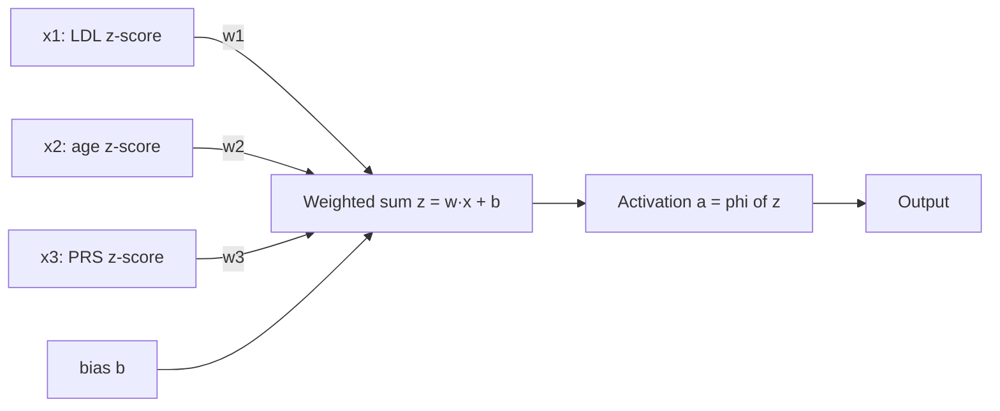
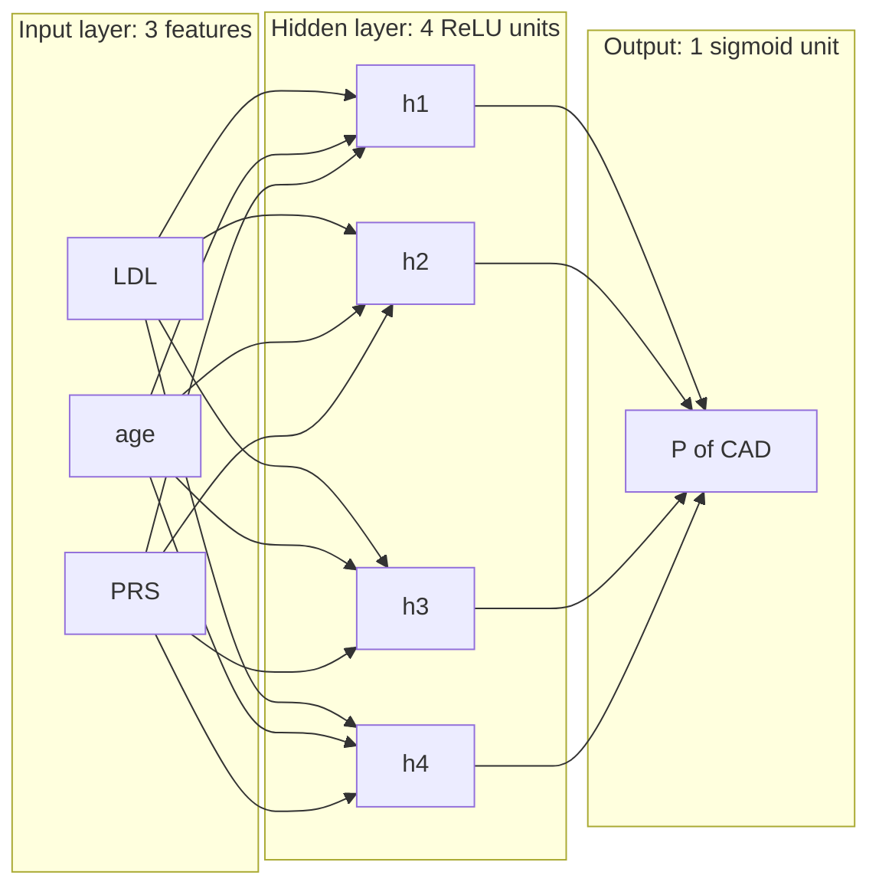

+++
summary = "Build a multilayer perceptron from single neurons, explain why depth and nonlinearity are needed, write its forward pass in matrix form and count its parameters."
+++

# From Perceptron to MLP

Logistic regression ([Linear and logistic regression](../../classical-machine-learning/linear-and-logistic-regression/)) already gives us a heart-disease risk model: take a weighted sum of LDL cholesterol, age, blood pressure and a polygenic score, squash it through a sigmoid, and read off a probability. It has one big limitation. The log-odds is a **linear** function of the inputs, so the model cannot represent effects like "a high polygenic score matters much more when LDL is also high" unless you hand-craft that interaction term yourself.

A neural network removes that limitation. It learns its own features, interactions included, by stacking many small logistic-regression-like units. Every architecture in the rest of this book (convolutional networks for DNA, LSTMs, transformers, genomic foundation models) is built from the pieces in this chapter: weighted sums, nonlinearities and layers.

## Key ideas

### The artificial neuron

A **neuron** takes an input vector $\mathbf{x} \in \mathbb{R}^n$, computes a weighted sum plus a bias, and passes the result through an **activation function** $\phi$:

$$
z = \mathbf{w}^\top \mathbf{x} + b = \sum_{j=1}^{n} w_j x_j + b, \qquad a = \phi(z).
$$

The number $z$ is the **pre-activation** (or *logit*), and $a$ is the **activation**. With $\phi = \sigma$, the sigmoid, one neuron *is* logistic regression. The weights $\mathbf{w}$ say how much each input matters, and the bias $b$ shifts the threshold.



Geometrically, the set of inputs where $z = 0$ is a **hyperplane** (a line in 2-D). The neuron says "one side versus the other side", with a soft or hard transition depending on $\phi$.

### The perceptron and its learning rule

Rosenblatt's **perceptron** (1958) is a neuron with a hard step activation:

$$
\hat{y} = \begin{cases} 1 & \text{if } \mathbf{w}^\top\mathbf{x} + b > 0 \\ 0 & \text{otherwise.} \end{cases}
$$

It is trained one example at a time with the **perceptron learning rule**:

> [!IMPORTANT]
> For each example $(\mathbf{x}, y)$ with prediction $\hat y$:
> $$\mathbf{w} \leftarrow \mathbf{w} + \eta\,(y - \hat{y})\,\mathbf{x}, \qquad b \leftarrow b + \eta\,(y - \hat{y}).$$

If the prediction is right, $y - \hat y = 0$ and nothing changes. If the perceptron said 0 when the answer was 1, it adds $\eta\mathbf{x}$ to $\mathbf{w}$. That increases $\mathbf{w}^\top\mathbf{x}$ by $\eta\lVert\mathbf{x}\rVert^2 \ge 0$, nudging this example towards the positive side. A false positive is corrected the opposite way.

The **perceptron convergence theorem** (Novikoff, 1962) guarantees that if the data are linearly separable with margin $\gamma$ and every $\lVert\mathbf{x}\rVert \le R$, the rule makes at most $(R/\gamma)^2$ mistakes before it stops changing. If the data are *not* linearly separable, it never settles down.

### XOR: why one layer is not enough

The **XOR** function outputs 1 when exactly one of two binary inputs is 1:

| $x_1$ | $x_2$ | XOR |
|---|---|---|
| 0 | 0 | 0 |
| 0 | 1 | 1 |
| 1 | 0 | 1 |
| 1 | 1 | 0 |

**Claim:** no single perceptron computes XOR. Suppose $w_1, w_2, b$ worked. The four rows require

1. $b \le 0$ (row 1 gives 0),
2. $w_2 + b > 0$ (row 2 gives 1),
3. $w_1 + b > 0$ (row 3 gives 1),
4. $w_1 + w_2 + b \le 0$ (row 4 gives 0).

Add inequalities 2 and 3: $w_1 + w_2 + 2b > 0$, so $w_1 + w_2 + b > -b \ge 0$ by inequality 1. That contradicts inequality 4. $\blacksquare$

Geometrically, no single straight line separates $\{(0,1),(1,0)\}$ from $\{(0,0),(1,1)\}$. Minsky and Papert's book *Perceptrons* (1969) made limitations like this famous.

XOR is not a toy for us. Biology is full of interactions: a variant that matters only on a particular genetic background, or a risk factor whose effect depends on another. In genetics this is called **epistasis** (gene–gene interaction) or gene–environment interaction. XOR is the simplest pure interaction: neither input alone tells you anything about the output.

### Adding a hidden layer

The fix is to compute **intermediate features** first, then combine them. Take two hidden ReLU neurons, where $\operatorname{ReLU}(z) = \max(0, z)$:

$$
h_1 = \operatorname{ReLU}(x_1 + x_2), \qquad h_2 = \operatorname{ReLU}(x_1 + x_2 - 1), \qquad \hat y = h_1 - 2h_2.
$$

| $x_1, x_2$ | $h_1$ | $h_2$ | $\hat y = h_1 - 2h_2$ |
|---|---|---|---|
| 0, 0 | 0 | 0 | 0 |
| 0, 1 | 1 | 0 | 1 |
| 1, 0 | 1 | 0 | 1 |
| 1, 1 | 2 | 1 | 0 |

The hidden layer bends the input space: $h_2$ "switches on" only when both inputs are on, and the output subtracts that case away. The output neuron is still linear, but it is linear in **learned features** $(h_1, h_2)$, not in the raw inputs.

> [!WARNING]
> The nonlinearity is essential. If the hidden units were linear, $\hat y = \mathbf{w}_2^\top(W_1\mathbf{x} + \mathbf{b}_1) + b_2 = (\mathbf{w}_2^\top W_1)\mathbf{x} + \text{const}$, which is again a single linear function. Stacking linear layers without activations adds parameters but no expressive power.

### The multilayer perceptron

A **multilayer perceptron (MLP)**, also called a fully connected or feed-forward network, stacks layers of neurons. Every neuron in layer $\ell$ receives every activation from layer $\ell - 1$.



The "perceptron" in the name is historical: modern MLPs use smooth activations and are trained by gradient descent with **backpropagation** ([the chain rule and backpropagation](../../calculus-and-optimization/the-chain-rule-and-backpropagation/)), not by the perceptron rule. The step function has zero derivative almost everywhere, so gradient descent cannot use it.

### The forward pass in matrix form

Process a **batch** of $B$ examples at once. Stack them as rows of $X \in \mathbb{R}^{B \times n_0}$. Layer $\ell$ has a weight matrix $W_\ell \in \mathbb{R}^{n_{\ell-1} \times n_\ell}$ and a bias $\mathbf{b}_\ell \in \mathbb{R}^{n_\ell}$:

> [!IMPORTANT]
> $$H_0 = X, \qquad Z_\ell = H_{\ell-1} W_\ell + \mathbf{b}_\ell, \qquad H_\ell = \phi(Z_\ell), \qquad \ell = 1, \dots, L.$$
> Shapes: $H_{\ell-1}$ is $B \times n_{\ell-1}$, $W_\ell$ is $n_{\ell-1} \times n_\ell$, so $Z_\ell$ and $H_\ell$ are $B \times n_\ell$.

The bias is added to every row (**broadcasting**; see [matrix multiplication and tensors](../../linear-algebra/matrix-multiplication-and-tensors/)). The activation acts element by element. For binary classification the last layer has $n_L = 1$ and uses a sigmoid, giving a $B \times 1$ column of probabilities.

> [!NOTE]
> PyTorch's `nn.Linear(n_in, n_out)` stores its weight as an `(n_out, n_in)` matrix and computes `x @ W.T + b`. It is the same maths with the matrix transposed. When you copy weights between NumPy and PyTorch, remember the transpose.

### Counting parameters

A fully connected layer from $n_{\text{in}}$ to $n_{\text{out}}$ units has

$$
n_{\text{in}} \cdot n_{\text{out}} \;(\text{weights}) \;+\; n_{\text{out}} \;(\text{biases}).
$$

For an MLP with layer sizes $n_0, n_1, \dots, n_L$, the total is $\sum_{\ell=1}^{L} (n_{\ell-1} + 1)\, n_\ell$.

Example: a network that reads 1,000 genotype dosages and has hidden layers of 256 and 64 units and one output:

| Layer | Weight shape | Weights | Biases | Total |
|---|---|---|---|---|
| 1000 → 256 | 1000 × 256 | 256,000 | 256 | 256,256 |
| 256 → 64 | 256 × 64 | 16,384 | 64 | 16,448 |
| 64 → 1 | 64 × 1 | 64 | 1 | 65 |
| **Total** | | | | **272,769** |

The first layer holds 94% of the parameters. That is typical: the widest input dominates. With 1,000 SNPs and only a few thousand cases, 272,769 parameters is a lot, and regularisation ([regularization and the bias-variance tradeoff](../../classical-machine-learning/regularization-and-the-bias-variance-tradeoff/)) becomes essential. This is one reason the sequence architectures in the next module **share** weights across positions.

### Activation functions and their derivatives

Backpropagation multiplies by $\phi'(z)$ at every layer, so the derivative matters as much as the function.

**Sigmoid.** $\sigma(z) = \dfrac{1}{1+e^{-z}}$. Differentiate with the quotient rule:

$$
\sigma'(z) = \frac{e^{-z}}{(1+e^{-z})^2} = \frac{1}{1+e^{-z}}\cdot\frac{e^{-z}}{1+e^{-z}} = \sigma(z)\,\bigl(1 - \sigma(z)\bigr).
$$

The maximum is $\sigma'(0) = 0.25$. For large $|z|$ the sigmoid **saturates** and $\sigma'(z) \to 0$.

**Tanh.** $\tanh(z) = \dfrac{e^z - e^{-z}}{e^z + e^{-z}} = 2\sigma(2z) - 1$, with range $(-1, 1)$ and derivative

$$
\tanh'(z) = 1 - \tanh^2(z).
$$

Its maximum slope is 1 at $z=0$, and its output is zero-centred, which usually makes it train better than the sigmoid as a hidden activation. It still saturates.

**ReLU.** $\operatorname{ReLU}(z) = \max(0, z)$, with $\operatorname{ReLU}'(z) = 1$ for $z > 0$ and $0$ for $z < 0$ (at exactly 0 frameworks pick 0). ReLU does not saturate for positive inputs and is very cheap to compute, which made deep networks much easier to train. Its weakness is **dead units**: a neuron whose pre-activation is negative for every input gets zero gradient and never recovers.

**GELU.** $\operatorname{GELU}(z) = z\,\Phi(z)$, where $\Phi$ is the standard normal CDF (Hendrycks and Gimpel, 2016). It is a smooth ReLU that lets small negative values through. By the product rule,

$$
\operatorname{GELU}'(z) = \Phi(z) + z\,\varphi(z),
$$

where $\varphi$ is the standard normal density. GELU is the default in transformers such as BERT and GPT-style models, which you will meet in [attention and transformers](../../deep-architectures-for-sequences/attention-and-transformers/).

| $z$ | $\sigma(z)$ | $\sigma'(z)$ | $\tanh z$ | $\tanh' z$ | ReLU | ReLU$'$ | GELU | GELU$'$ |
|---|---|---|---|---|---|---|---|---|
| $-2$ | 0.1192 | 0.1050 | $-0.9640$ | 0.0707 | 0 | 0 | $-0.0455$ | $-0.0852$ |
| $0$ | 0.5 | 0.25 | 0 | 1 | 0 | 0 | 0 | 0.5 |
| $2$ | 0.8808 | 0.1050 | 0.9640 | 0.0707 | 2 | 1 | 1.9545 | 1.0852 |

(These values are computed with PyTorch autograd in the code section.)

> [!TIP]
> Default choices that work well: ReLU or GELU in hidden layers; sigmoid only at the output for a binary probability; softmax at the output for several classes; no activation at the output for regression.

### Universal approximation

How expressive is an MLP? Remarkably so.

> [!IMPORTANT]
> **Universal approximation theorem.** Let $\phi$ be continuous and not a polynomial. For every continuous function $f$ on a closed, bounded set $K \subset \mathbb{R}^n$ and every $\varepsilon > 0$, there is a network with one hidden layer,
> $$g(\mathbf{x}) = \sum_{k=1}^{N} c_k\, \phi(\mathbf{w}_k^\top \mathbf{x} + b_k),$$
> with $\lvert f(\mathbf{x}) - g(\mathbf{x})\rvert < \varepsilon$ for all $\mathbf{x} \in K$.

Cybenko (1989) and Hornik, Stinchcombe and White (1989) proved versions for sigmoid-like activations; Leshno, Lin, Pinkus and Schocken (1993) showed that "non-polynomial" is exactly the condition needed.

**Intuition with ReLU in one dimension.** Each unit $c_k \operatorname{ReLU}(x - t_k)$ is a hinge: flat until $t_k$, then a line with slope $c_k$. A sum of hinges is a **piecewise linear** function whose slope changes by $c_k$ at each "knot" $t_k$. Any continuous function on an interval can be approximated by joining enough dots with straight lines, so enough hinges suffice. Two hinges make a ramp, and two ramps make a bump; in higher dimensions you can build localised bumps and add them up.

What the theorem does **not** say:

- It says nothing about **how many** units are needed. For some functions the required width grows exponentially with the input dimension.
- It does not say gradient descent will **find** those weights.
- It says nothing about **generalisation** from a finite sample.

In practice, **deep** networks often represent structured functions with far fewer parameters than shallow, wide ones, because each layer reuses the features computed by the layer below. That is the real reason we stack layers.

## Worked example

**Problem.** A tiny CAD model takes three standardised features, $(\text{age}, \text{LDL}, \text{PRS})$, has 4 ReLU hidden units and a sigmoid output. Its weights are

$$
W_1 = \begin{bmatrix} 0.5 & -1.0 & 0.2 & 0.0 \\ 0.3 & 0.4 & -0.5 & 1.0 \\ 1.0 & 0.0 & 0.3 & -0.2 \end{bmatrix}, \quad
\mathbf{b}_1 = \begin{bmatrix} 0 & 0.1 & -0.1 & 0 \end{bmatrix}, \quad
W_2 = \begin{bmatrix} 1.0 \\ -0.5 \\ 0.5 \\ 0.8 \end{bmatrix}, \quad b_2 = -1.
$$

Compute the predicted probability for patient 1 with $\mathbf{x} = (1.0,\ 2.0,\ 0.5)$, and count the parameters.

**Step 1: shapes.** $\mathbf{x}$ is $1 \times 3$, $W_1$ is $3 \times 4$, so $\mathbf{z}_1$ is $1 \times 4$. $W_2$ is $4 \times 1$, so $z_2$ is $1 \times 1$.

**Step 2: hidden pre-activations.** Each entry is $\mathbf{x}$ dotted with a column of $W_1$, plus the bias:

- unit 1: $1.0(0.5) + 2.0(0.3) + 0.5(1.0) + 0 = 0.5 + 0.6 + 0.5 = 1.6$
- unit 2: $1.0(-1.0) + 2.0(0.4) + 0.5(0) + 0.1 = -1.0 + 0.8 + 0.1 = -0.1$
- unit 3: $1.0(0.2) + 2.0(-0.5) + 0.5(0.3) - 0.1 = 0.2 - 1.0 + 0.15 - 0.1 = -0.75$
- unit 4: $1.0(0) + 2.0(1.0) + 0.5(-0.2) + 0 = 2.0 - 0.1 = 1.9$

**Step 3: ReLU.** $\mathbf{h} = (1.6,\ 0,\ 0,\ 1.9)$. Units 2 and 3 are "off" for this patient.

**Step 4: output.** $z_2 = 1.6(1.0) + 0(-0.5) + 0(0.5) + 1.9(0.8) - 1 = 1.6 + 1.52 - 1 = 2.12$.

**Step 5: sigmoid.** $p = 1/(1 + e^{-2.12}) = 1/(1 + 0.1200) \approx 0.893$.

**Step 6: parameters.** Layer 1: $3 \times 4 + 4 = 16$. Layer 2: $4 \times 1 + 1 = 5$. Total **21**.

For patient 2 with $\mathbf{x} = (-0.5,\ 0,\ -1.0)$ the same steps give $\mathbf{z}_1 = (-1.25,\ 0.6,\ -0.5,\ 0.2)$, $\mathbf{h} = (0,\ 0.6,\ 0,\ 0.2)$, $z_2 = -0.3 + 0.16 - 1 = -1.14$ and $p \approx 0.242$. Notice that different patients switch on different hidden units: the network is piecewise linear, with a different linear model in each region of input space.

## In code

First, the perceptron rule succeeds on AND and fails on XOR, while the hand-built two-layer ReLU network solves XOR.

```python
import numpy as np

def train_perceptron(X, y, epochs=20, lr=1.0):
    w = np.zeros(X.shape[1]); b = 0.0
    for epoch in range(epochs):
        errors = 0
        for xi, yi in zip(X, y):
            pred = 1 if xi @ w + b > 0 else 0
            if pred != yi:
                w += lr * (yi - pred) * xi
                b += lr * (yi - pred)
                errors += 1
        if errors == 0:
            return w, b, epoch + 1
    return w, b, None

X = np.array([[0, 0], [0, 1], [1, 0], [1, 1]], dtype=float)
for name, y in [("AND", [0, 0, 0, 1]), ("XOR", [0, 1, 1, 0])]:
    w, b, ep = train_perceptron(X, np.array(y))
    preds = (X @ w + b > 0).astype(int)
    print(f"{name}: w={w}, b={b}, converged after {ep} epochs, preds={preds}")

# A hand-built 2-layer network that solves XOR with ReLU
W1 = np.array([[1., 1.], [1., 1.]]); b1 = np.array([0., -1.])
w2 = np.array([1., -2.]); b2 = 0.0
H = np.maximum(0, X @ W1 + b1)
print("hidden:\n", H)
print("output:", H @ w2 + b2)
```

Output:

```
AND: w=[2. 1.], b=-2.0, converged after 6 epochs, preds=[0 0 0 1]
XOR: w=[-1.  0.], b=1.0, converged after None epochs, preds=[1 1 0 0]
hidden:
 [[0. 0.]
 [1. 0.]
 [1. 0.]
 [2. 1.]]
output: [0. 1. 1. 0.]
```

Next, the worked example in matrix form, the same network in PyTorch, parameter counts, and activation derivatives from autograd.

```python
import numpy as np
import torch
from torch import nn

X = np.array([[1.0, 2.0, 0.5],    # patient 1: age_z, ldl_z, prs_z
              [-0.5, 0.0, -1.0]]) # patient 2
W1 = np.array([[0.5, -1.0, 0.2, 0.0],
               [0.3,  0.4, -0.5, 1.0],
               [1.0,  0.0, 0.3, -0.2]])      # shape (3, 4)
b1 = np.array([0.0, 0.1, -0.1, 0.0])          # shape (4,)
W2 = np.array([[1.0], [-0.5], [0.5], [0.8]])  # shape (4, 1)
b2 = np.array([-1.0])
Z1 = X @ W1 + b1                               # (2, 4)
H = np.maximum(0, Z1)                          # (2, 4)
z2 = H @ W2 + b2                               # (2, 1)
p = 1 / (1 + np.exp(-z2))
print("Z1=\n", Z1); print("H=\n", H); print("z2=", z2.ravel()); print("p=", p.ravel().round(4))

mlp = nn.Sequential(nn.Linear(3, 4), nn.ReLU(), nn.Linear(4, 1))
with torch.no_grad():                          # note the transposes
    mlp[0].weight.copy_(torch.tensor(W1.T)); mlp[0].bias.copy_(torch.tensor(b1))
    mlp[2].weight.copy_(torch.tensor(W2.T)); mlp[2].bias.copy_(torch.tensor(b2))
print(torch.sigmoid(mlp(torch.tensor(X, dtype=torch.float32))).ravel())
print("params tiny:", sum(p.numel() for p in mlp.parameters()))

big = nn.Sequential(nn.Linear(1000, 256), nn.ReLU(), nn.Linear(256, 64), nn.ReLU(), nn.Linear(64, 1))
for name, prm in big.named_parameters():
    print(f"{name:10s} {tuple(prm.shape)}  {prm.numel()}")
print("params big:", sum(p.numel() for p in big.parameters()))

z = torch.tensor([-2.0, 0.0, 2.0], requires_grad=True)
for name, f in [("sigmoid", torch.sigmoid), ("tanh", torch.tanh), ("relu", torch.relu),
                ("gelu", nn.functional.gelu)]:
    y = f(z); g, = torch.autograd.grad(y.sum(), z)
    print(f"{name:8s} f={y.detach().numpy().round(4)}  f'={g.numpy().round(4)}")
```

Output:

```
Z1=
 [[ 1.6  -0.1  -0.75  1.9 ]
 [-1.25  0.6  -0.5   0.2 ]]
H=
 [[1.6 0.  0.  1.9]
 [0.  0.6 0.  0.2]]
z2= [ 2.12 -1.14]
p= [0.8928 0.2423]
tensor([0.8928, 0.2423], grad_fn=<ViewBackward0>)
params tiny: 21
0.weight   (256, 1000)  256000
0.bias     (256,)  256
2.weight   (64, 256)  16384
2.bias     (64,)  64
4.weight   (1, 64)  64
4.bias     (1,)  1
params big: 272769
sigmoid  f=[0.1192 0.5    0.8808]  f'=[0.105 0.25  0.105]
tanh     f=[-0.964  0.     0.964]  f'=[0.0707 1.     0.0707]
relu     f=[0. 0. 2.]  f'=[0. 0. 1.]
gelu     f=[-0.0455  0.      1.9545]  f'=[-0.0852  0.5     1.0852]
```

Finally, universal approximation in action: one-hidden-layer ReLU networks of growing width fitting a bumpy curve.

```python
import torch
from torch import nn

x = torch.linspace(-3, 3, 400).unsqueeze(1)          # shape (400, 1)
y = torch.sin(2 * x) + 0.3 * x**2                     # shape (400, 1)

for width in [1, 3, 10, 50]:
    torch.manual_seed(0)
    net = nn.Sequential(nn.Linear(1, width), nn.ReLU(), nn.Linear(width, 1))
    opt = torch.optim.Adam(net.parameters(), lr=0.005)
    for step in range(5000):
        loss = ((net(x) - y) ** 2).mean()
        opt.zero_grad(); loss.backward(); opt.step()
    n_params = sum(p.numel() for p in net.parameters())
    print(f"width={width:3d}  params={n_params:4d}  final MSE={loss.item():.4f}")
```

Output:

```
width=  1  params=   4  final MSE=1.1757
width=  3  params=  10  final MSE=0.1787
width= 10  params=  31  final MSE=0.0076
width= 50  params= 151  final MSE=0.0013
```

With one hinge the network can only draw a bent line. With 10 or more hinges it traces the curve closely. Here we measure fit on the training points only. Whether a wide network **generalises** is a separate question, which the next chapter takes up.

## Biomedical connection

Why might an MLP beat logistic regression for CAD risk?

- **Interactions.** Lipoprotein(a), encoded by *LPA*, and LDL cholesterol are both causal risk factors for CAD. A linear model adds their contributions on the log-odds scale. An MLP can learn whether risk rises faster when both are high, without anyone writing down the product term.
- **Nonlinear dose–response.** Risk is not linear in age or blood pressure across the whole range. Hidden ReLU units carve the input space into regions with different slopes.
- **Combining modalities.** A polygenic risk score is one number summarising many SNPs ([GWAS and polygenic risk scores](../../genomics-foundations/gwas-and-polygenic-risk-scores/)). An MLP can take the PRS together with clinical variables, or a vector of the top SNP dosages, and learn how to weigh them together.

Be realistic, though. For tabular clinical data, well-tuned logistic regression and gradient-boosted trees ([trees, forests and boosting](../../classical-machine-learning/trees-forests-and-boosting/)) are strong baselines that MLPs often fail to beat. Most of the common-variant contribution to CAD risk appears roughly additive on the log-odds scale. The payoff of neural networks for genomics comes mainly from **architecture**: convolutions and attention that read raw DNA sequence, which an MLP on hand-made features cannot do. That is where this book is heading.

> [!CAUTION]
> A network that "learns interactions" can just as easily learn spurious ones from a few thousand patients. Any claimed gene–gene interaction found by a flexible model needs replication in an independent cohort before anyone takes it seriously, and no model output here is a clinical risk assessment.

## Practice

1. A perceptron has $\mathbf{w} = (1, -1)$, $b = 0$ and $\eta = 1$. It sees $\mathbf{x} = (2, 3)$ with label $y = 1$. What are $\mathbf{w}$ and $b$ after the update, and is the example now classified correctly?

<details>
<summary>Answer</summary>

$z = 2 - 3 + 0 = -1 \le 0$, so $\hat y = 0$ and $y - \hat y = 1$. Update: $\mathbf{w} = (1,-1) + (2,3) = (3, 2)$, $b = 0 + 1 = 1$. Now $z = 6 + 6 + 1 = 13 > 0$, so it is classified correctly.

</details>

2. Show that a perceptron can compute AND but not XOR, and give weights for AND.

<details>
<summary>Answer</summary>

AND: $w_1 = w_2 = 1$, $b = -1.5$. Then $z = -1.5, -0.5, -0.5, 0.5$ for the four rows, so only $(1,1)$ fires. (The code found $w = (2, 1)$, $b = -2$, which also works: $z = -2, -1, 0, 1$, and $z = 0$ is classified as 0.) For XOR, see the proof in Key ideas: rows 2 and 3 force $w_1 + w_2 + 2b > 0$, which with $b \le 0$ contradicts row 4.

</details>

3. Count the parameters of an MLP with layer sizes $20 \to 64 \to 64 \to 1$.

<details>
<summary>Answer</summary>

$(20+1)\cdot 64 + (64+1)\cdot 64 + (64+1)\cdot 1 = 1344 + 4160 + 65 = 5569$.

</details>

4. Using $\sigma'(z) = \sigma(z)(1-\sigma(z))$, compute $\sigma'(z)$ at $z = \ln 3$. Then explain why a 10-layer sigmoid network has trouble passing gradients back to its first layer.

<details>
<summary>Answer</summary>

$\sigma(\ln 3) = 1/(1 + 1/3) = 3/4$, so $\sigma' = \tfrac34 \cdot \tfrac14 = \tfrac{3}{16} = 0.1875$. Backpropagation multiplies by one $\sigma'$ factor per layer, and each is at most $0.25$. Ten such factors give at most $0.25^{10} \approx 9.5 \times 10^{-7}$ (before weight factors), so the early-layer gradients vanish. The next chapter treats this properly.

</details>

5. Write $f(x) = |x|$ exactly as a one-hidden-layer ReLU network. How many hidden units do you need?

<details>
<summary>Answer</summary>

$|x| = \operatorname{ReLU}(x) + \operatorname{ReLU}(-x)$. Two hidden units with weights $+1$ and $-1$, zero biases, and output weights $(1, 1)$.

</details>

## Further reading

- Goodfellow, Bengio and Courville, *Deep Learning* (MIT Press, 2016), chapter 6, "Deep Feedforward Networks".
- Rosenblatt, F. (1958). The perceptron: a probabilistic model for information storage and organization in the brain. *Psychological Review* 65(6).
- Minsky, M. and Papert, S. (1969). *Perceptrons*. MIT Press.
- Cybenko, G. (1989). Approximation by superpositions of a sigmoidal function. *Mathematics of Control, Signals and Systems* 2.
- Hornik, K., Stinchcombe, M. and White, H. (1989). Multilayer feedforward networks are universal approximators. *Neural Networks* 2(5).
- Hendrycks, D. and Gimpel, K. (2016). Gaussian Error Linear Units (GELUs). arXiv:1606.08415.
