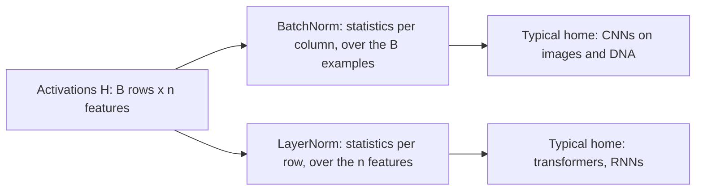
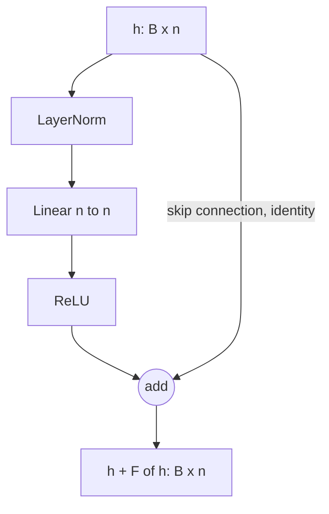
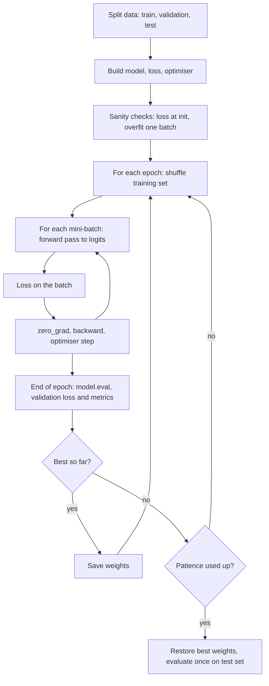

+++
summary = "Diagnose and fix the problems that make deep networks hard to train: vanishing and exploding gradients, poor initialisation, unnormalised activations, overfitting, and silent bugs."
+++

# Training Deep Networks

The previous chapter showed that a multilayer perceptron can represent almost any function. Getting gradient descent to actually *find* a good one is a separate problem, and for networks with more than a few layers it was the main obstacle in deep learning until the early 2010s. The genomic models later in this book, such as convolutional networks with tens of layers and transformers with dozens of blocks, only train because of the tools in this chapter: careful initialisation, normalisation layers, residual connections, dropout and early stopping.

We will derive *why* each tool works, because when you design your own DNA → heart-disease model you will need to know which knob to turn when training goes wrong.

## Key ideas

### Vanishing and exploding gradients

Take a deep network where each layer computes $\mathbf{z}_\ell = W_\ell^\top \mathbf{h}_{\ell-1} + \mathbf{b}_\ell$ and $\mathbf{h}_\ell = \phi(\mathbf{z}_\ell)$. Backpropagation ([the chain rule and backpropagation](../../calculus-and-optimization/the-chain-rule-and-backpropagation/)) passes the error signal $\boldsymbol{\delta}_\ell = \partial \mathcal{L}/\partial \mathbf{z}_\ell$ backwards with

$$
\boldsymbol{\delta}_{\ell} = \bigl(W_{\ell+1}\, \boldsymbol{\delta}_{\ell+1}\bigr) \odot \phi'(\mathbf{z}_\ell),
$$

where $\odot$ is element-wise multiplication. Unroll this from the output layer $L$ down to layer 1, and the gradient reaching the first layer is a **product of $L-1$ factors**, each of which multiplies by a weight matrix and by $\phi'$.

The scalar version makes the danger obvious. With one unit per layer,

$$
\frac{\partial \mathcal{L}}{\partial z_1} = \frac{\partial \mathcal{L}}{\partial z_L}\prod_{\ell=2}^{L} w_\ell\, \phi'(z_{\ell-1}).
$$

- If each factor $|w_\ell \phi'(z_{\ell-1})|$ is typically below 1, the product shrinks **exponentially** with depth: **vanishing gradients**. With sigmoids, $\phi' \le 0.25$, so even with $|w| = 1$ twenty layers give at most $0.25^{20} \approx 9 \times 10^{-13}$.
- If the factors are typically above 1, the product grows exponentially: **exploding gradients**, which show up as a loss that suddenly becomes `nan`.

Early layers then either learn nothing or blow up. For a DNA model, the early layers are the ones that detect sequence motifs, so this is fatal.

The same product appears in the **forward** pass: activations are multiplied by one weight matrix per layer, so their scale also shrinks or grows exponentially unless we choose the weights carefully.

### Initialisation from the variance argument

**Goal:** choose the random initial weights so that the variance of activations (forward) and of gradients (backward) stays roughly constant from layer to layer.

**Setup.** Consider one pre-activation in layer $\ell$,

$$
z = \sum_{j=1}^{n_{\text{in}}} w_j h_j,
$$

where the weights $w_j$ are drawn independently with mean 0 and variance $\sigma_w^2$, independently of the inputs $h_j$, which are identically distributed. Because $\mathbb{E}[w_j] = 0$, each term has mean 0 and

$$
\operatorname{Var}(w_j h_j) = \mathbb{E}[w_j^2]\,\mathbb{E}[h_j^2] - (\mathbb{E}[w_j]\mathbb{E}[h_j])^2 = \sigma_w^2\, \mathbb{E}[h^2].
$$

The terms are uncorrelated, so their variances add:

> [!IMPORTANT]
> $$\operatorname{Var}(z) = n_{\text{in}}\, \sigma_w^2\, \mathbb{E}[h^2].$$

Note the $\mathbb{E}[h^2]$, not $\operatorname{Var}(h)$: they are equal only if $h$ has mean zero.

**Xavier / Glorot initialisation (tanh).** Near zero, $\tanh(z) \approx z$, so $h$ has mean 0 and $\mathbb{E}[h^2] \approx \operatorname{Var}(z_{\text{prev}})$. To keep $\operatorname{Var}(z) = \operatorname{Var}(z_{\text{prev}})$ we need $n_{\text{in}}\sigma_w^2 = 1$. Running the same argument on the backward pass, where each $\partial\mathcal{L}/\partial h_j$ is a sum over the $n_{\text{out}}$ units that $h_j$ feeds, gives $n_{\text{out}}\sigma_w^2 = 1$. Glorot and Bengio (2010) took the compromise

$$
\sigma_w^2 = \frac{2}{n_{\text{in}} + n_{\text{out}}}.
$$

**He / Kaiming initialisation (ReLU).** If $z$ is symmetric around zero, ReLU zeroes half of it. Then

$$
\mathbb{E}[\operatorname{ReLU}(z)^2] = \int_0^\infty z^2 p(z)\,dz = \tfrac12\,\mathbb{E}[z^2] = \tfrac12 \operatorname{Var}(z).
$$

Plugging in: $\operatorname{Var}(z_\ell) = n_{\text{in}}\sigma_w^2 \cdot \tfrac12 \operatorname{Var}(z_{\ell-1})$. Keeping the variance constant requires (He et al., 2015)

$$
\sigma_w^2 = \frac{2}{n_{\text{in}}}.
$$

The factor 2 exactly compensates for ReLU throwing away half the signal. Biases are usually initialised to zero.

| Initialisation | Weight variance | Use with |
|---|---|---|
| Xavier / Glorot | $2/(n_{\text{in}} + n_{\text{out}})$ | tanh, sigmoid, linear |
| He / Kaiming | $2/n_{\text{in}}$ | ReLU and relatives |
| "Small random" $\mathcal{N}(0, 0.01^2)$ | $10^{-4}$ | nothing deep: signal dies |

> [!NOTE]
> PyTorch's `nn.Linear` does not use exact He initialisation by default. Its default gives weight variance $1/(3n_{\text{in}})$, which is fine for shallow networks but shrinks the signal in deep plain ReLU stacks (see the experiment below). Modern deep architectures rely on normalisation and residual connections rather than on initialisation alone.

### Normalisation layers

Even with good initialisation, the distribution of activations drifts during training. **Normalisation layers** re-standardise activations explicitly, which keeps them in a good range and makes optimisation much less sensitive to the learning rate.

**Batch normalisation** (Ioffe and Szegedy, 2015). For a mini-batch $H \in \mathbb{R}^{B \times n}$, normalise **each feature (column) across the batch**:

$$
\mu_j = \frac1B\sum_{i=1}^B H_{ij}, \qquad \sigma_j^2 = \frac1B\sum_{i=1}^B (H_{ij} - \mu_j)^2, \qquad \hat H_{ij} = \gamma_j\,\frac{H_{ij} - \mu_j}{\sqrt{\sigma_j^2 + \epsilon}} + \beta_j.
$$

The learnable scale $\gamma_j$ and shift $\beta_j$ let the network undo the normalisation if that helps. During training BN uses batch statistics and keeps a running average of $\mu_j, \sigma_j^2$; at evaluation it uses the running averages. Consequences: behaviour depends on the batch, it is unreliable with tiny batches, and forgetting to switch to evaluation mode is a classic bug.

**Layer normalisation** (Ba, Kiros and Hinton, 2016). Normalise **each example (row) across its features**:

$$
\mu_i = \frac1n\sum_{j=1}^n H_{ij}, \qquad \sigma_i^2 = \frac1n\sum_{j=1}^n (H_{ij} - \mu_i)^2, \qquad \hat H_{ij} = \gamma_j\,\frac{H_{ij} - \mu_i}{\sqrt{\sigma_i^2 + \epsilon}} + \beta_j.
$$

LayerNorm does not depend on other examples in the batch, behaves identically in training and evaluation, and works for variable-length sequences. That is why every transformer uses it.



### Dropout

**Dropout** (Srivastava et al., 2014) randomly sets each activation to zero with probability $p$ during training. With **inverted dropout**, as used in PyTorch, the survivors are scaled by $1/(1-p)$:

$$
\tilde h_j = \frac{m_j}{1-p}\, h_j, \qquad m_j \sim \text{Bernoulli}(1-p).
$$

Then $\mathbb{E}[\tilde h_j] = \frac{(1-p)}{1-p} h_j = h_j$, so at evaluation time we simply switch dropout off with no rescaling. Dropout stops units relying on specific partners and acts like training an ensemble of many thinned networks that share weights. It is a regulariser: it usually *raises* training loss and lowers validation loss.

### Residual connections

A **residual block** (He et al., 2016) adds its input back to its output:

$$
\mathbf{h}_{\ell+1} = \mathbf{h}_\ell + F(\mathbf{h}_\ell),
$$

where $F$ is a small sub-network (for example LayerNorm → Linear → ReLU). Differentiate:

$$
\frac{\partial \mathbf{h}_{\ell+1}}{\partial \mathbf{h}_\ell} = I + \frac{\partial F}{\partial \mathbf{h}_\ell}.
$$

The identity $I$ means that, however small $\partial F/\partial \mathbf{h}$ becomes, the gradient has a direct path from the loss back to every layer. The product of Jacobians no longer has to vanish. Residual connections are what made 100+ layer CNNs trainable, and every transformer block uses two of them.



A block like this has the same input and output shape. For $n = 64$ it has $2n$ LayerNorm parameters plus $n^2 + n$ linear parameters: $128 + 4160 = 4288$.

### Early stopping

Train while monitoring the **validation** loss. Keep a copy of the weights with the best validation loss; if it has not improved for `patience` epochs, stop and restore that copy. Early stopping limits how far the weights travel from their small initial values, which acts much like L2 regularisation. It requires a validation set that is never used for gradient updates, and the final performance must still be measured on a separate **test** set ([model evaluation](../../classical-machine-learning/model-evaluation/)).

### Anatomy of the training loop



The optimiser choice (SGD with momentum, Adam, AdamW) and learning-rate schedules are covered in [gradient descent and optimizers](../../calculus-and-optimization/gradient-descent-and-optimizers/).

### Debugging checklist

Neural networks fail silently: a buggy model often still trains, just badly. Work through this list before tuning anything.

1. **Check the loss at initialisation.** For binary cross-entropy with balanced classes and a fresh network that outputs $p \approx 0.5$, the loss should be $-\ln 0.5 = \ln 2 \approx 0.693$. For $K$ balanced classes with softmax it should be $\ln K$. A very different value means a bug in the loss, the labels, or the output layer.
2. **Overfit one small batch.** Take 16–32 examples and train on them alone. The loss should go to nearly 0. If it cannot, the model, the loss or the optimiser step is broken.
3. **Check shapes.** Print every tensor shape once. A `(B,)` target against a `(B, 1)` output silently broadcasts to `(B, B)` in some losses.
4. **Use the right loss for your output.** `BCEWithLogitsLoss` expects raw logits; applying a sigmoid first gives a wrong but trainable loss.
5. **Toggle modes.** Call `model.train()` before training and `model.eval()` before validation, or dropout and batch norm will misbehave.
6. **Watch gradient norms.** Gradients of zero in early layers suggest vanishing gradients or dead ReLUs; `nan` suggests explosion (lower the learning rate, clip gradients).
7. **Compare to a baseline.** Logistic regression on the same features. If the network cannot beat it, find out why before adding layers.
8. **Look for leakage.** Normalisation statistics, feature selection and imputation must be fitted on training data only; related individuals must not be split across train and test.

## Worked example

**Problem.** (a) A ReLU layer has $n_{\text{in}} = 256$ inputs. What weight standard deviation does He initialisation use? (b) For the 2 × 3 batch below, compute BatchNorm and LayerNorm (no $\gamma$, $\beta$, and $\epsilon \approx 0$). (c) What should the initial loss be for a CAD dataset with 10% prevalence, if the output bias is set to the log-odds of the prevalence?

$$
H = \begin{bmatrix} 1 & 2 & 3 \\ 5 & 0 & 1 \end{bmatrix}
$$

**(a)** $\sigma_w^2 = 2/256 = 0.0078125$, so $\sigma_w = \sqrt{0.0078125} \approx 0.0884$. Compare Xavier for a $256 \to 256$ layer: $\sigma_w^2 = 2/512$, $\sigma_w \approx 0.0625$.

**(b) BatchNorm, column by column.** Column 1: $\mu = 3$, deviations $\pm 2$, $\sigma^2 = 4$, $\sigma = 2$, so the column becomes $(-1, 1)$. Column 2: $\mu = 1$, deviations $\pm1$, $\sigma = 1$, giving $(1, -1)$. Column 3: $\mu = 2$, deviations $\pm 1$, giving $(1, -1)$. With only two examples, every column becomes $\pm 1$. This shows how crude batch statistics are for tiny batches.

**LayerNorm, row by row.** Row 1: $\mu = 2$, deviations $(-1, 0, 1)$, $\sigma^2 = 2/3$, $\sigma = 0.8165$, giving $(-1.2247,\ 0,\ 1.2247)$. Row 2: $\mu = 2$, deviations $(3, -2, -1)$, $\sigma^2 = (9 + 4 + 1)/3 = 14/3$, $\sigma = 2.1602$, giving $(1.3887,\ -0.9258,\ -0.4629)$.

**(c)** If the output bias is $b = \ln(0.1/0.9)$, every prediction starts at $p = 0.1$. The expected loss is the entropy of the labels:

$$
-(0.1\ln 0.1 + 0.9 \ln 0.9) = 0.1(2.3026) + 0.9(0.1054) = 0.2303 + 0.0948 = 0.3251.
$$

With a default zero-ish bias the starting loss is about $\ln 2 = 0.693$ instead, and the first many updates are wasted just learning the base rate. For imbalanced clinical outcomes, initialising the output bias to the prevalence log-odds is a cheap, useful trick.

## In code

**Initialisation.** Push a batch through 20 random layers of width 256 and track the standard deviation of the activations.

```python
import torch
from torch import nn

torch.manual_seed(0)
x = torch.randn(512, 256)                      # a batch of 512 inputs, 256 features

def activation_stds(init, act, depth=20, width=256):
    h, stds = x, []
    for _ in range(depth):
        W = torch.empty(width, width)
        if init == "N(0,1)":    nn.init.normal_(W, 0, 1.0)
        if init == "N(0,0.01)": nn.init.normal_(W, 0, 0.01)
        if init == "xavier":    nn.init.xavier_normal_(W)
        if init == "he":        nn.init.kaiming_normal_(W, nonlinearity="relu")
        h = act(h @ W)
        stds.append(h.std().item())
    return stds

for act_name, act in [("tanh", torch.tanh), ("relu", torch.relu)]:
    for init in ["N(0,0.01)", "N(0,1)", "xavier", "he"]:
        s = activation_stds(init, act)
        print(f"{act_name:5s} {init:10s} layer1={s[0]:.3g}  layer10={s[9]:.3g}  layer20={s[19]:.3g}")
```

Output:

```
tanh  N(0,0.01)  layer1=0.156  layer10=1.1e-08  layer20=1.12e-16
tanh  N(0,1)     layer1=0.974  layer10=0.974  layer20=0.974
tanh  xavier     layer1=0.627  layer10=0.231  layer20=0.169
tanh  he         layer1=0.721  layer10=0.557  layer20=0.554
relu  N(0,0.01)  layer1=0.0934  layer10=3e-10  layer20=1.2e-19
relu  N(0,1)     layer1=9.31  layer10=3.02e+10  layer20=7.92e+20
relu  xavier     layer1=0.585  layer10=0.0233  layer20=0.000672
relu  he         layer1=0.827  layer10=1.08  layer20=0.655
```

Read the ReLU rows first: tiny weights make the signal vanish, $\mathcal{N}(0,1)$ makes it explode ($\sigma_w^2 n_{\text{in}}/2 = 128$ per layer), Xavier loses about half the variance per layer, and He keeps it stable. For tanh, $\mathcal{N}(0,1)$ *looks* stable at 0.974, but that is a trap: a further check showed 86.5% of the units had $|h| > 0.99$, deep in saturation where $\tanh' \approx 0$. Xavier with tanh decays slowly, because tanh is only approximately linear.

**Gradients through depth.** Measure the gradient norm of the first, middle and last block in 20-block networks.

```python
import torch
from torch import nn

class Block(nn.Module):
    def __init__(self, width, act, residual):
        super().__init__()
        self.lin, self.act, self.residual = nn.Linear(width, width), act, residual
        self.norm = nn.LayerNorm(width) if residual else nn.Identity()
    def forward(self, h):
        out = self.act(self.lin(self.norm(h)))
        return h + out if self.residual else out      # skip connection

def grad_norms(act, residual, depth=20, width=64):
    torch.manual_seed(0)
    net = nn.Sequential(nn.Linear(10, width),
                        *[Block(width, act, residual) for _ in range(depth)],
                        nn.Linear(width, 1))
    x = torch.randn(256, 10); y = (torch.rand(256, 1) < 0.5).float()
    loss = nn.functional.binary_cross_entropy_with_logits(net(x), y)
    loss.backward()
    return [net[i].lin.weight.grad.norm().item() for i in (1, depth // 2, depth)]

for name, act, res in [("sigmoid", nn.Sigmoid(), False), ("relu", nn.ReLU(), False),
                       ("relu+LN+residual", nn.ReLU(), True)]:
    g1, g10, g20 = grad_norms(act, res)
    print(f"{name:17s} |grad| block 1 = {g1:.1e}  block 10 = {g10:.1e}  block 20 = {g20:.1e}")
```

Output:

```
sigmoid           |grad| block 1 = 7.6e-19  block 10 = 5.0e-11  block 20 = 2.7e-02
relu              |grad| block 1 = 2.8e-09  block 10 = 1.5e-06  block 20 = 9.7e-03
relu+LN+residual  |grad| block 1 = 4.2e-01  block 10 = 2.9e-01  block 20 = 2.3e-01
```

The sigmoid stack's first block receives a gradient $10^{16}$ times smaller than its last block. The plain ReLU stack (with PyTorch's default, smaller-than-He initialisation) also vanishes. With LayerNorm and skip connections, all blocks receive gradients of similar size.

**Normalisation and dropout.**

```python
import torch
from torch import nn

h = torch.tensor([[1.0, 2.0, 3.0],
                  [5.0, 0.0, 1.0]])           # batch of 2 examples, 3 features
bn = nn.BatchNorm1d(3, affine=False)            # normalise each column over the batch
ln = nn.LayerNorm(3, elementwise_affine=False)  # normalise each row over its features
print("batchnorm:\n", bn(h).round(decimals=4))
print("layernorm:\n", ln(h).round(decimals=4))

torch.manual_seed(0)
drop = nn.Dropout(p=0.5)
x = torch.ones(1, 8)
drop.train(); print("dropout train:", drop(x))
drop.eval();  print("dropout eval: ", drop(x))
```

Output (matches the worked example):

```
batchnorm:
 tensor([[-1.,  1.,  1.],
        [ 1., -1., -1.]])
layernorm:
 tensor([[-1.2247,  0.0000,  1.2247],
        [ 1.3887, -0.9258, -0.4629]])
dropout train: tensor([[0., 0., 2., 0., 0., 0., 2., 2.]])
dropout eval:  tensor([[1., 1., 1., 1., 1., 1., 1., 1.]])
```

Survivors are scaled to 2 = $1/(1-0.5)$. Which units are dropped depends on the random seed.

**A complete training loop** with both sanity checks, mini-batches, dropout, weight decay and early stopping, on a synthetic cohort whose risk depends on an interaction ($x_0 x_2$) and a nonlinear term ($x_3^2$).

```python
import copy, math
import torch
from torch import nn
from sklearn.metrics import roc_auc_score

torch.manual_seed(0)
n, d = 2000, 20
X = torch.randn(n, d)
logit = 0.8 * X[:, 0] + 0.6 * X[:, 1] + 0.7 * X[:, 0] * X[:, 2] - 0.5 * X[:, 3] ** 2
y = (torch.rand(n) < torch.sigmoid(logit)).float().unsqueeze(1)
Xtr, ytr, Xva, yva = X[:1400], y[:1400], X[1400:], y[1400:]

def make_model(p_drop=0.0):
    return nn.Sequential(nn.Linear(d, 128), nn.ReLU(), nn.Dropout(p_drop),
                         nn.Linear(128, 128), nn.ReLU(), nn.Dropout(p_drop),
                         nn.Linear(128, 1))
loss_fn = nn.BCEWithLogitsLoss()

# Sanity check 1: loss at initialisation should be close to ln 2
model = make_model()
with torch.no_grad():
    print(f"loss at init = {loss_fn(model(Xtr), ytr).item():.4f}   ln 2 = {math.log(2):.4f}")

# Sanity check 2: the model can overfit a single small batch
opt = torch.optim.Adam(model.parameters(), lr=1e-3)
xb, yb = Xtr[:32], ytr[:32]
for step in range(300):
    loss = loss_fn(model(xb), yb); opt.zero_grad(); loss.backward(); opt.step()
print(f"one-batch loss after 300 steps = {loss.item():.5f}")

def train(p_drop, wd, max_epochs=200, patience=10):
    torch.manual_seed(1)
    model = make_model(p_drop)
    opt = torch.optim.AdamW(model.parameters(), lr=1e-3, weight_decay=wd)
    best, best_state, bad = float("inf"), None, 0
    for epoch in range(max_epochs):
        model.train()                                   # dropout on
        perm = torch.randperm(len(Xtr))
        for i in range(0, len(Xtr), 64):                # mini-batches of 64
            idx = perm[i:i + 64]
            loss = loss_fn(model(Xtr[idx]), ytr[idx])
            opt.zero_grad(); loss.backward(); opt.step()
        model.eval()                                    # dropout off
        with torch.no_grad():
            val = loss_fn(model(Xva), yva).item()
        if val < best - 1e-4:
            best, best_state, bad = val, copy.deepcopy(model.state_dict()), 0
        else:
            bad += 1
            if bad >= patience:
                break
    model.load_state_dict(best_state)
    with torch.no_grad():
        tr = loss_fn(model(Xtr), ytr).item()
        auc = roc_auc_score(yva.numpy(), model(Xva).numpy())
    return epoch + 1, tr, best, auc

for p_drop, wd in [(0.0, 0.0), (0.3, 1e-2)]:
    ep, tr, va, auc = train(p_drop, wd)
    print(f"dropout={p_drop} wd={wd}: stopped at epoch {ep}, train loss {tr:.3f}, "
          f"best val loss {va:.3f}, val AUC {auc:.3f}")
```

Output:

```
loss at init = 0.7054   ln 2 = 0.6931
one-batch loss after 300 steps = 0.00026
dropout=0.0 wd=0.0: stopped at epoch 17, train loss 0.504, best val loss 0.638, val AUC 0.679
dropout=0.3 wd=0.01: stopped at epoch 25, train loss 0.484, best val loss 0.630, val AUC 0.693
```

Both sanity checks pass. Early stopping halted both runs well before 200 epochs. On this one split the regularised model reached a slightly better validation loss and AUC; with 600 validation examples a difference of 0.014 in AUC is within noise, so you would confirm it with cross-validation or several seeds before believing it.

## Biomedical connection

Deep genomic models stack many layers over long inputs, so every issue here shows up in practice:

- **Depth.** Sequence models that predict regulatory activity from DNA, such as the dilated CNNs and transformers in the next module, use tens of layers. They rely on batch or layer normalisation and residual connections throughout.
- **Small labelled cohorts.** A CAD case–control set may have thousands of cases, while the model may have millions of parameters. Dropout, weight decay and early stopping are not optional, and the validation set must be drawn from the same population as the training set but contain different (and unrelated) individuals.
- **Class imbalance.** In a general population cohort, incident CAD over 10 years is a minority outcome. Set the output bias to the prevalence log-odds, report AUC and calibration rather than accuracy, and remember that the "loss at init" sanity value changes accordingly.
- **Batch effects.** BatchNorm normalises using whatever examples share a mini-batch. If samples from one sequencing centre or genotyping array cluster in batches, the normalisation can leak technical signal. Shuffle properly.

> [!CAUTION]
> Early stopping on a validation set, then reporting that same validation score as the model's performance, overstates accuracy. Any number that will be quoted (in a paper or to a clinician) must come from a held-out test set, ideally an external cohort, touched once.

## Practice

1. A layer has $n_{\text{in}} = 512$ and $n_{\text{out}} = 128$. Give the Xavier and He weight variances.

<details>
<summary>Answer</summary>

Xavier: $2/(512 + 128) = 2/640 = 0.003125$. He: $2/512 = 0.00390625$.

</details>

2. Show that if $z \sim \mathcal{N}(0, s^2)$ then $\mathbb{E}[\operatorname{ReLU}(z)] = s/\sqrt{2\pi}$, and explain why this means ReLU outputs are not zero-mean.

<details>
<summary>Answer</summary>

$\mathbb{E}[\operatorname{ReLU}(z)] = \int_0^\infty z \frac{1}{s\sqrt{2\pi}} e^{-z^2/2s^2} dz$. Substitute $u = z^2/2s^2$, $du = z\,dz/s^2$: the integral becomes $\frac{s^2}{s\sqrt{2\pi}}\int_0^\infty e^{-u}du = \frac{s}{\sqrt{2\pi}} \approx 0.399s$. It is positive, so ReLU activations have a positive mean. That is why He's derivation uses $\mathbb{E}[h^2]$ rather than $\operatorname{Var}(h)$.

</details>

3. With dropout $p = 0.2$, a unit has activation $h = 3$. What values can $\tilde h$ take during training, with what probabilities, and what is $\mathbb{E}[\tilde h]$?

<details>
<summary>Answer</summary>

$\tilde h = 0$ with probability 0.2, and $\tilde h = 3/0.8 = 3.75$ with probability 0.8. $\mathbb{E}[\tilde h] = 0.8 \times 3.75 = 3$.

</details>

4. A colleague's binary classifier starts at loss 4.2 and refuses to decrease on a batch of 16 examples. List two likely bugs.

<details>
<summary>Answer</summary>

A starting loss far above $\ln 2$ suggests (a) huge initial logits, for example from unscaled inputs or a bad initialisation, or (b) a mismatched loss, such as passing probabilities, or labels coded as 1/2 instead of 0/1. Failing to overfit 16 examples suggests the optimiser is not stepping (forgot `opt.step()` or `zero_grad()`, or the parameters were not passed to the optimiser), the learning rate is far too small or too large, or the targets are broadcast to the wrong shape.

</details>

5. In a residual block $\mathbf{h}_{\ell+1} = \mathbf{h}_\ell + F(\mathbf{h}_\ell)$ with scalar $h$ and $F(h) = a\,h$, what is $\partial h_{L}/\partial h_1$ after $L - 1$ blocks? Compare to a plain network $h_{\ell+1} = a h_\ell$ with $a = 0.1$ and $L = 11$.

<details>
<summary>Answer</summary>

Residual: each block multiplies by $1 + a$, so $\partial h_L/\partial h_1 = (1+a)^{L-1} = 1.1^{10} \approx 2.59$. Plain: $a^{L-1} = 0.1^{10} = 10^{-10}$. The identity path keeps the gradient alive. (In real networks normalisation keeps the residual stream from growing without bound.)

</details>

## Further reading

- Goodfellow, Bengio and Courville, *Deep Learning* (MIT Press, 2016), chapters 7 and 8.
- Glorot, X. and Bengio, Y. (2010). Understanding the difficulty of training deep feedforward neural networks. *AISTATS*.
- He, K., Zhang, X., Ren, S. and Sun, J. (2015). Delving deep into rectifiers. *ICCV*.
- He, K., Zhang, X., Ren, S. and Sun, J. (2016). Deep residual learning for image recognition. *CVPR*.
- Ioffe, S. and Szegedy, C. (2015). Batch normalization. *ICML*.
- Ba, J. L., Kiros, J. R. and Hinton, G. E. (2016). Layer normalization. arXiv:1607.06450.
- Srivastava, N., Hinton, G., Krizhevsky, A., Sutskever, I. and Salakhutdinov, R. (2014). Dropout: a simple way to prevent neural networks from overfitting. *JMLR* 15.
- Karpathy, A. (2019). "A Recipe for Training Neural Networks" (blog post), a practical debugging guide.
