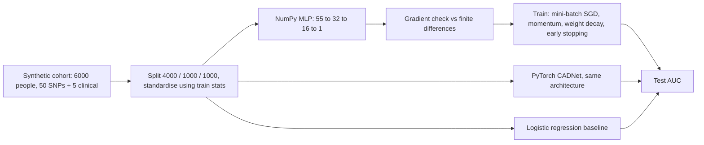

+++
summary = "Implement, gradient-check and train a multilayer perceptron in pure NumPy on a synthetic genotype-plus-clinical CAD dataset, then rebuild it in idiomatic PyTorch and compare."
+++

# A Neural Network from Scratch

Frameworks such as PyTorch compute gradients for you, which is wonderful until something goes wrong and you cannot tell whether the bug is in your data, your model or your understanding. The cure is to build a network once with nothing but NumPy: write the forward pass, derive and code the backward pass, prove it correct with a gradient check, and train it. After that, `loss.backward()` stops being magic.

In this chapter we do exactly that on a synthetic cohort that mimics our running problem: 50 SNP genotypes plus five clinical variables, used to predict coronary artery disease. Then we rebuild the same model in idiomatic PyTorch and check that the two agree. Along the way we get an honest lesson about when neural networks help, and when they don't.

## Key ideas

### The plan



### The synthetic cohort

Each simulated person has:

- **Genotypes** $G \in \{0, 1, 2\}^{50}$: the number of copies of the effect allele at 50 SNPs, drawn from a binomial with an allele frequency between 0.05 and 0.5 per SNP (Hardy–Weinberg proportions; see [DNA, genes and variation](../../genomics-foundations/dna-genes-and-variation/)). Only the first 10 SNPs have true effects.
- **Clinical variables:** age (40–70), sex, LDL cholesterol (mmol/L), systolic blood pressure (mmHg) and smoking status.

The true log-odds of CAD is

$$
\text{logit} = -2 + 0.06(\text{age}-55) + 0.0015(\text{age}-55)^2 + 0.5\,\text{male} + 0.45(\text{LDL}-3.4) + 0.02(\text{SBP}-130) + 0.7\,\text{smoker} + \text{PRS} + 0.6\,\text{PRS}\cdot(\text{LDL}-3.4),
$$

where $\text{PRS} = \sum_j \beta_j (G_j - 2f_j)$ is the true genetic score built from the 10 causal SNPs. Two terms are deliberately *not* linear: a curved age effect and a **gene × LDL interaction**. These are the kind of structure an MLP could exploit and plain logistic regression cannot. The effect sizes are invented for teaching; they are not estimates from any real cohort.

### Architecture and shapes

The network is $55 \to 32 \to 16 \to 1$ with ReLU hidden units and a single logit output. For a mini-batch of $B$ people:

| Step | Operation | Shape |
|---|---|---|
| Input | standardised features $X$ | $B \times 55$ |
| Layer 1 | $Z_1 = XW_1 + \mathbf{b}_1$, $H_1 = \operatorname{ReLU}(Z_1)$ | $W_1$: $55\times 32$; $Z_1, H_1$: $B \times 32$ |
| Layer 2 | $Z_2 = H_1W_2 + \mathbf{b}_2$, $H_2 = \operatorname{ReLU}(Z_2)$ | $W_2$: $32 \times 16$; $Z_2, H_2$: $B \times 16$ |
| Output | $\mathbf{z}_3 = H_2W_3 + b_3$ (logits) | $W_3$: $16 \times 1$; $\mathbf{z}_3$: $B \times 1$ |
| Probability | $\mathbf{p} = \sigma(\mathbf{z}_3)$ | $B \times 1$ |

Parameters: $(55\cdot32 + 32) + (32\cdot16 + 16) + (16\cdot 1 + 1) = 1792 + 528 + 17 = 2337$.

### The loss

We use mean binary cross-entropy ([loss functions](../../calculus-and-optimization/loss-functions/)):

$$
\mathcal{L} = \frac1B\sum_{i=1}^B \Bigl[-y_i \ln p_i - (1-y_i)\ln(1-p_i)\Bigr], \qquad p_i = \sigma(z_i).
$$

Computing $\sigma$ and then $\ln$ can overflow for large $|z|$. Substituting $p = \sigma(z)$ and simplifying gives a **numerically stable** form that works for any $z$:

$$
\ell(z, y) = \max(z, 0) - zy + \ln\bigl(1 + e^{-|z|}\bigr).
$$

(Check it for $y=1$, $z>0$: $z - z + \ln(1+e^{-z}) = -\ln\sigma(z)$. Correct.)

### Deriving the backward pass

Write $\boldsymbol{\delta}_\ell = \partial \mathcal{L}/\partial Z_\ell$, a matrix with the same shape as $Z_\ell$.

**Output layer.** For one example, $\partial \ell / \partial z = \sigma(z) - y = p - y$. This beautifully simple result comes from the sigmoid derivative $\sigma(1-\sigma)$ cancelling the denominators of the log-loss ([linear and logistic regression](../../classical-machine-learning/linear-and-logistic-regression/) derives it). With the mean over the batch:

$$
\boldsymbol{\delta}_3 = \frac{1}{B}(\mathbf{p} - \mathbf{y}) \qquad (B \times 1).
$$

**Weights of any layer.** Since $Z_\ell = H_{\ell-1}W_\ell + \mathbf{b}_\ell$, each weight $W_\ell[j,k]$ affects column $k$ of $Z_\ell$ through $H_{\ell-1}[i,j]$ in every row $i$. Summing over the batch:

> [!IMPORTANT]
> $$\frac{\partial \mathcal{L}}{\partial W_\ell} = H_{\ell-1}^\top \boldsymbol{\delta}_\ell, \qquad \frac{\partial \mathcal{L}}{\partial \mathbf{b}_\ell} = \sum_{i=1}^{B} \boldsymbol{\delta}_\ell[i, :], \qquad \boldsymbol{\delta}_{\ell-1} = \bigl(\boldsymbol{\delta}_\ell W_\ell^\top\bigr) \odot \mathbb{1}[Z_{\ell-1} > 0].$$

Check the shapes, because they catch most mistakes: $H_{\ell-1}^\top$ is $n_{\ell-1} \times B$ and $\boldsymbol{\delta}_\ell$ is $B \times n_\ell$, so the product is $n_{\ell-1} \times n_\ell$, the shape of $W_\ell$. And $\boldsymbol{\delta}_\ell W_\ell^\top$ is $B \times n_{\ell-1}$, the shape of $Z_{\ell-1}$. The indicator $\mathbb{1}[Z > 0]$ is the ReLU derivative.

The forward pass must **cache** every $Z_\ell$ (and the input) because the backward pass needs them. This is why training uses much more memory than prediction.

### Gradient checking

A central finite difference approximates each partial derivative:

$$
\frac{\partial \mathcal{L}}{\partial \theta} \approx \frac{\mathcal{L}(\theta + \varepsilon) - \mathcal{L}(\theta - \varepsilon)}{2\varepsilon}.
$$

Its error is $O(\varepsilon^2)$, much better than the one-sided version's $O(\varepsilon)$. Compare with backprop using the **relative error** $|g_{\text{num}} - g_{\text{bp}}| / (|g_{\text{num}}| + |g_{\text{bp}}|)$. In double precision with $\varepsilon = 10^{-5}$, values around $10^{-7}$ or smaller mean the gradient is right; values around $10^{-2}$ or larger mean a bug. (ReLU's kink at 0 can occasionally cause a larger error if a perturbation crosses it; that is not a bug.)

### The optimiser

We use mini-batch SGD with momentum and L2 weight decay ([gradient descent and optimizers](../../calculus-and-optimization/gradient-descent-and-optimizers/)):

$$
\mathbf{v} \leftarrow \mu\mathbf{v} - \eta\bigl(\nabla_W\mathcal{L} + \lambda W\bigr), \qquad W \leftarrow W + \mathbf{v},
$$

with $\eta = 0.01$, $\mu = 0.9$, $\lambda = 0.03$, batch size 64, and early stopping on validation loss (keep the best epoch out of 60).

## Worked example

**Problem.** One person with features $\mathbf{x} = (1, 2)$ and label $y = 1$ passes through a $2 \to 2 \to 1$ ReLU network with no biases:

$$
W_1 = \begin{bmatrix} 0.1 & -0.2 \\ 0.3 & 0.4 \end{bmatrix}, \qquad W_2 = \begin{bmatrix} 0.5 \\ -0.5 \end{bmatrix}.
$$

Do one forward pass, one backward pass, and one SGD step with $\eta = 0.1$.

**Forward.**

- $\mathbf{z}_1 = \mathbf{x}W_1 = (1\cdot 0.1 + 2 \cdot 0.3,\ 1\cdot(-0.2) + 2\cdot 0.4) = (0.7,\ 0.6)$.
- $\mathbf{h}_1 = \operatorname{ReLU}(\mathbf{z}_1) = (0.7,\ 0.6)$. Both units are active.
- $z_2 = 0.7(0.5) + 0.6(-0.5) = 0.35 - 0.30 = 0.05$.
- $p = \sigma(0.05) = 0.5125$, loss $= -\ln 0.5125 = 0.6685$.

**Backward.**

- $\delta_2 = p - y = 0.5125 - 1 = -0.4875$.
- $\partial\mathcal{L}/\partial W_2 = \mathbf{h}_1^\top \delta_2 = (0.7, 0.6)^\top(-0.4875) = (-0.3413,\ -0.2925)^\top$.
- $\boldsymbol{\delta}_1 = (\delta_2 W_2^\top) \odot \mathbb{1}[\mathbf{z}_1 > 0] = (-0.4875 \cdot 0.5,\ -0.4875 \cdot (-0.5)) \odot (1, 1) = (-0.2438,\ 0.2438)$.
- $\partial\mathcal{L}/\partial W_1 = \mathbf{x}^\top \boldsymbol{\delta}_1 = \begin{bmatrix} 1 \\ 2 \end{bmatrix}\begin{bmatrix} -0.2438 & 0.2438 \end{bmatrix} = \begin{bmatrix} -0.2438 & 0.2438 \\ -0.4875 & 0.4875 \end{bmatrix}$.

Interpretation: the prediction is too low, so the gradient says "increase the weight on the hidden unit with a positive output weight, and decrease the other's".

**SGD step** ($W \leftarrow W - 0.1\,\nabla W$):

$$
W_1 = \begin{bmatrix} 0.1244 & -0.2244 \\ 0.3488 & 0.3512 \end{bmatrix}, \qquad W_2 = \begin{bmatrix} 0.5341 \\ -0.4708 \end{bmatrix}.
$$

**Check.** The new forward pass gives $\mathbf{z}_1 = (0.8219,\ 0.4781)$, $z_2 = 0.8219(0.5341) - 0.4781(0.4708) = 0.2139$, $p = 0.5533$ and loss $0.5919$, down from $0.6685$. All of these numbers were confirmed with PyTorch autograd.

## In code

The code below is one program split into five parts. Run them in order in one file or notebook.

**Part 1: the data.**

```python
import numpy as np

rng = np.random.default_rng(42)
n, n_snps = 6000, 50

# genotypes: 50 SNPs, dosage 0/1/2 copies of the effect allele (Hardy-Weinberg)
maf = rng.uniform(0.05, 0.5, n_snps)                      # effect-allele frequencies
G = rng.binomial(2, maf, size=(n, n_snps)).astype(float)  # shape (6000, 50)
beta = np.zeros(n_snps)
beta[:10] = rng.normal(0, 0.25, 10)                       # only 10 SNPs are causal
prs = (G - 2 * maf) @ beta                                # true genetic score

# clinical features
age = rng.uniform(40, 70, n)
male = rng.binomial(1, 0.5, n).astype(float)
ldl = rng.normal(3.4, 0.9, n)                             # mmol/L
sbp = rng.normal(130, 15, n)                              # systolic BP, mmHg
smoker = rng.binomial(1, 0.2, n).astype(float)

# outcome: additive effects plus a gene-by-LDL interaction and a nonlinear age term
logit = (-2.0 + 0.06 * (age - 55) + 0.0015 * (age - 55) ** 2 + 0.5 * male
         + 0.45 * (ldl - 3.4) + 0.02 * (sbp - 130) + 0.7 * smoker
         + 1.0 * prs + 0.6 * prs * (ldl - 3.4))
y = (rng.random(n) < 1 / (1 + np.exp(-logit))).astype(float)

X = np.column_stack([G, age, male, ldl, sbp, smoker])     # shape (6000, 55)
idx = rng.permutation(n)
tr, va, te = idx[:4000], idx[4000:5000], idx[5000:]
mu, sd = X[tr].mean(0), X[tr].std(0)                      # fit scaling on TRAIN only
Xs = (X - mu) / sd
Xtr, ytr, Xva, yva, Xte, yte = Xs[tr], y[tr], Xs[va], y[va], Xs[te], y[te]
print("X:", X.shape, " prevalence:", y.mean().round(3),
      " train/val/test:", len(tr), len(va), len(te))
```

**Part 2: the MLP class.** The `backward` method is a line-by-line translation of the boxed formulas.

```python
class MLP:
    """ReLU MLP for binary classification. sizes = [n_in, h1, ..., 1]."""
    def __init__(self, sizes, seed=0):
        r = np.random.default_rng(seed)
        self.W = [r.normal(0, np.sqrt(2 / a), (a, b)) for a, b in zip(sizes[:-1], sizes[1:])]
        self.b = [np.zeros(b) for b in sizes[1:]]

    def forward(self, X):
        self.cache = [X]                        # H_0 = X
        H = X
        for l, (W, b) in enumerate(zip(self.W, self.b)):
            Z = H @ W + b                       # (B, n_l)
            last = l == len(self.W) - 1
            H = Z if last else np.maximum(0, Z) # ReLU on hidden layers, raw logit at the end
            self.cache.append(Z)
        return H[:, 0]                          # logits, shape (B,)

    def loss(self, logits, y):
        # numerically stable binary cross-entropy with logits
        return np.mean(np.maximum(logits, 0) - logits * y + np.log1p(np.exp(-np.abs(logits))))

    def backward(self, logits, y):
        B = len(y)
        p = 1 / (1 + np.exp(-logits))
        delta = ((p - y) / B)[:, None]          # dL/dZ_L, shape (B, 1)
        gW, gb = [None] * len(self.W), [None] * len(self.W)
        for l in reversed(range(len(self.W))):
            Z_prev = self.cache[l]              # pre-activation of previous layer (or X)
            H_prev = Z_prev if l == 0 else np.maximum(0, Z_prev)
            gW[l] = H_prev.T @ delta            # (n_{l-1}, n_l)
            gb[l] = delta.sum(axis=0)           # (n_l,)
            if l > 0:
                delta = (delta @ self.W[l].T) * (Z_prev > 0)   # back through W and ReLU
        return gW, gb

    def predict_proba(self, X):
        return 1 / (1 + np.exp(-self.forward(X)))
```

**Part 3: the gradient check.**

```python
net = MLP([55, 16, 8, 1], seed=1)
Xb, yb = Xtr[:20], ytr[:20]
gW, gb = net.backward(net.forward(Xb), yb)

def numerical_grad(param, i, j, eps=1e-5):
    old = param[i, j]
    param[i, j] = old + eps; lp = net.loss(net.forward(Xb), yb)
    param[i, j] = old - eps; lm = net.loss(net.forward(Xb), yb)
    param[i, j] = old
    return (lp - lm) / (2 * eps)

check = np.random.default_rng(0)
for l, W in enumerate(net.W):
    errs = []
    for _ in range(10):                          # 10 random entries per layer
        i, j = check.integers(W.shape[0]), check.integers(W.shape[1])
        num, ana = numerical_grad(W, i, j), gW[l][i, j]
        errs.append(abs(num - ana) / max(1e-12, abs(num) + abs(ana)))
    print(f"layer {l}: W shape {W.shape}, max relative error {max(errs):.1e}")
```

**Part 4: training in NumPy, with a logistic-regression baseline.**

```python
from sklearn.metrics import roc_auc_score
from sklearn.linear_model import LogisticRegression

def train_numpy(sizes, lr=0.01, momentum=0.9, wd=0.03, epochs=60, batch=64, seed=0):
    net = MLP(sizes, seed=seed)
    vW = [np.zeros_like(W) for W in net.W]; vb = [np.zeros_like(b) for b in net.b]
    order = np.random.default_rng(seed)
    best = (np.inf, None, 0)
    for epoch in range(epochs):
        perm = order.permutation(len(Xtr))
        for s in range(0, len(Xtr), batch):
            ib = perm[s:s + batch]
            gW, gb = net.backward(net.forward(Xtr[ib]), ytr[ib])
            for l in range(len(net.W)):          # SGD with momentum and L2 weight decay
                vW[l] = momentum * vW[l] - lr * (gW[l] + wd * net.W[l])
                vb[l] = momentum * vb[l] - lr * gb[l]
                net.W[l] += vW[l]; net.b[l] += vb[l]
        val = net.loss(net.forward(Xva), yva)
        if val < best[0]:                        # remember the best epoch (early stopping)
            best = (val, ([W.copy() for W in net.W], [b.copy() for b in net.b]), epoch + 1)
    net.W, net.b = best[1]
    print(f"best val loss {best[0]:.4f} at epoch {best[2]}")
    return net

net = train_numpy([55, 32, 16, 1])
print(f"numpy MLP            test AUC = {roc_auc_score(yte, net.predict_proba(Xte)):.3f}")
logreg = LogisticRegression(max_iter=2000).fit(Xtr, ytr)
print(f"logistic regression  test AUC = {roc_auc_score(yte, logreg.predict_proba(Xte)[:, 1]):.3f}")
print(f"true logit (oracle)  test AUC = {roc_auc_score(yte, logit[te]):.3f}")
```

**Part 5: the same model in PyTorch.** An `nn.Module` declares the layers, a `DataLoader` handles shuffling and batching, autograd replaces our `backward`, and `torch.optim.SGD` replaces our update loop. (PyTorch's `weight_decay` for SGD adds $\lambda W$ to the gradient, exactly as we did.)

```python
import torch
from torch import nn
from torch.utils.data import TensorDataset, DataLoader

class CADNet(nn.Module):
    def __init__(self, n_in=55, h1=32, h2=16):
        super().__init__()
        self.layers = nn.Sequential(
            nn.Linear(n_in, h1), nn.ReLU(),     # (B, 55) -> (B, 32)
            nn.Linear(h1, h2), nn.ReLU(),       # (B, 32) -> (B, 16)
            nn.Linear(h2, 1))                   # (B, 16) -> (B, 1)
        for m in self.layers:
            if isinstance(m, nn.Linear):        # He init, same as the numpy version
                nn.init.kaiming_normal_(m.weight, nonlinearity="relu"); nn.init.zeros_(m.bias)
    def forward(self, x):
        return self.layers(x).squeeze(-1)       # logits, shape (B,)

torch.manual_seed(0)
t = lambda a: torch.tensor(a, dtype=torch.float32)
train_dl = DataLoader(TensorDataset(t(Xtr), t(ytr)), batch_size=64, shuffle=True)
model = CADNet()
print("parameters:", sum(p.numel() for p in model.parameters()))
opt = torch.optim.SGD(model.parameters(), lr=0.01, momentum=0.9, weight_decay=0.03)
loss_fn = nn.BCEWithLogitsLoss()

best_val, best_state = float("inf"), None
for epoch in range(60):
    model.train()
    for xb, yb in train_dl:
        loss = loss_fn(model(xb), yb)
        opt.zero_grad(); loss.backward(); opt.step()
    model.eval()
    with torch.no_grad():
        val = loss_fn(model(t(Xva)), t(yva)).item()
    if val < best_val:
        best_val, best_epoch = val, epoch + 1
        best_state = {k: v.clone() for k, v in model.state_dict().items()}
model.load_state_dict(best_state)
with torch.no_grad():
    p_te = torch.sigmoid(model(t(Xte))).numpy()
print(f"best val loss {best_val:.4f} at epoch {best_epoch}")
print(f"PyTorch MLP          test AUC = {roc_auc_score(yte, p_te):.3f}")
```

Output of all five parts:

```
X: (6000, 55)  prevalence: 0.226  train/val/test: 4000 1000 1000
layer 0: W shape (55, 16), max relative error 9.3e-10
layer 1: W shape (16, 8), max relative error 2.9e-09
layer 2: W shape (8, 1), max relative error 5.6e-10
best val loss 0.4921 at epoch 27
numpy MLP            test AUC = 0.737
logistic regression  test AUC = 0.737
true logit (oracle)  test AUC = 0.756
parameters: 2337
best val loss 0.4926 at epoch 39
PyTorch MLP          test AUC = 0.732
```

### Reading the results

- **The gradient check passes.** Relative errors of $10^{-9}$ mean our hand-derived backward pass matches the true derivative.
- **NumPy and PyTorch agree.** Validation losses of 0.4921 and 0.4926 and test AUCs of 0.737 and 0.732. They differ slightly because the initial weights and batch order come from different random number generators, not because the maths differs.
- **The MLP does not beat logistic regression.** Both reach 0.737. The oracle, which knows the true logit, reaches only 0.756, so there is just 0.02 of AUC to gain from modelling the interaction perfectly, and with 4,000 training people (about 900 cases) the MLP cannot reliably find it. With a 1,000-person test set containing about 226 cases, each AUC has a standard error of about 0.02 (so a 95% interval of roughly $\pm 0.04$), which is larger than any of the differences here.

The last point is the most important lesson of the chapter. The ceiling on performance is set by the **data**, not by the model: the outcome is a coin flip with probability $\sigma(\text{logit})$, so even the true model is far from perfect. Neural networks earn their keep when there is a lot of nonlinear structure *and* enough data to learn it, or when the input is something like raw sequence that simple models cannot read at all.

> [!TIP]
> When we tried the same experiment with 30,000 simulated people, the MLP and logistic regression were still within about 0.003 AUC of each other. The interaction was simply too weak to matter much. Always simulate your problem first: it tells you how much a complex model could possibly gain.

## Biomedical connection

Real studies have the same structure as our simulation, at larger scale. UK Biobank, for example, links genotypes for roughly half a million participants to health records. Papers that compared neural networks with linear polygenic scores for common diseases have generally found small or no gains from the neural networks for most traits, consistent with the largely additive genetic architecture of common-variant risk. Where flexible models help more is in combining heterogeneous inputs (genotypes, clinical measurements, imaging, ECGs) and in reading raw sequence.

Three habits from this chapter carry straight over to real data:

1. **Fit preprocessing on the training set only.** We computed the means and standard deviations on `Xtr` and applied them to validation and test. Fitting them on all data leaks test information.
2. **Always report a simple baseline.** If a reviewer asks "does the deep model beat logistic regression on the same features?", you must already know the answer.
3. **Respect the noise ceiling.** A model's AUC is bounded by how predictable the outcome really is. For CAD, lifestyle, environment and chance mean that no genotype-based model will approach an AUC of 1.

> [!CAUTION]
> The simulated cohort has no population structure, no relatives, no missing data and no ancestry differences. In real data, polygenic scores derived mainly from European-ancestry cohorts lose accuracy in other ancestries, and a model trained on one population must be evaluated separately in each group it will be used on. The [capstone](../../capstone-heart-disease-risk/evaluation-fairness-and-deployment/) returns to this.

## Practice

1. In the worked example, suppose the label had been $y = 0$. Recompute $\delta_2$ and $\partial\mathcal{L}/\partial W_2$.

<details>
<summary>Answer</summary>

$\delta_2 = p - y = 0.5125$. $\partial \mathcal{L}/\partial W_2 = (0.7, 0.6)^\top (0.5125) = (0.3588,\ 0.3075)^\top$. The signs flip: gradient descent now pushes the prediction down.

</details>

2. If $z_1$ for the second hidden unit had been $-0.6$ instead of $0.6$, which entries of $\partial\mathcal{L}/\partial W_1$ would be zero, and why?

<details>
<summary>Answer</summary>

The second hidden unit would be inactive, so $\mathbb{1}[z_1 > 0] = (1, 0)$ and $\boldsymbol{\delta}_1 = (-0.2438, 0)$. The whole second column of $\partial\mathcal{L}/\partial W_1$, the weights feeding that unit, would be zero. A unit that is off receives no gradient for that example.

</details>

3. Count the parameters of a $55 \to 64 \to 64 \to 1$ network. By what factor does the parameter count grow compared with $55 \to 32 \to 16 \to 1$?

<details>
<summary>Answer</summary>

$(55\cdot 64 + 64) + (64 \cdot 64 + 64) + (64 + 1) = 3584 + 4160 + 65 = 7809$. Compared with 2337, that is about $3.3\times$.

</details>

4. Why does the gradient check use $\varepsilon = 10^{-5}$ and double precision, rather than $\varepsilon = 10^{-12}$ or float32?

<details>
<summary>Answer</summary>

The finite difference has truncation error of order $\varepsilon^2$ (smaller $\varepsilon$ is better) but also rounding error of order (machine precision)/$\varepsilon$, because we subtract two nearly equal losses. In float64 (precision about $10^{-16}$), $\varepsilon = 10^{-5}$ balances them well, giving errors around $10^{-10}$. With $\varepsilon = 10^{-12}$ the rounding error dominates. In float32 (precision about $10^{-7}$) the rounding error at $\varepsilon = 10^{-5}$ would be around $10^{-2}$, too large to distinguish a bug from noise.

</details>

5. Modify the simulation so that the MLP *should* beat logistic regression. What would you change?

<details>
<summary>Answer</summary>

Make the nonlinear part of the true logit carry much more of the signal and give the model enough data to learn it. For example, increase the PRS × LDL coefficient, add a strong SNP × SNP interaction (an XOR-like pattern between two variants), and increase $n$. Check by computing the oracle AUC with and without the nonlinear terms: the gap between them is the most the MLP can gain over a linear model.

</details>

## Further reading

- Goodfellow, Bengio and Courville, *Deep Learning* (MIT Press, 2016), section 6.5, "Back-Propagation and Other Differentiation Algorithms".
- Rumelhart, D. E., Hinton, G. E. and Williams, R. J. (1986). Learning representations by back-propagating errors. *Nature* 323.
- Nielsen, M. *Neural Networks and Deep Learning* (free online book, 2015), chapters 1–2.
- The PyTorch tutorials "Learning PyTorch with Examples" and "Datasets & DataLoaders" (pytorch.org).
