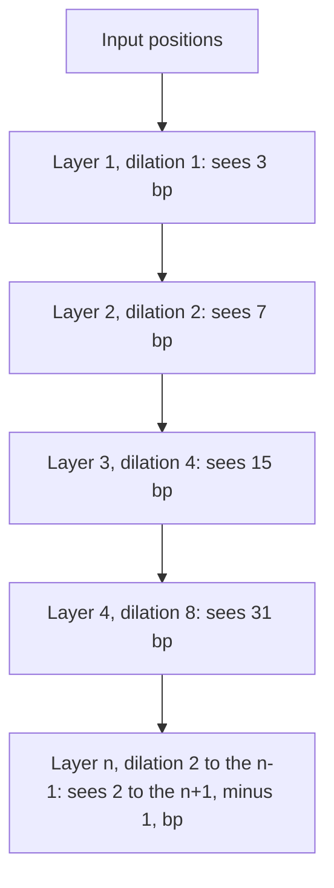
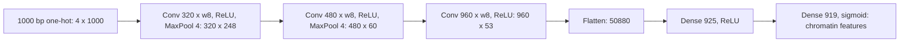
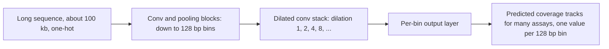

+++
summary = "Compute 1D convolutions on one-hot DNA by hand, relate filters to position weight matrices, reason about receptive fields and dilation, and train a CNN that discovers a planted motif."
+++

# Convolutional Networks for DNA

Most of the genetic signal for coronary artery disease from genome-wide association studies lies **outside** protein-coding genes. The 9p21 risk locus, for example, sits in a gene desert near *CDKN2A/CDKN2B*. Non-coding variants act mainly by changing **regulatory DNA**: short sequence patterns, or **motifs**, where transcription factors bind and switch genes on or off. To predict what a non-coding variant does, a model must read raw DNA and recognise motifs wherever they occur.

A multilayer perceptron is a poor fit for that job. It would need separate weights to detect the same motif at position 10 and at position 500. **Convolutional neural networks (CNNs)** solve this by sliding one small, learned detector along the whole sequence. This chapter builds CNNs from the convolution operation up, connects their filters to the position weight matrices of classical bioinformatics, and ends with landmark genomic CNNs and a working motif-finding model.

## Key ideas

### One-hot DNA as a tensor

From [encoding DNA for machine learning](../../bioinformatics-algorithms/encoding-dna-for-machine-learning/): a sequence of length $L$ becomes a $4 \times L$ matrix with one 1 per column, in the row for A, C, G or T. PyTorch's `Conv1d` uses the **channels-first** layout, so a batch of $B$ sequences is a tensor of shape $(B, 4, L)$: batch, channels, length. The four bases are the input channels, just as red, green and blue are the channels of an image.

### The 1D convolution

A convolutional layer has $C_{\text{out}}$ **filters** (also called kernels). Each filter is a small weight tensor of shape $C_{\text{in}} \times k$, where $k$ is the filter **width**, plus a bias. Output channel $c$ at position $i$ is

> [!IMPORTANT]
> $$Y[c, i] = b_c + \sum_{c'=1}^{C_{\text{in}}} \sum_{j=0}^{k-1} W[c, c', j]\; X[c', \, s\,i + d\,j]$$
> where $s$ is the stride and $d$ the dilation (both 1 by default). The output length is
> $$L_{\text{out}} = \left\lfloor \frac{L + 2p - d(k-1) - 1}{s} \right\rfloor + 1,$$
> with $p$ positions of zero padding on each side.

(Strictly, this is *cross-correlation*: true convolution flips the filter. Deep learning libraries all compute the formula above and call it convolution. Since the weights are learned, the distinction does not matter.)

On one-hot DNA the inner sum is a **lookup**. In each column of $X$ exactly one entry is 1, so $\sum_{c'} W[c, c', j]X[c', i+j]$ simply picks out the filter's weight for whichever base is at position $i+j$. A filter's score at a position is the **sum of its weights for the bases it sees**.

### Filters are learned motif detectors

This is exactly how a **position weight matrix (PWM)** scores a sequence. A PWM for a motif of width $k$ stores, for each position $j$ and base $b$, the log-odds

$$
W[b, j] = \log_2 \frac{p_{j}(b)}{q(b)},
$$

where $p_j(b)$ is the probability of base $b$ at motif position $j$ (estimated from known binding sites) and $q(b)$ is the background frequency (often 0.25). The PWM score of a window is $\sum_j W[x_{i+j}, j]$, the log-likelihood ratio "motif model versus background" ([distributions and likelihood](../../probability-and-statistics/distributions-and-likelihood/)). Sliding a PWM along a sequence **is** a 1D convolution with one filter.

The difference: a PWM comes from known binding sites, while a CNN filter's weights are **learned** from labelled sequences by gradient descent. First-layer filters of trained genomic CNNs often turn out to resemble known transcription-factor motifs, which is one of the main reasons biologists trust and use these models. A ReLU after the convolution acts like a threshold: "report only windows that score above $-b_c$".


### Weight sharing and parameter count

A `Conv1d(C_in, C_out, k)` layer has $C_{\text{in}} \cdot k \cdot C_{\text{out}} + C_{\text{out}}$ parameters, **independent of the sequence length**. Sixteen width-11 filters on DNA cost $4 \cdot 11 \cdot 16 + 16 = 720$ parameters, whether the input is 200 bp or 200,000 bp. A dense layer from a 200-bp one-hot input ($800$ numbers) to just 16 units would already need $800 \cdot 16 + 16 = 12{,}816$, and it would have to learn the motif separately at every position.

This gives CNNs their key inductive bias, **translation equivariance**: shift the input by one base and the output map shifts by one position. A following *global* pooling step makes the final prediction **translation invariant**: the motif counts wherever it is.

### Padding, stride and pooling

- **Padding.** Without padding ("valid"), the output is $k-1$ positions shorter than the input. Padding with $p = (k-1)/2$ zeros on each side (odd $k$) keeps $L_{\text{out}} = L$ ("same"). On one-hot DNA a zero column means "no base", which contributes 0 to the score.
- **Stride.** With stride $s$ the filter jumps $s$ positions at a time and the output shrinks by a factor of about $s$.
- **Max pooling.** `MaxPool1d(m)` takes the maximum over non-overlapping windows of $m$ positions, shrinking the length by $m$. It keeps "a motif was here, roughly" and discards the exact position, which also gives some tolerance to motif spacing.
- **Global pooling.** `AdaptiveMaxPool1d(1)` takes the maximum over the whole length: one number per filter.

### Receptive field

The **receptive field** of an output unit is the span of input positions that can affect it. For a stack of layers with widths $k_\ell$, strides $s_\ell$ and dilations $d_\ell$:

> [!IMPORTANT]
> $$r_\ell = r_{\ell-1} + (k_\ell - 1)\, d_\ell\, J_{\ell-1}, \qquad J_\ell = J_{\ell-1}\, s_\ell, \qquad r_0 = 1,\ J_0 = 1,$$
> where $J_\ell$ is the "jump": the distance in input bases between neighbouring units of layer $\ell$. Pooling layers count as layers with $k = s = m$.

Ten plain width-3 convolutions have a receptive field of only $1 + 10 \cdot 2 = 21$ bp. But enhancers can regulate genes tens of thousands of bases away, so models of gene regulation need receptive fields of many kilobases. Pooling helps (it multiplies the jump), and so does dilation.

### Dilated convolutions

A **dilated** convolution with dilation $d$ looks at inputs $d$ apart: positions $i, i+d, i+2d, \ldots$. It has the same number of parameters as an ordinary filter of width $k$, but spans $d(k-1)+1$ positions. Stacking width-3 layers with dilations $1, 2, 4, \ldots, 2^{n-1}$ gives

$$
r = 1 + \sum_{\ell=0}^{n-1} 2 \cdot 2^\ell = 1 + 2(2^n - 1) = 2^{n+1} - 1.
$$

The receptive field grows **exponentially** in depth while the parameter count grows only linearly. Ten such layers see $2^{11} - 1 = 2047$ bases.



### Landmark genomic CNNs

**DeepSEA** (Zhou and Troyanskaya, *Nature Methods*, 2015) takes 1,000 bp of sequence and predicts 919 chromatin features at once (transcription-factor binding, DNase I hypersensitivity and histone marks measured by ENCODE and Roadmap Epigenomics) as a multi-task problem with 919 sigmoid outputs. It used three convolutional layers (320, 480 and 960 filters of width 8, with max pooling) followed by a fully connected layer. Its key application was **variant-effect prediction**: score the reference and alternate alleles of a variant and look at the change in predicted chromatin features.



**Basset** (Kelley, Snoek and Rinn, *Genome Research*, 2016) predicts chromatin accessibility (DNase-seq peaks) in 164 cell types from 600 bp of sequence, with three convolutional layers (300, 200 and 200 filters of widths 19, 11 and 7), pooling, and two fully connected layers. The paper showed that many first-layer filters matched known transcription-factor motifs, and used in-silico mutagenesis (see [interpretability](../../deep-architectures-for-sequences/interpretability/)) to score variants.

**Basenji** (Kelley et al., *Genome Research*, 2018) moved to much longer inputs, on the order of 100 kb, and predicted genomic signal tracks in 128 bp bins along the sequence. Its design was: a few standard convolution and pooling layers to shrink the sequence to bin resolution, then a stack of **dilated** convolutions with exponentially growing dilation so that each bin's prediction can draw on distal regulatory elements. Its successor, Enformer, replaces the dilated stack with transformer layers; see [genomic foundation models](../../deep-architectures-for-sequences/genomic-foundation-models/).



The parameter tables in the code section are for our own re-implementations of the DeepSEA and Basset layer layouts, using "valid" convolutions and no batch normalisation. The published models differ in details such as padding, normalisation and dropout, so treat the totals as illustrative of where the parameters live, not as the official counts.

## Worked example

**Problem.** Score the sequence `GAGACTC` with a width-3 filter designed to detect `GAC`: weight $+1$ for the matching base at each position and $-1$ for the other three, no bias. Compute the output with no padding, with "same" padding, with stride 2, and after max pooling of size 2.

The filter, as a $4 \times 3$ matrix (rows A, C, G, T; columns positions 0, 1, 2):

$$
W = \begin{bmatrix} -1 & +1 & -1 \\ -1 & -1 & +1 \\ +1 & -1 & -1 \\ -1 & -1 & -1 \end{bmatrix}
$$

**No padding.** $L_{\text{out}} = 7 - 3 + 1 = 5$. Because the input is one-hot, each window's score is (number of matching positions) minus (number of mismatching positions):

| $i$ | window | matches with G, A, C | score |
|---|---|---|---|
| 0 | GAG | G ✓, A ✓, G ✗ | $1 + 1 - 1 = 1$ |
| 1 | AGA | ✗ ✗ ✗ | $-3$ |
| 2 | GAC | ✓ ✓ ✓ | $3$ |
| 3 | ACT | ✗ ✗ ✗ | $-3$ |
| 4 | CTC | ✗, ✗, C ✓ | $-1$ |

Output: $(1, -3, 3, -3, -1)$. The maximum, 3, marks the motif at position 2.

**Same padding** ($p = 1$). Add an all-zero column at each end; $L_{\text{out}} = 7$. The two new edge windows are $(\varnothing, \text{G}, \text{A})$, which scores $0 + (-1) + (-1) = -2$ (G is not A, A is not C), and $(\text{T}, \text{C}, \varnothing)$, scoring $-1 - 1 + 0 = -2$. Output: $(-2, 1, -3, 3, -3, -1, -2)$.

**Stride 2.** Keep every second window of the unpadded output, $i = 0, 2, 4$: $(1, 3, -1)$. Check with the formula: $\lfloor (7 - 2 - 1)/2 \rfloor + 1 = 3$.

**Max pool 2** on the unpadded output $(1, -3, 3, -3, -1)$: windows $\{1, -3\}$ and $\{3, -3\}$ give $(1, 3)$; the leftover last value is dropped, since $\lfloor 5/2 \rfloor = 2$.

**Receptive field.** For the motif CNN in the code below, one conv layer of width 11 has $r = 11$; the global max pool then makes the final output depend on the whole 200 bp.

## In code

The worked example in PyTorch:

```python
import numpy as np
import torch
import torch.nn.functional as F

BASES = "ACGT"
def one_hot(seq):
    x = np.zeros((4, len(seq)), dtype=np.float32)       # channels-first: (4, L)
    for i, b in enumerate(seq):
        x[BASES.index(b), i] = 1.0
    return x

seq = "GAGACTC"
X = torch.tensor(one_hot(seq)).unsqueeze(0)              # (batch=1, 4, 7)
# a width-3 filter that rewards "GAC": +1 for the matching base, -1 for others
W = -torch.ones(1, 4, 3)                                  # (out_channels, in_channels, width)
for j, b in enumerate("GAC"):
    W[0, BASES.index(b), j] = 1.0
out = F.conv1d(X, W)                                      # no padding: length 7 - 3 + 1 = 5
print("windows:", [seq[i:i+3] for i in range(len(seq) - 2)])
print("scores :", out[0, 0].tolist())
print("same padding:", F.conv1d(X, W, padding=1)[0, 0].tolist())
print("stride 2    :", F.conv1d(X, W, stride=2)[0, 0].tolist())
print("max pool 2  :", F.max_pool1d(out, 2)[0, 0].tolist())
```

```
windows: ['GAG', 'AGA', 'GAC', 'ACT', 'CTC']
scores : [1.0, -3.0, 3.0, -3.0, -1.0]
same padding: [-2.0, 1.0, -3.0, 3.0, -3.0, -1.0, -2.0]
stride 2    : [1.0, 3.0, -1.0]
max pool 2  : [1.0, 3.0]
```

Now a CNN that **learns** a motif. We generate 5,000 random 200-bp sequences. Half are positives, and each positive gets one copy of an AP-1-like site `TGA[C/G]TCA` planted at a random position. The network never sees the motif; it only sees labels.

| Layer | Output shape | Parameters |
|---|---|---|
| Input | $(B, 4, 200)$ | 0 |
| Conv1d 4 → 16, $k = 11$, padding 5 | $(B, 16, 200)$ | $4 \cdot 11 \cdot 16 + 16 = 720$ |
| ReLU | $(B, 16, 200)$ | 0 |
| Global max pool | $(B, 16)$ | 0 |
| Linear 16 → 1 | $(B, 1)$ | $16 + 1 = 17$ |
| **Total** | | **737** |

```python
import numpy as np
import torch
from torch import nn

rng = np.random.default_rng(0)
torch.manual_seed(0)
L, N = 200, 5000
BASES = np.array(list("ACGT"))

def sample_motif():                     # AP-1-like site TGA[C/G]TCA
    return list("TGA") + [rng.choice(["C", "G"])] + list("TCA")

def make_dataset(n):
    seqs = rng.choice(BASES, size=(n, L))           # i.i.d. uniform background
    y = rng.integers(0, 2, n)
    for i in np.where(y == 1)[0]:                   # plant one motif in each positive
        pos = rng.integers(0, L - 7)
        seqs[i, pos:pos + 7] = sample_motif()
    X = (seqs[:, None, :] == BASES[None, :, None]).astype(np.float32)   # (n, 4, L)
    return torch.tensor(X), torch.tensor(y, dtype=torch.float32), seqs

X, y, seqs = make_dataset(N)
Xtr, ytr, Xte, yte = X[:4000], y[:4000], X[4000:], y[4000:]

class MotifCNN(nn.Module):
    def __init__(self, n_filters=16, width=11):
        super().__init__()
        self.conv = nn.Conv1d(4, n_filters, width, padding=width // 2)  # (B,4,L) -> (B,16,L)
        self.pool = nn.AdaptiveMaxPool1d(1)                             # (B,16,L) -> (B,16,1)
        self.fc = nn.Linear(n_filters, 1)                               # (B,16)   -> (B,1)
    def forward(self, x):
        h = torch.relu(self.conv(x))
        return self.fc(self.pool(h).squeeze(-1)).squeeze(-1)            # logits (B,)

model = MotifCNN()
print("parameters:", sum(p.numel() for p in model.parameters()))
opt = torch.optim.Adam(model.parameters(), lr=1e-2)
loss_fn = nn.BCEWithLogitsLoss()
for epoch in range(15):
    perm = torch.randperm(len(Xtr))
    for i in range(0, len(Xtr), 64):
        idx = perm[i:i + 64]
        loss = loss_fn(model(Xtr[idx]), ytr[idx])
        opt.zero_grad(); loss.backward(); opt.step()
model.eval()
with torch.no_grad():
    acc = ((model(Xte) > 0).float() == yte).float().mean().item()
print(f"test accuracy: {acc:.3f}")
```

```
parameters: 737
test accuracy: 0.989
```

Which filter learned the motif? Take the filter with the largest output weight, find where it fires most strongly in each positive test sequence, and line up those 11-bp windows (continue in the same session):

```python
w_out = model.fc.weight[0].detach()                     # (16,) weight of each filter's max
k = int(torch.argmax(w_out))
print(f"filter {k} has the largest output weight ({w_out[k]:.2f})")
with torch.no_grad():
    act = torch.relu(model.conv(Xte))[:, k, :]          # (1000, 200) activation map
pos_idx = torch.where(yte == 1)[0]
best = act[pos_idx].argmax(dim=1)                       # top-scoring position per positive seq
counts = np.zeros((4, 11))
test_seqs = seqs[4000:]
for i, c in zip(pos_idx.tolist(), best.tolist()):
    padded = np.concatenate([["N"] * 5, test_seqs[i], ["N"] * 5])  # match padding=5
    window = padded[c:c + 11]
    for j, b in enumerate(window):
        if b != "N":
            counts["ACGT".index(b), j] += 1
freq = counts / counts.sum(0, keepdims=True)
print("     " + " ".join(f"{j:>4d}" for j in range(11)))
for r, b in enumerate("ACGT"):
    print(f"{b}:   " + " ".join(f"{v:4.2f}" for v in freq[r]))
IUPAC = {"CG": "S", "AT": "W", "AG": "R", "CT": "Y", "AC": "M", "GT": "K"}
def code(col):                                          # IUPAC letter for one column
    top = np.argsort(col)[::-1]
    if col[top[0]] > 0.8: return "ACGT"[top[0]]
    if col[top[0]] + col[top[1]] > 0.8: return IUPAC["".join(sorted("ACGT"[t] for t in top[:2]))]
    return "n"
consensus = "".join(code(freq[:, c]) for c in range(11))
print("consensus of top windows:", consensus)
```

```
filter 13 has the largest output weight (1.79)
        0    1    2    3    4    5    6    7    8    9   10
A:   0.24 0.00 0.00 1.00 0.00 0.00 0.00 1.00 0.24 0.28 0.27
C:   0.26 0.00 0.00 0.00 0.51 0.00 1.00 0.00 0.24 0.25 0.24
G:   0.21 0.00 1.00 0.00 0.49 0.00 0.00 0.00 0.27 0.24 0.25
T:   0.29 1.00 0.00 0.00 0.00 1.00 0.00 0.00 0.25 0.23 0.24
consensus of top windows: nTGASTCAnnn
```

The filter recovered the planted motif exactly, including the C/G ambiguity at its centre (`S` is the IUPAC code for "C or G"), from labels alone. The flanking columns are close to the uniform 0.25 background. This frequency matrix is a PWM in all but name; exporting such matrices and comparing them with motif databases is a standard step in analysing genomic CNNs.

Finally, layer-by-layer shapes and parameter counts for DeepSEA-style and Basset-style networks, and a gradient-based measurement of receptive fields:

```python
import torch
from torch import nn

def describe(m):
    if isinstance(m, nn.Conv1d): return f"Conv1d {m.in_channels}->{m.out_channels}, k={m.kernel_size[0]}"
    if isinstance(m, nn.MaxPool1d): return f"MaxPool1d {m.kernel_size}"
    if isinstance(m, nn.Linear): return f"Linear {m.in_features}->{m.out_features}"
    return type(m).__name__

def show_shapes(model, x):
    print(f"{'input':24s} {tuple(x.shape)}")
    for layer in model:
        x = layer(x)
        if isinstance(layer, nn.ReLU): continue          # shape unchanged, no parameters
        n = sum(p.numel() for p in layer.parameters())
        print(f"{describe(layer):24s} {str(tuple(x.shape)):16s} params={n:,}")
    print(f"total parameters: {sum(p.numel() for p in model.parameters()):,}\n")

# DeepSEA-style: 1000 bp in, 919 chromatin features out (layer sizes from Zhou & Troyanskaya 2015)
deepsea = nn.Sequential(
    nn.Conv1d(4, 320, 8), nn.ReLU(), nn.MaxPool1d(4),
    nn.Conv1d(320, 480, 8), nn.ReLU(), nn.MaxPool1d(4),
    nn.Conv1d(480, 960, 8), nn.ReLU(), nn.Flatten(),
    nn.Linear(960 * 53, 925), nn.ReLU(), nn.Linear(925, 919))
show_shapes(deepsea, torch.zeros(1, 4, 1000))

# Basset-style: 600 bp in, 164 cell-type accessibility outputs (Kelley et al. 2016)
basset = nn.Sequential(
    nn.Conv1d(4, 300, 19), nn.ReLU(), nn.MaxPool1d(3),
    nn.Conv1d(300, 200, 11), nn.ReLU(), nn.MaxPool1d(4),
    nn.Conv1d(200, 200, 7), nn.ReLU(), nn.MaxPool1d(4), nn.Flatten(),
    nn.Linear(200 * 10, 1000), nn.ReLU(), nn.Linear(1000, 1000), nn.ReLU(),
    nn.Linear(1000, 164))
show_shapes(basset, torch.zeros(1, 4, 600))

# Receptive field of a dilated stack, measured with gradients
def receptive_field(dilations, k=3, L=4097):
    layers = []
    for d in dilations:
        layers += [nn.Conv1d(1, 1, k, dilation=d, padding=d * (k - 1) // 2), nn.ReLU()]
    net = nn.Sequential(*layers)
    for m in net:
        if isinstance(m, nn.Conv1d):
            nn.init.constant_(m.weight, 1.0); nn.init.constant_(m.bias, 1.0)
    x = torch.zeros(1, 1, L, requires_grad=True)
    net(x)[0, 0, L // 2].backward()                    # one output position
    return int((x.grad[0, 0] != 0).sum())               # inputs that influence it

print("10 plain conv layers (k=3):        RF =", receptive_field([1] * 10))
print("10 dilated layers (1,2,4,...,512): RF =", receptive_field([2 ** i for i in range(10)]))
```

```
input                    (1, 4, 1000)
Conv1d 4->320, k=8       (1, 320, 993)    params=10,560
MaxPool1d 4              (1, 320, 248)    params=0
Conv1d 320->480, k=8     (1, 480, 241)    params=1,229,280
MaxPool1d 4              (1, 480, 60)     params=0
Conv1d 480->960, k=8     (1, 960, 53)     params=3,687,360
Flatten                  (1, 50880)       params=0
Linear 50880->925        (1, 925)         params=47,064,925
Linear 925->919          (1, 919)         params=850,994
total parameters: 52,843,119

input                    (1, 4, 600)
Conv1d 4->300, k=19      (1, 300, 582)    params=23,100
MaxPool1d 3              (1, 300, 194)    params=0
Conv1d 300->200, k=11    (1, 200, 184)    params=660,200
MaxPool1d 4              (1, 200, 46)     params=0
Conv1d 200->200, k=7     (1, 200, 40)     params=280,200
MaxPool1d 4              (1, 200, 10)     params=0
Flatten                  (1, 2000)        params=0
Linear 2000->1000        (1, 1000)        params=2,001,000
Linear 1000->1000        (1, 1000)        params=1,001,000
Linear 1000->164         (1, 164)         params=164,164
total parameters: 4,129,664

10 plain conv layers (k=3):        RF = 21
10 dilated layers (1,2,4,...,512): RF = 2047
```

Two lessons from the tables. First, in the DeepSEA-style network about 89% of the parameters (47.1 of 52.8 million) sit in the first dense layer after flattening: the convolutions themselves are cheap. Later architectures replace large flatten-then-dense layers with global pooling or per-position outputs. Second, the measured receptive fields, 21 and 2,047 bases, match the formulas.

## Biomedical connection

How would a CNN fit into a DNA → heart-disease model?

1. **Annotating non-coding risk variants.** Most CAD-associated GWAS variants are non-coding. A sequence-to-function CNN trained on chromatin data (as DeepSEA and Basset were) can score each variant by comparing predictions for the reference and alternate alleles. Variants predicted to disrupt a transcription-factor site in a relevant cell type (for example liver for lipid genes, or vascular smooth muscle and endothelial cells for vessel-wall biology) become better candidates for being causal.
2. **Building features for risk prediction.** Those variant-effect scores can weight variants in a polygenic score, or be pooled per gene or per pathway, and fed to the risk model with clinical data. The CNN supplies biology; the risk model supplies the person-level prediction.
3. **Direct sequence-to-phenotype models** that read each person's whole genome remain impractical: with 3 billion bases per person and only thousands of cases, there is far too little data. Sequence models are trained on molecular readouts (millions of labelled genomic positions), not directly on disease labels.

> [!CAUTION]
> A predicted change in chromatin accessibility is a hypothesis about molecular mechanism, not evidence that a variant causes disease. Variant classification for clinical reporting follows formal guidelines in which computational predictions count only as supporting evidence.

## Practice

1. A `Conv1d(4, 64, 15, padding=0)` layer receives input of shape $(32, 4, 500)$. What is the output shape, and how many parameters does the layer have?

<details>
<summary>Answer</summary>

$L_{\text{out}} = 500 - 15 + 1 = 486$, so the output is $(32, 64, 486)$. Parameters: $4 \cdot 15 \cdot 64 + 64 = 3840 + 64 = 3904$.

</details>

2. A PWM position has base probabilities $p(\text{A}) = 0.7$, $p(\text{C}) = 0.1$, $p(\text{G}) = 0.1$, $p(\text{T}) = 0.1$ with uniform background. Compute the log2-odds weights for that column.

<details>
<summary>Answer</summary>

$\log_2(0.7/0.25) = \log_2 2.8 \approx 1.485$ for A, and $\log_2(0.1/0.25) = \log_2 0.4 \approx -1.322$ for each of C, G and T.

</details>

3. Compute the receptive field of: Conv $k=8$ → MaxPool 4 → Conv $k=8$ → MaxPool 4 → Conv $k=8$ (all stride 1 convolutions, as in DeepSEA).

<details>
<summary>Answer</summary>

Start $r = 1$, $J = 1$. Conv $k=8$: $r = 1 + 7 = 8$. Pool 4: $r = 8 + 3 \cdot 1 = 11$, $J = 4$. Conv $k=8$: $r = 11 + 7 \cdot 4 = 39$. Pool 4: $r = 39 + 3 \cdot 4 = 51$, $J = 16$. Conv $k=8$: $r = 51 + 7 \cdot 16 = 163$. Each unit in the third conv layer sees 163 bp. (The dense layer that follows sees all 1,000.)

</details>

4. How many width-3 dilated layers, with dilations $1, 2, 4, \ldots$, are needed for a receptive field of at least 100,000 bp?

<details>
<summary>Answer</summary>

Need $2^{n+1} - 1 \ge 100{,}000$, so $2^{n+1} \ge 100{,}001$. $2^{16} = 65{,}536$ is too small and $2^{17} = 131{,}072$ works, so $n + 1 = 17$ and $n = 16$ layers. In practice models first downsample with pooling, so they need fewer dilated layers.

</details>

5. Our motif CNN uses global **max** pooling. What would change if it used global **average** pooling instead, and which choice suits "does the sequence contain at least one motif"?

<details>
<summary>Answer</summary>

Average pooling divides the single strong motif response by the length (200), so one motif in a long sequence gives a weak signal, and the output becomes closer to "how many / how strong are matches on average". Max pooling directly answers "is there at least one strong match anywhere", which is exactly our labelling rule. Average pooling suits tasks where the total motif density matters.

</details>

## Further reading

- Goodfellow, Bengio and Courville, *Deep Learning* (MIT Press, 2016), chapter 9, "Convolutional Networks".
- Alipanahi, B., Delong, A., Weirauch, M. T. and Frey, B. J. (2015). Predicting the sequence specificities of DNA- and RNA-binding proteins by deep learning (DeepBind). *Nature Biotechnology* 33.
- Zhou, J. and Troyanskaya, O. G. (2015). Predicting effects of noncoding variants with deep learning-based sequence model (DeepSEA). *Nature Methods* 12.
- Kelley, D. R., Snoek, J. and Rinn, J. L. (2016). Basset: learning the regulatory code of the accessible genome with deep convolutional neural networks. *Genome Research* 26.
- Kelley, D. R. et al. (2018). Sequential regulatory activity prediction across chromosomes with convolutional neural networks (Basenji). *Genome Research* 28.
- Yu, F. and Koltun, V. (2016). Multi-scale context aggregation by dilated convolutions. *ICLR*.
- Stormo, G. D. (2000). DNA binding sites: representation and discovery. *Bioinformatics* 16(1).
