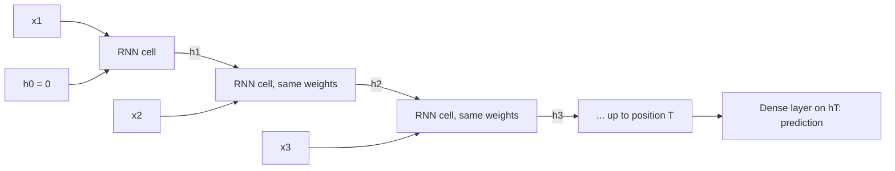
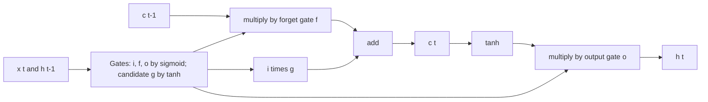

+++
summary = "Write down and compute the recurrences of vanilla RNNs, LSTMs and GRUs, explain vanishing gradients through time and how gating fixes them, and build a DanQ-style CNN + BiLSTM for DNA."
+++

# Recurrent Networks and LSTMs

A convolutional filter sees a fixed window, and global max pooling throws away *where* things were found. But regulatory grammar depends on arrangement: the order of transcription-factor sites, their spacing, and their orientation relative to a gene. A model that asks "is motif A upstream of motif B?" needs to carry information along the sequence.

**Recurrent neural networks (RNNs)** read a sequence one position at a time and keep a running **hidden state**, a memory vector updated at each step. For about a decade they were the standard tool for sequences, from speech to text to DNA. This chapter derives how they work, why plain RNNs forget, how the gates of the **LSTM** and **GRU** fix that, and how the DanQ model combined a CNN with a bidirectional LSTM to read regulatory DNA. It ends with why transformers have largely taken over, which sets up the next chapter.

## Key ideas

### The recurrence

At each position $t = 1, \ldots, T$ the RNN takes the input $\mathbf{x}_t \in \mathbb{R}^{I}$ (for DNA, a one-hot base or a vector of convolutional features) and the previous hidden state $\mathbf{h}_{t-1} \in \mathbb{R}^{H}$, and computes

> [!IMPORTANT]
> $$\mathbf{h}_t = \tanh\bigl(W_{x}\mathbf{x}_t + W_{h}\mathbf{h}_{t-1} + \mathbf{b}\bigr), \qquad \mathbf{h}_0 = \mathbf{0}.$$
> $W_x$ is $H \times I$, $W_h$ is $H \times H$, $\mathbf{b}$ is $H$-dimensional. The **same** weights are used at every step.

Weight sharing across time is the RNN's version of the CNN's weight sharing across positions: the parameter count does not depend on sequence length. For a prediction about the whole sequence we can feed the final state $\mathbf{h}_T$, or an average of all $\mathbf{h}_t$, into a dense output layer.

**Shapes in PyTorch** (with `batch_first=True`): input $(B, T, I)$, output (all hidden states) $(B, T, H)$, final state $(1, B, H)$ per layer and direction. Note the time axis is dimension 1, while `Conv1d` puts the length last, so moving from a CNN to an RNN needs a `transpose(1, 2)`.



**Parameter count.** $W_x$, $W_h$ and $\mathbf{b}$ give $H \cdot I + H^2 + H$. PyTorch keeps two bias vectors (one for each matrix), so `nn.RNN` reports $H(I + H) + 2H$. For one-hot DNA ($I = 4$) and $H = 32$: $32 \cdot 36 + 64 = 1216$.

### Backpropagation through time

To train, unroll the recurrence into a deep feed-forward network with one "layer" per time step, then apply ordinary backpropagation. This is **backpropagation through time (BPTT)**. Because the weights are shared, the gradient for $W_h$ is the **sum** of its gradients at every step.

How does $\mathbf{h}_T$ depend on an early input? By the chain rule,

$$
\frac{\partial \mathbf{h}_T}{\partial \mathbf{h}_k} = \prod_{t=k+1}^{T} \frac{\partial \mathbf{h}_t}{\partial \mathbf{h}_{t-1}} = \prod_{t=k+1}^{T} \operatorname{diag}\bigl(1 - \mathbf{h}_t^2\bigr)\, W_h.
$$

This is the same product of Jacobians that caused vanishing gradients in deep MLPs ([training deep networks](../../neural-networks/training-deep-networks/)), except that now the depth is the **sequence length** and it is the same matrix $W_h$ every time. Roughly, if the largest singular value of $W_h$ times the typical $\tanh'$ is below 1, the product shrinks like $\gamma^{T-k}$ and the network cannot learn dependencies more than a few dozen steps long. If it is above 1, gradients explode. Bengio, Simard and Frasconi (1994) analysed this difficulty; exploding gradients are usually tamed by **gradient clipping** (rescale the gradient if its norm exceeds a threshold), but vanishing gradients need a change of architecture.

### The LSTM

The **long short-term memory** network (Hochreiter and Schmidhuber, 1997; the forget gate was added by Gers, Schmidhuber and Cummins, 2000) adds a second state, the **cell state** $\mathbf{c}_t$, and three **gates**: sigmoid-valued vectors in $(0, 1)$ that decide how much information flows.

> [!IMPORTANT]
> $$\begin{aligned}
> \mathbf{i}_t &= \sigma(W_{xi}\mathbf{x}_t + W_{hi}\mathbf{h}_{t-1} + \mathbf{b}_i) && \text{input gate}\\
> \mathbf{f}_t &= \sigma(W_{xf}\mathbf{x}_t + W_{hf}\mathbf{h}_{t-1} + \mathbf{b}_f) && \text{forget gate}\\
> \mathbf{g}_t &= \tanh(W_{xg}\mathbf{x}_t + W_{hg}\mathbf{h}_{t-1} + \mathbf{b}_g) && \text{candidate values}\\
> \mathbf{o}_t &= \sigma(W_{xo}\mathbf{x}_t + W_{ho}\mathbf{h}_{t-1} + \mathbf{b}_o) && \text{output gate}\\
> \mathbf{c}_t &= \mathbf{f}_t \odot \mathbf{c}_{t-1} + \mathbf{i}_t \odot \mathbf{g}_t\\
> \mathbf{h}_t &= \mathbf{o}_t \odot \tanh(\mathbf{c}_t)
> \end{aligned}$$

In words: the forget gate decides what to erase from memory, the input gate decides how much of the new candidate to write, and the output gate decides how much of the memory to expose as $\mathbf{h}_t$.

**Why gating fixes vanishing gradients.** Look at the cell-state update. Ignoring the (smaller) indirect paths through $\mathbf{h}_{t-1}$,

$$
\frac{\partial \mathbf{c}_t}{\partial \mathbf{c}_{t-1}} = \operatorname{diag}(\mathbf{f}_t), \qquad \frac{\partial \mathbf{c}_T}{\partial \mathbf{c}_k} \approx \prod_{t=k+1}^{T}\operatorname{diag}(\mathbf{f}_t).
$$

There is no weight matrix and no squashing derivative in this product, just the forget gates. If the network learns $\mathbf{f}_t \approx 1$ for a memory unit, information and gradient flow across hundreds of steps almost unchanged. This additive "memory highway" is the same idea as the residual connection: an identity-like path for gradients. A common practical trick is to initialise the forget-gate bias to a positive value (1 or more) so that the LSTM starts out remembering.

**Parameter count.** Four gates, each with the shape of a vanilla RNN: $4\,[H(I+H) + 2H]$ in PyTorch. For $I = 4$, $H = 32$: $4 \times 1216 = 4864$. PyTorch stacks the four gate matrices into one weight of shape $(4H, I)$, in the order input, forget, candidate, output.



### The GRU

The **gated recurrent unit** (Cho et al., 2014) merges the cell and hidden state and uses two gates. In PyTorch's convention:

$$
\begin{aligned}
\mathbf{r}_t &= \sigma(W_{xr}\mathbf{x}_t + W_{hr}\mathbf{h}_{t-1} + \mathbf{b}_r) && \text{reset gate}\\
\mathbf{z}_t &= \sigma(W_{xz}\mathbf{x}_t + W_{hz}\mathbf{h}_{t-1} + \mathbf{b}_z) && \text{update gate}\\
\mathbf{n}_t &= \tanh\bigl(W_{xn}\mathbf{x}_t + \mathbf{b}_{xn} + \mathbf{r}_t \odot (W_{hn}\mathbf{h}_{t-1} + \mathbf{b}_{hn})\bigr) && \text{candidate}\\
\mathbf{h}_t &= (1 - \mathbf{z}_t) \odot \mathbf{n}_t + \mathbf{z}_t \odot \mathbf{h}_{t-1}
\end{aligned}
$$

The last line is an interpolation: when $\mathbf{z}_t \approx 1$ the state is copied forward unchanged, giving the same gradient highway as the LSTM's forget gate. With three weight blocks instead of four, a GRU has $3[H(I+H) + 2H]$ parameters: 3648 for $I=4$, $H=32$. In practice GRUs and LSTMs perform similarly; neither is uniformly better.

### Bidirectional RNNs

A forward RNN's state at position $t$ summarises only $\mathbf{x}_1, \ldots, \mathbf{x}_t$. For DNA there is no natural "reading direction": a regulatory element can be influenced by sequence on either side, and the two strands run in opposite directions. A **bidirectional RNN** (Schuster and Paliwal, 1997) runs one RNN left-to-right and a second, with separate weights, right-to-left, and concatenates their states:

$$
\mathbf{h}_t = \bigl[\overrightarrow{\mathbf{h}}_t \,;\, \overleftarrow{\mathbf{h}}_t\bigr] \in \mathbb{R}^{2H}.
$$

Each position now has context from the whole sequence. Output shape $(B, T, 2H)$, and twice the parameters. Bidirectionality is fine for sequence **classification**; it cannot be used for left-to-right **generation**, where the future is not yet known.

### DanQ: convolution plus BiLSTM

**DanQ** (Quang and Xie, *Nucleic Acids Research*, 2016) tackled the same task as DeepSEA, predicting 919 chromatin features from 1,000 bp, with a hybrid design: a convolutional layer to detect motifs, max pooling to shorten the sequence, then a **bidirectional LSTM** to model the arrangement of those motifs, then dense layers. The paper reported improvements over DeepSEA on that benchmark.


| Layer | Output shape | Parameters |
|---|---|---|
| Input | $(B, 4, 1000)$ | 0 |
| Conv1d 4 → 320, $k=26$ | $(B, 320, 975)$ | $4\cdot26\cdot320 + 320 = 33{,}600$ |
| MaxPool 13 | $(B, 320, 75)$ | 0 |
| BiLSTM 320 → 2 × 320 | $(B, 75, 640)$ | $2 \times 4[320(320+320) + 640] = 1{,}643{,}520$ |
| Dense 48,000 → 925 | $(B, 925)$ | $44{,}400{,}925$ |
| Dense 925 → 919 | $(B, 919)$ | $850{,}994$ |
| **Total** | | **46,929,039** |

(Counts for our PyTorch re-implementation of the layer sizes described in the paper, with dropout omitted; dropout has no parameters. The original was written in Keras, which uses one bias per LSTM gate rather than two, so its LSTM count is slightly lower.) As with DeepSEA, the flatten-then-dense layer dominates the parameter count.

### Why transformers largely replaced RNNs

1. **No parallelism over time.** $\mathbf{h}_t$ needs $\mathbf{h}_{t-1}$, so an RNN must process a sequence step by step. A transformer processes all positions at once, which suits GPUs far better.
2. **Long paths.** Information from position 1 must pass through $T - 1$ state updates to reach position $T$. Even with gates, very long-range dependencies are hard to learn. In self-attention every pair of positions is connected directly.
3. **Fixed-size memory.** Everything the RNN knows about the past must fit in one $H$-dimensional vector.

The trade-off is cost: attention compares every pair of positions, $O(L^2)$ in sequence length, while an RNN is $O(L)$. That trade-off matters a lot for DNA, and it is why recent **state-space** and long-convolution models, which revive recurrence-like linear-time computation, are attractive for genomics (see [genomic foundation models](../../deep-architectures-for-sequences/genomic-foundation-models/)).

## Worked example

**Part 1: a scalar RNN.** Take $H = I = 1$, $h_t = \tanh(0.5\,h_{t-1} + 1.0\,x_t)$, $h_0 = 0$, inputs $x = (1, 0, -1)$.

- $h_1 = \tanh(0 + 1) = 0.7616$
- $h_2 = \tanh(0.5 \times 0.7616 + 0) = \tanh(0.3808) = 0.3634$
- $h_3 = \tanh(0.5 \times 0.3634 - 1) = \tanh(-0.8183) = -0.6741$

How sensitive is $h_3$ to each input? Using $\tanh'(z) = 1 - \tanh^2(z)$, i.e. $1 - h_t^2$:

$$
\frac{\partial h_3}{\partial x_3} = 1 - h_3^2 = 1 - 0.4545 = 0.5455,
$$

$$
\frac{\partial h_3}{\partial x_2} = (1 - h_3^2)(0.5)(1 - h_2^2) = 0.5455 \times 0.5 \times 0.8679 = 0.2367,
$$

$$
\frac{\partial h_3}{\partial x_1} = 0.2367 \times 0.5 \times (1 - h_1^2) = 0.2367 \times 0.5 \times 0.4200 = 0.0497.
$$

Each step back multiplies by $w \cdot \tanh' \le 0.5$. After 20 steps the factor would be below $0.5^{20} \approx 10^{-6}$. That is vanishing gradient through time, in miniature. (Autograd gives $0.0497, 0.2367, 0.5455$, matching.)

**Part 2: one LSTM step.** Scalar LSTM with previous cell $c_{t-1} = 1$ and gate pre-activations $2$ (forget), $0$ (input), $1$ (candidate) and $1$ (output):

- $f = \sigma(2) = 0.8808$, $i = \sigma(0) = 0.5$, $g = \tanh(1) = 0.7616$, $o = \sigma(1) = 0.7311$
- $c_t = 0.8808 \times 1 + 0.5 \times 0.7616 = 0.8808 + 0.3808 = 1.2616$
- $h_t = 0.7311 \times \tanh(1.2616) = 0.7311 \times 0.8515 = 0.6225$

The direct gradient $\partial c_t/\partial c_{t-1} = f = 0.88$. Over 20 such steps it shrinks only to $0.88^{20} \approx 0.078$, against $10^{-6}$ for the RNN above, and if the network learns $f$ closer to 1 it barely shrinks at all.

## In code

Parameter counts, shapes, and a measurement of how strongly the final hidden state depends on the first input, for an untrained RNN and for LSTMs with different forget-gate bias initialisations.

```python
import torch
from torch import nn

for cls in [nn.RNN, nn.LSTM, nn.GRU]:
    m = cls(input_size=4, hidden_size=32, batch_first=True)
    shapes = {n: tuple(p.shape) for n, p in m.named_parameters()}
    print(f"{cls.__name__:5s} params={sum(p.numel() for p in m.parameters()):5d}  {shapes}")

bi = nn.LSTM(4, 32, batch_first=True, bidirectional=True)
out, (h, c) = bi(torch.randn(8, 100, 4))          # (batch, length, features)
print("BiLSTM params:", sum(p.numel() for p in bi.parameters()),
      " out:", tuple(out.shape), " h_n:", tuple(h.shape))

def sensitivity(m, T):                            # |d h_T / d x_1| for a random input
    x = torch.randn(1, T, 4, requires_grad=True)
    m(x)[0][0, -1].sum().backward()
    return x.grad[0, 0].norm().item()

torch.manual_seed(0)
rnn = nn.RNN(4, 32, batch_first=True)
print("RNN              ", [f"{sensitivity(rnn, T):.1e}" for T in (10, 50, 100)])
for fb in [0.0, 1.0, 3.0]:
    torch.manual_seed(0)
    lstm = nn.LSTM(4, 32, batch_first=True)
    with torch.no_grad():                         # gate order in PyTorch: i, f, g, o
        lstm.bias_ih_l0[32:64] = fb; lstm.bias_hh_l0[32:64] = 0.0
    print(f"LSTM forget bias {fb}", [f"{sensitivity(lstm, T):.1e}" for T in (10, 50, 100)])
```

```
RNN   params= 1216  {'weight_ih_l0': (32, 4), 'weight_hh_l0': (32, 32), 'bias_ih_l0': (32,), 'bias_hh_l0': (32,)}
LSTM  params= 4864  {'weight_ih_l0': (128, 4), 'weight_hh_l0': (128, 32), 'bias_ih_l0': (128,), 'bias_hh_l0': (128,)}
GRU   params= 3648  {'weight_ih_l0': (96, 4), 'weight_hh_l0': (96, 32), 'bias_ih_l0': (96,), 'bias_hh_l0': (96,)}
BiLSTM params: 9728  out: (8, 100, 64)  h_n: (2, 8, 32)
RNN               ['1.0e-02', '1.4e-13', '0.0e+00']
LSTM forget bias 0.0 ['1.9e-03', '3.6e-12', '1.1e-22']
LSTM forget bias 1.0 ['3.4e-02', '1.6e-05', '3.1e-09']
LSTM forget bias 3.0 ['2.3e-01', '2.6e-01', '7.2e-01']
```

The columns are sequence lengths 10, 50 and 100. The vanilla RNN's sensitivity to the first base collapses to exactly zero in float32 by $T = 100$. An LSTM is not magic: with forget gates near $\sigma(0) = 0.5$ it forgets just as fast. With forget bias 3, so $f \approx \sigma(3) = 0.95$ at initialisation, the first input still matters at $T = 100$. Training normally learns such gate values; the initialisation just gives it a head start.

Next, a task that needs **order**. Every sequence contains two motifs, `GATAAG` and `CACGTG`, one in the first 40 bases and one after base 50. The label is 1 if `GATAAG` comes first. A CNN with global max pooling can tell *which* motifs are present, but both are always present. A mini-DanQ (conv → pool → BiLSTM) can learn their order.

```python
import numpy as np
import torch
from torch import nn

rng = np.random.default_rng(1)
torch.manual_seed(1)
L, N = 100, 6000
BASES = np.array(list("ACGT"))
A, B = list("GATAAG"), list("CACGTG")

def make_dataset(n):
    seqs = rng.choice(BASES, size=(n, L))
    y = rng.integers(0, 2, n)                     # 1 = A upstream of B, 0 = B upstream of A
    for i in range(n):
        p1 = rng.integers(0, 40); p2 = rng.integers(50, L - 6)
        first, second = (A, B) if y[i] == 1 else (B, A)
        seqs[i, p1:p1 + 6] = first; seqs[i, p2:p2 + 6] = second
    X = (seqs[:, None, :] == BASES[None, :, None]).astype(np.float32)   # (n, 4, L)
    return torch.tensor(X), torch.tensor(y, dtype=torch.float32)

X, y = make_dataset(N)
Xtr, ytr, Xte, yte = X[:5000], y[:5000], X[5000:], y[5000:]

class CNNMaxPool(nn.Module):                      # sees WHICH motifs, not their order
    def __init__(self):
        super().__init__()
        self.conv = nn.Conv1d(4, 32, 9, padding=4)
        self.fc = nn.Linear(32, 1)
    def forward(self, x):
        h = torch.relu(self.conv(x)).amax(dim=2)  # global max pool: (B, 32)
        return self.fc(h).squeeze(-1)

class MiniDanQ(nn.Module):                        # conv -> pool -> BiLSTM -> dense
    def __init__(self):
        super().__init__()
        self.conv = nn.Conv1d(4, 32, 9, padding=4)           # (B, 32, 100)
        self.pool = nn.MaxPool1d(4)                          # (B, 32, 25)
        self.lstm = nn.LSTM(32, 16, batch_first=True, bidirectional=True)
        self.fc = nn.Linear(2 * 16, 1)
    def forward(self, x):
        h = self.pool(torch.relu(self.conv(x)))              # (B, 32, 25)
        out, _ = self.lstm(h.transpose(1, 2))                # (B, 25, 32): 16 fwd + 16 bwd
        return self.fc(out.mean(dim=1)).squeeze(-1)          # average over positions

def fit(model, epochs=10):
    opt = torch.optim.Adam(model.parameters(), lr=3e-3)
    loss_fn = nn.BCEWithLogitsLoss()
    for _ in range(epochs):
        perm = torch.randperm(len(Xtr))
        for i in range(0, len(Xtr), 64):
            idx = perm[i:i + 64]
            loss = loss_fn(model(Xtr[idx]), ytr[idx])
            opt.zero_grad(); loss.backward(); opt.step()
    with torch.no_grad():
        return ((model(Xte) > 0).float() == yte).float().mean().item()

for M in [CNNMaxPool, MiniDanQ]:
    m = M()
    n = sum(p.numel() for p in m.parameters())
    print(f"{M.__name__:10s} params={n:5d}  test accuracy={fit(m):.3f}")
```

```
CNNMaxPool params= 1217  test accuracy=0.566
MiniDanQ   params= 7617  test accuracy=1.000
```

The order-blind CNN is barely above chance. (The small edge it has comes from incidental cues, such as a motif touching the zero-padded sequence start, which can only happen to the first motif.) The BiLSTM solves the task. Its parameter count: conv $4 \cdot 9 \cdot 32 + 32 = 1184$; BiLSTM $2 \times 4[16(32 + 16) + 32] = 6400$; dense $33$; total 7617. This takes about 15 seconds on a laptop CPU.

Finally, the full DanQ layout with shapes and parameter counts:

```python
import torch
from torch import nn

class DanQ(nn.Module):
    """Layer sizes as described by Quang & Xie (2016); dropout omitted."""
    def __init__(self):
        super().__init__()
        self.conv = nn.Conv1d(4, 320, 26)                  # (B,4,1000)  -> (B,320,975)
        self.pool = nn.MaxPool1d(13, 13)                   # (B,320,975) -> (B,320,75)
        self.bilstm = nn.LSTM(320, 320, batch_first=True, bidirectional=True)
        self.fc1 = nn.Linear(75 * 640, 925)
        self.fc2 = nn.Linear(925, 919)
    def forward(self, x):
        h = self.pool(torch.relu(self.conv(x)))
        print("after conv+pool:", tuple(h.shape))
        h, _ = self.bilstm(h.transpose(1, 2))              # (B,75,320) -> (B,75,640)
        print("after BiLSTM:   ", tuple(h.shape))
        h = torch.relu(self.fc1(h.flatten(1)))             # (B,48000) -> (B,925)
        return self.fc2(h)                                  # (B,919) logits

m = DanQ()
print("output:         ", tuple(m(torch.zeros(2, 4, 1000)).shape))
for name, mod in m.named_children():
    print(f"{name:7s} {sum(p.numel() for p in mod.parameters()):>12,}")
print(f"total   {sum(p.numel() for p in m.parameters()):>12,}")
```

```
after conv+pool: (2, 320, 75)
after BiLSTM:    (2, 75, 640)
output:          (2, 919)
conv          33,600
pool               0
bilstm     1,643,520
fc1       44,400,925
fc2          850,994
total     46,929,039
```

## Biomedical connection

Regulatory elements are combinatorial. An enhancer that drives a gene in hepatocytes, the cells that clear LDL from blood via the LDL receptor (*LDLR*), typically needs several transcription factors bound together, often with constraints on spacing and orientation. A single convolutional layer detects the parts; a recurrent (or attention) layer on top can learn the grammar that combines them. That was DanQ's motivation, and the same motivation now drives transformer layers in models such as Enformer.

For a DNA → CAD pipeline, a sequence model of this kind would again sit at the **variant annotation** stage: predict the regulatory effect of each non-coding variant near lipid or vascular genes, then use those predictions as prior information or features in a person-level risk model. RNNs also appear on the clinical side, for example reading a patient's sequence of visits, lab values or ECG samples over time, although transformers are now common there too.

> [!CAUTION]
> Sequence models are trained on molecular assays from particular cell lines and tissues. A model with no training data from heart or vascular cell types may simply not know the regulatory grammar relevant to CAD, and its variant scores in those contexts should be treated with extra scepticism.

## Practice

1. Count the parameters of `nn.GRU(input_size=320, hidden_size=64, bidirectional=True)`.

<details>
<summary>Answer</summary>

One direction: $3[64(320 + 64) + 2 \cdot 64] = 3[24{,}576 + 128] = 74{,}112$. Two directions: $148{,}224$.

</details>

2. A scalar RNN has $h_t = \tanh(w h_{t-1} + x_t)$ and operates where $\tanh' \approx 0.8$. For which values of $|w|$ will $\partial h_{T}/\partial h_{T-50}$ explode rather than vanish?

<details>
<summary>Answer</summary>

Each step multiplies by about $0.8w$. Over 50 steps the factor is $(0.8w)^{50}$, which grows if $|0.8w| > 1$, i.e. $|w| > 1.25$, and vanishes if $|w| < 1.25$. Only a knife-edge around $|w| = 1.25$ keeps it stable, which is why plain RNNs are hard to train on long sequences.

</details>

3. In one LSTM step, $c_{t-1} = 2$, $f = 0.5$, $i = 0.9$, $g = -1$, $o = 1$. Compute $c_t$ and $h_t$.

<details>
<summary>Answer</summary>

$c_t = 0.5 \times 2 + 0.9 \times (-1) = 1 - 0.9 = 0.1$. $h_t = 1 \times \tanh(0.1) \approx 0.0997$.

</details>

4. A BiLSTM with hidden size 128 reads a pooled feature map of shape $(B, 256, 50)$ produced by `Conv1d`. What must you do to the tensor first, what is the output shape, and what is the input size of a dense layer applied after flattening?

<details>
<summary>Answer</summary>

Transpose to $(B, 50, 256)$ (time on axis 1, with `batch_first=True`). The output is $(B, 50, 256)$: 50 steps with $2 \times 128 = 256$ features each. Flattened, the dense layer's input size is $50 \times 256 = 12{,}800$.

</details>

5. Explain why a bidirectional LSTM is appropriate for predicting chromatin accessibility from a 1,000-bp window, but would be inappropriate for a model that generates DNA sequence one base at a time.

<details>
<summary>Answer</summary>

For classification the whole window is known in advance, and a base's regulatory role can depend on sequence on both sides, so using both directions is legitimate and helpful. A generative model predicts base $t$ from bases before it; a backward RNN would let it see the future base it is meant to predict, so the model would cheat in training and could not be used for generation.

</details>

## Further reading

- Goodfellow, Bengio and Courville, *Deep Learning* (MIT Press, 2016), chapter 10, "Sequence Modeling: Recurrent and Recursive Nets".
- Hochreiter, S. and Schmidhuber, J. (1997). Long short-term memory. *Neural Computation* 9(8).
- Gers, F. A., Schmidhuber, J. and Cummins, F. (2000). Learning to forget: continual prediction with LSTM. *Neural Computation* 12(10).
- Cho, K. et al. (2014). Learning phrase representations using RNN encoder–decoder for statistical machine translation. *EMNLP*.
- Bengio, Y., Simard, P. and Frasconi, P. (1994). Learning long-term dependencies with gradient descent is difficult. *IEEE Transactions on Neural Networks* 5(2).
- Schuster, M. and Paliwal, K. K. (1997). Bidirectional recurrent neural networks. *IEEE Transactions on Signal Processing* 45(11).
- Quang, D. and Xie, X. (2016). DanQ: a hybrid convolutional and recurrent deep neural network for quantifying the function of DNA sequences. *Nucleic Acids Research* 44(11).
