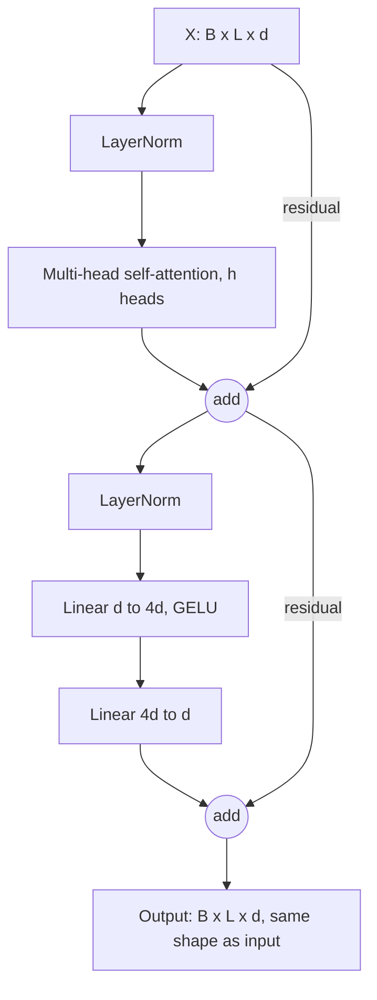
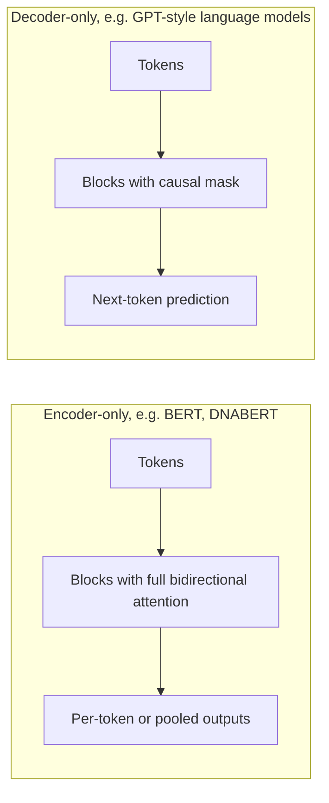

+++
summary = "Derive scaled dot-product attention, build multi-head attention and a transformer block from scratch with every tensor shape and parameter count, and explain masking, positional encodings and the quadratic cost that shapes genomic transformers."
+++

# Attention and Transformers

The transformer (Vaswani et al., 2017) is the architecture behind large language models, and it is now central to genomics too: DNA language models, Enformer's gene-expression predictions and many protein models are built on it. Its core operation, **attention**, lets every position in a sequence look directly at every other position and decide, based on content, which ones matter. For DNA this is exactly what we want: an enhancer 20 kb away can influence a promoter, and attention connects them in one step instead of passing a message through 20,000 recurrent updates.

This chapter builds the transformer from the ground up. We derive attention, explain the $\sqrt{d}$ scaling, assemble multi-head attention and the full block, and verify our from-scratch implementation against PyTorch to seven decimal places. We finish with the price, $O(L^2)$ cost, and why it dominates design decisions for long DNA.

## Key ideas

### Attention as a soft dictionary lookup

A Python dictionary maps a **query** to a **value** by finding the **key** that matches it exactly. Attention is a soft version: compare the query with *every* key, turn the similarities into weights that sum to 1, and return the weighted average of the values.

Given $n$ keys $\mathbf{k}_j$ with values $\mathbf{v}_j$ and a query $\mathbf{q}$:

$$
\alpha_j = \frac{\exp(s(\mathbf{q}, \mathbf{k}_j))}{\sum_{j'} \exp(s(\mathbf{q}, \mathbf{k}_{j'}))}, \qquad \text{output} = \sum_j \alpha_j \mathbf{v}_j,
$$

where $s$ is a similarity score. If one key matches far better than the rest, the softmax puts almost all weight on it and we recover a hard lookup. Because everything is differentiable, the network can **learn** what to query for and what to store.

In **self-attention**, the queries, keys and values all come from the same sequence. Each position $i$ has an embedding $\mathbf{x}_i \in \mathbb{R}^{d}$, and three learned matrices produce

$$
\mathbf{q}_i = W_Q^\top\mathbf{x}_i, \qquad \mathbf{k}_i = W_K^\top\mathbf{x}_i, \qquad \mathbf{v}_i = W_V^\top\mathbf{x}_i.
$$

Intuitively, $\mathbf{q}_i$ is "what position $i$ is looking for", $\mathbf{k}_j$ is "what position $j$ offers", and $\mathbf{v}_j$ is "what position $j$ passes on if chosen". For DNA, a position inside a promoter might query for "binding sites of a transcription factor that partners with mine", and positions in an enhancer whose keys match would contribute their values.

### Scaled dot-product attention

Stack the $L$ queries, keys and values as rows of $Q, K \in \mathbb{R}^{L \times d_k}$ and $V \in \mathbb{R}^{L \times d_v}$. With the dot product as the score:

> [!IMPORTANT]
> $$\operatorname{Attention}(Q, K, V) = \operatorname{softmax}\!\left(\frac{QK^\top}{\sqrt{d_k}}\right) V$$
> Shapes: $QK^\top$ is $L \times L$ (every query against every key); the softmax acts on each **row**; the result is $L \times d_v$.

Entry $(i, j)$ of $A = \operatorname{softmax}(QK^\top/\sqrt{d_k})$ is how much position $i$ attends to position $j$. Each row of $A$ is a probability distribution.

### Why divide by $\sqrt{d_k}$?

Suppose that, at initialisation, the components of $\mathbf{q}$ and $\mathbf{k}$ are independent with mean 0 and variance 1. The score is $\mathbf{q}\cdot\mathbf{k} = \sum_{m=1}^{d_k} q_m k_m$. Each term has mean $\mathbb{E}[q_m]\mathbb{E}[k_m] = 0$ and variance

$$
\operatorname{Var}(q_m k_m) = \mathbb{E}[q_m^2 k_m^2] - 0 = \mathbb{E}[q_m^2]\,\mathbb{E}[k_m^2] = 1.
$$

The $d_k$ terms are independent, so $\operatorname{Var}(\mathbf{q}\cdot\mathbf{k}) = d_k$ and the standard deviation is $\sqrt{d_k}$. Dividing by $\sqrt{d_k}$ brings the variance back to 1, whatever the head size.

Why does that matter? With $d_k = 512$, raw scores have a standard deviation of about 22. The softmax of numbers that far apart is nearly one-hot. Its Jacobian, $\partial \boldsymbol{\alpha}/\partial \mathbf{s} = \operatorname{diag}(\boldsymbol{\alpha}) - \boldsymbol{\alpha}\boldsymbol{\alpha}^\top$, is then almost zero, because every entry involves either $\alpha_j \approx 0$ or $\alpha_j(1-\alpha_j) \approx 0$. Gradients stop flowing through the attention weights, and learning stalls. It is the softmax version of a saturated sigmoid ([training deep networks](../../neural-networks/training-deep-networks/)). The code section measures this directly.

### Multi-head attention

One attention pattern per position is limiting: a position may need to attend to a partner motif *and* to nearby sequence at the same time. **Multi-head attention** runs $h$ attention operations in parallel, each on its own $d_k = d/h$-dimensional projection, then concatenates the results and mixes them:

$$
\operatorname{head}_r = \operatorname{Attention}(XW_Q^{(r)}, XW_K^{(r)}, XW_V^{(r)}), \qquad \operatorname{MHA}(X) = \bigl[\operatorname{head}_1; \ldots; \operatorname{head}_h\bigr] W_O.
$$

In practice the $h$ query projections are one $d \times d$ matrix whose output is reshaped into $h$ heads.

| Step | Shape |
|---|---|
| Input $X$ | $(B, L, d)$ |
| $Q = XW_Q$, also $K$, $V$ | $(B, L, d)$ |
| Split into heads (view + transpose) | $(B, h, L, d_k)$ |
| Scores $QK^\top/\sqrt{d_k}$ | $(B, h, L, L)$ |
| Softmax over the last axis, times $V$ | $(B, h, L, d_k)$ |
| Merge heads (transpose + reshape) | $(B, L, d)$ |
| Output projection $W_O$ | $(B, L, d)$ |

**Parameters:** four $d \times d$ matrices plus four bias vectors, $4(d^2 + d)$, independent of $h$ and of $L$. For $d = 128$ that is $66{,}048$.

### Positional information

Self-attention has no built-in notion of order. Permute the input positions and the outputs are permuted in exactly the same way (attention is **permutation-equivariant**); pool them and the result does not change at all. For DNA, where order is everything, we must inject position explicitly.

- **Sinusoidal encodings** (Vaswani et al., 2017). Add a fixed vector to each position's embedding:
  $$\operatorname{PE}(p, 2m) = \sin\!\left(\frac{p}{10000^{2m/d}}\right), \qquad \operatorname{PE}(p, 2m+1) = \cos\!\left(\frac{p}{10000^{2m/d}}\right).$$
  Each pair of dimensions is a clock ticking at a different frequency, from fast (one cycle every $2\pi$ positions) to very slow, so every position gets a unique pattern, and a shift by $\Delta$ is a fixed rotation of each pair.
- **Learned absolute embeddings.** A trainable $L_{\max} \times d$ table, as in BERT. Simple, but it cannot handle sequences longer than $L_{\max}$.
- **Rotary position embedding (RoPE)** (Su et al., 2021). Instead of adding to $\mathbf{x}$, rotate each 2-D pair of components of the query and key by an angle proportional to the position: $\mathbf{q}_p \mapsto R(p\theta)\mathbf{q}_p$. Since rotations satisfy $R(p\theta)^\top R(p'\theta) = R((p'-p)\theta)$, the score $(R(p\theta)\mathbf{q})^\top(R(p'\theta)\mathbf{k}) = \mathbf{q}^\top R((p'-p)\theta)\mathbf{k}$ depends only on the **relative** offset $p' - p$. Many recent language models use RoPE.
- **Relative position biases** add a learned term depending on $j - i$ directly to the score. Enformer uses a form of relative positional encoding.

### The transformer block

A transformer is a stack of identical blocks. Each block has two sub-layers, each wrapped in a residual connection with layer normalisation. The modern **pre-LN** arrangement is

$$
X' = X + \operatorname{MHA}(\operatorname{LN}(X)), \qquad X'' = X' + \operatorname{FFN}(\operatorname{LN}(X')),
$$

where the **feed-forward network** acts on each position separately: $\operatorname{FFN}(\mathbf{x}) = W_2\,\operatorname{GELU}(W_1\mathbf{x} + \mathbf{b}_1) + \mathbf{b}_2$, with hidden size $d_{ff}$, typically $4d$. (The original paper put LayerNorm after each residual addition, "post-LN"; pre-LN trains more stably in deep stacks.) Attention mixes information **across** positions; the FFN processes information **within** each position. The residual stream (see [residual connections](../../neural-networks/training-deep-networks/)) keeps gradients flowing through dozens of blocks.



**Parameter count** for $d = 128$, $h = 8$, $d_{ff} = 512$:

| Component | Formula | Parameters |
|---|---|---|
| LayerNorm 1 | $2d$ | 256 |
| Multi-head attention | $4(d^2 + d)$ | 66,048 |
| LayerNorm 2 | $2d$ | 256 |
| FFN | $(d \cdot d_{ff} + d_{ff}) + (d_{ff}\cdot d + d)$ | 131,712 |
| **Block total** | | **198,272** |

Two-thirds of the parameters are in the FFN. A model with 12 such blocks has about 2.4 million parameters plus its embeddings, whatever the sequence length.

### Encoders, decoders and masking



- An **encoder** lets every position attend to every other. It suits classification and per-position prediction (is this base in a binding site?) and is trained with **masked language modelling**: hide some tokens and predict them from both sides.
- A **decoder** uses a **causal mask**: position $i$ may attend only to positions $j \le i$. It suits generation and is trained to predict the next token. The mask is implemented by setting scores with $j > i$ to $-\infty$ before the softmax, so $e^{-\infty} = 0$ weight:
  $$M_{ij} = \begin{cases} 0 & j \le i \\ -\infty & j > i \end{cases}, \qquad A = \operatorname{softmax}\!\left(\frac{QK^\top}{\sqrt{d_k}} + M\right).$$
- An **encoder–decoder** (the original transformer, for translation) adds **cross-attention**, where queries come from the decoder and keys and values from the encoder output.

A **padding mask** works the same way, setting scores for padding positions to $-\infty$ so that variable-length sequences can share a batch.

### The $O(L^2)$ cost and long DNA

The score matrix has $L^2$ entries per head per sequence. Computing $QK^\top$ and $AV$ costs about $2 \cdot 2L^2 d_k$ multiply-adds per head, i.e. $O(L^2 d)$ per layer, and naively storing $A$ needs $O(L^2)$ memory.

| Sequence length $L$ | Entries in one $L \times L$ matrix | float32 memory, one head |
|---|---|---|
| 1,000 | $10^6$ | 0.004 GiB |
| 10,000 | $10^8$ | 0.37 GiB |
| 100,000 | $10^{10}$ | 37 GiB |
| 1,000,000 | $10^{12}$ | 3,725 GiB |

Regulatory interactions span up to around a megabase, so naive attention over single bases is out of the question. Genomic models get around this in several ways:

1. **Shorten the sequence before attention.** Convolutions and pooling compress many bases into one token. Enformer does this, so its transformer layers work on 128-bp bins instead of single bases.
2. **Bigger tokens.** $k$-mer or byte-pair tokenisation (DNABERT, DNABERT-2, Nucleotide Transformer) packs several bases into each token.
3. **Memory-efficient exact attention.** FlashAttention (Dao et al., 2022) computes attention in tiles without ever storing the full $L \times L$ matrix. Memory becomes linear in $L$, but compute is still quadratic.
4. **Sub-quadratic alternatives.** Long convolutions and state-space models (HyenaDNA, and later models) mix information across the sequence in roughly $O(L \log L)$ or $O(L)$ time. See [genomic foundation models](../../deep-architectures-for-sequences/genomic-foundation-models/).

## Worked example

**Problem.** Three positions with $d_k = 2$ and

$$
Q = K = \begin{bmatrix} 1 & 0 \\ 0 & 1 \\ 1 & 1 \end{bmatrix}, \qquad V = \begin{bmatrix} 1 & 0 \\ 0 & 2 \\ 3 & 3 \end{bmatrix}.
$$

Compute the attention output for positions 1 and 3, then the causal version for position 2.

**Step 1: scores.** $QK^\top$ has entries $\mathbf{q}_i \cdot \mathbf{k}_j$:

$$
QK^\top = \begin{bmatrix} 1 & 0 & 1 \\ 0 & 1 & 1 \\ 1 & 1 & 2 \end{bmatrix}, \qquad \frac{QK^\top}{\sqrt 2} = \begin{bmatrix} 0.7071 & 0 & 0.7071 \\ 0 & 0.7071 & 0.7071 \\ 0.7071 & 0.7071 & 1.4142 \end{bmatrix}.
$$

**Step 2: softmax of row 1.** $e^{0.7071} = 2.0281$ and $e^0 = 1$. The sum is $2.0281 + 1 + 2.0281 = 5.0562$, so

$$
\boldsymbol{\alpha}_1 = (0.4011,\ 0.1978,\ 0.4011).
$$

**Step 3: output for position 1.**

$$
0.4011(1, 0) + 0.1978(0, 2) + 0.4011(3, 3) = (0.4011 + 1.2033,\ 0.3956 + 1.2033) = (1.6044,\ 1.5989).
$$

**Row 3.** $e^{1.4142} = 4.1133$; sum $= 2.0281 + 2.0281 + 4.1133 = 8.1695$; weights $(0.2483,\ 0.2483,\ 0.5035)$. Position 3's query matches its own key best. Output: $0.2483(1,0) + 0.2483(0,2) + 0.5035(3,3) = (1.7587,\ 2.0070)$.

**Causal row 2.** Position 2 may not see position 3, so its score row becomes $(0,\ 0.7071,\ -\infty)$. Softmax: $e^0 = 1$, $e^{0.7071} = 2.0281$, sum $3.0281$, weights $(0.3302,\ 0.6698,\ 0)$. Output: $0.3302(1,0) + 0.6698(0,2) = (0.3302,\ 1.3395)$. Compare the unmasked output for position 2, $(1.4011,\ 2.0056)$: hiding position 3 removed its large value vector.

## In code

The worked example, checked against PyTorch's built-in fused attention:

```python
import torch, math
import torch.nn.functional as F
torch.set_printoptions(precision=4, sci_mode=False)
Q = torch.tensor([[1., 0.], [0., 1.], [1., 1.]])
K = torch.tensor([[1., 0.], [0., 1.], [1., 1.]])
V = torch.tensor([[1., 0.], [0., 2.], [3., 3.]])
S = Q @ K.T / math.sqrt(2)
A = torch.softmax(S, dim=-1)
print(S); print(A); print(A @ V)
print(F.scaled_dot_product_attention(Q[None], K[None], V[None])[0])
print(F.scaled_dot_product_attention(Q[None], K[None], V[None], is_causal=True)[0])
```

```
tensor([[0.7071, 0.0000, 0.7071],
        [0.0000, 0.7071, 0.7071],
        [0.7071, 0.7071, 1.4142]])
tensor([[0.4011, 0.1978, 0.4011],
        [0.1978, 0.4011, 0.4011],
        [0.2483, 0.2483, 0.5035]])
tensor([[1.6044, 1.5989],
        [1.4011, 2.0056],
        [1.7587, 2.0070]])
tensor([[1.6044, 1.5989],
        [1.4011, 2.0056],
        [1.7587, 2.0070]])
tensor([[1.0000, 0.0000],
        [0.3302, 1.3395],
        [1.7587, 2.0070]])
```

In the causal output, position 1 can only see itself, so it returns $\mathbf{v}_1 = (1, 0)$ exactly.

**Why $\sqrt{d_k}$**, measured: random queries against 20 random keys.

```python
import math, torch
torch.manual_seed(0)
for d in [4, 64, 512]:
    q, k = torch.randn(10000, d), torch.randn(10000, 20, d)
    s = (k @ q.unsqueeze(-1)).squeeze(-1)                 # (10000, 20) raw scores
    for name, scores in [("raw", s), ("scaled", s / math.sqrt(d))]:
        a = torch.softmax(scores, dim=-1)
        print(f"d={d:4d} {name:6s} var(score)={scores.var():8.2f}  mean max weight={a.max(-1).values.mean():.3f}")
```

```
d=   4 raw    var(score)=    4.02  mean max weight=0.399
d=   4 scaled var(score)=    1.01  mean max weight=0.208
d=  64 raw    var(score)=   63.86  mean max weight=0.833
d=  64 scaled var(score)=    1.00  mean max weight=0.216
d= 512 raw    var(score)=  510.48  mean max weight=0.943
d= 512 scaled var(score)=    1.00  mean max weight=0.216
```

The score variance equals $d$, as derived. Unscaled, a $d = 512$ head puts 94% of its weight on one key on average, at initialisation, before learning anything. Scaled, the behaviour is the same at every head size.

**Multi-head attention from scratch**, verified against `nn.MultiheadAttention` with identical weights, with and without a causal mask:

```python
import math, torch
from torch import nn

class MyMultiHeadAttention(nn.Module):
    def __init__(self, d_model, n_heads):
        super().__init__()
        assert d_model % n_heads == 0
        self.h, self.d_k = n_heads, d_model // n_heads
        self.W_q = nn.Linear(d_model, d_model)
        self.W_k = nn.Linear(d_model, d_model)
        self.W_v = nn.Linear(d_model, d_model)
        self.W_o = nn.Linear(d_model, d_model)

    def forward(self, x, causal=False):
        B, L, D = x.shape
        def split(t):                                   # (B, L, D) -> (B, h, L, d_k)
            return t.view(B, L, self.h, self.d_k).transpose(1, 2)
        q, k, v = split(self.W_q(x)), split(self.W_k(x)), split(self.W_v(x))
        scores = q @ k.transpose(-2, -1) / math.sqrt(self.d_k)      # (B, h, L, L)
        if causal:                                      # position i may not see j > i
            mask = torch.triu(torch.ones(L, L, dtype=torch.bool), diagonal=1)
            scores = scores.masked_fill(mask, float("-inf"))
        attn = torch.softmax(scores, dim=-1)            # each row sums to 1
        out = (attn @ v).transpose(1, 2).reshape(B, L, D)           # concat heads
        return self.W_o(out), attn

torch.manual_seed(0)
B, L, D, H = 2, 10, 32, 4
x = torch.randn(B, L, D)
mine = MyMultiHeadAttention(D, H)
ref = nn.MultiheadAttention(D, H, batch_first=True)

with torch.no_grad():   # copy our weights into PyTorch's packed in_proj layout
    ref.in_proj_weight.copy_(torch.cat([mine.W_q.weight, mine.W_k.weight, mine.W_v.weight]))
    ref.in_proj_bias.copy_(torch.cat([mine.W_q.bias, mine.W_k.bias, mine.W_v.bias]))
    ref.out_proj.weight.copy_(mine.W_o.weight); ref.out_proj.bias.copy_(mine.W_o.bias)

for causal in [False, True]:
    out_mine, attn_mine = mine(x, causal=causal)
    mask = nn.Transformer.generate_square_subsequent_mask(L) if causal else None
    out_ref, attn_ref = ref(x, x, x, attn_mask=mask, average_attn_weights=False)
    print(f"causal={causal}: max |diff| output = {(out_mine - out_ref).abs().max():.2e}, "
          f"attention = {(attn_mine - attn_ref).abs().max():.2e}")
print("shapes: out", tuple(out_mine.shape), " attn", tuple(attn_mine.shape))
print("params mine:", sum(p.numel() for p in mine.parameters()),
      " ref:", sum(p.numel() for p in ref.parameters()))
print("causal attention row 2 (head 0, batch 0):", attn_mine[0, 0, 2].detach().numpy().round(3))
```

```
causal=False: max |diff| output = 8.94e-08, attention = 5.96e-08
causal=True: max |diff| output = 1.19e-07, attention = 5.96e-08
shapes: out (2, 10, 32)  attn (2, 4, 10, 10)
params mine: 4224  ref: 4224
causal attention row 2 (head 0, batch 0): [0.349 0.225 0.427 0.    0.    0.    0.    0.    0.    0.   ]
```

Differences of $10^{-7}$ are float32 rounding: the implementations agree. The parameter count is $4(32^2 + 32) = 4224$. The causal row shows position 3 (index 2) attending only to positions 1–3.

**A full block**, compared with PyTorch's `nn.TransformerEncoderLayer`, plus sinusoidal encodings and the memory cost of attention:

```python
import math, torch
from torch import nn

class TransformerBlock(nn.Module):
    """Pre-LayerNorm encoder block: x + MHA(LN(x)), then x + FFN(LN(x))."""
    def __init__(self, d_model=128, n_heads=8, d_ff=512, dropout=0.1):
        super().__init__()
        self.ln1 = nn.LayerNorm(d_model)
        self.attn = nn.MultiheadAttention(d_model, n_heads, dropout=dropout, batch_first=True)
        self.ln2 = nn.LayerNorm(d_model)
        self.ffn = nn.Sequential(nn.Linear(d_model, d_ff), nn.GELU(),
                                 nn.Linear(d_ff, d_model), nn.Dropout(dropout))
    def forward(self, x, mask=None):
        h = self.ln1(x)
        x = x + self.attn(h, h, h, attn_mask=mask, need_weights=False)[0]   # (B, L, d)
        x = x + self.ffn(self.ln2(x))                                       # (B, L, d)
        return x

def sinusoidal_pe(L, d):
    pos = torch.arange(L).unsqueeze(1)                        # (L, 1)
    freq = torch.exp(-math.log(10000.0) * torch.arange(0, d, 2) / d)   # (d/2,)
    pe = torch.zeros(L, d)
    pe[:, 0::2], pe[:, 1::2] = torch.sin(pos * freq), torch.cos(pos * freq)
    return pe                                                  # (L, d)

block = TransformerBlock()
ref = nn.TransformerEncoderLayer(128, 8, 512, activation="gelu", norm_first=True, batch_first=True)
count = lambda m: sum(p.numel() for p in m.parameters())
print("our block:", count(block), "  nn.TransformerEncoderLayer:", count(ref))
for name, mod in block.named_children():
    print(f"  {name:5s} {count(mod):7,}")

x = torch.randn(4, 250, 128) + sinusoidal_pe(250, 128)      # (B, L, d)
print("block output shape:", tuple(block(x).shape))
print("PE rows 0 and 1, first 4 dims:\n", sinusoidal_pe(2, 128)[:, :4])

for L in [1_000, 10_000, 100_000, 1_000_000]:              # one L x L float32 matrix
    print(f"L={L:>9,}: L^2 = {L*L:.1e} entries = {L*L*4/2**30:10.3f} GiB")
```

```
our block: 198272   nn.TransformerEncoderLayer: 198272
  ln1       256
  attn   66,048
  ln2       256
  ffn   131,712
block output shape: (4, 250, 128)
PE rows 0 and 1, first 4 dims:
 tensor([[0.0000, 1.0000, 0.0000, 1.0000],
        [0.8415, 0.5403, 0.7617, 0.6479]])
L=    1,000: L^2 = 1.0e+06 entries =      0.004 GiB
L=   10,000: L^2 = 1.0e+08 entries =      0.373 GiB
L=  100,000: L^2 = 1.0e+10 entries =     37.253 GiB
L=1,000,000: L^2 = 1.0e+12 entries =   3725.290 GiB
```

Check one PE value by hand: position 1, dimension 2 is $\sin(1/10000^{2/128}) = \sin(e^{-\ln(10^4)/64}) = \sin(0.8660) = 0.7617$.

**Position matters.** Back to the order task from the [RNN chapter](../../deep-architectures-for-sequences/recurrent-networks-and-lstms/): is `GATAAG` upstream of `CACGTG`? A tiny DNA transformer (conv embedding into 25 tokens, one encoder block, mean pooling) is trained with and without a learned positional embedding.

```python
import numpy as np, torch
from torch import nn

rng = np.random.default_rng(1); torch.manual_seed(1)
L, N = 100, 6000
BASES = np.array(list("ACGT"))
A, B = list("GATAAG"), list("CACGTG")
def make_dataset(n):                    # same order task as the RNN chapter
    seqs = rng.choice(BASES, size=(n, L)); y = rng.integers(0, 2, n)
    for i in range(n):
        p1 = rng.integers(0, 40); p2 = rng.integers(50, L - 6)
        first, second = (A, B) if y[i] == 1 else (B, A)
        seqs[i, p1:p1 + 6] = first; seqs[i, p2:p2 + 6] = second
    X = (seqs[:, None, :] == BASES[None, :, None]).astype(np.float32)
    return torch.tensor(X), torch.tensor(y, dtype=torch.float32)
X, y = make_dataset(N)
Xtr, ytr, Xte, yte = X[:5000], y[:5000], X[5000:], y[5000:]

class TinyDNATransformer(nn.Module):
    def __init__(self, d=32, use_pe=True):
        super().__init__()
        self.embed = nn.Sequential(nn.Conv1d(4, d, 9, padding=4), nn.ReLU(), nn.MaxPool1d(4))
        self.pos = nn.Parameter(torch.randn(1, 25, d) * 0.1) if use_pe else None  # learned PE
        self.block = nn.TransformerEncoderLayer(d, 4, 64, dropout=0.0, batch_first=True,
                                                norm_first=True)
        self.fc = nn.Linear(d, 1)
    def forward(self, x):
        h = self.embed(x).transpose(1, 2)           # (B, 4, 100) -> (B, 25, 32) tokens
        if self.pos is not None:
            h = h + self.pos                         # add position information
        h = self.block(h)                            # (B, 25, 32)
        return self.fc(h.mean(dim=1)).squeeze(-1)    # mean-pool tokens -> logit

def fit(model, epochs=10):
    opt = torch.optim.Adam(model.parameters(), lr=3e-3); loss_fn = nn.BCEWithLogitsLoss()
    for _ in range(epochs):
        perm = torch.randperm(len(Xtr))
        for i in range(0, len(Xtr), 64):
            idx = perm[i:i + 64]
            loss = loss_fn(model(Xtr[idx]), ytr[idx]); opt.zero_grad(); loss.backward(); opt.step()
    model.eval()
    with torch.no_grad():
        return ((model(Xte) > 0).float() == yte).float().mean().item()

for use_pe in [False, True]:
    torch.manual_seed(0)
    m = TinyDNATransformer(use_pe=use_pe)
    print(f"positional encoding={use_pe!s:5s} params={sum(p.numel() for p in m.parameters())}"
          f"  test accuracy={fit(m):.3f}")
```

```
positional encoding=False params=9761  test accuracy=0.601
positional encoding=True  params=10561  test accuracy=0.998
```

Without positional information the transformer is nearly blind to order: attention followed by mean pooling gives the same answer for any rearrangement of the tokens, and the small edge above 50% comes from incidental cues such as zero padding at the sequence ends. Adding a learned $25 \times 32$ positional table (800 parameters) solves the task. (The run takes about a minute on a CPU.)

## Biomedical connection

Transformers matter for a DNA → CAD model in two places.

**Long-range regulation.** Many CAD risk variants are thought to act through enhancers that regulate genes some distance away, and enhancer–promoter distances of tens of kilobases are common. A model must connect distant positions to predict a variant's effect on gene expression. Attention does this in one layer, which is why Enformer (Avsec et al., 2021) added transformer blocks on top of a convolutional trunk, and why its predictions of variant effects on expression improved over the purely convolutional Basenji2.

**Learning a language of DNA.** Encoder transformers trained with masked language modelling on large amounts of genome sequence produce general-purpose embeddings of sequence context. These **genomic foundation models**, covered in the [next chapter](../../deep-architectures-for-sequences/genomic-foundation-models/), can then be fine-tuned for tasks with little labelled data, such as classifying variants in genes like *LDLR*, *APOB* or *PCSK9*, where relatively few variants have expert-curated labels.

> [!CAUTION]
> An attention map is a tempting picture of "which DNA the model used", but attention weights are not a reliable explanation of a prediction. Treat them as one diagnostic among several; the [interpretability](../../deep-architectures-for-sequences/interpretability/) chapter explains why and offers better tools.

## Practice

1. For $d = 768$, $h = 12$ and $d_{ff} = 3072$, give $d_k$ and count the parameters of one pre-LN transformer block (two LayerNorms, MHA with biases, FFN with biases).

<details>
<summary>Answer</summary>

$d_k = 768/12 = 64$. MHA: $4(768^2 + 768) = 4(589{,}824 + 768) = 2{,}362{,}368$. FFN: $(768 \cdot 3072 + 3072) + (3072 \cdot 768 + 768) = 2{,}362{,}368 + 2{,}360{,}064 = 4{,}722{,}432$. LayerNorms: $4 \cdot 768 = 3072$. Total $7{,}087{,}872$. (Twelve such blocks give about 85 million, the core of BERT-base.)

</details>

2. In the worked example, the query of position 1 is changed to $\mathbf{q}_1 = (2, 0)$. Compute its attention weights.

<details>
<summary>Answer</summary>

Raw scores: $\mathbf{q}_1 \cdot \mathbf{k}_j = (2, 0, 2)$; scaled by $\sqrt2$: $(1.4142, 0, 1.4142)$. Exponentials $(4.1133, 1, 4.1133)$, sum $9.2266$, weights $(0.4458, 0.1084, 0.4458)$. A larger query norm sharpens the distribution.

</details>

3. Show that if attention scores have standard deviation $\sigma$ then, for two keys, the attention weight on the better one is $\sigma(\Delta)$ (the logistic function) of the score gap $\Delta$. What gap gives 95% of the weight?

<details>
<summary>Answer</summary>

With two scores $s_1, s_2$, $\alpha_1 = e^{s_1}/(e^{s_1} + e^{s_2}) = 1/(1 + e^{-(s_1 - s_2)}) = \sigma(\Delta)$. For $\sigma(\Delta) = 0.95$, $\Delta = \ln(0.95/0.05) = \ln 19 \approx 2.94$. Unscaled scores with standard deviation $\sqrt{512} \approx 22.6$ produce such gaps almost always, which is why unscaled attention saturates.

</details>

4. A DNA model uses single-nucleotide tokens and 196,608-bp inputs. Estimate the memory for one float32 attention matrix (one head, one sequence). How much smaller is it if a convolutional stem first pools to 128-bp bins?

<details>
<summary>Answer</summary>

$L^2 = 196{,}608^2 \approx 3.87 \times 10^{10}$ entries $\times 4$ bytes $\approx 1.55 \times 10^{11}$ bytes $\approx 144$ GiB. With 128-bp bins, $L = 196{,}608/128 = 1536$, so $L^2 \approx 2.36 \times 10^6$ entries $\approx 9.4$ MB. Pooling by 128 reduces the matrix by $128^2 = 16{,}384$ times.

</details>

5. Explain why a transformer encoder with no positional information, followed by mean pooling, gives exactly the same output for a sequence and any reordering of its tokens.

<details>
<summary>Answer</summary>

Each sub-layer is permutation-equivariant: LayerNorm and the FFN act on each position independently; in attention, permuting the rows of $X$ permutes the rows of $Q$, $K$, $V$, which permutes both rows and columns of $QK^\top$ consistently, so the output rows are permuted the same way. Composition keeps equivariance. Mean pooling is invariant to the order of rows, so the final output is unchanged.

</details>

## Further reading

- Vaswani, A. et al. (2017). Attention is all you need. *NeurIPS*.
- Bahdanau, D., Cho, K. and Bengio, Y. (2015). Neural machine translation by jointly learning to align and translate. *ICLR*.
- Devlin, J., Chang, M.-W., Lee, K. and Toutanova, K. (2019). BERT: pre-training of deep bidirectional transformers for language understanding. *NAACL*.
- Su, J. et al. (2021). RoFormer: enhanced transformer with rotary position embedding. arXiv:2104.09864.
- Xiong, R. et al. (2020). On layer normalization in the transformer architecture. *ICML*.
- Dao, T., Fu, D. Y., Ermon, S., Rudra, A. and Ré, C. (2022). FlashAttention: fast and memory-efficient exact attention with IO-awareness. *NeurIPS*.
- Avsec, Ž. et al. (2021). Effective gene expression prediction from sequence by integrating long-range interactions. *Nature Methods* 18.
- Prince, S. J. D. *Understanding Deep Learning* (MIT Press, 2023), chapter 12, "Transformers".
