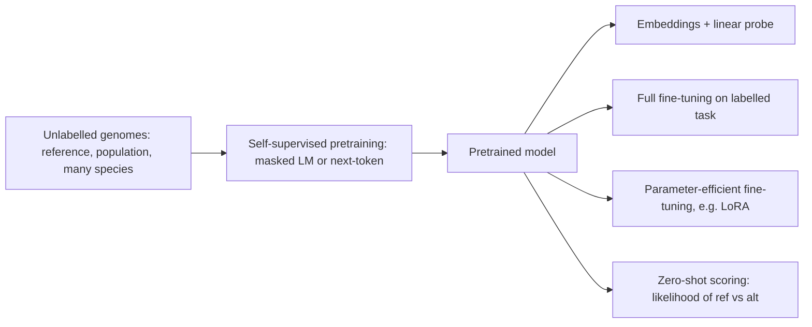
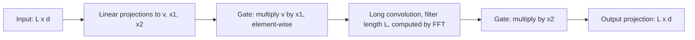
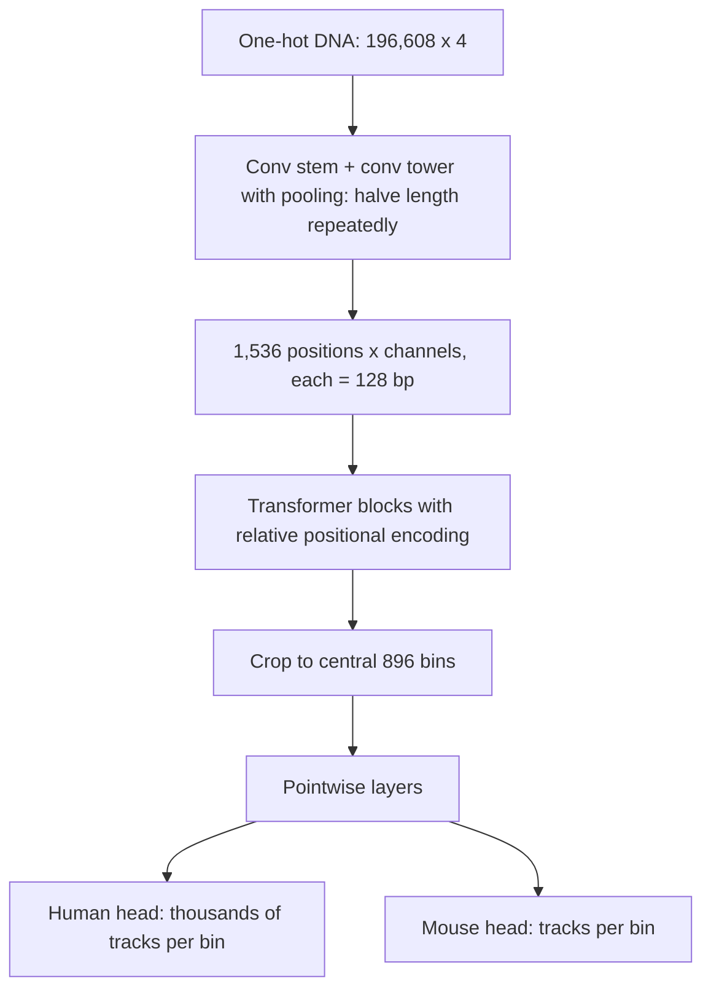
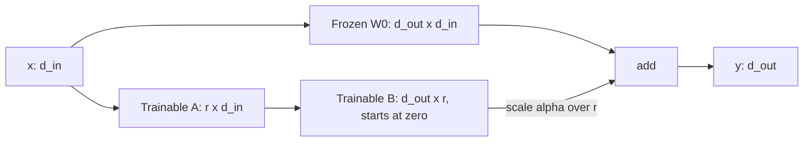
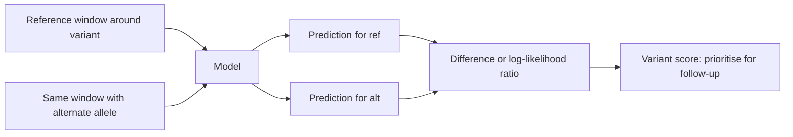

+++
summary = "Explain how DNA language models and sequence-to-function models are pretrained and adapted, compare the main published architectures, and use a pretrained model for embeddings, fine-tuning, LoRA and zero-shot variant-effect scoring."
+++

# Genomic Foundation Models

Labelled data is the bottleneck in biomedical AI. There are only so many curated pathogenic variants in *LDLR*, so many people with confirmed familial hypercholesterolemia, so many CAD cases with whole-genome sequences. Unlabelled DNA, by contrast, is abundant: reference genomes for hundreds of species, thousands of human genomes from projects such as 1000 Genomes, and the evolutionary record they contain.

A **foundation model** is pretrained on a large, broad dataset with a **self-supervised** objective (one that needs no human labels) and then adapted to many downstream tasks. In natural language this recipe gave BERT and GPT. In genomics it has produced DNA language models such as DNABERT, the Nucleotide Transformer, HyenaDNA and Evo, alongside large supervised **sequence-to-function** models such as Enformer. This chapter explains how they are trained, how they differ, how to use them (embeddings, linear probes, fine-tuning, LoRA, zero-shot variant scoring), and where they fall short. We then demonstrate the whole workflow on a small synthetic genome.

## Key ideas

### Self-supervised objectives

**Masked language modelling (MLM)**, the BERT objective ([attention and transformers](../../deep-architectures-for-sequences/attention-and-transformers/)). Choose a random subset $\mathcal{M}$ of positions (typically about 15%), replace them with a `[MASK]` token, and train an **encoder** to recover them from both sides:

$$
\mathcal{L}_{\text{MLM}} = -\sum_{i \in \mathcal{M}} \log p_\theta\bigl(x_i \mid \mathbf{x}_{\setminus \mathcal{M}}\bigr).
$$

**Next-token prediction**, the GPT objective (autoregressive). Train a **causal** model to predict each token from everything before it:

$$
\mathcal{L}_{\text{AR}} = -\sum_{t=1}^{T} \log p_\theta(x_t \mid x_1, \ldots, x_{t-1}).
$$

Both are cross-entropy losses ([information theory](../../probability-and-statistics/information-theory/)). A model that knows nothing scores $\ln 4 \approx 1.386$ nats per nucleotide. To do better it must learn whatever regularities exist: motifs, codon structure, repeats, conservation. The bet behind DNA language models is that the patterns needed to predict DNA are the same patterns that make DNA functional.



### Tokenisation choices

How DNA is cut into tokens decides the sequence length $L$ the model must handle, which matters because attention costs $O(L^2)$.

| Strategy | Example models | Tokens per kb | Notes |
|---|---|---|---|
| Single nucleotide | HyenaDNA, Evo | 1000 | Exact resolution; long sequences |
| Overlapping $k$-mers | DNABERT ($k$ = 3 to 6) | about 1000 | Neighbouring tokens share bases, so masking must cover contiguous spans or the answer leaks |
| Non-overlapping 6-mers | Nucleotide Transformer | about 167 | 6× shorter; a single SNP changes a whole token |
| Byte-pair encoding (BPE) | DNABERT-2 | variable | Merges frequent substrings into tokens, learned from data |

### The main published models

The descriptions below stick to well-documented design choices. Model sizes change between versions, so check the original papers before quoting numbers.

**DNABERT** (Ji et al., *Bioinformatics*, 2021). A BERT-style transformer encoder pretrained with masked language modelling on the human reference genome, using overlapping $k$-mer tokens and inputs of up to 512 tokens. Fine-tuned versions were applied to tasks such as promoter, splice-site and transcription-factor binding-site prediction.

**DNABERT-2** (Zhou et al., ICLR 2024). Replaces $k$-mers with **byte-pair encoding** tokens, is pretrained on genomes from many species, uses efficiency improvements in the attention layers, and introduced a multi-task benchmark (GUE, the Genome Understanding Evaluation).

**Nucleotide Transformer** (Dalla-Torre et al., *Nature Methods*, 2024). A family of transformer encoders of increasing size, pretrained with masked language modelling on non-overlapping 6-mer tokens. Training sets included the human reference genome, thousands of human genomes from the 1000 Genomes Project, and a multi-species collection of hundreds of genomes. A central finding was that training on diverse species helped downstream performance.

**HyenaDNA** (Nguyen et al., NeurIPS 2023). Replaces attention with the **Hyena** operator (Poli et al., 2023): long convolutions whose filters are generated implicitly by a small network, combined with element-wise gating. A convolution over the whole sequence can be computed with the fast Fourier transform in $O(L \log L)$ time, so HyenaDNA reaches context lengths up to about a million single-nucleotide tokens. It is autoregressive (next-nucleotide prediction) and was pretrained on the human reference genome. Hyena belongs to the same broad family as **state-space models**: sequence mixers that, unlike attention, scale nearly linearly with length.



**Enformer** (Avsec et al., *Nature Methods*, 2021) is not a language model: it is a large **supervised** sequence-to-function model. It takes 196,608 bp of one-hot DNA, uses a convolutional tower with pooling to reduce it to 1,536 positions of 128 bp each, applies transformer blocks (with relative positional encodings) so that each position can attend across the whole window, crops to the central 896 bins, and predicts thousands of genomic tracks (gene expression measured by CAGE, chromatin accessibility, transcription-factor binding and histone marks) for human and mouse. Its receptive field lets it use elements up to roughly 100 kb away, and it improved variant-effect predictions for gene expression compared with its convolutional predecessor Basenji2. Because it is trained on so many assays, it is widely used as a general-purpose feature extractor, which is why it is often grouped with foundation models.



**Evo** (Nguyen et al., *Science*, 2024). A large autoregressive DNA model built on **StripedHyena**, a hybrid architecture that mixes Hyena-style long-convolution layers with a smaller number of attention layers, trained at single-nucleotide resolution on prokaryotic (bacterial and archaeal) and phage genomes with a long context window. The paper showed zero-shot prediction of mutational effects and generation of sequences such as CRISPR–Cas systems. A successor, Evo 2, extended training to genomes from all domains of life, including eukaryotes. Evo 1 was not trained on human DNA, so it is not directly suited to human variant interpretation.

### Using a pretrained model

**Embeddings.** Run a sequence through the frozen model and take its hidden states, a tensor of shape $(L, d)$. Pool them (mean over positions, or a special classification token) to get one $d$-dimensional vector per sequence. Nearby vectors should mean functionally similar sequences.

**Linear probing.** Train only a logistic regression (or linear regression) on frozen embeddings. It is cheap and hard to overfit, and it measures how much task-relevant information the pretrained features expose *linearly*.

**Full fine-tuning.** Add a task head and update **all** weights with a small learning rate. This usually gives the best accuracy but needs a full copy of the model per task and more labelled data to avoid overfitting.

**Parameter-efficient fine-tuning: LoRA** (Hu et al., 2021). Freeze each weight matrix $W_0 \in \mathbb{R}^{d_{\text{out}} \times d_{\text{in}}}$ and learn a **low-rank update**:

> [!IMPORTANT]
> $$W = W_0 + \frac{\alpha}{r}\, B A, \qquad B \in \mathbb{R}^{d_{\text{out}} \times r}, \quad A \in \mathbb{R}^{r \times d_{\text{in}}}, \quad r \ll \min(d_{\text{in}}, d_{\text{out}}).$$
> Trainable parameters per matrix: $r(d_{\text{in}} + d_{\text{out}})$ instead of $d_{\text{in}} d_{\text{out}}$.

$B$ is initialised to zero, so training starts exactly at the pretrained model. For a $1024 \times 1024$ matrix with $r = 8$: $8 \times 2048 = 16{,}384$ trainable parameters instead of $1{,}048{,}576$, 1.6%. The update $BA$ has rank at most $r$, which is a strong but often reasonable assumption: adapting to a new task needs only a few new "directions". After training, $BA$ can be merged into $W_0$, so inference costs nothing extra.



### Variant-effect prediction

The most direct clinical use is scoring genetic variants. There are two families of approaches.

**Supervised sequence-to-function models** (DeepSEA, Basset, Enformer). Predict the molecular readouts for the reference sequence and for the sequence carrying the alternate allele, and take the difference:

$$
\Delta_{\text{track}} = f_{\text{track}}(\mathbf{x}_{\text{alt}}) - f_{\text{track}}(\mathbf{x}_{\text{ref}}).
$$

A large predicted change in, say, liver expression of a lipid gene marks the variant as a candidate regulatory variant.

**Zero-shot likelihood scores from language models.** Mask the variant position and compare the model's probabilities for the two alleles:

> [!IMPORTANT]
> $$\operatorname{LLR} = \log p_\theta(x_i = \text{alt} \mid \text{context}) - \log p_\theta(x_i = \text{ref} \mid \text{context}).$$

A strongly negative LLR means the model finds the alternate allele "unnatural" in that context, much as a strongly conserved position resists mutation in evolution. No labels are used at all. This idea worked well for proteins (protein language models scoring missense variants), and DNA language models have shown promising results on some genomes, for example GPN in plants (Benegas, Batra and Song, 2023). For the human genome, where only a small fraction of sequence is under strong constraint, zero-shot DNA-LM scores are an active research area rather than an established clinical tool.



### Limits

- **Pretraining signal is diluted.** Most of the human genome is not under strong selection, so much of a language model's capacity goes into predicting sequence that carries little functional signal. Several benchmark studies have found that DNA language models do not consistently beat well-tuned supervised CNNs trained from scratch on the same task.
- **Personal genomes are hard.** Studies in 2023 (Sasse et al.; Huang et al.; both in *Nature Genetics*) found that Enformer-style models, despite predicting expression well *across genes*, explained variation in expression *between individuals* poorly and sometimes got the direction of a variant's effect wrong.
- **Likelihood is not pathogenicity.** "Unusual under the model" is evidence of constraint, not proof of disease, and says nothing direct about effect size on CAD risk.
- **Training data bias.** Reference genomes and many functional datasets over-represent certain ancestries and cell lines. Effects in under-represented groups or untested cell types may be poorly predicted.
- **Cost and reproducibility.** Large models need GPUs to fine-tune, and benchmark results depend heavily on data splits. Splitting by chromosome avoids leakage between overlapping windows.

## Worked example

**Problem.** (a) Count the parameters of the tiny DNA encoder used in the code: vocabulary 5 (A, C, G, T, `[MASK]`), length $L = 60$, width $d = 32$, a convolution stem with kernel 7, two pre-LN transformer blocks with 4 heads and FFN size $4d = 128$, and a final LayerNorm. (b) How many parameters does LoRA with $r = 4$ on both FFN layers of both blocks train? (c) Interpret an LLR of $-3.46$.

**(a)** Layer by layer, with shapes for a batch of $B$ sequences:

| Component | Output shape | Parameters |
|---|---|---|
| Token embedding $5 \times 32$ | $(B, 60, 32)$ | 160 |
| Learned positions $60 \times 32$ | added | 1,920 |
| Conv stem $32 \to 32$, $k = 7$ | $(B, 60, 32)$ | $32 \cdot 32 \cdot 7 + 32 = 7{,}200$ |
| Block: 2 LayerNorms | | $2 \cdot 64 = 128$ |
| Block: MHA | $(B, 60, 32)$ | $4(32^2 + 32) = 4{,}224$ |
| Block: FFN $32 \to 128 \to 32$ | $(B, 60, 32)$ | $(32 \cdot 128 + 128) + (128 \cdot 32 + 32) = 8{,}352$ |
| Block total, × 2 blocks | | $2 \times 12{,}704 = 25{,}408$ |
| Final LayerNorm | $(B, 60, 32)$ | 64 |
| **Encoder total** | | **34,752** |

The MLM head ($32 \to 4$) adds 132, and a classification head ($32 \to 1$) adds 33.

**(b)** For `ff1` ($d_{\text{in}} = 32$, $d_{\text{out}} = 128$): $4(32 + 128) = 640$. For `ff2` ($128 \to 32$): also 640. Two blocks: $2 \times 1280 = 2560$, plus the 33-parameter head: **2,593** trainable, 7.5% of the full fine-tuning count of 34,785.

**(c)** $\operatorname{LLR} = -3.46$ nats means the model thinks the alternate base is $e^{3.46} \approx 32$ times less likely than the reference in that context. In our synthetic genome that happens inside motifs, where context makes the base predictable; for background positions the LLR is near 0.

## In code

The program below runs in three parts (about a minute in total on a CPU). Part 1 pretrains the encoder on an unlabelled synthetic "genome": random sequence in which three motifs (an AP-1-like site `TGACTCA`, an E-box `CACGTG` and a GATA site `GATAAG`) are each planted with probability 0.5.

```python
import numpy as np, torch
from torch import nn

torch.set_num_threads(4)
rng = np.random.default_rng(0); torch.manual_seed(0)
L, MASK = 60, 4                                    # tokens: A=0 C=1 G=2 T=3, [MASK]=4
MOTIFS = {"AP1": "TGACTCA", "EBOX": "CACGTG", "GATA": "GATAAG"}
enc = lambda s: ["ACGT".index(c) for c in s]

def make_genome(n):
    """Random background with planted motifs; returns tokens and which motifs are present."""
    X = rng.integers(0, 4, size=(n, L))
    present = np.zeros((n, len(MOTIFS)), dtype=int)
    for i in range(n):
        for m_idx, m in enumerate(MOTIFS.values()):
            if rng.random() < 0.5:                     # each motif present half the time
                p = rng.integers(0, L - len(m))
                X[i, p:p + len(m)] = enc(m); present[i, m_idx] = 1
    return torch.tensor(X), present

class Block(nn.Module):                                # pre-LN transformer block
    def __init__(self, d, h):
        super().__init__()
        self.ln1, self.ln2 = nn.LayerNorm(d), nn.LayerNorm(d)
        self.attn = nn.MultiheadAttention(d, h, batch_first=True)
        self.ff1, self.ff2 = nn.Linear(d, 4 * d), nn.Linear(4 * d, d)
    def forward(self, x):
        a = self.ln1(x)
        x = x + self.attn(a, a, a, need_weights=False)[0]
        return x + self.ff2(nn.functional.gelu(self.ff1(self.ln2(x))))

class DNAEncoder(nn.Module):
    """Single-nucleotide-token transformer encoder, BERT-style."""
    def __init__(self, d=32, n_layers=2, n_heads=4):
        super().__init__()
        self.tok = nn.Embedding(5, d)                          # (B, L) -> (B, L, d)
        self.pos = nn.Parameter(torch.randn(1, L, d) * 0.02)   # learned positions
        self.conv = nn.Conv1d(d, d, 7, padding=3)              # local context, as in many DNA LMs
        self.blocks = nn.ModuleList(Block(d, n_heads) for _ in range(n_layers))
        self.norm = nn.LayerNorm(d)
    def forward(self, tokens):                                 # -> embeddings (B, L, d)
        x = self.tok(tokens)
        x = x + self.conv(x.transpose(1, 2)).transpose(1, 2) + self.pos
        for blk in self.blocks:
            x = blk(x)
        return self.norm(x)

encoder, mlm_head = DNAEncoder(), nn.Linear(32, 4)            # head predicts the hidden base
print("encoder parameters:", sum(p.numel() for p in encoder.parameters()))

# Self-supervised pretraining: masked language modelling on an unlabelled "genome"
G, _ = make_genome(8000)
opt = torch.optim.AdamW(list(encoder.parameters()) + list(mlm_head.parameters()), lr=2e-3)
for epoch in range(6):
    perm, total = torch.randperm(len(G)), 0.0
    for i in range(0, len(G), 64):
        x = G[perm[i:i + 64]]
        mask = torch.rand(x.shape) < 0.15                       # hide 15% of positions
        logits = mlm_head(encoder(x.masked_fill(mask, MASK)))   # (B, L, 4)
        loss = nn.functional.cross_entropy(logits[mask], x[mask])
        opt.zero_grad(); loss.backward(); opt.step(); total += loss.item()
    print(f"epoch {epoch + 1}: mean masked-LM loss {total / (len(G) / 64):.3f}   (ln 4 = 1.386)")
```

Part 2 scores variants zero-shot: plant an AP-1 site at positions 20–26 of 200 random sequences, and compute the LLR for all three alternate alleles at a base in the middle of the site and at a background base.

```python
encoder.eval(); mlm_head.eval()
def llr_at(tokens, pos):
    x = tokens.clone().unsqueeze(0); ref = int(x[0, pos])
    x[0, pos] = MASK
    with torch.no_grad():
        logp = torch.log_softmax(mlm_head(encoder(x))[0, pos], dim=-1)   # (4,)
    return [(logp[alt] - logp[ref]).item() for alt in range(4) if alt != ref]

inside, outside = [], []
for _ in range(200):
    x = torch.tensor(rng.integers(0, 4, L)); p = 20
    x[p:p + 7] = torch.tensor(enc("TGACTCA"))          # AP-1 site at positions 20-26
    inside += llr_at(x, p + 3)                          # a base in the middle of the site
    outside += llr_at(x, 50)                            # a background base far away
print(f"mean LLR, variants inside AP-1 site : {np.mean(inside):6.2f}")
print(f"mean LLR, variants in background    : {np.mean(outside):6.2f}")
```

Part 3 adapts the encoder to a labelled task with only **64 labelled sequences**: does the sequence contain an E-box? We compare four strategies, testing on 2,000 held-out sequences.

```python
import copy
from sklearn.linear_model import LogisticRegression
from sklearn.metrics import roc_auc_score

Xd, present = make_genome(2200)
yd = torch.tensor(present[:, 1], dtype=torch.float32)          # label: E-box present
Xl, yl, Xt, yt = Xd[:64], yd[:64], Xd[200:], yd[200:]          # only 64 labelled examples

class LoRALinear(nn.Module):
    """Frozen base layer plus a trainable low-rank update: W x + (alpha/r) B A x."""
    def __init__(self, base, r=4, alpha=8):
        super().__init__()
        self.base, self.scale = base, alpha / r
        self.A = nn.Parameter(torch.randn(r, base.in_features) * 0.01)   # (r, d_in)
        self.B = nn.Parameter(torch.zeros(base.out_features, r))         # (d_out, r), zero init
    def forward(self, x):
        return self.base(x) + self.scale * (x @ self.A.T @ self.B.T)

class Classifier(nn.Module):
    def __init__(self, enc):
        super().__init__()
        self.enc, self.head = enc, nn.Linear(32, 1)
    def forward(self, x):
        return self.head(self.enc(x).mean(dim=1)).squeeze(-1)   # mean-pool positions

def train_eval(model, epochs=100, lr=1e-3):
    trainable = [p for p in model.parameters() if p.requires_grad]
    opt = torch.optim.AdamW(trainable, lr=lr)
    for _ in range(epochs):
        model.train()
        for i in range(0, len(Xl), 32):
            loss = nn.functional.binary_cross_entropy_with_logits(model(Xl[i:i+32]), yl[i:i+32])
            opt.zero_grad(); loss.backward(); opt.step()
    model.eval()
    with torch.no_grad():
        return roc_auc_score(yt, model(Xt)), sum(p.numel() for p in trainable)

torch.manual_seed(0)
results = {}
results["from scratch"] = train_eval(Classifier(DNAEncoder()))
results["full fine-tune"] = train_eval(Classifier(copy.deepcopy(encoder)))

lora_enc = copy.deepcopy(encoder)
for p in lora_enc.parameters():
    p.requires_grad = False                                    # freeze everything...
for blk in lora_enc.blocks:                                    # ...then add adapters
    blk.ff1, blk.ff2 = LoRALinear(blk.ff1), LoRALinear(blk.ff2)
results["LoRA (r=4)"] = train_eval(Classifier(lora_enc), lr=1e-2)

with torch.no_grad():                                          # linear probe: frozen features
    emb = lambda X: encoder(X).mean(dim=1).numpy()
    probe = LogisticRegression(max_iter=5000).fit(emb(Xl), yl)
    results["linear probe"] = (roc_auc_score(yt, probe.predict_proba(emb(Xt))[:, 1]), 32 + 1)

for name, (auc, n) in results.items():
    print(f"{name:15s} trainable params={n:6d}   test AUC={auc:.3f}")
```

Output of all three parts:

```
encoder parameters: 34752
epoch 1: mean masked-LM loss 1.372   (ln 4 = 1.386)
epoch 2: mean masked-LM loss 1.350   (ln 4 = 1.386)
epoch 3: mean masked-LM loss 1.333   (ln 4 = 1.386)
epoch 4: mean masked-LM loss 1.319   (ln 4 = 1.386)
epoch 5: mean masked-LM loss 1.315   (ln 4 = 1.386)
epoch 6: mean masked-LM loss 1.306   (ln 4 = 1.386)
mean LLR, variants inside AP-1 site :  -3.46
mean LLR, variants in background    :   0.05
from scratch    trainable params= 34785   test AUC=0.893
full fine-tune  trainable params= 34785   test AUC=0.964
LoRA (r=4)      trainable params=  2593   test AUC=0.719
linear probe    trainable params=    33   test AUC=0.756
```

What the numbers say:

- **Pretraining learns the motifs.** The loss falls below the $\ln 4$ of a know-nothing model. It can never fall far, because about 85% of positions are pure random background that no model can predict; all the gain comes from motif positions.
- **Zero-shot scoring works here.** Without a single label, variants that break the AP-1 site get an average LLR of $-3.46$, while background variants score about 0.
- **Pretraining helps with few labels.** Fine-tuning the pretrained encoder (AUC 0.964) beats training the same architecture from scratch (0.893) on 64 labels.
- **Cheaper adaptations are weaker here.** Mean-pooled frozen embeddings support only a mediocre linear probe (0.756): the MLM objective never asked the model to summarise "is there an E-box somewhere" in its average embedding. LoRA restricted to the FFN layers of this very small model also lags (0.719); in large models LoRA is typically applied to the attention projections as well and comes much closer to full fine-tuning. These are single runs on one random split, so treat small differences with caution.

## Biomedical connection

Where could a genomic foundation model enter our DNA → CAD pipeline?

1. **Interpreting rare variants in familial hypercholesterolemia genes.** Many variants found by sequencing *LDLR*, *APOB* or *PCSK9* are "variants of uncertain significance". A model fine-tuned on the small set of curated pathogenic and benign variants, or zero-shot likelihood scores, can rank them for functional follow-up.
2. **Prioritising non-coding GWAS variants.** At loci such as 9p21 or near *SORT1*, where the causal variant is thought to act through regulation, Enformer-style predicted expression changes in relevant tissues help choose which of many correlated variants to test.
3. **Building better polygenic scores.** Functional annotations, including model predictions, can be used as priors that up-weight likely functional variants when estimating PRS weights.
4. **Embedding regions for a person-level model.** In principle, one could embed each person's sequence around key genes and feed the embeddings to a risk model. The 2023 results on personal expression prediction are a warning that today's models do not yet capture differences between individuals reliably.

> [!CAUTION]
> No genomic foundation model is a validated clinical test for CAD risk or for variant pathogenicity. Under clinical variant-classification guidelines, computational predictions provide only supporting evidence and must be combined with population frequency, segregation, functional and clinical data. Present model scores to clinicians, if at all, as research information.

## Practice

1. A tokeniser uses non-overlapping 6-mers. How many tokens represent a 12 kb sequence, and how many distinct tokens are possible (ignoring N and special tokens)? How does a single SNP affect the token sequence?

<details>
<summary>Answer</summary>

$12{,}000 / 6 = 2000$ tokens. There are $4^6 = 4096$ possible 6-mers. A SNP changes exactly one token into a different one of the 4096, so the model sees a whole new token rather than a one-base change, one reason tokenisation matters for variant scoring.

</details>

2. With overlapping 3-mers, the sequence `ACGTA` becomes tokens `ACG`, `CGT`, `GTA`. If only the middle token `CGT` is masked, can the model recover it trivially? What does DNABERT do about this?

<details>
<summary>Answer</summary>

Yes: `ACG` reveals that the token starts with `CG`, and `GTA` reveals that it ends with `GT`, so `CGT` is fully determined. The model would learn to copy from neighbours instead of learning biology. DNABERT masks contiguous runs of $k$ tokens so that the hidden bases cannot be read off the neighbouring tokens.

</details>

3. A transformer has 24 layers, each with four $1280 \times 1280$ attention projections. How many parameters does LoRA with $r = 16$ on all four projections train, and what fraction of those projections' weights is that?

<details>
<summary>Answer</summary>

Per matrix: $16(1280 + 1280) = 40{,}960$. Per layer: $4 \times 40{,}960 = 163{,}840$. Over 24 layers: $3{,}932{,}160$. The frozen projection weights number $24 \times 4 \times 1280^2 = 157{,}286{,}400$, so LoRA trains $2.5\%$ of them.

</details>

4. A masked language model assigns probabilities $(A, C, G, T) = (0.02, 0.90, 0.05, 0.03)$ at a position whose reference base is C. Compute the LLR for the C>T variant, in nats and bits.

<details>
<summary>Answer</summary>

$\ln(0.03/0.90) = \ln(1/30) = -3.40$ nats, or $\log_2(1/30) = -4.91$ bits. The model finds T 30 times less likely than C in this context.

</details>

5. Enformer predicts a large drop in liver CAGE signal for a variant's alternate allele near a lipid gene. List three reasons why this does not establish that the variant raises CAD risk.

<details>
<summary>Answer</summary>

(i) The prediction may be wrong; such models predict between-individual effects much less reliably than between-gene differences. (ii) Even a real change in expression may be small, or occur in a tissue or condition not relevant to disease. (iii) The causal path from the gene's expression to LDL to CAD must hold, and the effect size may be negligible compared with other risk factors. Statistical genetics (association, colocalisation, Mendelian randomisation) and experiments are needed.

</details>

## Further reading

- Bommasani, R. et al. (2021). On the opportunities and risks of foundation models. arXiv:2108.07258.
- Ji, Y., Zhou, Z., Liu, H. and Davuluri, R. V. (2021). DNABERT: pre-trained Bidirectional Encoder Representations from Transformers model for DNA-language in genome. *Bioinformatics* 37(15).
- Zhou, Z. et al. (2024). DNABERT-2: efficient foundation model and benchmark for multi-species genome. *ICLR*.
- Dalla-Torre, H. et al. (2024). Nucleotide Transformer: building and evaluating robust foundation models for human genomics. *Nature Methods*.
- Nguyen, E. et al. (2023). HyenaDNA: long-range genomic sequence modeling at single nucleotide resolution. *NeurIPS*.
- Poli, M. et al. (2023). Hyena hierarchy: towards larger convolutional language models. *ICML*.
- Nguyen, E. et al. (2024). Sequence modeling and design from molecular to genome scale with Evo. *Science* 386.
- Avsec, Ž. et al. (2021). Effective gene expression prediction from sequence by integrating long-range interactions. *Nature Methods* 18.
- Hu, E. J. et al. (2021). LoRA: low-rank adaptation of large language models. arXiv:2106.09685 (ICLR 2022).
- Benegas, G., Batra, S. S. and Song, Y. S. (2023). DNA language models are powerful predictors of genome-wide variant effects. *PNAS* 120(44).
- Sasse, A. et al. (2023). Benchmarking of deep neural networks for predicting personal gene expression from DNA sequence highlights shortcomings. *Nature Genetics* 55.
- Huang, C. et al. (2023). Personal transcriptome variation is poorly explained by current genomic deep learning models. *Nature Genetics* 55.
