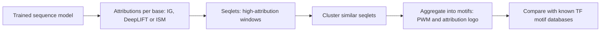

+++
summary = "Explain why a genomic or clinical model made a prediction using saliency, gradient × input, integrated gradients, in-silico mutagenesis and SHAP, and test whether those explanations can be trusted."
+++

# Interpretability

A model that says "this person has a 22% ten-year risk of coronary artery disease" or "this non-coding variant disrupts a regulatory element" will not be acted on in a clinic, or believed by a biologist, unless someone can ask **why**. Interpretability methods attribute a prediction to parts of the input: which bases of a DNA sequence, which clinical variables. Done well, they turn a black box into a hypothesis generator: the motif a CNN relies on can be matched to a known transcription factor, and a risk model's reliance on LDL cholesterol can be checked against what cardiologists know.

Done badly, they produce convincing pictures of nothing. This chapter covers the main methods with their formulas, applies them to the motif CNN from [convolutional networks for DNA](../../deep-architectures-for-sequences/convolutional-networks-for-dna/), computes exact SHAP values for a tabular CAD model, and ends with the sanity checks that separate real explanations from artefacts.

## Key ideas

### Why it matters clinically

- **Trust and error-finding.** If a risk model leans heavily on a hospital identifier or on the scanner that made an image, an attribution map exposes the shortcut before it harms patients.
- **Scientific discovery.** Attributions on sequence models reveal motifs and their arrangements, i.e. the regulatory grammar the model learned.
- **Variant interpretation.** For one variant, the question "how much does the prediction change if this base changes?" *is* the clinical question.
- **Accountability.** Regulators and clinicians increasingly expect that a model's behaviour can be inspected.

Throughout, write $f(\mathbf{x})$ for the model's output (usually a **logit**, since attributions on a saturated probability are uninformative) and $\mathbf{x} \in \mathbb{R}^{4 \times L}$ for a one-hot sequence.

### Saliency maps

The simplest attribution is the gradient of the output with respect to the input (Simonyan, Vedaldi and Zisserman, 2014):

$$
S_{b,i} = \frac{\partial f}{\partial x_{b,i}}.
$$

It answers "if I nudged this input slightly, how much would the output change?" For one-hot DNA it gives four numbers per position, one per base. Problems: gradients are **local** (a ReLU or a max-pool that is switched off gives zero gradient even for an important input), and they can be noisy.

### Gradient × input

Multiply the gradient by the input (Shrikumar et al., 2017):

$$
A_{b,i} = x_{b,i}\,\frac{\partial f}{\partial x_{b,i}}.
$$

For one-hot DNA only the observed base is nonzero, so the attribution at position $i$ is simply the gradient for the base that is actually there. Summing over bases gives one score per position, which is how sequence logos of attributions are drawn: letters scaled by their attribution. For a linear model $f = \mathbf{w}^\top\mathbf{x} + b$, gradient × input gives exactly $w_j x_j$, each feature's contribution.

> [!NOTE]
> One-hot inputs can only lie on the "simplex" (exactly one base per position), but the gradient also has components pointing off it, in directions such as "add 0.1 of every base", which no real sequence can take. A common correction subtracts, at each position, the mean of the four gradients before plotting.

### Integrated gradients

**Integrated gradients (IG)** (Sundararajan, Taly and Yan, 2017) fixes the locality problem by accumulating gradients along a straight path from a **baseline** $\mathbf{x}'$ (an "uninformative" input) to the actual input:

> [!IMPORTANT]
> $$\operatorname{IG}_j(\mathbf{x}) = (x_j - x'_j)\int_0^1 \frac{\partial f\bigl(\mathbf{x}' + \alpha(\mathbf{x} - \mathbf{x}')\bigr)}{\partial x_j}\,d\alpha \;\approx\; (x_j - x'_j)\,\frac1m\sum_{k=1}^{m} \frac{\partial f\bigl(\mathbf{x}' + \tfrac{k - 1/2}{m}(\mathbf{x} - \mathbf{x}')\bigr)}{\partial x_j}.$$

**Completeness.** By the fundamental theorem of calculus for path integrals, $\sum_j \operatorname{IG}_j(\mathbf{x}) = f(\mathbf{x}) - f(\mathbf{x}')$: the attributions add up exactly to the change in output from baseline to input. To see it, let $g(\alpha) = f(\mathbf{x}' + \alpha(\mathbf{x} - \mathbf{x}'))$. By the chain rule, $g'(\alpha) = \sum_j (x_j - x'_j)\,\partial_j f(\cdots)$, and $\int_0^1 g'(\alpha)\,d\alpha = g(1) - g(0)$.

**Choosing the baseline** is the key decision. For DNA, common choices are all zeros (no base), uniform $0.25$ at every position (the background frequency), or an average over several **dinucleotide-shuffled** versions of the input, which keep its base composition but destroy motifs. The attribution answers "relative to this baseline, what mattered?", so different baselines answer different questions.

### In-silico mutagenesis (ISM)

The most direct method needs no gradients: mutate each position to each alternative base and record the change in the prediction,

$$
\Delta_{b,i} = f(\mathbf{x}^{(i \to b)}) - f(\mathbf{x}).
$$

This is exactly the reference-versus-alternate variant score from the [previous chapter](../../deep-architectures-for-sequences/genomic-foundation-models/), applied to every possible single-nucleotide variant. It needs $3L$ forward passes (cheap when batched for short sequences, expensive for 200-kb Enformer inputs) and it captures one mutation at a time, so it misses effects that only appear when several bases change together. A position's importance is often summarised by its most damaging mutation, $\min_b \Delta_{b,i}$.

### SHAP for tabular models

For clinical risk models, the standard tool is **SHAP** (Lundberg and Lee, 2017), built on the **Shapley value** from cooperative game theory. Treat features as players and the prediction as the payout. For a set $S$ of features, define the **value** $v(S)$ as the expected model output when the features in $S$ are fixed to the patient's values and the others are drawn from a background population. Feature $j$'s Shapley value is its average marginal contribution over all orders in which features could be added:

> [!IMPORTANT]
> $$\phi_j = \sum_{S \subseteq F \setminus \{j\}} \frac{|S|!\,(d - |S| - 1)!}{d!}\,\bigl[v(S \cup \{j\}) - v(S)\bigr].$$

Shapley values are the unique attribution satisfying a few fairness axioms, including **efficiency**: $\sum_j \phi_j = f(\mathbf{x}) - \mathbb{E}[f(\mathbf{X})]$, the patient's prediction minus the population average. For a linear model with independent features, $\phi_j = w_j(x_j - \mathbb{E}[x_j])$. Exact computation needs $2^{d}$ subsets, so libraries use approximations (KernelSHAP) or exact fast algorithms for trees (TreeSHAP). Integrated gradients is closely related: it is the Aumann–Shapley value of a continuous game.

> [!WARNING]
> SHAP explains the **model**, not the biology. If LDL and ApoB are strongly correlated, the model may use either, and SHAP will split credit in ways that depend on the background distribution and the model's arbitrary choice. A large SHAP value for a feature is not evidence that changing that feature would change the patient's risk; that is a causal question.

### Attention is not explanation

It is tempting to read a transformer's attention weights as "what the model looked at". But attention weights are only one part of the computation: values are transformed, many heads and layers are combined, and residual connections bypass attention entirely. Jain and Wallace (2019) showed that very different attention distributions can produce the same predictions; Wiegreffe and Pinter (2019) argued that attention can still be informative under some conditions. The practical rule: treat attention maps as a hypothesis, and confirm with methods tied to the output, such as ISM or IG.

### From attributions to motifs: TF-MoDISco

Attribution maps for thousands of sequences are too many to inspect by eye. **TF-MoDISco** (Shrikumar et al., 2018) automates the step from attributions to motifs. Conceptually:

1. Compute per-base attributions (for example DeepLIFT or IG) for many sequences.
2. Extract **seqlets**: short windows with high total attribution.
3. Cluster seqlets by the similarity of their attribution patterns.
4. Align and aggregate each cluster into a motif, represented both as a position weight matrix and as an attribution-weighted logo.

The output is a list of the motifs the model relies on, which can be matched against databases of known transcription-factor motifs. This differs from looking at first-layer filters: motifs are often distributed across several filters and layers, and attributions capture what the **whole model** uses.



### Sanity checks

Adebayo et al. (2018) showed that some popular saliency methods produce nearly the same maps for a trained model and for a model with **random weights**, so those maps reflected the input's structure rather than anything learned. Before trusting an attribution method on your model:

1. **Model randomisation test.** Re-initialise the weights; attributions should change drastically.
2. **Ground truth on synthetic data.** Plant known motifs, as we did, and check that attributions recover them.
3. **Completeness or consistency checks.** IG attributions should sum to $f(\mathbf{x}) - f(\mathbf{x}')$; agreement between ISM and gradient methods on the key positions is reassuring.
4. **Redundancy awareness.** If a sequence contains two copies of a motif, destroying one may barely change the output, so single-mutation methods understate both.
5. **Stability.** Small, irrelevant changes in input, random seed or baseline should not reshuffle the explanation.

## Worked example

**Problem 1: Shapley values by hand.** A model $f(x_1, x_2) = 2x_1 + 3x_2 + 4x_1x_2$ is explained at $\mathbf{x} = (1, 1)$ relative to the baseline $(0, 0)$ (so $v(S)$ is $f$ with the features outside $S$ set to 0).

Values: $v(\varnothing) = f(0,0) = 0$; $v(\{1\}) = f(1, 0) = 2$; $v(\{2\}) = f(0, 1) = 3$; $v(\{1,2\}) = f(1,1) = 9$.

With $d = 2$, both orderings have weight $\tfrac12$:

$$
\phi_1 = \tfrac12\bigl[v(\{1\}) - v(\varnothing)\bigr] + \tfrac12\bigl[v(\{1,2\}) - v(\{2\})\bigr] = \tfrac12(2) + \tfrac12(6) = 4,
$$

$$
\phi_2 = \tfrac12\bigl[v(\{2\}) - v(\varnothing)\bigr] + \tfrac12\bigl[v(\{1,2\}) - v(\{1\})\bigr] = \tfrac12(3) + \tfrac12(7) = 5.
$$

Check efficiency: $4 + 5 = 9 = f(1,1) - f(0,0)$. Each feature gets its own main effect (2 and 3) plus **half** the interaction term (4 split as 2 + 2). Shapley values share interactions equally; they do not tell you an interaction exists.

**Problem 2: integrated gradients by hand.** Take $f(x) = x^2$ with input $x = 3$ and baseline $x' = 0$. The path is $\alpha \cdot 3$, the gradient along it is $2(3\alpha) = 6\alpha$, so

$$
\operatorname{IG} = (3 - 0)\int_0^1 6\alpha\, d\alpha = 3 \times 3 = 9 = f(3) - f(0).
$$

Compare gradient × input: $3 \times f'(3) = 3 \times 6 = 18$, which overshoots, because the gradient at the input is larger than its average along the path. With 2 midpoint steps, IG $\approx 3 \times \tfrac12\bigl(6 \cdot 0.25 + 6 \cdot 0.75\bigr) = 3 \times 3 = 9$: for a quadratic the midpoint rule is exact.

**Problem 3: ISM by hand.** For the `GAC` filter from the CNN chapter (weight $+1$ for a matching base, $-1$ otherwise), the window `GAC` scores $3$. Mutating its middle base A to any other base turns a match into a mismatch, changing the score by $-2$: $\Delta = -2$ for all three alternatives. Mutating a base *outside* the window changes nothing: $\Delta = 0$.

## In code

Part 1 re-creates and trains the motif CNN from the CNN chapter, keeping track of where each motif was planted.

```python
import numpy as np, torch
from torch import nn

rng = np.random.default_rng(0); torch.manual_seed(0)
L, BASES = 200, np.array(list("ACGT"))
def make_dataset(n):
    seqs = rng.choice(BASES, size=(n, L)); y = rng.integers(0, 2, n); where = np.full(n, -1)
    for i in np.where(y == 1)[0]:
        pos = rng.integers(0, L - 7); where[i] = pos
        seqs[i, pos:pos + 7] = list("TGA") + [rng.choice(["C", "G"])] + list("TCA")
    X = (seqs[:, None, :] == BASES[None, :, None]).astype(np.float32)
    return torch.tensor(X), torch.tensor(y, dtype=torch.float32), where
X, y, where = make_dataset(5000)
Xtr, ytr, Xte, yte, where_te = X[:4000], y[:4000], X[4000:], y[4000:], where[4000:]

class MotifCNN(nn.Module):
    def __init__(self):
        super().__init__()
        self.conv, self.fc = nn.Conv1d(4, 16, 11, padding=5), nn.Linear(16, 1)
    def forward(self, x):                                   # (B, 4, L) -> logits (B,)
        return self.fc(torch.relu(self.conv(x)).amax(dim=2)).squeeze(-1)

model = MotifCNN()
opt = torch.optim.Adam(model.parameters(), lr=1e-2)
for epoch in range(15):
    perm = torch.randperm(4000)
    for i in range(0, 4000, 64):
        idx = perm[i:i + 64]
        loss = nn.functional.binary_cross_entropy_with_logits(model(Xtr[idx]), ytr[idx])
        opt.zero_grad(); loss.backward(); opt.step()
model.eval()
with torch.no_grad():
    print(f"test accuracy: {((model(Xte) > 0).float() == yte).float().mean():.3f}")
```

Part 2 implements saliency, integrated gradients (uniform 0.25 baseline, 50 midpoint steps) and batched in-silico mutagenesis, and applies them to one positive test sequence.

```python
def saliency(x):                                 # gradient of the logit w.r.t. the input
    x = x.clone().requires_grad_(True)
    model(x.unsqueeze(0))[0].backward()
    return x.grad                                # (4, L)

def integrated_gradients(x, baseline=None, steps=50):
    baseline = torch.full_like(x, 0.25) if baseline is None else baseline
    alphas = (torch.arange(steps) + 0.5) / steps                 # midpoint Riemann sum
    path = baseline + alphas[:, None, None] * (x - baseline)     # (steps, 4, L)
    path.requires_grad_(True)
    model(path).sum().backward()
    return (x - baseline) * path.grad.mean(dim=0)                # (4, L)

def ism(x):                                      # in-silico mutagenesis: all 3L single mutants
    with torch.no_grad():
        ref = model(x.unsqueeze(0))[0]
        muts = x.repeat(4 * L, 1, 1)                             # (4L, 4, L)
        for b in range(4):
            muts[b * L + torch.arange(L), :, torch.arange(L)] = 0.0
            muts[b * L + torch.arange(L), b, torch.arange(L)] = 1.0
        return (model(muts) - ref).view(4, L)                     # effect of base b at pos i

i = int(np.where(yte.numpy() == 1)[0][0]); x = Xte[i]; p = where_te[i]
print(f"motif planted at positions {p}-{p + 6}")
g = saliency(x)
scores = {"saliency |grad|": g.abs().amax(0),
          "gradient x input": (g * x).sum(0),
          "integrated grads": integrated_gradients(x).sum(0),
          "ISM (worst drop)": -ism(x).amin(0)}
for name, s in scores.items():
    top = torch.topk(s, 7).indices.sort().values.tolist()
    print(f"{name:17s} top-7 positions: {top}")

ig = integrated_gradients(x)
with torch.no_grad():
    gap = model(x[None])[0] - model(torch.full_like(x, 0.25)[None])[0]
print(f"IG completeness: sum of attributions = {ig.sum():.3f},  f(x) - f(baseline) = {gap:.3f}")
```

(In `ism`, the mutant that "changes" a base to itself has $\Delta = 0$, so each row of the $4 \times L$ result includes the reference base at zero.)

Part 3 runs the sanity checks: hit rates over all positive test sequences for the trained model and for an untrained model, and the two-copy redundancy test.

```python
pos_ids = np.where(yte.numpy() == 1)[0]
def hit_rate(attr_fn, net):           # fraction of top-7 positions inside the planted motif
    global model
    saved, model = model, net
    hits = []
    for i in pos_ids:
        s = attr_fn(Xte[i]); top = torch.topk(s, 7).indices.numpy()
        hits.append(np.mean((top >= where_te[i]) & (top < where_te[i] + 7)))
    model = saved
    return np.mean(hits)
methods = {"gradient x input": lambda x: (saliency(x) * x).sum(0),
           "integrated grads": lambda x: integrated_gradients(x).sum(0),
           "ISM (worst drop)": lambda x: -ism(x).amin(0)}
torch.manual_seed(1)
random_model = MotifCNN().eval()                        # sanity check: untrained weights
for name, fn in methods.items():
    print(f"{name:17s} trained: {hit_rate(fn, model):.3f}   randomised weights: {hit_rate(fn, random_model):.3f}")

# Redundancy: two copies of the motif in one sequence
x2 = Xte[pos_ids[0]].clone(); p = where_te[pos_ids[0]]
q = 20 if p > 40 else 150
x2[:, q:q + 7] = Xte[pos_ids[0]][:, p:p + 7]            # copy the motif to positions q..q+6
e = ism(x2).amin(0)
gxi = (saliency(x2) * x2).sum(0)
print(f"two copies at {q} and {p}: worst ISM drop in copy 1 = {e[q:q+7].min():.3f}, copy 2 = {e[p:p+7].min():.3f}")
print(f"gradient x input summed over copy 1 = {gxi[q:q+7].sum():.3f}, copy 2 = {gxi[p:p+7].sum():.3f}")
e1 = ism(Xte[pos_ids[0]]).amin(0)
print(f"one copy only: worst ISM drop in the motif = {e1[p:p+7].min():.3f}")
with torch.no_grad():
    print(f"logits: one copy {model(Xte[pos_ids[0]][None])[0]:.2f}, two copies {model(x2[None])[0]:.2f}")
```

Output of parts 1–3 (about 20 seconds on a CPU):

```
test accuracy: 0.989
motif planted at positions 93-99
saliency |grad|   top-7 positions: [93, 94, 95, 96, 97, 98, 99]
gradient x input  top-7 positions: [93, 94, 95, 96, 97, 98, 99]
integrated grads  top-7 positions: [93, 94, 95, 96, 97, 98, 99]
ISM (worst drop)  top-7 positions: [93, 94, 95, 96, 97, 98, 99]
IG completeness: sum of attributions = 7.937,  f(x) - f(baseline) = 7.950
gradient x input  trained: 0.994   randomised weights: 0.013
integrated grads  trained: 0.994   randomised weights: 0.012
ISM (worst drop)  trained: 0.994   randomised weights: 0.013
two copies at 20 and 93: worst ISM drop in copy 1 = -0.553, copy 2 = -2.377
gradient x input summed over copy 1 = 3.816, copy 2 = 21.372
one copy only: worst ISM drop in the motif = -12.080
logits: one copy 6.61, two copies 7.28
```

Reading the results:

- **All four methods find the motif** at positions 93–99 on this example, and on average 99.4% of the top-7 positions fall inside the planted motif across all positive test sequences.
- **Completeness holds** for IG to within 0.013; the small gap is the error of the 50-step Riemann sum.
- **The randomisation test passes.** With untrained weights the hit rate drops to about 0.013, no better than the chance level of $7/200 = 0.035$, so the explanations reflect what the model learned rather than the input's structure.
- **Redundancy fools single-mutation methods.** With one motif copy, the worst single mutation drops the logit by 12.1. With two copies, the worst mutation in either copy drops it by only 0.6 or 2.4, because the other copy still drives most filters. Gradient × input also splits credit unevenly (3.8 against 21.4) because max pooling passes gradient only to the strongest match of each filter. Every method understates how important each copy is on its own.

Part 4 computes **exact SHAP values** for a gradient-boosted CAD risk model on four features, by enumerating all $2^4 = 16$ subsets with a 200-person background sample.

```python
import itertools, math
import numpy as np
from sklearn.ensemble import GradientBoostingClassifier

rng = np.random.default_rng(0)
n = 4000
names = ["LDL", "age", "PRS", "smoker"]
X = np.column_stack([rng.normal(3.4, 0.9, n), rng.uniform(40, 70, n),
                     rng.normal(0, 1, n), rng.binomial(1, 0.2, n)])
logit = -1.5 + 0.5 * (X[:, 0] - 3.4) + 0.06 * (X[:, 1] - 55) + 0.5 * X[:, 2] + 0.7 * X[:, 3]
y = rng.random(n) < 1 / (1 + np.exp(-logit))
gbm = GradientBoostingClassifier(max_depth=3, random_state=0).fit(X, y)
f = lambda Z: gbm.decision_function(Z)                  # model output in log-odds

background = X[rng.choice(n, 200, replace=False)]       # reference population

def value(x, S):
    """v(S): average model output when features in S are fixed to x, the rest from background."""
    Z = background.copy()
    Z[:, list(S)] = x[list(S)]
    return f(Z).mean()

def exact_shap(x):
    d = len(x); phi = np.zeros(d)
    for j in range(d):
        others = [k for k in range(d) if k != j]
        for size in range(d):
            for S in itertools.combinations(others, size):
                w = math.factorial(size) * math.factorial(d - size - 1) / math.factorial(d)
                phi[j] += w * (value(x, S + (j,)) - value(x, S))
    return phi

patient = np.array([5.0, 62, 1.5, 1])                   # high LDL, 62 y, high PRS, smoker
phi = exact_shap(patient)
for nm, v, p in zip(names, patient, phi):
    print(f"{nm:7s} value={v:5.1f}   SHAP (log-odds) = {p:+.3f}")
print(f"sum of SHAP = {phi.sum():.3f};  f(patient) - mean f(background) = "
      f"{f(patient[None])[0] - f(background).mean():.3f}")
```

```
LDL     value=  5.0   SHAP (log-odds) = +0.785
age     value= 62.0   SHAP (log-odds) = +0.581
PRS     value=  1.5   SHAP (log-odds) = +0.588
smoker  value=  1.0   SHAP (log-odds) = +0.284
sum of SHAP = 2.237;  f(patient) - mean f(background) = 2.237
```

Efficiency holds exactly: the four contributions add up to the patient's log-odds minus the background average. Compare with the true generating model's contributions, $w_j(x_j - \mathbb{E}x_j)$: LDL $0.5 \times 1.6 = 0.80$, age $0.06 \times 7 = 0.42$, PRS $0.5 \times 1.5 = 0.75$, smoking $0.7 \times 0.8 = 0.56$. The LDL value is close, but the others differ noticeably, because SHAP explains the fitted **boosted model**, with its own approximations and noise from 4,000 people, not the true biology.

## Biomedical connection

Interpretability touches every stage of a DNA → CAD model.

- **Sequence models.** For a regulatory variant at a CAD locus, ISM and IG on an Enformer-like model show which bases around the variant drive the predicted expression change, and whether the variant falls in a recognisable transcription-factor motif. That turns a score into a testable mechanism.
- **Motif discovery.** Running TF-MoDISco over attributions in, for example, liver-specific regulatory elements can reveal which transcription factors the model associates with liver activity, a check that the model learned known biology.
- **Clinical risk models.** SHAP summaries let clinicians see that a model's predictions are driven by recognised risk factors (age, LDL, blood pressure, smoking, diabetes, the polygenic score) in plausible directions. Per-patient explanations can support conversations about modifiable risk, with the caveat below.
- **Fairness audits.** Comparing attributions across ancestry groups can reveal when a model relies on features, such as a polygenic score, that are less accurate in some groups.

> [!CAUTION]
> A SHAP value saying "LDL contributed +0.8 log-odds for this patient" describes the model's arithmetic, not the effect of lowering that patient's LDL. Treatment effects come from randomised trials and causal analyses, not from attribution methods. Explanations are also not validation: a model can give sensible-looking explanations and still be poorly calibrated or inaccurate in a new population.

## Practice

1. For a linear model $f(\mathbf{x}) = 2x_1 - x_2 + 0.5x_3$, with input $(1, 4, 2)$ and baseline $(0, 0, 0)$, compute gradient × input and integrated gradients. Do they agree?

<details>
<summary>Answer</summary>

The gradient is constant, $(2, -1, 0.5)$. Gradient × input: $(2, -4, 1)$. IG: $(x_j - 0) \times$ (average gradient along the path) $= (2, -4, 1)$. They agree for any linear model, and both sum to $f(\mathbf{x}) - f(\mathbf{0}) = 2 - 4 + 1 = -1$.

</details>

2. Compute Shapley values for $f(x_1, x_2) = \max(x_1, x_2)$ at $\mathbf{x} = (1, 1)$ with baseline $(0, 0)$.

<details>
<summary>Answer</summary>

$v(\varnothing) = 0$, $v(\{1\}) = 1$, $v(\{2\}) = 1$, $v(\{1,2\}) = 1$. $\phi_1 = \tfrac12(1 - 0) + \tfrac12(1 - 1) = 0.5$, and by symmetry $\phi_2 = 0.5$. Each redundant feature gets half the credit, even though removing either alone changes nothing (that is what single-feature ablation or ISM would report: 0 for both).

</details>

3. ISM on a 196,608-bp input requires how many forward passes? If one forward pass takes 0.2 s, how long is that?

<details>
<summary>Answer</summary>

$3 \times 196{,}608 = 589{,}824$ passes, about $117{,}965$ s, roughly 33 hours on one device. In practice ISM is limited to a window around the variant or genes of interest, or approximated with gradients.

</details>

4. Why should attributions usually be computed on the logit rather than on the predicted probability?

<details>
<summary>Answer</summary>

The sigmoid saturates. For a confident prediction (say $p = 0.999$), $\partial p/\partial z = p(1-p) \approx 0.001$, so all gradients with respect to the input are tiny even for important bases. The logit does not saturate, and differences in logit are additive changes in log-odds, which are easier to interpret.

</details>

5. A colleague shows an attention map from a DNA transformer in which one head attends strongly from a promoter to an enhancer 30 kb away, and concludes that the enhancer drives the prediction. What two additional analyses would you ask for?

<details>
<summary>Answer</summary>

(i) An output-based attribution: ISM or IG over the enhancer, or deleting or shuffling the enhancer in silico and measuring the change in prediction. If the prediction barely changes, attention was not decisive. (ii) A sanity check, such as the same analysis on a model with randomised weights or on control sequences, to show the pattern is learned and specific. Experimental validation, for example CRISPR perturbation of the enhancer, would be the gold standard.

</details>

## Further reading

- Simonyan, K., Vedaldi, A. and Zisserman, A. (2014). Deep inside convolutional networks: visualising image classification models and saliency maps. *ICLR Workshop*.
- Sundararajan, M., Taly, A. and Yan, Q. (2017). Axiomatic attribution for deep networks. *ICML*.
- Shrikumar, A., Greenside, P. and Kundaje, A. (2017). Learning important features through propagating activation differences (DeepLIFT). *ICML*.
- Lundberg, S. M. and Lee, S.-I. (2017). A unified approach to interpreting model predictions. *NeurIPS*.
- Lundberg, S. M. et al. (2020). From local explanations to global understanding with explainable AI for trees. *Nature Machine Intelligence* 2.
- Jain, S. and Wallace, B. C. (2019). Attention is not explanation. *NAACL*.
- Wiegreffe, S. and Pinter, Y. (2019). Attention is not not explanation. *EMNLP*.
- Adebayo, J. et al. (2018). Sanity checks for saliency maps. *NeurIPS*.
- Shrikumar, A. et al. (2018). Technical note on Transcription Factor Motif Discovery from Importance Scores (TF-MoDISco). arXiv:1811.00416.
- Molnar, C. *Interpretable Machine Learning* (free online book).
