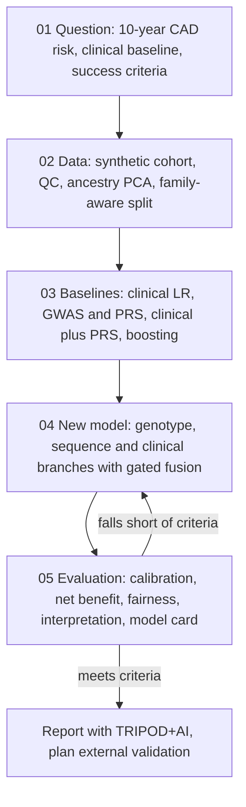

+++
summary = "Turn 'predict heart disease from DNA' into a precise research question with a defined outcome, a clinical baseline to beat, metrics for added value and success criteria fixed in advance."
+++

# Framing the Problem

Everything in this track has been building towards one project: **design, build and evaluate a new model that predicts a person's risk of coronary artery disease (CAD) from their DNA plus routine clinical data.** Before writing any code, a real research group spends weeks on the question itself. What exactly are we predicting? For whom? Compared with what? How will we know we have succeeded?

Most failed prediction projects fail here, not in the neural network. The model is built to answer a question nobody asked. Or it predicts a label that does not mean what the authors think. Or it "beats" a baseline that no clinician uses. This chapter turns the vague goal into a project you could defend in front of a cardiologist, a statistician and an ethics committee. The next four chapters carry it out:

- [02 · the data pipeline](../the-data-pipeline/): build the cohort.
- [03 · baselines](../baselines-prs-and-clinical-models/): build the models to beat.
- [04 · the deep learning model](../designing-a-deep-learning-model/): design the new model.
- [05 · evaluation and deployment](../evaluation-fairness-and-deployment/): judge it honestly.

> [!NOTE]
> **Prerequisites.** This capstone uses the whole track. The most important recalls are:
> [genetics of heart disease](../../genomics-foundations/genetics-of-heart-disease/),
> [GWAS and polygenic risk scores](../../genomics-foundations/gwas-and-polygenic-risk-scores/),
> [logistic regression](../../classical-machine-learning/linear-and-logistic-regression/) and
> [model evaluation](../../classical-machine-learning/model-evaluation/).

## Key ideas

### The clinical question: which risk, over what time?

"Risk of heart disease" is not one number. Two framings dominate.

- **10-year risk** is the probability of a first CAD event, such as a heart attack (myocardial infarction), a coronary revascularisation or coronary death, within the next ten years. Clinical guidelines use it to decide who is offered a statin or blood-pressure treatment *now*.
- **Lifetime risk** is the probability of an event at any time before death. It answers a different question: *who is on a dangerous trajectory, even if nothing will happen soon?*

Age dominates 10-year risk. A 35-year-old with very high genetic risk almost always has a low 10-year risk, because events before 45 are rare. That is why 10-year calculators rarely flag young people, even ones whose lifetime risk is high. Genetics is fixed at conception and can be measured at birth, so it is most useful on the **lifetime** axis: it can point to young people who would benefit from starting prevention early.

Who might benefit from a genetic risk estimate?

1. **Carriers of familial hypercholesterolaemia (FH) variants** in *LDLR*, *APOB* or *PCSK9*. They have very high LDL cholesterol from birth. Early statin treatment helps them, and testing their relatives ("cascade screening") finds more carriers.
2. **People with a high polygenic risk score (PRS).** Each common variant has a small effect, but together they can shift risk substantially. Such people may benefit from earlier or more intensive lipid lowering. The evidence on how much this changes outcomes is still developing.
3. **People near a treatment threshold.** For someone whose clinical risk sits right at the cut-off, extra information can move the decision one way or the other. This is where "added value" is easiest to show.

> [!CAUTION]
> A risk score is not a diagnosis, and a genetic score is not destiny. Most people with a high PRS never develop CAD, and many people with a low PRS do. Any clinical use of genetic risk needs validated tools, genetic counselling where relevant, and clinicians in charge of decisions. This capstone is an educational research exercise, not medical advice.

### Defining the outcome, and why labels are noisy

In a biobank, "CAD" usually means that a hospital record, death record or self-report contains one of a list of diagnosis or procedure codes. Typical examples are codes for myocardial infarction, coronary revascularisation and other forms of ischaemic heart disease. Choices you must make, and write down:

- **Hard vs broad endpoint.** "MI or coronary death" is specific but rarer. "Any ischaemic heart disease code" has more cases but more noise.
- **Prevalent vs incident.** Prevalent cases had the disease before enrolment. Incident cases developed it during follow-up. A model for *future* risk should be trained on incident events, and its predictors should be measured before the event. Otherwise you get **reverse causation**. For example, someone already diagnosed may be on a statin, so their measured LDL is *lower*, not higher.
- **Follow-up and censoring.** A person followed for 4 years without an event is not the same as one followed for 10 years without an event. Chapter 04 mentions survival losses that handle this properly. In this capstone we simplify to a binary label.

Labels are **noisy**. Some heart attacks are never coded (silent infarctions, events abroad, unlinked records), and some codes are wrong. How much does that hurt? Suppose a fraction of true cases are missed and recorded as controls, and nothing else is wrong. The AUC is the probability that a random case scores higher than a random control. The observed "controls" are a mixture: true controls in proportion $1-w$, hidden cases in proportion $w$. Against a true control, a case wins with probability $A$, the true AUC. Against a hidden case, which has the same score distribution, a case wins with probability $\tfrac12$. So

$$
A_{\text{obs}} = (1-w)\,A + w \cdot \tfrac12 = A - w\,(A - \tfrac12).
$$

> [!IMPORTANT]
> With missed cases making up a share $w$ of the recorded controls, the observed AUC is
> $$A_{\text{obs}} = A - w\,(A - \tfrac12).$$
> Ranking metrics shrink slightly towards 0.5. **Absolute risk** is biased downwards by the full missed fraction. So calibration suffers more than discrimination.

### Existing clinical baselines

You are not starting from zero. Clinicians already use validated 10-year risk calculators. Three you should know, conceptually:

- **Pooled Cohort Equations (PCE).** Used in the 2013 ACC/AHA guideline in the United States. They are sex- and race-specific equations built from several US cohort studies, and they estimate 10-year risk of atherosclerotic cardiovascular disease.
- **QRISK** (currently QRISK3). Used in the UK. It was derived from millions of primary-care records and adds factors such as deprivation, ethnicity, chronic kidney disease and several other conditions.
- **SCORE2.** The European Society of Cardiology's 10-year risk model (2021). It is recalibrated to low-, moderate-, high- and very-high-risk regions of Europe.

They differ in detail, but they share a structure. Each is a survival or logistic-type model on **age, sex, cholesterol (total and HDL, or non-HDL), systolic blood pressure, smoking and diabetes**, plus extras. That is why our synthetic cohort has exactly those clinical covariates. We will not copy any published coefficients. Instead, in [chapter 03](../baselines-prs-and-clinical-models/) we fit our own clinical-only model, which plays the role of "the calculator the clinic already has".

> [!WARNING]
> The right comparison is never "my model vs. chance". It is **"clinical model + my new information" vs. "clinical model alone"**, evaluated on the same people. A genetic model with AUC 0.62 may sound useless or impressive. What matters is how much it adds to a clinical model that already reaches around 0.75.

### What "added value" means

Three different questions, three different metrics.

**1. Discrimination: does the new model rank people better?** The AUC (area under the ROC curve) equals the probability that a randomly chosen case receives a higher score than a randomly chosen non-case (see [model evaluation](../../classical-machine-learning/model-evaluation/)). Added value is $\Delta\text{AUC} = \text{AUC}_{\text{new}} - \text{AUC}_{\text{old}}$, reported with a confidence interval from a **paired** bootstrap on the same test set. When the baseline is strong, $\Delta\text{AUC}$ is usually small, often around 0.01–0.03, even for a useful marker. AUC is a rank statistic dominated by the bulk of people far from any decision threshold.

**2. Reclassification: does it change decisions?** Pick a clinically meaningful threshold $t$, say "offer a statin if 10-year risk $\ge 7.5\%$". Count how many people cross it when the new information is added. The categorical **net reclassification index** is

$$
\text{NRI} = \underbrace{\frac{\#\text{cases moved up} - \#\text{cases moved down}}{\#\text{cases}}}_{\text{NRI}_\text{events}} + \underbrace{\frac{\#\text{non-cases moved down} - \#\text{non-cases moved up}}{\#\text{non-cases}}}_{\text{NRI}_\text{non-events}}.
$$

Always report the two parts separately. A single NRI can hide harm, for example many non-cases being pushed into treatment.

**3. Calibration: are the probabilities right?** If the model says 20%, about 20% of such people should have events. A model can rank perfectly and still be badly calibrated, for example if every probability is doubled. Clinical thresholds are absolute probabilities, so calibration is not optional. [Chapter 05](../evaluation-fairness-and-deployment/) adds **net benefit** (decision curves), which combines discrimination, calibration and the cost of over-treatment into one clinically meaningful number.

### Real data sources and how access works

Our code uses a synthetic cohort. A real project would draw on resources like these. Access rules change, so treat the following as the general pattern, not current policy.

| Resource | What it offers | How access works (in general) |
|---|---|---|
| **UK Biobank** | About 500,000 UK adults recruited at ages 40–69, with genotype arrays, imputed data, exome and whole-genome sequences, linked hospital and death records | Registered researchers apply with a project proposal; approved projects pay an access fee and analyse data on a cloud platform |
| **All of Us** (NIH) | A large and deliberately diverse US cohort with genomes, electronic health records and surveys | Institutional agreement, researcher registration and training; tiered data access inside a cloud "Researcher Workbench" |
| **FinnGen** | Genotypes linked to national health registries in Finland, a population with distinctive genetic history | GWAS summary statistics are publicly released; individual-level data is restricted to the consortium and partners |
| **dbGaP** | NIH's archive of many individual studies' genotypes and phenotypes | Controlled access: a data-access request reviewed by a Data Access Committee, with use limited to approved purposes |
| **CARDIoGRAMplusC4D** | Large meta-analysed CAD GWAS **summary statistics** (per-SNP effect sizes and p-values) | Summary statistics are downloadable; individual-level data stays with the member studies |
| **ClinVar** | Public database of variant–condition assertions, such as "pathogenic for familial hypercholesterolaemia" | Open |
| **gnomAD** | Allele frequencies across large populations of different ancestries | Open |

Notice the split. **Summary statistics** are usually open, because they summarise many people. **Individual-level** genotypes are almost always controlled, because a genome identifies a person. That is why a realistic project combines the two: PRS weights from a large public GWAS, applied to individual-level data in an approved cohort. Chapter 03 simulates exactly this.

### The project roadmap



### Success criteria, written before seeing the test set

A good project fixes its criteria **before** touching the test data, ideally in a written analysis plan. Ours:

1. **Primary metric:** test-set AUC of "clinical + new information" minus "clinical only", with a 95% paired-bootstrap CI that excludes 0.
2. **No loss of calibration:** calibration slope within roughly 0.9–1.1 after any recalibration fitted on validation data only.
3. **Clinical usefulness:** higher net benefit than the clinical model across a plausible range of treatment thresholds (for example 5–20%).
4. **Fairness:** performance reported **per ancestry group**, with the size of any gap stated. Here "fair" means "honestly characterised", not "identical".
5. **The deep model must earn its complexity:** it must beat a well-tuned *logistic regression with the same inputs*. Otherwise we recommend the simpler model.
6. **One look at the test set.** All tuning uses train and validation only.

> [!TIP]
> Criterion 5 is the one students forget. If a neural network beats logistic regression only because it was given extra inputs that the regression never saw, you have learned something about the *inputs*, not about the *architecture*. Always add the new inputs to the simple model too.

## Worked example

**Part 1: reclassification by hand.** A validation cohort has 1,000 people: 100 had a CAD event in 10 years, 900 did not. The threshold for offering a statin is 7.5%. Adding a PRS to the clinical model moves people as follows.

| | moved up (now $\ge 7.5\%$) | moved down (now $< 7.5\%$) |
|---|---|---|
| cases (100) | 12 | 4 |
| non-cases (900) | 45 | 30 |

$$
\text{NRI}_\text{events} = \frac{12 - 4}{100} = 0.080, \qquad
\text{NRI}_\text{non-events} = \frac{30 - 45}{900} = -0.0167.
$$

So $\text{NRI} = 0.080 - 0.0167 = 0.0633$. The total is positive. But the non-event part is *negative*: 15 more healthy people were pushed into treatment than were pulled out. Whether that is worth catching 8 more future cases depends on the harms and costs of statins against the harm of a missed heart attack. This trade-off is exactly what net benefit formalises in chapter 05.

**Part 2: label noise by hand.** The true AUC is $A = 0.80$ and prevalence is 10%. The records miss 20% of cases. Per 100 people, $10 \times 0.2 = 2$ cases are hidden among the $90 + 2 = 92$ recorded controls, so $w = 2/92 = 0.0217$. Then

$$
A_\text{obs} = 0.80 - 0.0217 \times (0.80 - 0.50) = 0.80 - 0.0065 = 0.7935.
$$

The AUC barely moves. But the **observed prevalence** falls from 10% to 8%. A model trained on these labels will under-predict absolute risk by about a fifth, which is enough to move many people across a 7.5% threshold.

## In code

First, check the label-noise formula by simulation.

```python
# Label noise: what missed CAD diagnoses do to AUC and to apparent risk
import numpy as np
from sklearn.metrics import roc_auc_score

rng = np.random.default_rng(0)
n = 200_000
score = rng.normal(0, 1, n)                       # a risk score (log-odds scale)
p_true = 1 / (1 + np.exp(-(-2.6 + 1.2 * score)))  # true probability of CAD
y_true = rng.random(n) < p_true
print(f"true prevalence {y_true.mean():.3f}, AUC against true labels {roc_auc_score(y_true, score):.3f}")

for miss in [0.1, 0.2, 0.4]:
    # each true case is recorded with probability 1 - miss (no false positives here)
    y_obs = y_true & (rng.random(n) > miss)
    w = (y_true & ~y_obs).sum() / (~y_obs).sum()  # share of 'controls' who are hidden cases
    A = roc_auc_score(y_true, score)
    print(f"miss {miss:.0%}: observed prevalence {y_obs.mean():.3f}, "
          f"observed AUC {roc_auc_score(y_obs, score):.3f}, "
          f"formula A - w(A - 0.5) = {A - w * (A - 0.5):.3f}")
```

Output:

```text
true prevalence 0.109, AUC against true labels 0.784
miss 10%: observed prevalence 0.098, observed AUC 0.782, formula A - w(A - 0.5) = 0.781
miss 20%: observed prevalence 0.087, observed AUC 0.778, formula A - w(A - 0.5) = 0.778
miss 40%: observed prevalence 0.065, observed AUC 0.772, formula A - w(A - 0.5) = 0.771
```

Even with 40% of cases missed, the AUC drops by only about 0.01, but the apparent prevalence falls from 10.9% to 6.5%. Next, measure "added value" for a toy genetic marker.

```python
# "Added value": delta AUC and the categorical net reclassification index (NRI)
import numpy as np
from sklearn.metrics import roc_auc_score

rng = np.random.default_rng(1)
n = 100_000
clinical = rng.normal(0, 1, n)                    # what a clinical calculator captures
genetic = rng.normal(0, 1, n)                     # independent genetic liability (a PRS)
y = rng.random(n) < 1 / (1 + np.exp(-(-2.7 + 1.0 * clinical + 0.4 * genetic)))

def risk(logit):
    return 1 / (1 + np.exp(-logit))

# for clarity we use the true coefficients; in practice both models are fitted
old = risk(-2.65 + 1.0 * clinical)                # clinical-only model
new = risk(-2.7 + 1.0 * clinical + 0.4 * genetic) # clinical + genetics
print(f"AUC old {roc_auc_score(y, old):.3f}, new {roc_auc_score(y, new):.3f}")

t = 0.075                                         # treatment threshold: 7.5% risk
up, down = (new >= t) & (old < t), (new < t) & (old >= t)
nri_events = (up[y].sum() - down[y].sum()) / y.sum()
nri_nonevents = (down[~y].sum() - up[~y].sum()) / (~y).sum()
print(f"cases moved up {up[y].sum()}, down {down[y].sum()}  -> NRI_events {nri_events:+.3f}")
print(f"non-cases moved down {down[~y].sum()}, up {up[~y].sum()} -> NRI_nonevents {nri_nonevents:+.3f}")
print(f"NRI = {nri_events + nri_nonevents:+.3f}")
```

Output:

```text
AUC old 0.747, new 0.764
cases moved up 505, down 414  -> NRI_events +0.010
non-cases moved down 6372, up 4797 -> NRI_nonevents +0.017
NRI = +0.027
```

The genetic marker carries real information: its log-odds ratio is 0.4 per standard deviation. Yet $\Delta\text{AUC}$ is only 0.017, and roughly 12% of the population crosses the threshold in one direction or the other. Small summary numbers can hide many changed individual decisions. That is why we report several metrics, not one.

## Biomedical connection

Three facts from [the genetics of heart disease](../../genomics-foundations/genetics-of-heart-disease/) shape this project.

- **Monogenic FH** (variants in *LDLR*, *APOB*, *PCSK9*) is rare but has a large effect, acting mainly through lifelong high LDL cholesterol. Screening for it is a classic, actionable use of DNA. Our synthetic cohort includes a few FH-like variants for this reason.
- **Polygenic risk** comes from many common variants, such as those at the 9p21 locus, each with a small effect. Khera and colleagues (2018) showed that a genome-wide PRS identifies a share of the population, about 8% in their UK Biobank analysis, with at least threefold the average risk of CAD. That is a risk increase comparable to monogenic FH, but in far more people.
- **Portability.** PRSs built from GWAS of mostly European-ancestry participants predict less accurately in other ancestries. Allele frequencies and linkage disequilibrium (LD) patterns differ between groups, so a tag SNP that tracks a causal variant well in one group can track it poorly in another. Our synthetic cohort deliberately has three ancestry groups so that you will *see* this loss, not just read about it.

Other important genetic factors, such as lipoprotein(a), whose level is largely set by the *LPA* gene, are outside this simulation. In a real project, Lp(a) would be a strong candidate input.

## Practice

1. A 30-year-old woman with a very high PRS has a 10-year CAD risk of 1% according to a calculator. Explain why the calculator and her genetics are not in conflict, and name the risk framing in which her PRS matters.

<details>
<summary>Answer</summary>

10-year risk is dominated by age: almost nobody has a CAD event between 30 and 40, so even a doubled relative risk keeps her absolute 10-year risk low. Her PRS describes a raised **lifetime** risk (relative risk at every age), which accumulates over decades. The PRS is relevant for lifetime-risk framing and for decisions about earlier prevention, not for a 10-year threshold today.

</details>

2. Prevalence is 12%, true AUC is 0.76, and 25% of cases are missed (recorded as controls). Compute the observed AUC and the observed prevalence.

<details>
<summary>Answer</summary>

Per 100 people: 12 cases, 3 missed. Recorded controls $= 88 + 3 = 91$, so $w = 3/91 = 0.0330$.
$A_\text{obs} = 0.76 - 0.0330 \times 0.26 = 0.76 - 0.0086 = 0.7514$.
Observed prevalence $= 9/100 = 9\%$.

</details>

3. With 200 cases and 1,800 non-cases, a new model moves 20 cases up and 6 down, and moves 50 non-cases down and 90 up across the treatment threshold. Compute $\text{NRI}_\text{events}$, $\text{NRI}_\text{non-events}$ and the total NRI. Is the new model clearly better?

<details>
<summary>Answer</summary>

$\text{NRI}_\text{events} = (20-6)/200 = 0.070$. $\text{NRI}_\text{non-events} = (50-90)/1800 = -0.0222$. Total $= 0.0478$.
Not clearly: it catches 14 more future cases but sends 40 more non-cases into treatment. Whether that trade is worth it depends on the relative harm of a missed event vs. unnecessary treatment, which is what net benefit (chapter 05) quantifies.

</details>

4. A colleague reports: "Our CNN on DNA plus clinical data has AUC 0.77, beating the clinical model (0.74)." The clinical model did not get the genetic inputs. What extra comparison must they run before claiming the *architecture* helped?

<details>
<summary>Answer</summary>

Fit a simple model, such as logistic regression, on **the same inputs** (clinical plus a PRS, plus any sequence-derived variant dosages). If that reaches about 0.77 too, the gain came from the genetic information, not the deep architecture. Compare the deep model with it using a paired bootstrap CI on the same test set.

</details>

5. Why must predictors for an *incident* CAD model be measured before the event? Give one concrete example of what goes wrong otherwise.

<details>
<summary>Answer</summary>

Otherwise the predictors can be consequences of the disease or its treatment (reverse causation). Example: after a heart attack, most patients are started on statins, so their LDL measured later is low. A model trained on post-event LDL would learn that low LDL goes with CAD, the opposite of the true causal direction, and it would fail on people without a diagnosis.

</details>

## Further reading

- Khera AV, Chaffin M, Aragam KG, et al. "Genome-wide polygenic scores for common diseases identify individuals with risk equivalent to monogenic mutations." *Nature Genetics* 50 (2018).
- Goff DC Jr, Lloyd-Jones DM, et al. "2013 ACC/AHA guideline on the assessment of cardiovascular risk." *Circulation* (2014). Source of the Pooled Cohort Equations.
- Hippisley-Cox J, Coupland C, Brindle P. "Development and validation of QRISK3 risk prediction algorithms to estimate future risk of cardiovascular disease." *BMJ* (2017).
- SCORE2 working group and ESC Cardiovascular risk collaboration. "SCORE2 risk prediction algorithms." *European Heart Journal* (2021).
- Pencina MJ, D'Agostino RB Sr, D'Agostino RB Jr, Vasan RS. "Evaluating the added predictive ability of a new marker: from area under the ROC curve to reclassification and beyond." *Statistics in Medicine* (2008).
- Steyerberg EW. *Clinical Prediction Models*, 2nd ed. Springer (2019).
- Sudlow C, et al. "UK Biobank: an open access resource for identifying the causes of a wide range of complex diseases of middle and old age." *PLoS Medicine* (2015).
