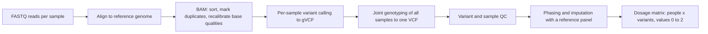

+++
summary = "Trace raw reads to a QC'd dosage matrix, then build the capstone's synthetic cohort (families, three ancestries, FH variants, a regulatory DNA window, clinical risk factors), compute ancestry PCs and make a leakage-safe split."
+++

# The Data Pipeline

A model is only as good as its data. In genomics, the path from a blood sample to a clean table of numbers is long, and every step can quietly introduce bias. This chapter has two halves.

1. **The real pipeline.** How raw sequencing reads become a *dosage matrix* (people × variants), and the quality-control (QC) filters that decide which variants and people survive.
2. **Our synthetic cohort.** Students rarely get biobank access, so we write one generator that mimics the features that matter: families, three ancestry groups with different allele frequencies, a polygenic background, rare FH-like variants, a short DNA window with a regulatory motif, correlated clinical risk factors, and a noisy CAD label. Then we run QC, ancestry PCA and a **leakage-safe** train/validation/test split, and save everything to `cad_cohort.npz` for chapters 03–05.

> [!NOTE]
> **Recall.** [Sequencing data](../../genomics-foundations/sequencing-data/) (FASTQ, quality scores, coverage) · [read mapping](../../bioinformatics-algorithms/indexing-and-read-mapping/) · [DNA variation](../../genomics-foundations/dna-genes-and-variation/) · [PCA via the SVD](../../linear-algebra/eigenvectors-svd-and-pca/) · [hypothesis tests](../../probability-and-statistics/hypothesis-testing-and-multiple-comparisons/) · [encoding DNA for ML](../../bioinformatics-algorithms/encoding-dna-for-machine-learning/).

## Key ideas

### From FASTQ to a dosage matrix



- **FASTQ → BAM.** Each short read is placed on the reference genome by an aligner such as BWA-MEM, which uses the FM-index ideas from [read mapping](../../bioinformatics-algorithms/indexing-and-read-mapping/). The aligned reads are stored in a BAM file, sorted by position. PCR duplicates are marked so they are not counted twice. Base quality scores are often recalibrated.
- **BAM → VCF.** A variant caller (for example GATK HaplotypeCaller or DeepVariant) looks at the pile of reads at each position and computes genotype likelihoods $P(\text{reads}\mid \text{genotype})$ for 0/0, 0/1 and 1/1. Calling each sample to a *gVCF* and then **joint-genotyping** all samples together has a big advantage: a site that is variant in anyone is evaluated in everyone, so "no call" and "homozygous reference" can be told apart.
- **Arrays instead of sequencing.** Most biobank genotypes come from SNP arrays, which measure several hundred thousand preselected sites cheaply. The calls then go through the same QC.
- **Imputation.** Using a large reference panel of phased haplotypes, an HMM (see [hidden Markov models](../../bioinformatics-algorithms/hidden-markov-models/)) infers the unmeasured variants that lie on the same haplotype as the measured ones. The output is a **dosage**: the expected number of alternative alleles, $\mathbb{E}[g] = P(0/1) + 2P(1/1) \in [0, 2]$. Dosages, not hard calls, are what PRS software and our models consume.

> [!TIP]
> The final object is just a matrix $X \in \mathbb{R}^{N \times M}$: $N$ people by $M$ variants, entries in $[0,2]$. Everything upstream exists to make that matrix *trustworthy*. Everything downstream (GWAS, PRS, neural networks) treats it as input features.

### Quality control, filter by filter

QC removes variants and samples whose data are more likely to be errors than biology. Typical filters:

| Filter | Level | What it measures | Typical rule | Why |
|---|---|---|---|---|
| Call rate | variant | fraction of samples with a non-missing genotype | drop if $< 98\%$ | poorly performing probes or sites produce biased missingness |
| Call rate | sample | fraction of variants called in a sample | drop if $< 97$–$98\%$ | low-quality DNA |
| MAF | variant | minor allele frequency | drop if $< 1\%$ for common-variant analyses | too few carriers for stable estimates; rare variants handled separately |
| HWE | variant | departure from Hardy–Weinberg proportions | drop if $p < 10^{-6}$ in controls of one ancestry | genotyping errors (e.g. heterozygotes miscalled) |
| Relatedness | sample pair | kinship or GRM between two people | flag pairs with kinship above about 0.0884 (2nd degree) | related people violate independence and leak across splits |
| Sex check | sample | X-chromosome heterozygosity vs. recorded sex | flag mismatches | sample swaps and data-entry errors |
| Heterozygosity | sample | genome-wide heterozygosity rate | flag outliers ($\pm 3$ SD) | contamination (too high) or inbreeding (too low) |

**Hardy–Weinberg equilibrium.** If allele A has frequency $p$ and the two alleles in a person are independent draws, the genotype frequencies are $(1-p)^2,\ 2p(1-p),\ p^2$. With observed counts $n_0, n_1, n_2$ (total $n$), estimate $\hat p = (n_1 + 2n_2)/(2n)$ and compare with the expected counts using Pearson's statistic

$$
\chi^2 = \sum_{k=0}^{2} \frac{(n_k - E_k)^2}{E_k}, \quad E_0 = n(1-\hat p)^2,\ E_1 = 2n\hat p(1-\hat p),\ E_2 = n\hat p^2 .
$$

There are 3 cells, minus 1 for the total and 1 for the estimated $\hat p$, which leaves **1 degree of freedom**. Two subtleties:

- Test HWE **within one ancestry group**. A mixture of groups with different $p$ has a heterozygote deficit even when every group is in HWE (the Wahlund effect).
- Test it **in controls**. A true risk allele is enriched in cases and can genuinely distort HWE there.

**Sex check.** Males have one X chromosome, so outside the pseudo-autosomal regions they should show essentially no X heterozygosity. Tools compute an inbreeding-like statistic $F$ from X-chromosome SNPs: near 1 for males and near 0 for females. A recorded "female" with $F \approx 1$ suggests a sample swap. Our simulation has no sex chromosomes, so we describe this check but do not run it.

**Relatedness.** The genetic relationship between persons $i$ and $j$ is estimated by the GRM

$$
A_{ij} = \frac{1}{M}\sum_{m=1}^{M} \frac{(x_{im} - 2p_m)(x_{jm} - 2p_m)}{2p_m(1-p_m)} .
$$

Its expectation is twice the kinship coefficient: about 1 for a person with themself, 0.5 for parent–offspring or full siblings, 0.25 for second-degree relatives and 0 for unrelated people. Dedicated tools such as KING are more robust to population structure. The idea is the same.

### Ancestry: PCA on genotypes

Standardise every SNP column: $z_{im} = (x_{im} - 2\hat p_m)/\sqrt{2\hat p_m(1-\hat p_m)}$. Then take the SVD $Z = U S V^\top$. The top right-singular vectors are the directions of greatest variance across people. In genotype data, these are allele-frequency differences between ancestry groups, because thousands of SNPs differ slightly and consistently between groups. The scores $ZV_{:,1:k}$ are the **principal components (PCs)**. They have two uses here:

1. as **covariates in GWAS**, to remove confounding by ancestry (population stratification);
2. as **covariates in risk models**, and for **reporting performance per ancestry**.

> [!WARNING]
> Fit the PCA (means, scales and $V$) on the **training** split, then *project* validation and test people. Fitting on everyone is a mild leak. It is harmless for unsupervised PCA in practice, but it is a bad habit that becomes a serious leak when you move on to supervised preprocessing.

### Designing the synthetic cohort

Each simulated feature exists to teach one thing later.

| Simulated feature | How | Teaches |
|---|---|---|
| 12,000 families, 1–3 children each | Mendelian transmission from 4 parental haplotypes | relatedness and leakage-safe splitting |
| 3 ancestry groups A/B/C (70/20/10%) | Balding–Nichols allele frequencies | PCA, stratification, portability |
| 200 causal loci, **not on the array** | each tagged by one array SNP with group-specific fidelity | why PRSs lose accuracy across ancestries |
| 1,800 null array SNPs | random frequencies, some rare | multiple testing, MAF filter |
| 3 rare FH-like variants | carrier frequency of about 0.3% each, +2 mmol/L LDL | monogenic risk, rare-variant handling |
| 200 bp DNA window | a regulatory motif `AGGTCACT`: one variant destroys it, one creates a reverse-strand copy | a CNN branch that has something to find |
| age, sex, LDL, SBP, smoking, diabetes | LDL depends on genetics and FH; diabetes on ancestry | clinical baseline, confounding |
| CAD label | logistic model, about 10% prevalence, 8% of cases missed | label noise and calibration |
| array errors | missing calls, 25 bad SNPs, 10 SNPs with miscalled heterozygotes | QC filters |
| external GWAS summary statistics | group-A GWAS of $n = 300{,}000$, simulated analytically | PRS from public summary statistics |

**Balding–Nichols.** Each locus has an ancestral frequency $p$. Group $k$'s frequency is drawn as

$$
p_k \sim \operatorname{Beta}\!\left(\frac{p(1-F_k)}{F_k},\ \frac{(1-p)(1-F_k)}{F_k}\right),
$$

which has mean $p$ and variance $F_k\,p(1-p)$. So $F_k$ (similar to $F_{ST}$) controls how far group $k$ has drifted. We use $F = 0.05, 0.10, 0.15$.

**Tag SNPs and portability: a short derivation.** On each haplotype, the array's tag allele $t$ copies the causal allele $c$ with probability $f$ (the fidelity). Otherwise it is an independent draw with the same frequency $q$. Then $\operatorname{Var}(t) = \operatorname{Var}(c) = q(1-q)$ and

$$
\operatorname{Cov}(t, c) = f\operatorname{Var}(c) + (1-f)\cdot 0 \quad\Rightarrow\quad \operatorname{corr}(t,c) = f .
$$

The regression slope of the trait on the tag is therefore $f\beta$, not $\beta$. A GWAS in group A (fidelity $\approx 0.95$) estimates $\approx 0.95\beta$. In group C (fidelity $\approx 0.40$), the same SNP only carries 40% of the causal signal. So the *same* weights recover less of the true genetic risk there. This is a simplified version of the real reason PRSs lose accuracy across ancestries: LD between array SNPs and causal variants differs between populations.

**The outcome model.** For person $i$ (LDL in mmol/L, SBP in mmHg, $G_i$ the direct polygenic score):

$$
\begin{aligned}
\operatorname{logit} P(\text{CAD}_i) = b_0 &+ 0.065(\text{age}-55) + 0.8\,\text{male} + 0.5(\text{LDL}-3.2) + 0.018(\text{SBP}-130) \\
&+ 0.65\,\text{smoker} + 0.75\,\text{diabetes} + G_i + 0.6\,\text{FH} + 0.5(\text{motif copies}-2) + e_{\text{group}} ,
\end{aligned}
$$

where $b_0$ is found by bisection so that prevalence is 10%. LDL itself contains a polygenic part and $+2.0$ mmol/L for FH carriers. So genetics acts on CAD both **directly** and **through LDL**, as it does in reality. The term $e_\text{group}$ is a non-genetic difference between groups (diet, healthcare access). It is what makes ancestry a *confounder* in a GWAS without PCs.

> [!CAUTION]
> These coefficients are made up for teaching. They are chosen to look plausible, not taken from any study. The motif effect, in particular, is much larger than a typical real regulatory variant, so that a small CNN can find it in about 1,000 cases. Do not interpret any number from this simulation as a fact about human biology.

### Leakage-safe splitting

Siblings share about half their genome **and** their family environment. If one sibling is in training and the other in test, a flexible model can partly "recognise" the family. The test score then overstates how well the model generalises to new families. The rules:

1. **Split by family**: everyone in a family goes to the same split. In real data with no pedigree, build families from the GRM or kinship (connected components of pairs above a threshold), or remove one member of each related pair.
2. **Stratify** by the things whose balance you need: ancestry and case status. Otherwise a small group such as C can end up with almost no test cases.
3. **Fit every preprocessing step on train only**: QC statistics, imputation means, PCA, scalers, and later the GWAS and PRS weights.

## Worked example

**HWE by hand.** At one SNP, 1,000 controls of group A have genotype counts $n_0 = 400$, $n_1 = 400$, $n_2 = 200$.

1. $\hat p = (400 + 2\cdot 200)/2000 = 800/2000 = 0.4$.
2. Expected counts: $E_0 = 1000 \cdot 0.6^2 = 360$, $E_1 = 1000 \cdot 2 \cdot 0.4 \cdot 0.6 = 480$, $E_2 = 1000 \cdot 0.4^2 = 160$.
3. $\chi^2 = \frac{(400-360)^2}{360} + \frac{(400-480)^2}{480} + \frac{(200-160)^2}{160} = 4.444 + 13.333 + 10.000 = 27.78$.
4. With 1 df, $p = P(\chi^2_1 > 27.78) \approx 1.4 \times 10^{-7} < 10^{-6}$, so the SNP **fails** HWE.

The pattern is too few heterozygotes and too many homozygotes. That is the signature of heterozygotes miscalled as homozygotes, which is exactly the error we plant in 10 SNPs.

**A sibling's GRM by hand.** Full siblings share 0, 1 or 2 alleles identical by descent at a locus with probabilities $\tfrac14, \tfrac12, \tfrac14$. The expected fraction of alleles shared IBD is $\tfrac14\cdot 0 + \tfrac12 \cdot \tfrac12 + \tfrac14 \cdot 1 = \tfrac12$, so $\mathbb{E}[A_{ij}] = 0.5$. With $M$ independent SNPs, the GRM of an *unrelated* pair has standard deviation of roughly $1/\sqrt{M}$. With about 1,800 common SNPs that is about 0.024, so a threshold of 0.35 separates siblings (around 0.5) from unrelated pairs (around 0) by many standard deviations.

## In code

Save the next five blocks together as `cohort.py`. The first block sets the constants and draws allele frequencies.

```python
# cohort.py: a synthetic CAD cohort with families, ancestry, DNA and clinical data.
import numpy as np

POPS = np.array(["A", "B", "C"])          # three synthetic ancestry groups
POP_SHARE = np.array([0.70, 0.20, 0.10])   # group A dominates, like most biobanks
FST = np.array([0.05, 0.10, 0.15])         # genetic drift of each group from the ancestral pool
TAG_FIDELITY = np.array([0.95, 0.60, 0.40])  # P(tag SNP allele copies the causal allele)

M_NULL, M_CAUSAL, N_FH = 1800, 200, 3      # null SNPs, causal loci, rare FH-like variants
N_LDL_LOCI = 40                            # causal loci that act through LDL
L = 200                                    # length of the sequenced regulatory window
MOTIF = "AGGTCACT"                         # planted (non-palindromic) regulatory motif
BASES = np.array(list("ACGT"))


def pop_freqs(rng, p_anc):
    """Balding-Nichols model: each group's allele frequency drifts from p_anc."""
    F = FST[:, None]
    p = rng.beta(p_anc * (1 - F) / F, (1 - p_anc) * (1 - F) / F)
    return np.clip(p, 0.001, 0.999)            # shape (3, n_loci)


def locus_layout(rng, n_win):
    """Allele frequencies and recombination blocks for every simulated locus."""
    p_null = pop_freqs(rng, rng.uniform(0.002, 0.5, M_NULL))
    p_caus = pop_freqs(rng, rng.uniform(0.05, 0.5, M_CAUSAL))
    p_fh = np.tile(rng.uniform(0.0012, 0.0020, N_FH), (3, 1))   # rare in every group
    p_win = pop_freqs(rng, rng.uniform(0.10, 0.45, n_win))
    # columns: null | causal | tag | FH | window
    p = np.hstack([p_null, p_caus, p_caus, p_fh, p_win])
    # a causal locus and its tag travel together (same block); the window is one block
    block = np.concatenate([np.arange(M_NULL),
                            M_NULL + np.arange(M_CAUSAL), M_NULL + np.arange(M_CAUSAL),
                            M_NULL + M_CAUSAL + np.arange(N_FH),
                            np.full(n_win, M_NULL + M_CAUSAL + N_FH)])
    fidelity = np.clip(TAG_FIDELITY[:, None] + rng.normal(0, 0.05, (3, M_CAUSAL)), 0, 1)
    return p, block, fidelity
```

Families: each family draws four parental haplotypes; each child receives one haplotype from each parent *per recombination block*. A causal locus and its tag form one block, so they are inherited together (they are in LD). The whole 200 bp window is also one block.

```python
def simulate_families(rng, n_fam, p, block, fidelity):
    """Parents' haplotypes -> 1 to 3 children per family (Mendelian transmission)."""
    fam_pop = rng.choice(3, n_fam, p=POP_SHARE)
    n_kids = rng.choice([1, 2, 3], n_fam, p=[0.6, 0.3, 0.1])
    c0, t0 = M_NULL, M_NULL + M_CAUSAL               # first causal, first tag column
    n_blocks = block.max() + 1
    haps, fam_id, pop = [], [], []
    for start in range(0, n_fam, 1000):              # chunks keep memory small
        f = np.arange(start, min(start + 1000, n_fam))
        k = fam_pop[f]
        H = rng.random((len(f), 4, p.shape[1])) < p[k][:, None, :]   # 4 parental haplotypes
        # tag SNPs copy the causal allele with ancestry-specific fidelity (LD differs by group)
        copy = rng.random((len(f), 4, M_CAUSAL)) < fidelity[k][:, None, :]
        H[:, :, t0:t0 + M_CAUSAL] = np.where(copy, H[:, :, c0:c0 + M_CAUSAL],
                                             H[:, :, t0:t0 + M_CAUSAL])
        for kid in range(3):
            has = n_kids[f] > kid
            pick_m = rng.integers(0, 2, (len(f), n_blocks))[:, block]      # mother: hap 0 or 1
            pick_f = 2 + rng.integers(0, 2, (len(f), n_blocks))[:, block]  # father: hap 2 or 3
            h1 = np.take_along_axis(H, pick_m[:, None, :], axis=1)[:, 0]
            h2 = np.take_along_axis(H, pick_f[:, None, :], axis=1)[:, 0]
            haps.append(np.stack([h1, h2], 1)[has])
            fam_id.append(f[has]); pop.append(k[has])
    return np.concatenate(haps).astype(np.int8), np.concatenate(fam_id), np.concatenate(pop)
```

The DNA window. We plant the motif `AGGTCACT` on the forward strand at positions 96–103. At positions 40–47 we place its reverse complement `AGTGACCT` with the last base changed. Site 0 (position 98, G→T) **destroys** the forward motif. Site 1 (position 47, A→T) **creates** a complete reverse-strand copy. Six more sites are neutral. A model must therefore recognise the motif on *both strands* and *count* intact copies. Each person's two haplotypes are stored as integer codes (A=0, C=1, G=2, T=3).

```python
def make_window(rng):
    """Reference window with one motif copy, plus the window's variable sites."""
    rc = lambda s: s[::-1].translate(str.maketrans("ACGT", "TGCA"))
    while True:
        ref = list(rng.choice(BASES, L))
        ref[96:104] = list(MOTIF)                     # forward-strand motif at 96..103
        ref[40:48] = list(rc(MOTIF)[:-1] + "A")       # reverse-strand motif missing 1 base
        s = "".join(ref)
        if s.count(MOTIF) == 1 and s.count(rc(MOTIF)) == 0:
            break
    # (position, alt base): 0 = disrupts the motif, 1 = creates a reverse-strand copy
    sites = [(98, "T"), (47, rc(MOTIF)[-1])]
    for pos in rng.choice([q for q in range(L) if not (36 <= q < 52 or 92 <= q < 108)],
                          6, replace=False):
        sites.append((int(pos), rng.choice([b for b in "ACGT" if b != s[pos]])))
    return s, sites


def build_sequences(ref, sites, win_haps):
    """Apply each haplotype's alleles at the window sites -> int codes (N, 2, L)."""
    code = {b: i for i, b in enumerate("ACGT")}
    seq = np.tile(np.array([code[b] for b in ref], np.int8), (*win_haps.shape[:2], 1))
    for j, (pos, alt) in enumerate(sites):
        seq[:, :, pos] = np.where(win_haps[:, :, j] == 1, code[alt], seq[:, :, pos])
    return seq


def count_motifs(seq):
    """Intact motif copies on either strand, summed over both haplotypes."""
    rc = MOTIF[::-1].translate(str.maketrans("ACGT", "TGCA"))
    text = np.array(["".join(BASES[h]) for h in seq.reshape(-1, L)])
    n = np.char.count(text, MOTIF) + np.char.count(text, rc)
    return n.reshape(seq.shape[0], 2).sum(1)
```

Clinical covariates and the noisy outcome:

```python
def simulate_phenotypes(rng, pop, dosage_causal, fh, motif_copies):
    n = len(pop)
    beta_cad = rng.normal(0, 0.075, M_CAUSAL)          # direct polygenic effects (log-odds)
    beta_ldl = np.zeros(M_CAUSAL)
    beta_ldl[:N_LDL_LOCI] = rng.normal(0, 0.12, N_LDL_LOCI)   # effects on LDL (mmol/L)
    g_ldl = dosage_causal @ beta_ldl
    g_cad = dosage_causal @ beta_cad
    age = rng.uniform(40, 75, n)
    male = rng.random(n) < 0.5
    ldl = (3.2 + (g_ldl - g_ldl.mean()) + 2.0 * fh + 0.01 * (age - 55)
           + np.array([0.0, -0.1, 0.15])[pop] + rng.normal(0, 0.75, n))
    ldl = np.clip(ldl, 1.0, None)
    sbp = 118 + 0.6 * (age - 40) + 5 * male + rng.normal(0, 14, n)
    smoker = rng.random(n) < np.array([0.18, 0.25, 0.12])[pop]
    p_diab = 1 / (1 + np.exp(-(-3.0 + 0.05 * (age - 55) + np.array([0.0, 0.4, 0.6])[pop])))
    diabetes = rng.random(n) < p_diab
    env = np.array([0.0, 0.60, -0.50])[pop]           # non-genetic group differences
    eta = (0.065 * (age - 55) + 0.8 * male + 0.5 * (ldl - 3.2) + 0.018 * (sbp - 130)
           + 0.65 * smoker + 0.75 * diabetes + (g_cad - g_cad.mean()) + 0.6 * fh
           + 0.50 * (motif_copies - 2) + env)
    lo, hi = -10.0, 5.0                              # bisection: choose b0 for 10% prevalence
    for _ in range(60):
        b0 = (lo + hi) / 2
        lo, hi = (b0, hi) if np.mean(1 / (1 + np.exp(-(b0 + eta)))) < 0.10 else (lo, b0)
    true_logit = b0 + eta
    y_true = (rng.random(n) < 1 / (1 + np.exp(-true_logit))).astype(np.int8)
    # label noise: 8% of real cases never recorded, 1% of non-cases miscoded as CAD
    flip = np.where(y_true == 1, rng.random(n) < 0.08, rng.random(n) < 0.01)
    y = np.where(flip, 1 - y_true, y_true).astype(np.int8)
    clin = np.column_stack([age, male, ldl, sbp, smoker, diabetes]).astype(np.float32)
    g_true = (g_cad - g_cad.mean()) + 0.5 * (g_ldl - g_ldl.mean())   # total genetic logit
    return clin, y, y_true, true_logit, beta_cad, beta_ldl, g_true
```

Finally, assemble everything. Only *tag* and *null* SNPs go on the "array". The causal variants stay hidden, as in real life. We also inject genotyping errors and simulate the external GWAS summary statistics that chapter 03 will use.

```python
CLIN_NAMES = ["age", "male", "ldl", "sbp", "smoker", "diabetes"]


def make_cohort(n_fam=12000, seed=2024):
    rng = np.random.default_rng(seed)
    ref, sites = make_window(rng)
    p, block, fidelity = locus_layout(rng, len(sites))
    haps, fam, pop = simulate_families(rng, n_fam, p, block, fidelity)
    dos = haps.sum(1)                                 # (N, n_loci) allele counts 0/1/2
    c0, t0, f0, w0 = M_NULL, M_NULL + M_CAUSAL, M_NULL + 2 * M_CAUSAL, M_NULL + 2 * M_CAUSAL + N_FH
    seq = build_sequences(ref, sites, haps[:, :, w0:])
    motifs = count_motifs(seq)
    fh_variants = dos[:, f0:w0]
    fh = (fh_variants.sum(1) > 0).astype(float)
    clin, y, y_true, true_logit, beta_cad, beta_ldl, g_true = simulate_phenotypes(
        rng, pop, dos[:, c0:t0].astype(float), fh, motifs)
    # the genotyping array sees null SNPs and tag SNPs (not the causal variants), shuffled
    typed = np.hstack([dos[:, :M_NULL], dos[:, t0:f0]])
    is_tag = np.r_[np.zeros(M_NULL, bool), np.ones(M_CAUSAL, bool)]
    true_beta = np.r_[np.zeros(M_NULL), beta_cad]
    # summary statistics of a large EXTERNAL GWAS in group A (n = 300,000), a stand-in for
    # consortium results such as CARDIoGRAMplusC4D: marginal tag effect + sampling noise
    pA = p[0, np.r_[:M_NULL, t0:f0]]
    marginal = np.r_[np.zeros(M_NULL), fidelity[0] * (beta_cad + 0.5 * beta_ldl)]
    ext_se = 1 / np.sqrt(300_000 * 2 * pA * (1 - pA) * 0.10 * 0.90)
    ext_beta = marginal + rng.normal(0, ext_se)
    order = rng.permutation(typed.shape[1])
    G = typed[:, order].astype(np.int8)
    # genotyping errors for the QC chapter: random missingness, bad SNPs, HWE failures
    G[rng.random(G.shape) < 0.005] = -1
    bad = rng.choice(G.shape[1], 35, replace=False)
    G[:, bad[:25]] = np.where(rng.random((len(G), 25)) < 0.08, -1, G[:, bad[:25]])
    het_err = (G[:, bad[25:]] == 1) & (rng.random((len(G), 10)) < 0.4)
    G[:, bad[25:]] = np.where(het_err, 2, G[:, bad[25:]])   # heterozygotes miscalled
    return dict(G=G, fh_variants=fh_variants.astype(np.int8), seq=seq, clin=clin, y=y,
                y_true=y_true, true_logit=true_logit, g_true=g_true, pop=pop, fam=fam, motifs=motifs,
                is_tag=is_tag[order], true_beta=true_beta[order],
                ext_beta=ext_beta[order], ext_se=ext_se[order], ref=np.array(list(ref)),
                sites=np.array([s[0] for s in sites]))
```

Now `prepare.py`: simulate the cohort, split by family, run QC, compute PCs, check for leakage and save. The first block simulates and splits:

```python
# prepare.py: simulate, split by family, QC, PCA, save cad_cohort.npz
import numpy as np
from cohort import make_cohort, POPS

d = make_cohort()
N, M = d["G"].shape
print(f"individuals: {N}, families: {len(np.unique(d['fam']))}, typed SNPs: {M}")
print(f"observed CAD prevalence: {d['y'].mean():.3f}  (true: {d['y_true'].mean():.3f})")
print(f"FH-variant carriers: {(d['fh_variants'].sum(1) > 0).sum()}")
for k, name in enumerate(POPS):
    m = d["pop"] == k
    print(f"  group {name}: n={m.sum():5d}  prevalence={d['y'][m].mean():.3f}")


def family_split(fam, pop, y, rng, frac=(0.6, 0.2, 0.2)):
    """Assign whole families to train/val/test, stratified by ancestry and case status."""
    fams = np.unique(fam)
    fam_pop = np.zeros(fams.max() + 1, int); fam_pop[fam] = pop
    fam_case = np.zeros(fams.max() + 1, int); np.maximum.at(fam_case, fam, y)
    split_of_fam = np.zeros(fams.max() + 1, int)
    for k in np.unique(pop):
        for c in (0, 1):
            f = rng.permutation(fams[(fam_pop[fams] == k) & (fam_case[fams] == c)])
            cut = np.round(np.cumsum(frac)[:2] * len(f)).astype(int)
            split_of_fam[f[cut[0]:cut[1]]] = 1
            split_of_fam[f[cut[1]:]] = 2
    return split_of_fam[fam]                     # 0 = train, 1 = val, 2 = test


rng = np.random.default_rng(7)
split = family_split(d["fam"], d["pop"], d["y"], rng)
for s, name in enumerate(["train", "val", "test"]):
    m = split == s
    print(f"{name:5s}: n={m.sum():5d}  prevalence={d['y'][m].mean():.3f}  "
          f"group shares={np.bincount(d['pop'][m], minlength=3) / m.sum()}")
```

QC on the training split, then mean-imputation of the few remaining missing calls:

```python
def hwe_chi2_p(g):
    """1-df chi-square HWE test per SNP; g has 0/1/2 with -1 = missing."""
    from scipy.stats import chi2
    n0, n1, n2 = [(g == v).sum(0).astype(float) for v in (0, 1, 2)]
    n = n0 + n1 + n2
    p = (2 * n2 + n1) / (2 * n)
    exp = np.stack([n * (1 - p) ** 2, 2 * n * p * (1 - p), n * p ** 2])
    stat = ((np.stack([n0, n1, n2]) - exp) ** 2 / np.maximum(exp, 1e-9)).sum(0)
    return chi2.sf(stat, df=1)


tr = split == 0
G = d["G"]
call_rate = (G[tr] != -1).mean(0)
obs = np.where(G[tr] == -1, np.nan, G[tr])
maf = np.nanmean(obs, 0) / 2
maf = np.minimum(maf, 1 - maf)
# HWE is tested within one ancestry group (mixing groups itself distorts HWE) and in controls
hwe_p = hwe_chi2_p(G[tr & (d["pop"] == 0) & (d["y"] == 0)])
keep = (call_rate >= 0.98) & (maf >= 0.01) & (hwe_p >= 1e-6)
print(f"fail call rate: {(call_rate < 0.98).sum()}, fail MAF: {(maf < 0.01).sum()}, "
      f"fail HWE: {(hwe_p < 1e-6).sum()}, kept: {keep.sum()} of {len(keep)}")

# mean-impute the remaining missing calls with TRAINING allele means (a stand-in for imputation)
X = G[:, keep].astype(np.float32)
train_mean = np.nanmean(np.where(G[tr][:, keep] == -1, np.nan, G[tr][:, keep]), 0)
X = np.where(X == -1, train_mean, X).astype(np.float32)
```

PCA, the relatedness check and saving:

```python
# PCA for ancestry: fit on the training split, project everyone
mu, sd = X[tr].mean(0), X[tr].std(0) + 1e-6
Z_tr = (X[tr] - mu) / sd
U, S, Vt = np.linalg.svd(Z_tr, full_matrices=False)
var_explained = S ** 2 / (S ** 2).sum()
print("variance explained by PC1..PC5:", np.round(var_explained[:5], 4))
pcs = ((X - mu) / sd) @ Vt[:10].T                 # (N, 10)
pcs /= pcs[tr].std(0)                             # unit variance on train
for k, name in enumerate(POPS):
    c = pcs[d["pop"] == k, :2].mean(0)
    print(f"  group {name}: mean PC1={c[0]:+.2f}  PC2={c[1]:+.2f}")


def close_relatives(Xa, Xb, thresh=0.35):
    """Genetic relationship (GRM) between rows of Xa and Xb; count rows of Xa with a relative."""
    p = np.concatenate([Xa, Xb]).mean(0) / 2
    c = (p > 0.05) & (p < 0.95)                   # common SNPs only: rare ones add noise
    p, s = p[c], np.sqrt(2 * p[c] * (1 - p[c]))
    A, B = (Xa[:, c] - 2 * p) / s, (Xb[:, c] - 2 * p) / s
    grm = A @ B.T / c.sum()
    return (grm > thresh).any(1).sum()


# leakage check inside group A: family split versus a naive random split of individuals
a = d["pop"] == 0
naive = np.random.default_rng(1).random(N) < 0.2
print("group-A test individuals with a close relative in train:")
print("  naive random split:", close_relatives(X[a & naive], X[a & ~naive]))
print("  family split      :", close_relatives(X[a & (split == 2)], X[a & tr]))

np.savez_compressed("cad_cohort.npz", X=X, snp_keep=keep, pcs=pcs.astype(np.float32),
                    split=split, **{k: v for k, v in d.items() if k != "G"})
print("saved cad_cohort.npz")
```

Running `python prepare.py` takes about half a minute on a laptop CPU and prints:

```text
individuals: 17928, families: 12000, typed SNPs: 2000
observed CAD prevalence: 0.100  (true: 0.099)
FH-variant carriers: 157
  group A: n=12545  prevalence=0.093
  group B: n= 3625  prevalence=0.128
  group C: n= 1758  prevalence=0.090
train: n=10775  prevalence=0.099  group shares=[0.6987471  0.20315545 0.09809745]
val  : n= 3568  prevalence=0.101  group shares=[0.69646861 0.20515695 0.09837444]
test : n= 3585  prevalence=0.101  group shares=[0.70599721 0.19637378 0.09762901]
fail call rate: 25, fail MAF: 61, fail HWE: 12, kept: 1902 of 2000
variance explained by PC1..PC5: [0.0426 0.0297 0.0011 0.0011 0.0011]
  group A: mean PC1=-0.63  PC2=-0.16
  group B: mean PC1=+1.78  PC2=-0.84
  group C: mean PC1=+0.83  PC2=+2.89
group-A test individuals with a close relative in train:
  naive random split: 1260
  family split      : 0
saved cad_cohort.npz
```

Read the output carefully. It is your first set of research findings.

- **QC caught the planted errors.** The 25 call-rate failures are exactly the 25 high-missingness SNPs we planted. The MAF filter removes 61 SNPs that were simulated as very rare. The HWE filter flags 12 SNPs: all 10 planted heterozygote-miscall SNPs, plus 2 SNPs that are very rare in group A. For one of them, 22 heterozygotes and 1 rare homozygote among about 6,800 controls make the expected homozygote count about 0.02, and the $\chi^2$ approximation breaks down when expected counts are that small. This is why real QC tools use an *exact* HWE test. 1,902 SNPs survive.
- **PCA finds ancestry without being told.** PC1 and PC2 explain far more variance than PC3 onwards, which sit at the noise floor of about 0.001. On these two axes the three groups have clearly separated centroids. Two PCs are enough to separate three groups, and we keep four in the models as a safety margin.
- **Prevalence differs by group.** This comes from the non-genetic term $e_{\text{group}}$ and from the different diabetes, smoking and LDL distributions. A GWAS that ignores ancestry would wrongly attribute some of this to SNPs whose frequencies differ between groups.
- **The family split prevents leakage.** Under a naive random split, many group-A test individuals have a sibling in training (GRM > 0.35). Under the family split, none do.

## Biomedical connection

Real pipelines face the same choices, at much larger scale.

- **FH variants are not found by the common-variant pipeline.** They are rare, so the MAF filter would delete them and arrays often miss them. In practice, monogenic variants come from **sequencing** (exome or genome) and are interpreted against curated resources such as **ClinVar** (is this *LDLR* variant pathogenic?) and **gnomAD** (is it too common in the general population to cause a rare disease?). That is why our generator keeps `fh_variants` outside the QC'd matrix `X`.
- **Regulatory variation is mostly invisible to arrays.** Many CAD GWAS signals, including the 9p21 region, lie outside protein-coding genes, and their causal mechanisms are often thought to be regulatory. Our window simulates a region that has been *sequenced*, so the model sees bases, not just one tag SNP.
- **Ancestry is a continuum, not three boxes.** Real people are admixed, and ancestry PCs vary continuously. Our discrete groups A/B/C are a simplification to make per-group reporting easy. Chapter 05 discusses why "ancestry group" labels must be used carefully.

> [!CAUTION]
> Genomic data identifies people and their relatives. Even a few hundred SNPs are enough to match a person across datasets. Real genotype matrices must stay inside approved, access-controlled environments, under the consent and data-use terms of the cohort.

## Practice

1. At a SNP in group-A controls the counts are $n_0 = 490$, $n_1 = 420$, $n_2 = 90$. Compute $\hat p$, the expected counts and $\chi^2$. Does the SNP pass a $10^{-6}$ HWE filter?

<details>
<summary>Answer</summary>

$\hat p = (420 + 180)/2000 = 0.3$. Expected: $1000\cdot0.49 = 490$, $1000\cdot 0.42 = 420$, $1000 \cdot 0.09 = 90$. Every cell matches, so $\chi^2 = 0$, $p = 1$. It passes; these are exact HWE proportions.

</details>

2. Show that the Balding–Nichols Beta distribution above has mean $p$. (Hint: a $\operatorname{Beta}(a,b)$ variable has mean $a/(a+b)$.)

<details>
<summary>Answer</summary>

$a + b = \frac{p(1-F) + (1-p)(1-F)}{F} = \frac{1-F}{F}$. So $a/(a+b) = \frac{p(1-F)/F}{(1-F)/F} = p$.

</details>

3. In group C the tag fidelity is about 0.40. A GWAS in group A estimates a tag effect of $0.95\beta$ for a causal effect $\beta$. Applied to group C, what fraction of the causal variance at this locus does the tag score explain, assuming equal allele frequencies?

<details>
<summary>Answer</summary>

The tag's correlation with the causal allele in group C is $f = 0.40$, so the tag explains $f^2 = 0.16$, that is 16% of the causal variance at the locus. In group A it explains $0.95^2 \approx 90\%$. The *weights* are fine; the *LD* is what changed.

</details>

4. A colleague splits individuals at random, trains a model with SNP dosages as inputs, and gets a test AUC 0.02 higher than with a family split. Give two possible explanations and say which split you would report.

<details>
<summary>Answer</summary>

(i) Leakage: siblings in train and test let the model partly memorise shared family genotypes and outcomes. (ii) Chance: different splits give different test sets, and a 0.02 difference may be within split-to-split variation. Check it by repeating with several seeds. Report the **family split**, because it estimates performance on new, unrelated people, which is the deployment setting.

</details>

5. Why do we compute the mean used for imputing missing genotypes on the training split only, even though it does not use the labels?

<details>
<summary>Answer</summary>

Every number the final model depends on should come from data it could have had at training time. Here the effect is tiny, but the habit matters. The same pipeline later fits scalers, PCA, GWAS weights and thresholds, and some of those *do* use labels. Fitting everything on train keeps the test set a true stand-in for future patients.

</details>

## Further reading

- Li H, Durbin R. "Fast and accurate short read alignment with Burrows–Wheeler transform." *Bioinformatics* (2009).
- McKenna A, et al. "The Genome Analysis Toolkit: a MapReduce framework for analyzing next-generation DNA sequencing data." *Genome Research* (2010).
- Purcell S, et al. "PLINK: a tool set for whole-genome association and population-based linkage analyses." *American Journal of Human Genetics* (2007).
- Anderson CA, et al. "Data quality control in genetic case-control association studies." *Nature Protocols* (2010).
- Price AL, et al. "Principal components analysis corrects for stratification in genome-wide association studies." *Nature Genetics* (2006).
- Manichaikul A, et al. "Robust relationship inference in genome-wide association studies." *Bioinformatics* (2010). The KING method.
- Balding DJ, Nichols RA. "A method for quantifying differentiation between populations at multi-allelic loci and its implications for investigating identity and paternity." *Genetica* (1995).
