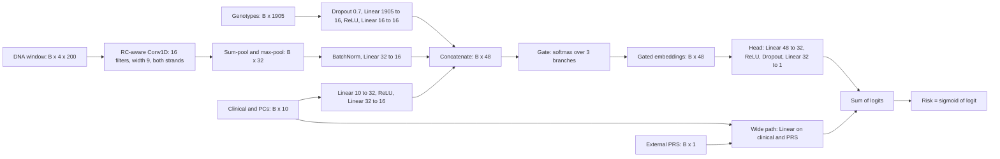

+++
summary = "Design, implement, train and ablate a multimodal network (genotype MLP, reverse-complement-aware DNA CNN, clinical MLP, gated fusion) for CAD risk, and compare it honestly with strong baselines."
+++

# Designing a Deep Learning Model

This is the chapter the track has been building towards: **a new architecture of our own**, designed for our question, built in PyTorch, trained with care and judged against the baselines from [chapter 03](../baselines-prs-and-clinical-models/). We have three kinds of input, each with its own structure:

| Input | Shape per person | Structure | Natural encoder |
|---|---|---|---|
| genotype dosages (+ FH variants) | 1,905 numbers | unordered, mostly tiny effects, $p \gg n_\text{cases}$ | heavily regularised MLP, plus the external PRS as a known-good summary |
| DNA window | $4 \times 200$ one-hot | ordered sequence; meaning comes from local motifs on either strand | 1D CNN with reverse-complement weight sharing |
| clinical + PCs | 10 numbers | dense, strongly predictive, roughly additive on the log-odds scale | small MLP plus a linear "wide" path |

The design principle is **match the encoder to the structure of the data**, then let a fusion layer combine the branches. At the end, we hold ourselves to criterion 5 from [chapter 01](../framing-the-problem/): the deep model must beat a simple model *given the same information*.

> [!NOTE]
> **Recall.** [MLPs](../../neural-networks/from-perceptron-to-mlp/) · [training deep networks](../../neural-networks/training-deep-networks/) (initialisation, normalisation, dropout, Adam) · [CNNs for DNA](../../deep-architectures-for-sequences/convolutional-networks-for-dna/) · [attention](../../deep-architectures-for-sequences/attention-and-transformers/) · [genomic foundation models](../../deep-architectures-for-sequences/genomic-foundation-models/) · [loss functions](../../calculus-and-optimization/loss-functions/) · [one-hot encoding of DNA](../../bioinformatics-algorithms/encoding-dna-for-machine-learning/).

## Key ideas

### The architecture



### Branch 1: genotypes

About 1,900 standardised dosages plus 3 raw FH-variant counts go through `Dropout(0.7) → Linear(1905→16) → ReLU → Dropout → Linear(16→16) → ReLU`. Chapter 03 showed the danger here. With roughly 1,000 training cases, *learning* per-SNP weights from scratch mostly fits noise: the training-split GWAS PRS was nearly useless. So we regularise this branch heavily (strong input dropout, weight decay), and we also hand the network the **external PRS** directly through the wide path. The branch then only has to learn what the PRS misses, such as the effect of FH variants or nonlinear combinations. This "prior knowledge as an input, residual learned" pattern is one of the most useful tricks in applied deep learning.

> [!TIP]
> Gene-level embeddings are a natural upgrade. Aggregate variants per gene (or per pathway) into a learned vector, so that the network shares statistical strength across variants in the same gene. That is closer to biology than a flat 1,905-wide input.

### Branch 2: a reverse-complement-aware CNN

DNA is double-stranded. A transcription-factor motif works on either strand, so a motif detector should respond to `AGGTCACT` and to its reverse complement `AGTGACCT` equally. We can **build this symmetry into the layer** instead of hoping the network learns it.

With channels ordered A, C, G, T, complementing a base maps channel index $c \mapsto 3 - c$ (A↔T, C↔G). Reversing maps position $\ell \mapsto L-1-\ell$. So for a one-hot input $x \in \mathbb{R}^{4\times L}$,

$$
\operatorname{rc}(x)_{c,\ell} = x_{3-c,\ L-1-\ell},
$$

which is just a flip along both axes. For a filter $w \in \mathbb{R}^{4 \times k}$, the convolution score at a window starting at $\ell$ is $\sum_{c,m} w_{c,m}\, x_{c,\ell+m}$. Substituting $c' = 3-c$, $m' = k-1-m$ shows that

$$
\big(w \star \operatorname{rc}(x)\big)\ \text{read backwards} \;=\; \operatorname{rc}(w) \star x .
$$

In words: *scanning the reverse strand with $w$ is the same as scanning the forward strand with the flipped filter.* So `RCConv1d` stacks $[w, \operatorname{rc}(w)]$ into one convolution with $2F$ output channels and takes the element-wise maximum of each pair. Both strands are covered with the same $F$ learned filters, which halves the number of parameters needed to learn each motif.

**Pooling.** The risk in our simulation depends on *how many* intact motif copies a person carries. A **sum pool** over positions counts hits, and a **max pool** asks whether there is any strong hit. We keep both, giving $2F = 32$ features.

**Why BatchNorm is essential here.** Every person shares more than 99% of this window. The pooled features are therefore a huge constant (the background) plus a tiny person-specific part (8 variable sites). Without normalisation, that tiny variation enters the next layer at a scale too small to learn from. In early experiments without it, the sequence branch learned nothing. `BatchNorm1d` subtracts the batch mean and divides by the batch SD. That removes the constant and rescales the informative variation to unit size.

**Diploid input.** Each person has two haplotypes. We average their one-hot encodings, so a heterozygous site has 0.5 in each of two channels. This "dosage one-hot" keeps the input $4 \times L$ and is linear in genotype. The alternative is to run the CNN on each haplotype and add the embeddings, which preserves phase.

### Branch 3: clinical

The 10 standardised clinical inputs (6 risk factors and 4 PCs) go through a small MLP, $10 \to 32 \to 16$. They also go straight to the **wide path**, a single linear layer that, together with the PRS, reproduces the chapter 03 logistic model *inside* the network. This is the *wide and deep* design. The network can never do much worse than logistic regression, because the linear solution is always available. The deep part only has to learn corrections.

### Fusion: gating

Let $\mathbf e_g, \mathbf e_s, \mathbf e_c \in \mathbb{R}^{16}$ be the branch embeddings. The gate computes per-person weights

$$
\boldsymbol\alpha = \operatorname{softmax}\big(W_\text{gate}[\mathbf e_g; \mathbf e_s; \mathbf e_c] + \mathbf b\big) \in \mathbb{R}^3, \qquad
\mathbf f = [3\alpha_1 \mathbf e_g;\ 3\alpha_2 \mathbf e_s;\ 3\alpha_3 \mathbf e_c] \in \mathbb{R}^{48}.
$$

The factor 3 makes uniform gates ($\alpha_k = \tfrac13$) leave the embeddings unchanged. Gating lets the model rely more on one modality for some people than for others. For example, it might lean on the sequence branch for carriers of rare motif variants. It is a lightweight cousin of attention over modalities. The final logit is

$$
z = \text{head}(\mathbf f) + \mathbf v^\top[\mathbf c; \text{PRS}] + v_0, \qquad \hat p = \sigma(z).
$$

### Tensor shapes and parameter count

For a batch of $B = 512$:

| Stage | Shape | Parameters |
|---|---|---|
| genotype input → MLP | $(B, 1905) \to (B,16)$ | $1905\cdot16 + 16 + 16\cdot 16 + 16 = 30{,}768$ |
| DNA input → RC conv | $(B,4,200) \to (B,32,200) \to \max \to (B,16,200)$ | $16\cdot4\cdot9 + 16 = 592$ |
| sum- and max-pool → BN → linear | $(B,32) \to (B,16)$ | $64 + 32\cdot16+16 = 592$ |
| clinical → MLP | $(B,10)\to(B,32)\to(B,16)$ | $352 + 528 = 880$ |
| gate | $(B,48) \to (B,3)$ | $48\cdot 3+3 = 147$ |
| head | $(B,48)\to(B,32)\to(B,1)$ | $1568 + 33 = 1{,}601$ |
| wide | $(B,11) \to (B,1)$ | $12$ |
| **total** | | **34,592** |

Almost 90% of the parameters sit in the first genotype layer. That is exactly where the data is weakest, which is why this branch is the most regularised.

### Training choices

- **Loss with class weighting.** Only about 10% of people are cases. `BCEWithLogitsLoss(pos_weight=w)` with $w = n_\text{neg}/n_\text{pos} \approx 9$ uses
  $$\ell(z, y) = -\big[w\,y\log\sigma(z) + (1-y)\log(1-\sigma(z))\big].$$
  For a person with true risk $p$, the expected loss is minimised where $\frac{d}{dq}\big[-w p\log q - (1-p)\log(1-q)\big] = 0$. That gives $-\frac{wp}{q} + \frac{1-p}{1-q} = 0$, so
  $$\frac{q}{1-q} = w\,\frac{p}{1-p}.$$
  **Class weighting multiplies the predicted odds by $w$.** It shifts every logit by $\log w \approx 2.2$. The ranking (AUC) is unchanged, but the probabilities are badly miscalibrated. We fix this with recalibration in [chapter 05](../evaluation-fairness-and-deployment/).
- **AdamW** (learning rate $10^{-3}$, weight decay 0.1), batches of 512.
- **Early stopping** on validation AUC with patience 6: keep the best weights, stop after 6 epochs without improvement.
- **Ablations.** Retrain from scratch with one branch removed (its embedding replaced by zeros). Removing a branch also removes its wide-path inputs.
- **Seeds.** Training is random (initialisation, batch order, dropout). One extra seed shows how much results move by chance. That tells us how to read ablation differences.

> [!WARNING]
> Early stopping on validation AUC *selects* the luckiest epoch. With validation AUC bouncing by about ±0.005 between epochs, the chosen epoch's validation score is optimistic. That is one reason the test AUC will be lower than the best validation AUC. Only the test set, used once, gives an unbiased number.

## Worked example

**RC convolution by hand.** Take a width-3 filter that detects `AGG`: $w$ has a 1 at (A, position 0), (G, 1) and (G, 2), and zeros elsewhere. Flipping both axes gives $\operatorname{rc}(w)$. Flipping the channel axis turns A into T and G into C, and flipping the positions reverses the order, giving 1s at (C, 0), (C, 1) and (T, 2). That is the pattern `CCT`, which is exactly the reverse complement of `AGG`.

Scan the sequence `TCCTA` (windows `TCC`, `CCT`, `CTA`):

| window | forward score ($w$, `AGG`) | reverse score ($\operatorname{rc}(w)$, `CCT`) | max |
|---|---|---|---|
| TCC | 0 | 1 (middle C) | 1 |
| CCT | 0 | **3** | 3 |
| CTA | 0 | 1 (first C) | 1 |

The forward filter alone would miss this sequence entirely. The RC layer finds a perfect `AGG` on the opposite strand at the second window, using the same three learned weights.

**Gating by hand.** Suppose the gate logits for one person are $(0.2,\ 1.0,\ -0.4)$. Then $e^{0.2} = 1.221$, $e^{1.0} = 2.718$, $e^{-0.4} = 0.670$, with sum $4.610$. So $\boldsymbol\alpha = (0.265,\ 0.590,\ 0.145)$, and the scale factors $3\alpha$ are $(0.795,\ 1.769,\ 0.436)$. For this person the sequence embedding is amplified and the clinical embedding damped. The wide path still carries the clinical signal linearly, so damping the clinical *embedding* does not throw that information away.

**The class-weighting shift by hand.** A person with true risk $p = 0.10$ has odds $1/9$. With $w = 9$, the trained model's odds become $9 \times 1/9 = 1$, so it outputs $q = 0.5$. A 10% risk is displayed as 50%.

## In code

Save the model code as `cad_model.py`. The data loading standardises with training statistics, builds the diploid one-hot window and wraps everything in a `Dataset`. Its `__getitem__` accepts a whole list of indices, so a batch is a single tensor gather.

```python
# cad_model.py: data loading and the multimodal CAD risk network
import numpy as np
import torch
import torch.nn as nn
from torch.utils.data import Dataset


def load_inputs(cohort="cad_cohort.npz", baselines="baseline_preds.npz"):
    """Return a dict of float32 arrays, standardised with TRAINING statistics only."""
    d, b = np.load(cohort), np.load(baselines)
    tr = d["split"] == 0
    X = d["X"]
    geno = (X - X[tr].mean(0)) / (X[tr].std(0) + 1e-6)
    geno = np.hstack([geno, d["fh_variants"]])                 # + raw FH allele counts
    seq = d["seq"]                                              # (N, 2, L) codes 0..3
    onehot = np.eye(4, dtype=np.float32)[seq].mean(1)          # (N, L, 4), het sites = 0.5
    clin = np.column_stack([d["clin"], d["pcs"][:, :4]])
    clin = (clin - clin[tr].mean(0)) / clin[tr].std(0)
    return dict(geno=geno.astype(np.float32), seq=onehot.transpose(0, 2, 1).copy(),
                clin=clin.astype(np.float32), prs=b["prs_ext"].astype(np.float32)[:, None],
                y=d["y"].astype(np.float32), split=d["split"], pop=d["pop"])


class CADDataset(Dataset):
    def __init__(self, arrays, mask):
        self.t = {k: torch.from_numpy(arrays[k][mask]) for k in ("geno", "seq", "clin", "prs", "y")}

    def __len__(self):
        return len(self.t["y"])

    def __getitem__(self, i):
        return {k: v[i] for k, v in self.t.items()}
```

The RC-aware convolution and the sequence branch:

```python
class RCConv1d(nn.Module):
    """Conv1d that scans both DNA strands with the SAME filters and keeps the stronger hit.
    With channels ordered A,C,G,T, the reverse complement of a filter is the filter flipped
    along both axes; scanning x with rc(w) equals scanning rc(x) with w (then flipping back)."""
    def __init__(self, c_in, c_out, k):
        super().__init__()
        self.conv = nn.Conv1d(c_in, c_out, k, padding=k // 2)

    def forward(self, x):                                       # x: (B, 4, L)
        w, b = self.conv.weight, self.conv.bias                 # w: (F, 4, k)
        w_both = torch.cat([w, w.flip(dims=(1, 2))])            # (2F, 4, k): fwd + rc filters
        h = nn.functional.conv1d(x, w_both, torch.cat([b, b]), padding=self.conv.padding)
        fwd, rev = h.chunk(2, dim=1)                            # each (B, F, L)
        return torch.maximum(fwd, rev)


class SequenceBranch(nn.Module):
    def __init__(self, n_filters=16, k=9, d_out=16):
        super().__init__()
        self.conv = RCConv1d(4, n_filters, k)
        # every person shares ~99% of the window, so pooled features are a huge constant plus a
        # tiny person-specific part: BatchNorm rescales that small variation to unit size
        self.proj = nn.Sequential(nn.BatchNorm1d(2 * n_filters), nn.Linear(2 * n_filters, d_out),
                                  nn.ReLU())

    def forward(self, x):
        h = torch.relu(self.conv(x))                            # (B, F, L)
        # sum-pool counts motif hits; max-pool finds the single best hit
        pooled = torch.cat([h.sum(-1), h.amax(-1)], dim=1)         # (B, 2F)
        return self.proj(pooled)                                # (B, d_out)


def mlp(d_in, d_hidden, d_out, p_drop):
    return nn.Sequential(nn.Dropout(p_drop), nn.Linear(d_in, d_hidden), nn.ReLU(),
                         nn.Dropout(p_drop), nn.Linear(d_hidden, d_out), nn.ReLU())
```

The full model with gated fusion and the wide path:

```python
class CADRiskNet(nn.Module):
    """Three branches -> gated fusion -> deep head, plus a 'wide' linear path for
    the inputs we already know are predictive (clinical factors and the external PRS)."""
    BRANCHES = ("geno", "seq", "clin")

    def __init__(self, n_snps, n_clin, d=16, use=BRANCHES):
        super().__init__()
        self.use = set(use)
        self.geno = mlp(n_snps, 16, d, p_drop=0.7)
        self.seq = SequenceBranch(d_out=d)
        self.clin = mlp(n_clin, 32, d, p_drop=0.1)
        self.gate = nn.Linear(3 * d, 3)                         # one weight per branch
        self.head = nn.Sequential(nn.Linear(3 * d, 32), nn.ReLU(), nn.Dropout(0.2),
                                  nn.Linear(32, 1))
        n_wide = (n_clin if "clin" in self.use else 0) + (1 if "geno" in self.use else 0)
        self.wide = nn.Linear(max(n_wide, 1), 1)

    def forward(self, b, return_gates=False):
        zeros = torch.zeros(len(b["y"]), self.gate.in_features // 3)
        e = [getattr(self, k)(b[k]) if k in self.use else zeros for k in self.BRANCHES]
        e_cat = torch.cat(e, dim=1)                             # (B, 3d)
        g = torch.softmax(self.gate(e_cat), dim=1)              # (B, 3), rows sum to 1
        fused = torch.cat([3 * g[:, i:i + 1] * e[i] for i in range(3)], dim=1)
        wide_in = [b["clin"]] if "clin" in self.use else []
        wide_in += [b["prs"]] if "geno" in self.use else []
        wide_in = torch.cat(wide_in, 1) if wide_in else zeros[:, :1]
        logit = self.head(fused).squeeze(1) + self.wide(wide_in).squeeze(1)
        return (logit, g) if return_gates else logit
```

Now `train_dl.py`: the training loop with class weighting and early stopping.

```python
# train_dl.py: train the multimodal model, run ablations, compare with baselines
import copy
import time
import numpy as np
import torch
import torch.nn as nn
from torch.utils.data import DataLoader, BatchSampler, RandomSampler
from sklearn.metrics import roc_auc_score, average_precision_score
from cad_model import load_inputs, CADDataset, CADRiskNet

torch.set_num_threads(4)
A = load_inputs()
tr, va, te = (A["split"] == s for s in (0, 1, 2))
y = A["y"]


def predict(model, ds):
    model.eval()
    with torch.no_grad():
        return torch.sigmoid(model(ds.t)).numpy()


def train(use=CADRiskNet.BRANCHES, seed=0, max_epochs=40, patience=6, verbose=False):
    torch.manual_seed(seed)
    ds_tr, ds_va = CADDataset(A, tr), CADDataset(A, va)
    model = CADRiskNet(A["geno"].shape[1], A["clin"].shape[1], use=use)
    pos_weight = torch.tensor((1 - y[tr].mean()) / y[tr].mean())   # about 9: class weighting
    loss_fn = nn.BCEWithLogitsLoss(pos_weight=pos_weight)
    opt = torch.optim.AdamW(model.parameters(), lr=1e-3, weight_decay=0.1)
    # a BatchSampler hands __getitem__ a whole list of indices: one tensor gather per batch
    loader = DataLoader(ds_tr, batch_size=None,
                        sampler=BatchSampler(RandomSampler(ds_tr), batch_size=512, drop_last=False))
    best_auc, best_state, bad_epochs = -1, None, 0
    for epoch in range(max_epochs):
        model.train()
        for batch in loader:
            opt.zero_grad()
            loss = loss_fn(model(batch), batch["y"])
            loss.backward()
            opt.step()
        val_auc = roc_auc_score(y[va], predict(model, ds_va))
        if verbose:
            print(f"  epoch {epoch:2d}  last-batch loss {loss.item():.3f}  val AUC {val_auc:.4f}")
        if val_auc > best_auc:                                  # early stopping on val AUC
            best_auc, best_state, bad_epochs = val_auc, copy.deepcopy(model.state_dict()), 0
        else:
            bad_epochs += 1
            if bad_epochs >= patience:
                break
    model.load_state_dict(best_state)
    return model, best_auc, epoch + 1
```

Check the shapes and parameter count, then train the full model:

```python
model = CADRiskNet(A["geno"].shape[1], A["clin"].shape[1])
batch = CADDataset(A, tr)[:4]
print({k: tuple(v.shape) for k, v in batch.items()})
for name in ("geno", "seq", "clin", "gate", "head", "wide"):
    print(f"  {name:5s}: {sum(p.numel() for p in getattr(model, name).parameters()):6d} parameters")
print(f"  total: {sum(p.numel() for p in model.parameters())} parameters")

t0 = time.time()
model, val_auc, n_ep = train(verbose=True)
print(f"full model: best val AUC {val_auc:.3f} after {n_ep} epochs ({time.time() - t0:.0f}s)")
torch.save(model.state_dict(), "cad_model.pt")
```

```text
{'geno': (4, 1905), 'seq': (4, 4, 200), 'clin': (4, 10), 'prs': (4, 1), 'y': (4,)}
  geno :  30768 parameters
  seq  :   1184 parameters
  clin :    880 parameters
  gate :    147 parameters
  head :   1601 parameters
  wide :     12 parameters
  total: 34592 parameters
  epoch  0  last-batch loss 1.177  val AUC 0.5556
  epoch  1  last-batch loss 1.452  val AUC 0.6291
  epoch  2  last-batch loss 1.193  val AUC 0.7102
  ... (epochs 3 to 18 omitted) ...
  epoch 19  last-batch loss 0.650  val AUC 0.7707
  epoch 20  last-batch loss 0.655  val AUC 0.7723
  epoch 21  last-batch loss 1.132  val AUC 0.7714
full model: best val AUC 0.775 after 22 epochs (29s)
```

Ablations, a second seed, and the honest baselines:

```python
def test_metrics(p):
    out = [roc_auc_score(y[te], p[te]), average_precision_score(y[te], p[te])]
    return out + [roc_auc_score(y[te & (A["pop"] == k)], p[te & (A["pop"] == k)]) for k in range(3)]


everyone = CADDataset(A, np.ones_like(tr))
p_full = predict(model, everyone)
results = {"multimodal (all branches)": test_metrics(p_full)}
for drop in CADRiskNet.BRANCHES:                                # ablations: retrain without one
    m, _, _ = train(use=[b for b in CADRiskNet.BRANCHES if b != drop])
    results[f"  without {drop} branch"] = test_metrics(predict(m, everyone))
m, _, _ = train(seed=1)                                         # seed-to-seed variation
p_seed1 = predict(m, everyone)
results["  full model, seed 1"] = test_metrics(p_seed1)
results["  average of seeds 0 and 1"] = test_metrics((p_full + p_seed1) / 2)

# an honest baseline: logistic regression that ALSO sees the window variants as dosages
from sklearn.linear_model import LogisticRegression
d = np.load("cad_cohort.npz")
alt = (d["seq"][:, :, d["sites"]] != np.array([{"A": 0, "C": 1, "G": 2, "T": 3}[b]
       for b in d["ref"][d["sites"]]])).sum(1)                 # (N, 8) window-site dosages
F = np.column_stack([A["clin"], A["prs"], d["fh_variants"].sum(1), alt])
lr = LogisticRegression(max_iter=2000).fit(F[tr], y[tr])
results["logistic: clin+PRS+FH+window SNPs"] = test_metrics(lr.predict_proba(F)[:, 1])
b = np.load("baseline_preds.npz")
results["logistic: clin+PRS+FH (ch. 03)"] = test_metrics(b["clin_prs_ext"])
results["oracle (true risk)"] = test_metrics(b["oracle"])

print(f"{'model':36s} {'AUC':>6s} {'PR-AUC':>7s} {'AUC_A':>6s} {'AUC_B':>6s} {'AUC_C':>6s}")
for name, r in results.items():
    print(f"{name:36s} " + " ".join(f"{v:6.3f}" for v in r))
np.savez("dl_preds.npz", p_full=p_full,
         p_lr_window=lr.predict_proba(F)[:, 1])
```

The whole script takes about 2 minutes on a laptop CPU:

```text
model                                   AUC  PR-AUC  AUC_A  AUC_B  AUC_C
multimodal (all branches)             0.735  0.256  0.741  0.722  0.699
  without geno branch                 0.728  0.254  0.735  0.730  0.658
  without seq branch                  0.724  0.237  0.723  0.724  0.694
  without clin branch                 0.650  0.174  0.670  0.610  0.597
  full model, seed 1                  0.749  0.252  0.764  0.721  0.697
  average of seeds 0 and 1            0.746  0.258  0.756  0.724  0.706
logistic: clin+PRS+FH+window SNPs     0.763  0.301  0.774  0.741  0.714
logistic: clin+PRS+FH (ch. 03)        0.747  0.268  0.755  0.728  0.701
oracle (true risk)                    0.779  0.335  0.782  0.772  0.753
```

### Reading the results honestly

| Model | Test AUC | PR-AUC |
|---|---|---|
| multimodal, seed 0 | 0.735 | 0.256 |
| multimodal, seed 1 | 0.749 | 0.252 |
| multimodal, average of 2 seeds | 0.746 | 0.258 |
| logistic: clinical + PCs + PRS + FH (chapter 03) | 0.747 | 0.268 |
| gradient boosting (chapter 03) | 0.749 | 0.272 |
| **logistic: clinical + PCs + PRS + FH + 8 window-SNP dosages** | **0.763** | **0.301** |
| oracle | 0.779 | 0.335 |

1. **Seed noise is as large as the effects we want to measure.** Two runs of the same model differ by 0.014 AUC. The ablation differences (−0.007 without the genotype branch, −0.011 without the sequence branch) are the same size. Without several seeds and a bootstrap, we cannot claim that either branch helps. Only the clinical branch is unambiguous: removing it drops the AUC to 0.650.
2. **The deep model ties the chapter 03 logistic model.** The 2-seed average (0.746) is indistinguishable from logistic regression on clinical + PRS + FH (0.747) and from boosting (0.749).
3. **The decisive comparison is the logistic model that also sees the window variants.** Logistic regression with the 8 window-SNP dosages added reaches **0.763**, clearly better than every deep run. So the window *does* carry real information (+0.016 AUC), and a linear model extracts it more efficiently than our CNN, which must discover the motif from about 1,000 cases.
4. **Verdict against criterion 5: not met.** On this data, we would recommend the logistic model with window-variant dosages over the network. That is a successful research outcome. We learned *what* information matters, and that the architecture is not yet worth its complexity at this sample size.

Why did the simple model win? Our simulation makes risk **additive** on the log-odds scale and the window's effect a simple count of motif copies. That is exactly the functional form logistic regression assumes. A CNN pays off when (i) the relevant variants are *not* known in advance (any mutation could create or destroy a motif, so you cannot hand-pick 8 dosages); (ii) effects are nonlinear or interact, such as motif spacing or combinations of transcription factors; (iii) many loci are modelled at once, so filters are shared and learned from far more data; or (iv) the network starts from pretrained sequence representations.

> [!CAUTION]
> Never report only the run that looked best. Pre-specify the number of seeds, report the mean and spread, and compare with the strongest simple baseline given *identical inputs*. Many published "deep learning beats clinical scores" claims fall apart under exactly these checks.

### Extending the design

- **Pretrained DNA foundation-model embeddings.** Replace the from-scratch CNN with a frozen [genomic foundation model](../../deep-architectures-for-sequences/genomic-foundation-models/). Compute the embedding of each person's window, or better, the *difference* between alternative- and reference-allele embeddings for each variant, and feed that to a small trainable head. The pretrained model has already learned regulatory "grammar" from millions of sequences, so 1,000 cases only need to teach it *which* signals matter for CAD.
- **Survival (time-to-event) loss.** A binary label throws away *when* events happen and mistreats censored people. Use the network output $\eta_i$ as the log-hazard in a Cox model and minimise the negative **partial log-likelihood**:
  $$\mathcal L = -\sum_{i:\,\delta_i = 1}\Big[\eta_i - \log\!\!\sum_{j:\,t_j \ge t_i}\! e^{\eta_j}\Big],$$
  where $\delta_i = 1$ marks an observed event and the inner sum runs over everyone still at risk at time $t_i$. This is the DeepSurv approach. It produces risk over any horizon, including 10-year and lifetime risk.
- **Multi-task learning.** Add heads that predict LDL, blood pressure, or related outcomes (stroke, peripheral artery disease) from the shared trunk. These auxiliary targets have far more signal per person than a rare binary outcome, which can regularise the genotype and sequence branches.
- **Attention fusion.** Treat the three embeddings as tokens and apply one [self-attention](../../deep-architectures-for-sequences/attention-and-transformers/) layer. This generalises our gate and lets you add modalities later (ECG, imaging, proteomics) without redesigning the head.

## Biomedical connection

Multimodal models that combine genomic and clinical data are an active area of cardiovascular research. Honest evaluations often find that most of the predictive signal comes from a few well-understood inputs (age, sex, lipids, blood pressure, smoking, diabetes, and a PRS). Gains from more complex architectures have to be demonstrated, not assumed. Sequence-based models such as DeepSEA, Basset and Enformer are powerful for *molecular* prediction tasks (chromatin, expression) because they train on many loci. Using their predictions as features for variants near CAD-associated genes, rather than learning sequence features from scratch on a disease label, is a realistic way to bring regulatory biology into risk prediction.

## Practice

1. Verify the parameter count of `SequenceBranch` with 16 filters of width 9 and $d_\text{out} = 16$.

<details>
<summary>Answer</summary>

Conv: $16 \times 4 \times 9 = 576$ weights + 16 biases = 592. (The reverse-complement filters reuse these weights, so they add none.) BatchNorm over 32 features: 32 scales + 32 shifts = 64. Linear $32 \to 16$: $512 + 16 = 528$. Total $592 + 64 + 528 = 1{,}184$. That matches the printed count.

</details>

2. With `pos_weight` $w = 4$, what probability will a perfectly trained model output for a person whose true risk is 20%?

<details>
<summary>Answer</summary>

True odds $= 0.2/0.8 = 0.25$. Weighted odds $= 4 \times 0.25 = 1$, so $q = 0.5$.

</details>

3. Using the reverse-complement rule, what is $\operatorname{rc}$ of the motif `AGGTCACT`? Check that it matches the reverse-strand copy planted in chapter 02.

<details>
<summary>Answer</summary>

Complement: `TCCAGTGA`; reverse: `AGTGACCT`. Chapter 02 planted `AGTGACC` + `A` at positions 40–47, and site 1 changes the final A to T, creating a full `AGTGACCT`.

</details>

4. The ablation "without seq branch" scores 0.724 and the full model 0.735. A classmate concludes that the sequence branch adds 0.011 AUC. Design a better experiment.

<details>
<summary>Answer</summary>

Train each configuration with several seeds (for example 5–10). Report the mean and SD of test AUC (or, better, validation AUC while still designing). Compare the paired difference using the same seeds and a paired bootstrap over test people. Also compare with logistic regression with and without the window dosages, which estimates how much information the window holds (here about 0.016).

</details>

5. Our CNN's input averages two haplotypes. Construct a case where this loses information that a per-haplotype CNN would keep.

<details>
<summary>Answer</summary>

Suppose risk depends on two variants being on the **same** haplotype: for example, one variant creates a motif only if a nearby variant does not destroy it on that copy. A double heterozygote in *cis* (both on one haplotype) and one in *trans* (one on each) give the same averaged one-hot input but different biology. Running the CNN on each phased haplotype and summing the embeddings would tell them apart.

</details>

## Further reading

- Cheng HT, et al. "Wide & deep learning for recommender systems." *Proceedings of the 1st Workshop on Deep Learning for Recommender Systems* (2016).
- Shrikumar A, Greenside P, Kundaje A. "Reverse-complement parameter sharing improves deep learning models for genomics." bioRxiv (2017).
- Zhou J, Troyanskaya OG. "Predicting effects of noncoding variants with deep learning–based sequence model." *Nature Methods* (2015). DeepSEA.
- Avsec Ž, et al. "Effective gene expression prediction from sequence by integrating long-range interactions." *Nature Methods* (2021). Enformer.
- Katzman JL, et al. "DeepSurv: personalized treatment recommender system using a Cox proportional hazards deep neural network." *BMC Medical Research Methodology* (2018).
- Ioffe S, Szegedy C. "Batch normalization: accelerating deep network training by reducing internal covariate shift." *ICML* (2015).
- Loshchilov I, Hutter F. "Decoupled weight decay regularization." *ICLR* (2019). AdamW.
