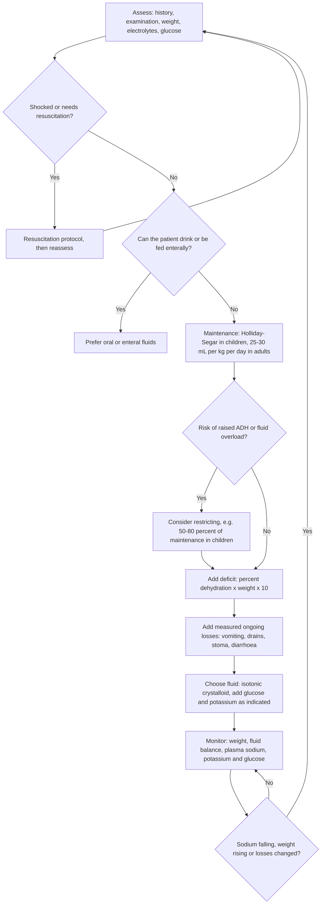

+++
summary = "Derive and apply the Holliday–Segar maintenance-fluid formula in its daily (100/50/20) and hourly (4-2-1) forms, add deficit, ongoing losses and Parkland burns volumes, and know why modern guidelines use isotonic fluid."
+++

# Maintenance Fluids and the Holliday–Segar Method

Almost every child admitted to hospital who cannot drink gets an intravenous fluid prescription, and many adults do too. The volume is nearly always worked out with one small formula published in 1957: **100 mL/kg/day for the first 10 kg, 50 mL/kg/day for the next 10 kg, and 20 mL/kg/day for every kilogram above that**. Its hourly cousin, the **4-2-1 rule**, is one of the first things a junior doctor memorises.

The formula is easy to use and easy to misuse. This chapter derives it from energy expenditure, shows that the daily and hourly forms agree only approximately (and exactly where they disagree), and puts it in its proper place in a full fluid plan: resuscitation, then **maintenance + deficit + ongoing losses**, then the choice of fluid, then monitoring. It also explains why the fluid that Holliday and Segar's numbers originally led to, a hypotonic saline solution, is no longer recommended for most children.

> [!CAUTION]
> The worked examples here teach arithmetic, not prescribing. Fluid prescriptions depend on the patient in front of you, on their electrolytes and on local policy. Always check volumes and fluid choice against the current guideline in use where you work (for example NICE NG29 for children, NICE CG174 for adults, the AAP 2018 guideline, or your hospital protocol), and have the prescription independently double-checked. Neonates, children with heart, kidney or liver disease, and patients with burns, diabetic ketoacidosis or raised intracranial pressure need specialist protocols.

You will need the unit skills from [units, concentrations and conversions](../../clinical-mathematics/units-concentrations-and-conversions/) and the body-weight ideas from [weight and body-size based dosing](../../clinical-mathematics/weight-and-body-size-based-dosing/). Turning mL/h into a drip rate is covered in [infusions and drip rates](../../clinical-mathematics/infusions-and-drip-rates/).

## Key ideas

### Where the formula comes from

Malcolm Holliday and William Segar (1957) started from a simple observation: **water need tracks energy use**. Burning food produces heat that must be lost, partly by evaporating water from skin and lungs, and burning food produces waste solutes that the kidneys must excrete in water. So they first estimated how much energy a hospitalised child spends per day, as a function of weight, and then converted energy to water.

**Step 1: energy.** From published data on energy expenditure, they approximated the daily energy use of a resting hospitalised child by a piecewise-linear curve:

| Body weight band | Energy expenditure |
|---|---|
| first 10 kg | 100 kcal per kg per day |
| next 10 kg (10–20 kg) | 50 kcal per kg per day |
| each kg above 20 kg | 20 kcal per kg per day |

The rate per kilogram falls as children grow because small bodies have more surface area per kilogram and a higher metabolic rate per kilogram.

**Step 2: water per unit energy.** As usually summarised, each 100 kcal spent costs roughly:

- about 50 mL lost through skin and breath (insensible losses),
- about 67 mL of urine to excrete the solute load at a concentration close to that of plasma,
- minus about 17 mL of water *made* by oxidising food (water of oxidation).

Net: $50 + 67 - 17 \approx 100$ mL. So **1 mL of water per kcal**, or 100 mL per 100 kcal. Because the conversion factor is 1, the energy table becomes a water table with the units changed from kcal to mL.

> [!IMPORTANT]
> **Holliday–Segar, daily form** (weight $w$ in kg, result in mL/day):
> $$D(w) = \begin{cases} 100\,w & w \le 10 \\ 1000 + 50\,(w-10) & 10 < w \le 20 \\ 1500 + 20\,(w-20) & w > 20 \end{cases}$$

Multiplying out the brackets gives a form that is quicker to use at the bedside: $D = 100w$, then $D = 50w + 500$, then $D = 20w + 1100$.

Holliday and Segar also proposed electrolyte needs per 100 kcal (about 3 mmol sodium and 2 mmol potassium per 100 kcal per day). Put 3 mmol of sodium into 100 mL of water and you get about 30 mmol/L, far below plasma sodium (about 135–145 mmol/L). That is where the long tradition of **hypotonic** maintenance fluids came from. We return to why that changed below.

### The hourly 4-2-1 rule

Fluids are run on pumps in mL/h, so divide by 24:

$$
\frac{100}{24} \approx 4.17, \qquad \frac{50}{24} \approx 2.08, \qquad \frac{20}{24} \approx 0.83 .
$$

Round each to a whole number and you get **4, 2 and 1 mL/kg/h**.

> [!IMPORTANT]
> **Holliday–Segar, hourly form (4-2-1 rule)** (result in mL/h):
> $$R(w) = \begin{cases} 4\,w & w \le 10 \\ 40 + 2\,(w-10) & 10 < w \le 20 \\ 60 + (w-20) & w > 20 \end{cases}$$
> Simplified: $R = 4w$, then $R = 2w + 20$, then $R = w + 40$.

The last line is worth remembering: **above 20 kg, the 4-2-1 rate is weight plus 40 mL/h.** A 30 kg child gets 70 mL/h, a 50 kg teenager 90 mL/h.

### How far apart are the two forms?

Rounding 4.17 down to 4 and 2.08 down to 2 makes the hourly form slightly *low* for small children. Rounding 0.83 *up* to 1 makes it slightly *high* for bigger ones. To see exactly how much, compare a day's worth of the hourly rate, $24R(w)$, with $D(w)$:

$$
24R(w) - D(w) = \begin{cases} 96w - 100w = -4w & w \le 10 \\ (48w + 480) - (50w + 500) = -2w - 20 & 10 < w \le 20 \\ (24w + 960) - (20w + 1100) = 4w - 140 & w > 20 \end{cases}
$$

- Up to 20 kg, the hourly form gives exactly **4% less** than the daily form. (Check: $-4w / 100w = -4\%$, and at 15 kg, $-50/1250 = -4\%$; in fact $-(2w+20)/(50w+500) = -2/50$ for every $w$ in the band.)
- Above 20 kg the gap $4w - 140$ shrinks, is **zero at exactly 35 kg**, and then grows: $+140$ mL/day at 70 kg ($+5.6\%$), $+340$ mL/day at 120 kg ($+9.7\%$).

So the two forms agree within a few per cent across childhood, which is well inside the uncertainty of the estimate itself. The disagreement only becomes noticeable in adult-sized patients, and by then you should not be using either form uncritically (see below).

> [!TIP]
> Do a mental cross-check every time: "about 100 mL/kg/day for a baby, about 4 mL/kg/h", and "an adult-sized teenager tops out somewhere around 100 mL/h". If your answer for a school-age child is 300 mL/h, you have probably multiplied the full weight by 4.

### From maintenance to a full fluid plan

Maintenance is only one of several pieces. A useful way to think about it is as a sum of separate volumes, each with its own reason:

$$
\text{fluid prescribed} = \text{maintenance} + \text{deficit replacement} + \text{ongoing losses},
$$

with **resuscitation** for shock handled first and separately, by a different protocol. The flowchart summarises the order of decisions.



### Deficit

If a child has lost fluid before admission, estimate the **deficit** from the percentage dehydration. One kilogram of body weight lost acutely is about one litre of water, so $p\%$ of $w$ kg is

$$
\text{deficit (mL)} = \frac{p}{100} \times w \times 1000 = p \times w \times 10 .
$$

> [!IMPORTANT]
> **Deficit (mL) = % dehydration × weight (kg) × 10.** A 10 kg child who is 5% dehydrated has lost about $5 \times 10 \times 10 = 500$ mL.

The best estimate of $p$ comes from a recent pre-illness weight: $p = 100 \times (\text{pre-illness} - \text{current}) / \text{pre-illness}$. Clinical signs give only a rough band. How fast the deficit is replaced (often over 24 hours, more slowly in hypernatraemic dehydration and in diabetic ketoacidosis) is set by guidelines, not by arithmetic.

### Ongoing losses

Losses that continue after admission (vomiting, nasogastric aspirate, diarrhoea, drain or stoma output, polyuria) are **measured** and replaced on top, typically volume for volume with a fluid whose electrolyte content resembles what is being lost, over a defined period. Write them on the fluid chart as a separate line so they are not lost in the maintenance figure.

### Burns: the Parkland formula

Major burns leak plasma for the first day, and resuscitation volumes are far larger than maintenance. The **Parkland formula** (Baxter and Shires, 1968) estimates the crystalloid (usually Hartmann's solution or Ringer's lactate) needed in the first 24 hours:

> [!IMPORTANT]
> **Parkland:** volume (mL in 24 h) = $4 \times$ weight (kg) $\times$ %TBSA burned.
> Give **half in the first 8 hours from the time of the burn** (not from arrival), and the other half over the next 16 hours.

Only partial- and full-thickness burns count towards %TBSA; superficial (epidermal) erythema does not. The formula is a *starting* estimate: the rate is titrated to urine output and clinical response, and over-resuscitation ("fluid creep") is a recognised harm. Some current guidance (for example ATLS, 10th edition) starts lower, at 2 mL/kg/%TBSA in adults. In children, burns protocols usually give maintenance fluid with glucose *in addition* to the resuscitation volume. Which burns need formal resuscitation is decided by the threshold set by your burns network.

### Restricting fluid when ADH is high

Many hospitalised patients secrete antidiuretic hormone (ADH) for reasons other than low blood volume: pain, nausea, surgery, pneumonia, meningitis and other CNS disease, bronchiolitis, and some drugs. This is the setting of the **syndrome of inappropriate ADH (SIADH)**. The kidneys then hold on to free water, and full Holliday–Segar volumes, especially of hypotonic fluid, can drive the plasma sodium down. NICE NG29 advises considering restricting maintenance to **50–80% of the routine volume** in children and young people at risk of water retention, with close monitoring of sodium.

### The modern caveats: isotonic fluid, adults and neonates

**Isotonic, not hypotonic.** Following Holliday and Segar's sodium estimate, children were for decades given fluids such as 0.18% or 0.2% saline with glucose. Because of non-osmotic ADH release, many developed **hospital-acquired (iatrogenic) hyponatraemia**, and some died of hyponatraemic encephalopathy. The evidence led to a change:

- The **AAP 2018 clinical practice guideline** (Feld et al.) recommends that patients aged 28 days to 18 years needing maintenance IV fluid receive **isotonic** solutions with appropriate potassium chloride and dextrose, because these significantly decrease the risk of hyponatraemia. It excludes several groups (for example neonates, and children with neurosurgical disorders, congenital or acquired heart disease, hepatic disease, cancer, renal dysfunction, diabetes insipidus, voluminous watery diarrhoea or severe burns).
- **NICE NG29** (children and young people) recommends isotonic crystalloids containing sodium in the range 131–154 mmol/L for routine maintenance, uses the Holliday–Segar formula for the volume, and recommends measuring plasma electrolytes and glucose when starting IV fluids and at least every 24 hours after that.

So the Holliday–Segar formula survives as a guide to **volume**. Its sodium content does not.

**Adults.** Holliday–Segar was built on children's energy data. Applied to a 70 kg adult it gives 2,500 mL/day (or 110 mL/h by 4-2-1). **NICE CG174** instead suggests **25–30 mL/kg/day** of water for routine adult maintenance, about 1,750–2,100 mL/day at 70 kg, along with roughly 1 mmol/kg/day each of sodium, potassium and chloride and 50–100 g/day of glucose. It advises considering a lower 20–25 mL/kg/day for patients who are older or frail, have renal impairment or cardiac failure, or are malnourished and at risk of refeeding syndrome, and adjusting the prescription to ideal body weight in obesity.

**Neonates are different.** Term and preterm babies in the first weeks of life have rapidly changing water needs, high insensible losses (especially preterm babies under radiant warmers), and immature kidneys. Their fluids follow separate **day-of-life protocols** set by neonatal units. Holliday–Segar is not used for them, and this chapter deliberately gives no neonatal volumes.

## Worked examples

All maintenance volumes below assume a well-hydrated patient with no special risk, and are the *arithmetic* only.

### 1. An infant, 3 kg (beyond the neonatal period)

A 2-month-old ex-preterm baby weighs 3 kg.

- Daily form: $100 \times 3 = 300$ mL/day, so $300/24 = 12.5$ mL/h.
- 4-2-1: $4 \times 3 = 12$ mL/h. That is $12 \times 24 = 288$ mL/day, 4% less.

Sanity check: about 100 mL/kg/day. ✓ Had this baby been 3 days old, neither number would apply: use the neonatal protocol. (Some units also keep ex-preterm infants on neonatal fluid protocols until near term-corrected age; follow local policy.)

### 2. An infant, 8 kg

- Daily: $100 \times 8 = 800$ mL/day, $800/24 \approx 33.3$ mL/h.
- 4-2-1: $4 \times 8 = 32$ mL/h.

### 3. A toddler, 15 kg

- Daily: $1000 + 50 \times 5 = 1{,}250$ mL/day, $1250/24 \approx 52.1$ mL/h. (Or $50 \times 15 + 500 = 1{,}250$.)
- 4-2-1: $40 + 2 \times 5 = 50$ mL/h. (Or $2 \times 15 + 20 = 50$.)

**Adding a deficit.** Suppose this child is judged 5% dehydrated from gastroenteritis, is not shocked, and the local protocol replaces the deficit over 24 hours.

- Deficit: $5 \times 15 \times 10 = 750$ mL.
- Maintenance: 1,250 mL.
- Total over 24 h: $1250 + 750 = 2{,}000$ mL, so $2000/24 \approx 83.3$ mL/h, plus any measured ongoing losses on top.

### 4. A school-age child, 25 kg

- Daily: $1500 + 20 \times 5 = 1{,}600$ mL/day, $1600/24 \approx 66.7$ mL/h.
- 4-2-1: $25 + 40 = 65$ mL/h.

**If at risk of raised ADH** (say, admitted with pneumonia), restricting to 50–80% gives $800$–$1{,}280$ mL/day, about $33$–$53$ mL/h, with plasma sodium checked closely.

### 5. An adolescent, 45 kg

- Daily: $1500 + 20 \times 25 = 2{,}000$ mL/day, $2000/24 \approx 83.3$ mL/h.
- 4-2-1: $45 + 40 = 85$ mL/h. Now the hourly form is the *larger* one (by 2%), because we are past the 35 kg crossover.

### 6. An adult, 70 kg

- Holliday–Segar daily: $1500 + 20 \times 50 = 2{,}500$ mL/day, $\approx 104.2$ mL/h.
- 4-2-1: $70 + 40 = 110$ mL/h, i.e. 2,640 mL/day.
- NICE CG174: $25$–$30 \times 70 = 1{,}750$–$2{,}100$ mL/day, i.e. about $72.9$–$87.5$ mL/h.

The paediatric formula gives about 20–40% more than the adult guideline. This is the main reason not to extend Holliday–Segar to adults without thinking.

### 7. An older adult with renal impairment, 60 kg

An 82-year-old woman with chronic kidney disease weighing 60 kg cannot drink after a stroke while a swallow assessment is pending. CG174 suggests considering the lower range of 20–25 mL/kg/day:

$$
20 \times 60 = 1{,}200 \text{ mL/day} \;(50 \text{ mL/h}), \qquad 25 \times 60 = 1{,}500 \text{ mL/day} \;(62.5 \text{ mL/h}).
$$

Holliday–Segar would have given 2,400 mL/day (100 mL/h), double the lower figure. Daily weights and electrolytes matter even more here.

### 8. An obese adult, 120 kg, 170 cm, male

Using actual weight at 25–30 mL/kg/day would give 3,000–3,600 mL/day, which is more than an adult of this height needs. CG174 advises adjusting to ideal body weight. Devine IBW for a man (see [weight and body-size based dosing](../../clinical-mathematics/weight-and-body-size-based-dosing/)):

$$
\text{IBW} = 50 + 2.3 \times \left(\frac{170}{2.54} - 60\right) = 50 + 2.3 \times 6.93 \approx 65.9 \text{ kg}.
$$

Then $25$–$30 \times 65.9 \approx 1{,}648$–$1{,}978$ mL/day, about $69$–$82$ mL/h.

### 9. Burns: an adult, 70 kg, 30% TBSA

The patient arrives 2 hours after the burn.

- Parkland total: $4 \times 70 \times 30 = 8{,}400$ mL in the first 24 hours from the burn.
- First half: 4,200 mL due by hour 8 after the burn. Six hours remain, so $4200 / 6 = 700$ mL/h (minus anything already given pre-hospital).
- Second half: $4200 / 16 = 262.5$ mL/h for the next 16 hours.
- Then titrate to urine output (commonly targeted at about 0.5 mL/kg/h in adults and about 1 mL/kg/h in smaller children) and clinical state.

A common error is to start the 8-hour clock at arrival. Starting it at hour 2 would give $4200/8 = 525$ mL/h, under-resuscitating in the period that matters most.

## Sanity checks and common errors

- **Banded, not flat.** The 50 and 20 apply only to the kilograms *in that band*. Multiplying a 25 kg child's whole weight by 20 gives 500 mL/day, a third of the right answer. Multiplying by 100 gives 2,500.
- **Hours vs days.** 4-2-1 gives mL/**h**; 100/50/20 gives mL/**day**. A result like "1,250 mL/h" for a toddler is a units slip.
- **Ceiling.** Children do not need more than an adult. Many units cap paediatric maintenance at an adult volume, and obese children are usually prescribed on a lower weight. Follow local guidance.
- **Isotonic by default.** The volume formula is from 1957; the choice of fluid is not. Use the isotonic fluid your guideline recommends, with glucose and potassium as indicated.
- **Count everything.** IV drugs, flushes and feeds are fluid too. In small children they can be a large fraction of the total.
- **Deficit uses percentage, not fraction.** $5\% \times 15 \text{ kg} \times 10 = 750$ mL. Using 0.05 instead of 5 gives 7.5 mL.
- **Burns clock starts at the burn.** Subtract fluids already given and the time already elapsed.
- **Reassess.** Any formula is a starting point. Weight, fluid balance, sodium and glucose tell you whether it was right.

## In code

The function below returns the daily volume and both hourly forms for any weight. It refuses impossible weights and neonates, and two helpers cover adults and deficits. A third does Parkland, catching up within the first 8 hours from the burn.

```python
def holliday_segar(weight_kg, age_days=None):
    """Holliday-Segar maintenance water for a child: (mL/day, mL/h daily form, mL/h 4-2-1 form).

    Teaching tool only. Refuses neonates and impossible weights.
    """
    if not isinstance(weight_kg, (int, float)) or not 0.5 <= weight_kg <= 250:
        raise ValueError(f"implausible weight: {weight_kg!r} kg")
    if age_days is not None and age_days < 28:
        raise ValueError("neonate: use the neonatal day-of-life fluid protocol instead")
    w = weight_kg
    if w <= 10:
        per_day, per_hour_421 = 100 * w, 4 * w
    elif w <= 20:
        per_day, per_hour_421 = 1000 + 50 * (w - 10), 40 + 2 * (w - 10)
    else:
        per_day, per_hour_421 = 1500 + 20 * (w - 20), 60 + (w - 20)
    return per_day, per_day / 24, per_hour_421

def adult_maintenance(weight_kg, ml_per_kg_day=(25, 30)):
    """NICE CG174-style adult range in mL/h (use ideal body weight if obese)."""
    if not 30 <= weight_kg <= 250:
        raise ValueError(f"implausible adult weight: {weight_kg!r} kg")
    lo, hi = ml_per_kg_day
    return lo * weight_kg / 24, hi * weight_kg / 24

def deficit_ml(weight_kg, percent_dehydration):
    if not 0 <= percent_dehydration <= 15:
        raise ValueError("percent dehydration outside 0-15: re-assess")
    return percent_dehydration * weight_kg * 10

def parkland(weight_kg, tbsa_percent, hours_since_burn=0.0, ml_per_kg_pct=4):
    """Parkland volume over 24 h from the time of the burn; returns (total, rate1, rate2)."""
    if not 0 < tbsa_percent <= 100 or not 0 <= hours_since_burn < 8:
        raise ValueError("check %TBSA and time since burn")
    total = ml_per_kg_pct * weight_kg * tbsa_percent
    rate_first = (total / 2) / (8 - hours_since_burn)   # catch up within 8 h of the burn
    rate_next = (total / 2) / 16
    return total, rate_first, rate_next

print(f"{'kg':>5} {'mL/day':>7} {'mL/h (daily/24)':>16} {'mL/h (4-2-1)':>13} {'diff %':>7}")
for w in [3, 8, 15, 25, 35, 45, 70]:
    d, h_daily, h_421 = holliday_segar(w)
    print(f"{w:>5} {d:>7.0f} {h_daily:>16.1f} {h_421:>13.0f} {100*(h_421-h_daily)/h_daily:>+7.1f}")

print("adult 70 kg, mL/h:", [round(x, 1) for x in adult_maintenance(70)])
print("deficit, 15 kg at 5%:", deficit_ml(15, 5), "mL")
print("Parkland 70 kg, 30%, 2 h late:", [round(x, 1) for x in parkland(70, 30, 2)])
for bad in [(0,), (8, 3)]:
    try:
        holliday_segar(*bad)
    except ValueError as e:
        print("refused:", e)
```

Output:

```text
   kg  mL/day  mL/h (daily/24)  mL/h (4-2-1)  diff %
    3     300             12.5            12    -4.0
    8     800             33.3            32    -4.0
   15    1250             52.1            50    -4.0
   25    1600             66.7            65    -2.5
   35    1800             75.0            75    +0.0
   45    2000             83.3            85    +2.0
   70    2500            104.2           110    +5.6
adult 70 kg, mL/h: [72.9, 87.5]
deficit, 15 kg at 5%: 750 mL
Parkland 70 kg, 30%, 2 h late: [8400, 700.0, 262.5]
refused: implausible weight: 0 kg
refused: neonate: use the neonatal day-of-life fluid protocol instead
```

The table reproduces every worked example, and the "diff %" column shows the derivation in numbers: exactly −4% up to 20 kg, zero at 35 kg, then positive. Turning this into a laminated weight-band chart, with rounding and caps, is the subject of [building your own clinical scales](../../clinical-mathematics/building-your-own-clinical-scales/).

## Practice

1. Find the maintenance volume for a 12 kg child, both in mL/day (and mL/h from it) and by the 4-2-1 rule.

<details>
<summary>Answer</summary>

Daily: $1000 + 50 \times 2 = 1{,}100$ mL/day, $1100/24 \approx 45.8$ mL/h. 4-2-1: $40 + 2 \times 2 = 44$ mL/h. The 4-2-1 figure is 4% lower, as it is for every weight up to 20 kg.

</details>

2. A 32 kg child. Daily volume, its hourly equivalent, and the 4-2-1 rate?

<details>
<summary>Answer</summary>

Daily: $1500 + 20 \times 12 = 1{,}740$ mL/day, $1740/24 = 72.5$ mL/h. 4-2-1: $32 + 40 = 72$ mL/h. They nearly agree because 32 kg is close to the 35 kg crossover.

</details>

3. An 18 kg child is 6% dehydrated, not shocked. The local protocol replaces deficit plus maintenance over 24 hours. What is the hourly rate, before ongoing losses?

<details>
<summary>Answer</summary>

Deficit $= 6 \times 18 \times 10 = 1{,}080$ mL. Maintenance $= 1000 + 50 \times 8 = 1{,}400$ mL/day. Total $2{,}480$ mL over 24 h, so about $103.3$ mL/h.

</details>

4. A 28 kg child with meningitis is at risk of raised ADH. Give the 50–80% restricted maintenance range in mL/day and mL/h.

<details>
<summary>Answer</summary>

Full maintenance: $1500 + 20 \times 8 = 1{,}660$ mL/day. 50%: 830 mL/day ($\approx 34.6$ mL/h). 80%: $1{,}328$ mL/day ($\approx 55.3$ mL/h).

</details>

5. An 80 kg adult with 25% TBSA burns arrives 3 hours after the injury, having received no fluid. Using Parkland at 4 mL/kg/%TBSA, give the two infusion rates.

<details>
<summary>Answer</summary>

Total $= 4 \times 80 \times 25 = 8{,}000$ mL. First half, 4,000 mL, must be in by hour 8; 5 hours remain, so $4000/5 = 800$ mL/h. Then $4000/16 = 250$ mL/h for 16 hours.

</details>

6. Show algebraically that, above 20 kg, the 4-2-1 rule and the daily form agree at exactly one weight. What is the percentage difference at 100 kg?

<details>
<summary>Answer</summary>

$24(w + 40) - (20w + 1100) = 4w - 140$, which is zero only at $w = 35$ kg. At 100 kg: daily $= 3{,}100$ mL/day $= 129.17$ mL/h; 4-2-1 $= 140$ mL/h. Difference $= (140 - 129.17)/129.17 \approx +8.4\%$.

</details>

7. An adult woman, 160 cm tall, weighs 110 kg. Using Devine IBW for women ($45.5 + 2.3 \times$ inches over 60) and 25–30 mL/kg/day, give her maintenance range in mL/h.

<details>
<summary>Answer</summary>

Height $= 160/2.54 \approx 62.99$ in, so $2.99$ in over 60. IBW $= 45.5 + 2.3 \times 2.99 \approx 52.4$ kg. Range $= 25$–$30 \times 52.4 \approx 1{,}310$–$1{,}571$ mL/day, i.e. about $54.6$–$65.5$ mL/h.

</details>

## Further reading

- Holliday, M. A. & Segar, W. E. (1957). The maintenance need for water in parenteral fluid therapy. *Pediatrics*, 19(5), 823–832.
- Feld, L. G., Neuspiel, D. R., Foster, B. A., et al. (2018). Clinical practice guideline: maintenance intravenous fluids in children. *Pediatrics*, 142(6), e20183083.
- Moritz, M. L. & Ayus, J. C. (2003). Prevention of hospital-acquired hyponatremia: a case for using isotonic saline. *Pediatrics*, 111(2), 227–230.
- NICE guideline NG29. *Intravenous fluid therapy in children and young people in hospital.* National Institute for Health and Care Excellence (2015, updated 2020).
- NICE clinical guideline CG174. *Intravenous fluid therapy in adults in hospital.* National Institute for Health and Care Excellence (2013, updated 2017).
- Baxter, C. R. & Shires, T. (1968). Physiological response to crystalloid resuscitation of severe burns. *Annals of the New York Academy of Sciences*, 150(3), 874–894.
