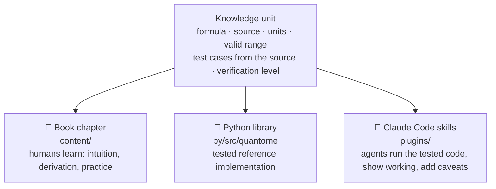

# Quantome vision

## Mission

> **Quantome makes the quantitative knowledge of mathematics, biology and medicine open, verified and executable:
> readable by students, runnable by researchers, and safely usable by AI agents.**

Quantome began as a textbook. It is becoming a **verified knowledge base with three outputs**, built from one source
of truth, in one repository, with shared CI and one community:



## Who it is for

- **Learners:** students from GMAT level to graduate research.
- **Researchers:** in mathematics, bioinformatics, genomics and biomedical AI.
- **Healthcare professionals:** doctors, nurses, pharmacists, dietitians and medical students.
- **AI agents** that serve these people.

**Clinical content is professional-facing only.** Quantome does not provide patient-facing advice. Its clinical
skills are decision-support arithmetic for trained professionals, who remain responsible for every decision and
must verify results against their local protocols. Quantome is not a medical device.

## Principles

1. **Compute, don't guess.** Skills make agents run tested code instead of doing arithmetic in the model. This is
   the single biggest safety gain for clinical and statistical work.
2. **Single source of truth.** Each formula is implemented once in `py/src/quantome`. Chapters teach it, and skills
   use a vendored copy, which CI checks for drift.
3. **Provenance on everything.** Every formula has a registry entry with its sources, validated input range,
   caveats, teaching chapter and verification level.
4. **Show the working.** Every result shows its inputs, units, formula, working, caveats and sources, so a human
   can check it.
5. **Refuse rather than extrapolate.** Inputs outside the validated range are refused, with an explanation.
6. **Humans in the loop.** Agents may write and verify, but humans review and merge, and clinical content needs a
   reviewer with clinical background.
7. **Open by default.** Everything (code, content, data where licences allow) is under Apache-2.0.

## Domains

| Domain | Sub-areas (✅ already covered) |
|---|---|
| **M · Mathematics** | arithmetic & algebra ✅, linear algebra ✅, calculus & optimization ✅, probability & statistics ✅, information theory ✅, numerical methods, ODEs & dynamical systems, discrete maths & algorithms |
| **B · Quantitative biology** | molecular genomics ✅, bioinformatics algorithms ✅, population genetics (partly ✅), enzyme kinetics, systems-biology ODEs, single-cell & omics statistics |
| **C · Clinical mathematics** | dosing ✅, infusions ✅, IV fluids ✅, nutrition (adult ✅, infant ✅), growth ✅, pharmacokinetics/pharmacodynamics, lab-medicine formulas, validated clinical scores, ECG intervals, ventilation & oxygenation |
| **E · Evidence & epidemiology** | diagnostic accuracy ✅, NNT/NNH and risk measures, survival analysis, meta-analysis, sample size & power, compartmental epidemic models, causal inference |
| **A · AI for biomedicine** | classical ML ✅, deep learning ✅, sequence & foundation models ✅, evaluation/calibration/fairness ✅, reporting standards (TRIPOD+AI ✅, CONSORT-AI, STARD), imaging & physiological signals |
| **R · Research practice** | study design, reproducibility, citation verification, data governance & privacy, ethics & regulation |

**Learning pathways** cut across domains as curated reading orders: GMAT Quant (Part I), Biomedical AI (Parts II–V)
and Clinical maths for professionals (Part VI). Planned: pharmacy calculations, biostatistics for researchers, and
MCAT/USMLE quantitative reasoning.

## Skill collections (Claude Code plugin marketplace)

```bash
/plugin marketplace add tristanseltec/quantome
/plugin install quantome-math@quantome
/plugin install quantome-clinical@quantome
/plugin install quantome-author@quantome
```

| Plugin | Status | Purpose |
|---|---|---|
| **quantome-clinical** | preview 0.1 | IV fluids, dosing, body size & renal function, GIR and infant nutrition, CDC BMI z-scores |
| **quantome-author** | 0.1 | Contributor toolkit: write chapters, verify code outputs, check citations, reviewer agents |
| quantome-stats | planned | test selection, power and sample size, diagnostic accuracy, survival, meta-analysis |
| quantome-genomics | planned | VCF QC, Hardy–Weinberg, polygenic risk scores, GWAS summary-statistics harmonisation |
| quantome-ai-bio | planned | architecture designer (shapes and parameters), evaluation audit, TRIPOD+AI checklist |
| **quantome-math** | 0.1 | exact solve-and-verify, answer-choice checking, Data Sufficiency counterexample proofs, GMAT tutor, verified practice generator |
| quantome-learn | planned | tutors for the other parts (biomedical AI, clinical maths), spaced-repetition review |

Skills use the open Agent Skills format, so other agents can use them. A Quantome MCP server exposing the same
calculators is planned.

## Verification levels

| Level | Meaning | Required for |
|---|---|---|
| **L0 Draft** | written, not verified | book only, marked as draft |
| **L1 Machine-verified** | code runs; test cases taken from the source pass; numbers recomputed; citations resolve | non-clinical skills; clinical skills in **preview** |
| **L2 Expert-reviewed** | signed off by a named domain reviewer, recorded in `registry.toml` | **clinical skills version 1.0** |
| **L3 Externally validated** | checked against an independent calculator or dataset, or published | flagged "validated" |

Today every clinical formula is **L1**, so `quantome-clinical` ships as a **preview (0.x)**. Version 1.0 requires every
formula it uses to reach L2. Reviewer sign-off happens in the open on GitHub (issue #1).

## Repository layout

```
content/                      book chapters (Markdown + LaTeX + Mermaid)
crates/                       Rust + Leptos static-site engine (book build | serve | check | new)
py/src/quantome/              single-source formulas, registry.toml, bundled reference data
py/tests/                     test cases from the original sources and the book's worked examples
plugins/quantome-clinical/    skills, agent, evals; lib/ is generated (do not edit)
plugins/quantome-author/      contributor skills, reviewer agents, evals
.claude-plugin/marketplace.json
scripts/sync_plugins.py       vendors py/src/quantome into plugins; --check for CI
docs/VISION.md                this document
```

## How a new formula travels

1. Implement it in `py/src/quantome/...`, with input-range checks and a `Result` that carries the working.
2. Add a registry entry: title, sources, caveats, chapter, `level = "L1"`.
3. Add tests whose expected values come **from the source**, plus the book's worked examples.
4. Teach it in a chapter. The chapter's code must match the library.
5. Expose it in a skill (SKILL.md: when to use it, the rules, the command), add eval cases, run `scripts/sync_plugins.py`.
6. CI runs the Rust checks, `book check`, the Python tests, a drift check and plugin validation.
7. A domain reviewer signs off, and the formula moves to L2.

## Roadmap

| Phase | Deliverables |
|---|---|
| **0 · Foundation** (now) | `py/quantome` library + registry for the Part VI formulas; marketplace with `quantome-author` and `quantome-clinical` preview; CI for tests, drift and plugin validation |
| **1 · Breadth** | `quantome-stats`, `quantome-genomics`; pharmacokinetics and lab-medicine units; verification badges in the book; scheduled skill evals |
| **2 · Community** | expert-reviewer programme (clinicians, pharmacists, statisticians); first clinical formulas at L2; `quantome-learn`; MCP server; Vietnamese translation |
| **3 · Recognition** | `quantome-clinical` 1.0 (all formulas L2); versioned releases with a DOI; a short paper on the verified-knowledge model; partnerships with teaching hospitals and universities |

## Non-goals

- Patient-facing advice or apps.
- Prescribing decisions: skills calculate, and professionals decide.
- Replacing local protocols, formularies or specialist teams.
- Bundling data whose licence does not allow redistribution.
